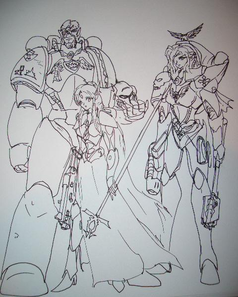

# [抗旱之活跃气氛] 40K小故事接龙

[抗旱之活跃气氛] 40K小故事接龙

warmaster

要求:符合40K背景,适度EGO.不要有明显的种族主义和常识性错误...字数适中.

无题

一片荒地

荒地,只有一面皇帝的双头鹰旗帜,以及几个散乱的坑,证明这是帝国皇帝,人类的主人的神圣领地.

如同所有的聚居世界一样，这个世界的空气毒性极大,夸张的说法是,大气中的固体颗粒可以填满你的肺;机械神教的说法是,标准的聚居世界大气,以及一张表格;帝国卫队的连长说的是,没事别摘下你的呼吸面具.

坑,帝国军标准临时野战工事,挖坑的方法,参见&lt;帝国军步兵手册&gt;.荒地上尘埃的表面是错落有秩,有深有浅的无数个坑.一名名身穿避弹甲的战士身居其中.坑的外面,是无数具泰伦虫的尸体.从小小的撕裂者,到庞然大物刽子手.在这里,驻守在帝国卫队索尼克228团第7474尖兵连的战士.他们先于主力到达这片高地,并成功打退了虫群的一次试探性进攻.

虫子的试探性进攻?怎么形容好呢?把向你飞来的子弹想成小虫子,炮弹想成大虫子,怪兽想成士兵...帝国战士的忠勇,由此可见一斑.相反,某些连银河系测绘草图都拿不出来的,蹲在东方某个用显微镜能找到的&quot;帝国&quot;上的种族,要试图&quot;拯救银河系&quot;的举动就显得...

尖兵,顾名意思,打头阵的.尖兵,要求快速机动力.尖兵,需要轻装.尖兵的确拥有快速机动力:他们是连人带装备用王尔古雷运输机运来的.他们同样也很轻装:经过镜面处理,表面有吸波材料涂层,硬化剂的复合避弹甲,可以轻松防备...激光枪的射击,榴弹弹片,和携带超大动能扑面而来的板砖,砍刀和爪子等等.再加上他可观的重量...的确需要非常有体力的士兵,才能穿着他快速行进...为什么我们不能乘坐奇美拉运兵车,穿着不仅轻便而且防护全面,高超的甲壳装甲战斗呢?一个分进尖兵连的新兵常问的问题.答案是:掷弹兵部队每年固定月份招人,今年过了,等明年吧!---哪个月份问这个问题得到的答案是一样的.

连长贝恩布洛克中尉盯着坏掉的传声器.出发前他有两个选择:1,带上那个可以对全连进行灵力通话的灵能者,还有一个刚毕业的,明显洋溢着热情的实习政委. 2,带上一大把普通传声器.他选了2.因为没有军官愿意和一名洋溢着热情的实习政委一起工作.原因?因为他是一名洋溢着热情的实习政委.这一大把传声器使中尉不得不丢掉了一门激光炮.算了,反正中尉本人对站在一个特大号探照灯旁边不抱好感.就算是虫子,也知道先炸什么.

补给军士长耐德正坐在坑里,一只手拿着一只扯下来的基因盗取者爪子,一只手拿着刺刀不停地打磨那可怕的利刃,他的腰上有一大串这样的东西:大部分是他那只榴弹发射器的战果,还有几个是在索尼克塞康达斯上,用一具动力起重哨兵取得的战果.

亚德里安正在忙着从他那被炸烂的自动加农炮上从护盾到弹舱提把,一切可以拆下来的东西都卸下来了.如果机械修士马可世知道了那根才打了500发炮弹的卡迪亚产炮管就这么被这小子粗野地拆下来,一定会气得全身灯泡亮个不停...可是这家伙现在也正带着他的奴工围着那空投哨戒炮塔拼命地拆呢.

被镰刀巨爪穿了一个大洞传声器的机械灵魂在不堪工业大气和短路电流的折磨前,终于接收到了一段宝贵的信息---第7474尖兵连放弃阵地后撤,于D34,R56区域与第300长矛兵连汇合,休整待命.

这该死的清剿残兵工作烦死了!中尉无言地抱怨着.他记得帝国军在伊卡尔四号行星上的战例,当时,配备重装甲和巨炮的帝国卫队在战斗前中阶段承受的伤亡微乎其微.而那最后的数万伤亡几乎都是在后期的清剿作战中伤亡的.聚居城市就像个巨大的迷宫,地震炮穿甲弹打在那厚厚的城墙上,只能把尘埃崩下来.错综复杂的道路,从大的能一整个连的毒刃坦克并排开过,到小的中尉不知道陆战队员能不能挤进去的狭窄隘道...好吧,虽然尖兵连的阵地距离最近的聚居城还有1000多公里...但这并不妨碍基因盗取者从某个鬼地方跳出来挥舞着那四条胳膊扑上来把一个整个步兵班撕成碎片...

因此,他们要带走一切能带走的东西,天知道下一次补给是什么时候..

帅气的冬瓜

一定是这个世界的丑陋酒吧女吸引了和她们有着相同基因的泰兰虫族....228团少数几个对人生没有怨念的士兵---旗手老冬边从嘴里喷着毒水边向自己心爱的霰弹枪里装填着子弹.....

只是又一次的寻常任务，我们一定能或者回去的。他看了看身边唯一的旅伴--那个被叫做纯腐败的莱特灵人，跨出了这个已经守备了3天3夜的壕沟。

Topp

&quot;皇帝眷顾你,孩子&quot;这是赛琳娜今天数不清第几次这样说了.医药包快见底,绷带也快用光了.大量引导皇帝的荣光来愈合那些伤员可怕的伤口让她的头一阵阵刺疼.不过至少接下来,这些伤员能撑到后送,或者军医上来吧.

散发着柑橘香的塔娜茶装在粗糙的铁杯里递到她面前.至少奇美拉的过滤系统可以让她在这里不用戴着有着难闻再生空气气味的面具.她把视线转向握着杯子的手的主人.

帅小伙卡克留斯,大家都是这样叫他的.尽管一条可怕的伤疤从额头上那块替代一片被爆矢炸飞的头骨的精金块一直延伸到接着管道的下颌.但是他参军前曾经被认为是前途无量的三维电影新星.但是很显然他已经不可能(如果他有想过的话)回到那种生活.尤其是在成为一位星际陆战队员之后.

&quot;谢谢,卡克&quot;一面感觉着灵能头箍的探针从大脑上埋设的基点抽离时近乎麻痹的轻松感,一面伸出手接过茶杯.至少温暖的饮料香气缓解了不少过滤空气里弥漫的血腥.&quot;战况怎么样?&quot;

&quot;很不好,医护主任.&quot;包裹在厚实的装甲里的身躯靠着装甲墙坐下&quot;很不好.我们这里还有四个兄弟和两个姐妹还能战斗.但是受伤的卫军和装备已经快要剥夺我们最后的车辆的战斗力了&quot; &quot;帅小伙&quot;在医护主任责难的眼神里缩了缩肩膀.&quot;皇帝佐证,姐妹,我不是说我们该抛下他们.但是我们是不是该...&quot;

&quot;直到我们联系到连队长.卡克&quot;赛琳娜轻轻摇摇头.那对比起人类更象灵族的尖细耳朵微微下垂&quot;或者其他的单位...等等.D34,R56,明白&quot;她把手从通信口上拿开&quot;我们要移动了.连队长要求我们在D34,R56和索尼克军团的老朋友会合.他们也朝那里移动.启动机魂,机械导师姐妹.上炮塔,卡克,通知其他兄弟姐妹上车.我们要移动了!&quot;

一辆毒刃和四辆奇美拉组成的奇怪车队开始朝即将成为战壕展览中心的地点快速地启动.留下了一片几成掩体的焦黑虫族尸海.

苏联坦克

“小子，有件事你要记住。”卡马尔中士叼着手卷烟对在坑里挥汗如雨的达卡卡列兵教诲道。

达卡卡停下手中的铁锹，抬起头，两个好奇的眼睛盯着蹲在坑边的中士。

“无论手头多紧，都记得要给自己留颗手榴弹。”

“为什么？”

中士深吸了一口烟，吐出一大团云雾：“填坑用碎肉比较方便，与其让那些臭虫用爪子来切肉，不如你自己来吧。”

卡马尔丢下烟头，插着兜转身走开了。

邢天

其实这是个冷笑话。

一天后勤补给连得大块头对新来的小兄弟说，一定要尊敬星际陆战军修士们，如果有荣幸，他们需要你去送补给，你一定要小心检查，不要送错东西，尤其是不要把安全套送过去

BTXP

洋溢着热情的实习政委被拒绝后,向战区主管政委做了汇报,司令部在简单的议论后认为前线不能没有政委.

于是在主管政委的安排下,实习政委跟着臭名远扬的&quot;屠夫&quot;前去督战,女武神载着风暴队员和两名政委出发了.

轰鸣的女武神中,洋溢着热情的实习政委显得极为兴奋,他喋喋不休,在发表了一番对人类帝国未来憧憬以及对任务的美好期望后,他问屠夫将来怎么打算.

屠夫沉默了许久&quot;打报道离开228,回阿仑斯,有白圆桶帽的军服才好看&quot;

&quot;屠夫&quot;的义肢擦拭着他心爱的爆矢枪,镶嵌着义眼满是伤疤的丑脸面无表情,心里却思绪着两件他要优先完成的任务:表彰一个胖子旗手,这个胖子扛了5年的旗帜从不离手,处决一个该死的莱特灵人,要不是那家伙个子太小,两个月前就崩中他了,当然前提条件是这两人都活着...............

drydry

女武神驾驶员罗德尼·杜恩带着一肚子的苦闷驾机飞行在200米的高度，这明显是一个低不过雷达扫描范围，高不过电筒枪射程的脑残高度。可毕竟泰伦异型没有电筒枪，他们只有各种另人作呕和恶心的生化弹药。可如果更高的话，如果被进化带飞翼的兵虫逮住，连迫降估计都来不及。“如果说被击落到那种玩意的阵地上，我还不如抱着颗手雷自杀来得痛快”罗德尼是这样想的，而且在他的枪套旁边的确就挂着那样一颗“光荣弹”。

“人们都说只有最好的飞行员才有资格驾驶女武神运输机，可为什么上头不知道珍惜人才呢？我以前在海军飞行队的时候，和驴耳朵灵族人玩缠斗我都不怕，可现在呢？和狗日的异型玩猫捉老鼠？这里飞行员的损失率是我在帝国海军时候的3倍都不止！”很多飞行员都会在私下这样的抱怨，可现在罗德尼一个字都不敢说——今天的客人可是有——政委——还他妈两个！如果他们会读心术的话，一定会大喊着“异端去死！”然后拔着扶手爬出来爆了自己的脑袋。

“真背运！”罗德尼正满肚牢骚不知道找谁发泄的时候，武器操作员通过无线电发来消息“11点方向有交战迹象，貌似是一架大飞机，被异形包围了，要去支援么？”

屠夫指挥官在得知消息后下令立刻前往支援，于是女武神划个圈超坠机点俯冲下去。

“我说怎么今天飞的这么顺利，原来是有人垫背啊”罗德尼想。100米，50米，30米，越来越近了，透过大气和浓烟已经可以用肉眼识别出大飞机的轮廓了“皇帝在上，活见鬼了。。。那是一架。。。灵族的吸血鬼掠夺者啊？！”

想抽身而出是不可能了，异形发现了靠近中的女武神，开始集中对她集中射击。机身两侧的机枪手不甘示弱，冒着被酸液和小虫子的风险奋起反击击。话说，霰弹模式和传甲燃烧弹模式交替使用的的暴弹杀起这些异形效率不俗呢。

可事情发展到这个样子，连屠夫指挥官都有点反应不过来了。。。

“管他是啥族，先把狗日的异形杂种杀个屁滚尿流，再拉上狗日的灵族俘虏，问问他们来到这个狗日的星球是啥目的，帝王保佑，风暴兵们，给那群长腿娘娘腔们看看，真正的猛士是如何战斗的！

，帝王保佑，风暴兵们，给那群长腿娘娘腔们看看，真正的猛士是如何战斗的！

杀杀杀杀杀杀杀杀杀杀杀杀杀杀杀丫！屠夫指挥官在跳下女武神加入战斗前前如是说。

Topp

&quot;爱尔维尔.我的女儿&quot;

回忆中的父亲还是那样慈和.尽管族人都不会衰老,用MON-KEIGH的眼睛来看的话,他更象是兄长而非父亲吧

&quot;爱尔维尔,我的女儿,活下去.&quot;那是第一次看到父亲拿起枪来.那是第一次看到,身为大先知的父亲举起了他最厌恶的武器.

&quot;爱尔维尔,我的女儿.你还年轻,有着很多的未来.带上年轻人们离开这里吧&quot;

故乡的丛林,在燃烧....动物...在悲鸣...那些...掠夺者,他们撕碎,吞噬,摧毁一切

&quot;爱尔维尔,我的女儿.我们的神不爱我们了.他们离开了我们&quot;

&quot;那父亲,我又该如何引导我们的未来呢?&quot;

父亲迟疑着.然后将手中的枪递了过来.不是习惯的那种温润的武器...冰冷,干涩,沉重,粗鲁....但是...

&quot;还有一个神愿意听他的子民的声音,有一个神为了他的子民献出了生命.如果你真的迷茫的话.孩子,我认识一个MON-KEIGH,那是数个千年前了.在他被他的同类烧死之前,他告诉我,MON-KEIGH的大先知已经成神,他也许会听到你的声音.如果他也不回答你,那么你就用剑和枪来引导你的人民&quot;

&quot;父亲....&quot;

那些掠食者,摧毁了故乡的小小殖民星球,摧毁了小小的和平,小小的希望.现在它又要吞吃这些最后的种子么....

&quot;卡锵&quot;

好难听,猴子的东西好粗糙

&quot;砰!&quot;好粗野的后坐,好可怕的枪声,好可怕的....

那只可怕的虫子高高仰起,然后带着头上足够把爱尔维尔的头塞进去的血洞倒下,但是这也是最后一发子弹了.MON-KEIGH送给父亲的武器,打光了最后一发子弹.

&quot;MON-KEIGH的大先知....如果你真的和父亲说的一样的话....为什么不救救我们呢...还是说...你只眷顾你的子嗣???&quot;

带着泪水的翡翠色双眼转向那无穷一般的几丁制甲壳之海.已经没用了...没用了...身边只剩下这些同胞,这些希望...然后....

&quot;小伙子们!让那些豆芽看看什么是真正的战士!!!!&quot;

那个粗鲁...丑陋,半边脸上都是粗糙的机械的MON-KEIGH....那些穿着绿色铠甲的MON-KEIGH

为什么,他们看起来头上都象有光环一般美丽呢?

&quot;人类的大先知啊!如果你认为我们有资格存活的话!引导我们吧!!&quot;

年轻的先知高高举起了右手,然后指向面前的虫海,一种从未体验过的能量从那非物质的空间中,带着金黄色的光芒照耀着她的灵魂,然后,碧蓝的闪电从纤细的指尖扑向怪物们的潮水.....

苏联坦克

&quot;停下&quot; 一声有力的呵斥让整支队伍颤抖了一下. 年轻的实习政委回过头的同时下巴几乎掉在地上.

没几个人不认识面前的男人.尽管已经活过了超过70个标准地球年,但是看起来依然只象是40出头的男子,健壮得仿佛象是一位小了一号的战斗修士.当然.他的身后跟着的正是十来个战斗修士,一大群瓦尔哈兰人,一位佩带着异族庭标志的美丽的女审判官和一群....蓝皮??

穿着撕去双袖的政委制服,佩带着团级政委肩章的男人朝这支队伍走来.一把巨大的撕人剑挂在他宽大的皮带上,他用一种近乎玩世不恭的表情扫视着面前的年轻人,那种历战之人特有的凌厉眼神让这个小年轻几乎当场尿出来.这是当然的,他可没少受到这位政委学院教官的照顾,无论是在课堂上还是无重力橄榄球场上.至于周围的士兵自然已经开始欢呼起来.西佛斯.凯恩.有人甚至说他在三维电视新闻上的露面频率已经超过了当前的总主教.

&quot;这可不是对待女士的方法,年轻人.我更不想让你们的死脑袋害得我们轨道上的长耳朵朋友转头就走,还是说,你,小伙子,能用这些来交换一个师团亡灵战士的支援?&quot;

粗大的手指点着小伙子的额头,他已经懵了.甚至在瓦尔哈兰人开始解开俘虏的时候都连一句废话都不敢出.

&quot;可是,大人&quot;,有着暴徒外号的老政委不甘不愿地对他敬礼.&quot;这些异族....&quot;

&quot;有一个异族用她的生命救下半个银河,政委先生&quot; 一个声音从老政委的头上传来,远在凯恩来得及开口之前.&quot;你能站在这里而不是变成那些骷髅大军的一员,要感谢的是皇帝,还有玛卡.那位先知&quot;

&quot;加百列连长&quot;凯恩微笑着打了招呼&quot;什么风把您吹来了?&quot;

红色铠甲包裹的巨人只是微微点了点头

&quot;一支千子军团的舰队正在朝这里前进.还有一支坏月部落的兽人WAAGH.塔尔迪尔先知正带着她的部队朝这里前进.希望能与我们再次合作.&quot;

&quot;真是巧了.我这里也有消息,我的那些蓝皮肤的老朋友也快到了.为了对虫子报一箭之仇&quot;

&quot;.................&quot;

年轻的政委听着两位大人物的交谈,已经完全不知所措.而那些灵族俘虏则被一群SM大兵带走了,只留下他一个人在现实和理论的交错中震惊得象个傻子

BTXP

首先&quot;如同所有的聚居世界一样，这个世界的空气毒性极大,夸张的说法是,大气中的固体颗粒可以填满你的肺&quot;

这句话你们全忘记了........

其次,上小说人物不厚道...........

&quot;屠夫&quot;叼着烟卷看着那群人,虽然机械肺早就无法享受烟草的乐趣,但是他还是习惯吞云吐物,他走过去拍拍实习生的肩膀&quot;由他们去把吧,孩子,伟大的人类正是由于这些...恩...表现才充满着危机,跟着我好好干,将来把你也拉去阿仑斯,今天放走一个异形,我们将来杀一百个补回来,呵呵,真怀念在猎杀队的日子啊!&quot;

老政委拉开大衣开始在内兜找烟,年轻的实习政委看到他那件满是弹坑,挂满了勋章的甲壳装甲,解开的衣领露出满是管线和伤痕的脖子,上面甚至还镶着颗虫牙.

老政委觉察到了实习生异样的目光,随手把烟头一丢,伸出左边的义肢转动了几下,嘘出一口烟:&quot;在当年众剑堡垒的战斗中留下的,支援部队的督战队一共去了2000个人,风暴兵全死了,20个政委回来了3个,228的运气一直不错,居然来了这么多人,想当初在众剑堡垒,放眼望去,城墙外全是紫色的,我们呢??除了不到半个连的谦卑者(SM),10多个蓝皮,一万不到的卫队兵,一大群的老百姓,其他毛都没有..谦卑者那帮疯子还很高兴,他们觉得哪怕手断了,用断肢的骨头还能刺虫子,那40多天过完后,我们团的政委还剩下三个残废,包括我,都是好小伙啊!!有个跟你一样的实习生,我记得叫卡里古拉,名啥忘记了,最后两天反攻的时候被只基因贼从狼王上拉了下去,要活到现在一定也是好样的,可惜卡里古拉家族就这么个独子,他们再也无法为皇帝提供种子了.........&quot;

老政委无表情的脸上微微地淡出一点悲伤,但眼神马上又放出了光芒:&quot;我很高兴我第一个学生为皇帝而死!!&quot;

老政委接着发出了冷笑:&quot;还有个活下来实习生就是现在绰号&quot;疯子&quot;的BTXP了,他一直说自己要死了要死了,结果这个从塔奎尼亚来的混蛋刚安上义肢就回他的塔奎尼亚当督军去了!!妈妈的!!还写信告诉我塔奎尼亚赴死军也戴圆桶帽,还是白色的!!!我要能再活着见到他,一定踹他!!!&quot;

Topp

&quot;恩...政委同志,这个异族没有说谎&quot;把手慢慢从慌张地左右乱看的灵族女孩的头上拿开,那个中年女人用她神经质又高亢的声音说着.她粗鲁地用灵能的触手伸进女孩的意识里狠狠地搜刮了一次,当场就让可怜的异族少女尖叫哭喊着满地打滚.即使是灵能种族的灵族,面前的女孩的修为还是远不如一位熟练的星际陆战队智库团长.&quot;而且没有找到那些信息&quot;她双手在胸前交错摆出双头鹰的姿势鞠躬.

旁观的老政委很不愉快地用粗冷的金属手指发出刺耳的嘎吱声抓了抓金属眼眶,这声音让那个年轻政委缩了下脖子,然后冰冷的义眼转向那个肌肉壮实,比自己高了两级的政委,那个让他怎么都喜欢不起来的帝国英雄.

&quot;那么凯恩政委的意思是?&quot;年轻人真是沉不住气,老屠夫一边想着一边让自己只有一半触觉的背深深埋进柔软的椅子.这里曾经是一位高层官员的个人住所,周围三公里能建立的小型隔绝生态圈成了集结点,228团的各单位和其他援军都嘈杂地拥挤在这里,那些来晚的蓝皮则只能窝在他们的魔鬼鱼里,这一点让老政委很爽快,而且那些讨厌的黑发豆芽很显然对面前这个金发绿眼的女孩表现出露骨的鄙视.让他那早就冷掉的心脏都对那女孩被看得可怜小狗一样畏缩的样子产生了那么一点点的同情.

&quot;凯恩先生难道想容许这个异族和她的人存活么?您已经看到了,那些...那些叫什么UTHWE的异族对她根本不管不股,那么杀了她不就没事了!&quot;

听到杀字,那个异族的女孩神色僵硬了一下,恐惧地转过眼睛在每一个在场的人脸上转过.

&quot;你确定这个女孩对'哪个'一无所知么&quot;抓抓有点毛茸茸的鬓角,壮硕的政委咳嗽了一声,让那些来自叫做艾尔文军团的,比一般的战斗修士矮小不少的阿斯塔特战士们对小政委投去的憎恶视线转向他着边

&quot;是的,长官,按您的要求我搜刮了她可爱的小脑袋里的一切记忆,完全没有相关的.而且....我们按您的要求预先把所有相关的都掩盖了起来.她绝对没有机会见到&quot;

凯恩点了点头,转向那个女孩,他很好奇为什么会有这样的事,从某几个士兵口中他听说了这个异族的小家伙在虫海中叫出的那个名号和随后射出的可怕的闪电.也听说了她完全没有反抗地被俘虏的场面

一块小小的白色的灵骨块在他皮革一般坚韧的手中飞到了女孩怀里

&quot;让我们看看你祈祷的那个来源有没有回应你吧,审判官您认为呢?&quot;

两位异族庭的判官,安博莉和条迪安鲁斯,一个有着一口落腮胡子戴着眼镜的瘦高年轻人一起点了点头.

战战兢兢的异族女孩接过了那小小的块,然后闭上眼

一阵温暖的金色光晕笼罩着她小小的身体,那块小小的白色立方体也开始扭曲,变形,变色.

&quot;哦哦哦哦哦哦!!!&quot;惊叹,难以置信,甚至是搀杂着感动和恐惧的声音在小小的密室中响起

一只金色的美丽双头雄鹰在异族女孩柔荑般的纤细指尖大大张开着神圣的翅膀.....

&quot;你活了&quot;女孩听到那个男人的声音,带着一丝调侃地看着她,但是她的意识里,似乎有什么,有什么...

&quot;人类啊!!&quot;一个庄严的声音,一个三重的声音,宛如鹰啸,宛如少女歌唱,宛如雄浑大钟一般的男子之声,从双头鹰的口中,从少女的口中传出

&quot;万年忠诚的人们啊!他们来了!我的敌人来了!你们的敌人来了! 那四个邪恶的来了!拿起你们的武器吧!暂时宽容你们的敌人吧!因为在那四个面前,你们知道你们的使命&quot;

少女眼中喷涌而出的金光散去,然后被夺走了每一丝体力的身体瘫软下去,被一双纤细的手轻轻扶住.手的主人,异端庭的安博莉审判官,那对灵活的碧绿双眼带着无边的凝重扫视着室内的所有人...没有人做出任何回应.但是通讯器里的叫声打破了寂静:

&quot;大人们!!虫子们上来了!!!!!!&quot;

liberator

萨卡伦静静地尾随在这支虫群背后，看着这群异型不断冲击帝国的阵地。尽管战线已经推进了数公里，帝国部队仍然奇迹般地没有溃败。

不过萨卡伦来这里的目的绝不是看热闹。虽然星辰议会决定不牵扯进这场战斗，但自从Tyranid的第一次入侵之后，任何研究这个可怕的掠食者种族的机会都是宝贵的。这次星辰议会全权委派萨卡伦的任务，就是弄到一个完整的暴君的脑子。

“全权委派”，萨卡伦已经不知道是多少次冷笑了。这群自我膨胀的蠢货，有眼不识泰山的无信者，居然认为他们有权指挥一个萨诺思的忠实仆人，这是连薄暮族长议会都不曾梦想过的事情。当然，理论上讲星辰议会的权力比薄暮族长议会大多了，可阴影教会是不承认的。不过无论如何，尤里克族长说服阴影教会，为了所有同胞的利益，暂时接受星辰议会的领导。

所以萨卡伦，教会最出色的阴影门徒之一，来到了这个修罗场。

萨卡伦可以感到虫巢意识时不时扫过他的心灵，但除非它们逮住一个Ascensian同化，分析，否则不可能有办法穿透他的自由之环，而萨卡伦可不想成为这个样品。至于光学视觉，熟练地运用阴影护甲已经把他隐蔽得非常好了，任何一个看过来的人或生物都会认为那不过是一块岩石的影子，或是一块洼地，或是建筑物下的垃圾堆，取决于当地的环境。

他早就可以看到他的猎物了，但距离太远，而且在混战的中心实在难以下手，而且萨卡伦更希望这家伙在战斗中被击毙，让他拾个便宜。可是几天过去了，这个巨兽仍然只是受了点伤，和被它杀死的人类相比完全不值一提，所以萨卡伦最终决定自己动手了。这些无能的人类，连这点事都做不到！

大约又过了三个小时，机会终于来了，萨卡伦找到了一个绝佳的狙击位置，一块巨大的岩石，从这里到暴君的位置不足1000米，而且视野非常好。他小心的避开横冲直撞的大小异形，又花了半个小时才来到狙击位置——毕竟，如果距离太近，谁都会觉得身边这团影子有问题。

萨卡伦拿出标志自己阴影门徒身份的狙击步枪——死亡之手，小心地把暴君套入瞄准镜中，着弹点选择在暴君的腹部，一方面避开甲壳最厚的部分，一方面避免伤害到他需要的脑子。

暴君开始屠杀试图抵抗的人类，看来帝国军队又要后撤了。机不可失。

“萨诺思，永亡之主，阴影之门的掌管者，永恒的宁静之手，光明的吞噬者，以你无所不至的暗影之手的名义，我向你献上这强大而污秽的生物的死亡作为献祭。”萨卡伦扣动了扳机。

一颗细长的子弹准确的穿入了暴君的腹部，暴君顿了一下，可怕的眼睛转向萨卡伦藏身的地方。萨卡伦一阵恐慌，担心它发现自己了。但是那个伤口太小了，暴君开始继续向帝国防线冲锋。

但它却没能开始冲锋，只是发出了极度骇人的咆哮。透过望远镜，萨卡伦可以看到那个小小的弹孔开始变黑，变成腐烂已久那种颜色。黑色很快开始扩展，同时它的身体其他部分也开始出现迅速变大的黑斑，暴君咆哮着横冲直撞，试图摆脱遍布全身的痛苦，但这只是徒劳的，没过多久，它就像一具腐烂多时，被食腐动物吞食了一半的残骸一样碎成数块倒在地上，只有身体最尖端的爪子和头尾尚能看出是刚刚死去。

入夜，战场上已经没有一个人了。异形在这里的攻势由于主脑意识节点的消失而崩溃，帝国推进的战线把这里变成了后方。没有人去动死去的暴君，甚至没人多看一眼它。带着活的阴影，萨卡伦来到暴君的尸体旁边，用随身携带的高频振动匕首轻轻割开暴君还算完整的头骨。他的任务完成了。

Topp

卡克留斯(第六大连标准战术队员) 爱尔维尔(130岁的新生代殖民地灵族) 塞琳娜(第五大连救护队长,副牧师长)

exar_kun

UTILITATUM ADMINISTRATUM BAKKA

TRANSMITTED:xxxxxxxxxx

RECEIVED:ASTROPATH xxxxx

DESTINATION:BATTLEFLEET BAKKA SOLAR ADMIRAL XXX

MISSION TIME: XXXXXXXXXX M41

THOUGHT FOR THE DAY

&quot;MY WILL BE DONE.&quot;

&quot;现在帝国高领主议会已经决定,由你们这支舰队完成对这个受诅咒的星球以及周围外星人和异端舰队的最后一击.待地面上的准备工作完成之后,舰队将从后方突然出现,利用星球本身压垮盘踞在轨道上的所有敌军舰队.完成第一步后,将接着对这颗行星执行灭绝令,一举摧毁所有出现在这里的敌对势力.&quot;

&quot;Oh great Machine God. We implore thee to cast your benevolent gaze upon this vessel,the Corax. Let your burning power seethe through its engines.Let your undying wards lay upon its shield generators and armored bulkheads.Let your mighty anger spit forth destruction and vengeance through the great mysteries of laser and plasma and missle.Invest this mighty armoured shell with your spirit and breath life into its power relays and conduits.&quot;

随着赞美机械神的颂歌,无数艘巨大的战舰预热他们的引擎,等离子引擎发出灿烂的光芒.从地面上看去,仿佛银河正随着帝皇的意志前进,给帝皇的敌人带去无尽的毁灭.

Topp

&quot;那些愚蠢的伪帝走狗&quot;

一只暗蓝色的巨手愤怒地挥下,通讯魔可怜的脑袋直接化作一堆肉泥

&quot;绝不能让他们摧毁那个星球.他们还不知道自己骑在宝库上.兄弟艾克修斯,我们必须拦截住那支被诅咒的舰队,为了变化之主&quot;

&quot;为了变化之主,大人,我的大人,如果帝国知道他们脚下埋藏着什么,嘿嘿嘿嘿&quot;一个甜腻的声音从角落里传来.

&quot;我是不知道你们在想什么,MON-KEIGH,不过不要忘记给我的报酬&quot;另一个女性的声音插进来&quot;我只关心你们在你们的目的完成后帮我对付LEILITH那个贱人&quot;

&quot;当然.当然,我的混乱女士,呵呵呵呵&quot;第一个声音笑了起来. 他们还不知道什么等着他们.艾克修斯,不要让战帅的遗产落到伪帝的爪牙手里哟&quot;

黑色的铠甲上布满金色的花纹.混沌术士鲁克丢斯得意地看着那些沉默地并列在阶梯下的身影.和他们身上那不怎么搭配的涂装

&quot;喂喂,这可是你们的家乡哦,你们以为我为什么挑选你们来的呢,我没了肉体的朋友们,&quot;

一阵沉默,没有任何的回答

&quot;切,真无趣&quot;

术士转过身去,却忽略了身后一件铠甲的双眼中闪过的光芒.

-----------------------------------------------------------------

&quot;行星灭绝?&quot;前线指挥部,在血鸦和瓦尔哈兰团快速部署到星球的赤道上去扫荡虫族残余后,留在指挥部的最高指挥官就成了帝国防卫军的罗德将军.他惊讶地看着通讯屏幕上那个素以玩世不恭著称的政委

&quot;是的,将军.行星灭绝&quot;

&quot;别开玩笑了!我们花了三年时间摧毁了虫族的主力,夺回了大部分城市,难道那些高层的白痴说烧就烧?撤离时间呢&quot;

&quot;我在争取,如果我们能在三个星期内完成这里的任务的话.....&quot;

将军已经略微发福的身体颓然地坐在椅子里.三个星期...么

warmaster

“连长,1排整备完毕,准备出发!”

“2排整备完毕,准备出发!”

“…”

刚刚结束的这场战斗让尖兵连得到了17个轻伤号,在异形的射击武器能发挥作用之前,哨戒炮塔和重武器已经让对方损失了近一半的大中型生物.在最后一只躲在虫群后面的武士虫被机关炮打成筛子以后,潮水般的虫群已经逼近了帝国卫队的防线,尖兵连抓紧时间组织了完整的防御阵形,一旦一个班被像出膛炮弹一样跳过来的角虫逼入肉搏战之后,另一个班的士兵就立刻能用火力配合迫击炮组切断其后蜂拥而来的兵虫.这样防止了各班组被数量占绝对优势的敌人逼入肉搏战而被迫赶出阵地,在毫无防备的工业荒原上被屠杀殆尽.事先布置后的反步兵雷和手雷代替的诡雷封锁了连队占卜机鉴定的危险地带.因为没有车辆需要维修,引擎师马可世和连指挥部待在一起,用他的计算器和生化大脑帮助连部指挥战斗.尽管防御周密,可仍有一群基因偷儿渗透了帝国军的防线,直冲连部而来,中尉不禁暗自咒骂自己为什么当初不去申请一具军官.武器耐德军士用榴弹枪结果了其中的四个.可还剩下两个冲进了连指挥部所在的掩体.

引擎师的钢铁面具迎着突入的异形憎物,挥动动力斧将一个基因贼从头到尾一斧劈成两半,另一只基因贼在即将扑到一个奴工身上时被引擎师的机械臂一记重拳打得甲壳破裂,内脏飞溅.可是没有人为他的精彩表现欢呼,中尉用自己的激光手枪向地上的基因偷儿连开两枪.耐德则继续蒙头填装自己的榴弹发射器.失去了主脑的虫群不过是一群凶猛的野兽,在冰雹一般射来的枪弹中败退了.

三架王尔古雷运输机以不可想象的高度低空略过尖兵连的阵地,甚至连占卜机都没有预测到她的来临.一具具重力囊从天翩翩而降.那些是哨兵机甲,伞兵,重武器…

“先命令撤退,又派这些渡渡鸟来.看来上头是要我们租出盖好的房子.”耐德讥讽道.”渡渡鸟”是一些帝国卫队军人对伞兵的蔑称,就像他们称风暴突队为”大锡兵”一样.渡渡鸟似乎是一种在古地球被灭绝的不能飞的鸟类,这个称呼不仅是拿伞兵的机动方式开涮,通常也预示着他们的下场.

就在整队完毕的尖兵们目瞪口呆地看着伞兵散布在这个不大的高地周围,有条不紊地行动时.一袭身穿土黄色全身防护甲的帝国军来到了中尉身边.”索尼克228团7474连的布洛克中尉?” “正是在下!”.就算是一个对帝国军系统毫不熟悉的家伙,处在中尉的情况下也会表示谦逊.通过厚厚的分光镜片,布洛克清晰地看出了来人等离子手枪上的火星封印,他身边那个臃肿的士兵看上去有点驼背,但仔细一看就能发现他背着一个比标准型更轻便,更紧凑的占卜机.

“%^**(!@#%$^$%&&$*&(*&^&*%&...”

“请说任一种帝国官方语.”

“昌普莱根第九伞兵团12连,德.索马上尉,我说的是索尼克方言啊.”

“我是索尼克塞康达斯人,我们那有很多方言.这里不是贵团的辖区.贵连为何在此出现?”布洛克的手指移向链锯刀的开关,耐德的手指也伸向了榴弹枪的保险.帝国卫队关于阵地的划分配置很严格,一般来自不同团的士兵很难有机会相见.

“我连业已作为参谋部直属部队参战,权限编码”!@#!%#@$”.布洛克使了个眼色,连部通讯员迅速地键入那一系列数字和符号.占卜机显出了一阵红光”权限编码错误”.

“嗡”的一声,中尉把开动的链锯刀横架上尉的肩膀上,耐德手中的榴弹枪对准了一个提着等离子枪的伞兵.尽管他本人被另外两把死光枪指着.而手刃两个基因贼的马可世却无动于衷地站着.

顿时,四周传来一阵武器的喀嚓声.上尉面不改色的抬起手臂,中尉手一哆嗦,差点就发力砍下去.上尉见状,便缓慢把另一只手臂,同时地反转手臂.将上面的战术神龛展示给中尉.

“机械灵魂刚刚刷新了本连的权限编码.”

“…”

Topp

&quot;撤消行星灭绝命令?大人.可是这命令才....不,大人,我绝不是...是的大人.立刻执行截击任务&quot;用义手擦了擦额头上的冷汗,战列舰&quot;皇帝的慈悲之剑&quot;舰长艾克萨.亢海军上校重重地叹了一口气.然后他的视线转向了身后的四个人.

&quot;大人,正如我等所说.在那个聚居世界的地底确实存在舰艇火炮火控系统的STC,虽然不确定是用于何种舰艇和火炮类型之上的,但是即使是只有一丝一缕增强的希望,我们也要争取&quot;年轻的机械牧师懒散地半站着.袍子的后摆被高高支起,把机械臂安装在尾椎上以形成随时可用的舒适椅子似乎最近在年轻的机械牧师中流行开来.而他身边的那个中年男子则更让人发毛.

虽然穿着得体的礼服,但是这位异端庭的高级审判官,被认为是温和派顶梁柱之一的皮耶罗,克里森也许是帝国中最具有外交天赋的男人之一.他身上如勋章一般挂着的道族冲击手枪和精灵工艺的链剑,已经他那双沉稳到让人感到看到内心深处的眼睛,让上校觉得非常非常之不舒服.作为一个标准的宇宙军军官,出生在一个宗教氛围浓郁的星球上,他一直信奉着人类是宇宙中最完美的种族,只有死外星人才是好外星人的哲学.不过这位专门负责外星人事务的审判官却让他自豪的巨舰与那些外星人的同行,这让他感到不快,非常不快,不过他是绝对不敢把怨言说出口的.

至于另一位,那个看起来颇为年轻的阿斯塔特战士,他身上古老的铠甲说明了他绝不是泛泛之辈.司掌着&quot;荒野之龙&quot;战团的代理战团长欧格鲁斯,正用他粗大的手轻轻抚摩着那个为他带来情报的人的一头长发,那个曾经让上校30年前还是一个小小少尉时,吃过大苦头的血蜘蛛氏族的领袖.这个黑色皮肤的邪恶外星人象是只小狗一样眯着眼睛接受比自己高出小半个人的巨汉的爱抚,脖子上打着审判庭和战团烙印的项圈和浑身缠满的经文带只说明一点,她是这个巨汉的私人奴仆,而正是她派进混沌阵营的替身,为她的主人带来了混沌舰队的目的和动向,当然,那个女孩没能活着逃出来.这一点对上校来说是唯一高兴的事情.他并不打算考虑如何感谢一个外星人,尽管他曾经听说只要出得起合理的价码就能让这些没操守的流民为你卖命.

一艘精灵巡洋舰优美的船身和阿斯塔特修士的突击巡洋舰并行着越过舷窗.当上校回过神来,正想说什么的时候,面前只剩下传送后空气中微微的刺疼感,那四个人已经失去了踪影

&quot;....&quot;把满肚子不满死死咽下去的上校重砸了一下面前的操作桌&quot;方向不变!全速前进,预定接触距离提前3.8光秒,准备舰队炮击战!!&quot;

远远的宇宙里,一群粗糙的舰艇,也朝着他们预期的目标扑来

Topp

(启示录开战- -+)

&quot;又有东西下来了!不是虫子!&quot;

7474连的阵线前起了一阵骚动,一个个深蓝色的恐惧之爪登陆艇轰然落下,地狱爪轰炸机呼啸着,炸弹在溃退的虫子中篱出一片片火海,激光炮和机关炮扫得几丁质甲壳和恶臭的体液满天乱飞,戴着防毒面具的士兵前仆后继地用激光枪扫射面前的异型生物,在他们身后是轰鸣的巨大战车,和巨人之军.

但是不会有一个士兵感到一丝喜悦和轻松.他们能感到的只是从尾椎骨一直直窜到脑门的恶寒.因为他们都很清楚,很快,他们就会步上虫子们的后尘,前提是他们要在这些被死亡之墙堵塞住,扭头回来的虫子前活下来.一把把激光枪颤抖着举了起来.而在他们看到远远地从最巨大的囊舱中走出，那四台有着狗一样头部和污秽得无法直视徽章的钢铁怪兽时,没有一个政委会去责怪那些把步枪落到地上的士兵.

但是稀稀拉拉的火线在求生的本能前还是再一次凝聚起来,被压缩在中间的虫子悲鸣着,一点点被死亡之线吞噬着.但是每一个帝国士兵都希望这能慢一点,因为比虫子更可怕的敌人也在一点点地逼近.通讯器悲鸣着,网络只有一片乱信号,即使来自工业发达的索尼克行星的士兵也没一个能帮上引擎师的忙. 显然.....他们已经看到那辆叛徒的毒刃巨大的炮塔朝他们这里转来,无声的对皇帝的临终祈祷浮现在每一个人的脑海中......

随后那台毒刃炸成了一个巨大的火球.两架巨大的,灰色的道族虎鲨TX-0-1,曾经最令卫军士兵们恐惧的空中怪物,现在美丽得仿佛皇上亲自送下的使者.

随后,黑色的夜翼,银白的闪电,一大队一大队地排列成V字队型高高掠过了战士们的上空,与足与其数量三倍的混沌战斗机狠狠地咬在了一起,而卫队的士兵们的身后,同时响起了毒刃粗重的引擎轰鸣,蝎子坦克反重力引擎的尖锐叫声.更让他们感到欣慰的是,道族的寻路者小队骑着直挺着双连磁轨炮的食人鱼TX-42,扑进了战场.无数装着士兵的女武神和奇美拉,甚至从民间征调的卡车,带着卫队和行星防卫军的好汉们,前来支援他们的兄弟
