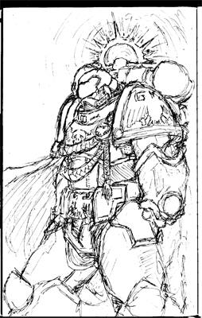
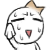

# 自做绘 仅自娱尔

自做绘 仅自娱尔

amonsoul 图片：  

 刚刚开会时画的自娱自乐而已...

lemanruss

很不错 搂主应该在上上色

amonsoul 

根据本人多年的作画经验 我的画只要我一上色 准就毁了...  反正是在下边听领导讲话的时候闲得无聊找点事干而已 

原本只是头像而已 随着领导讲话的延长 慢慢变成胸像 半身像 到领导讲话结束的时候就变成这个样子了...比例方面也就...
