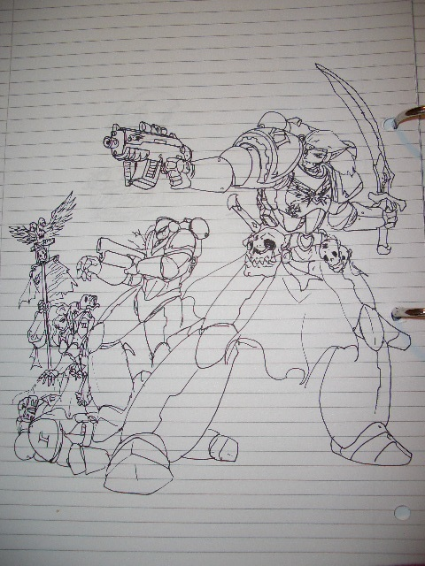
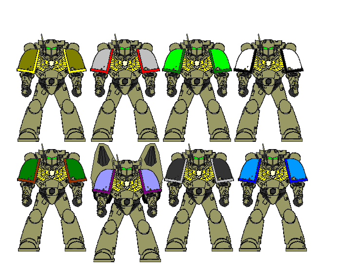
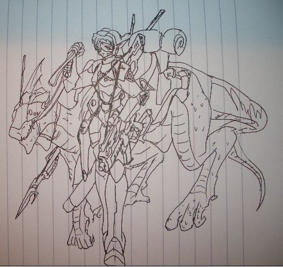
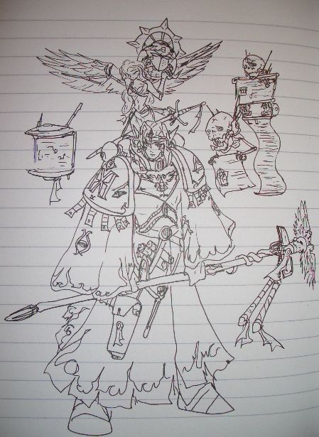
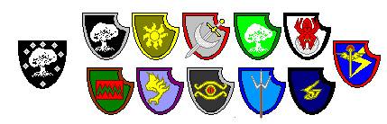
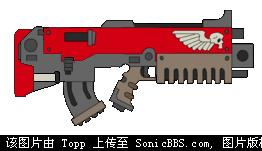
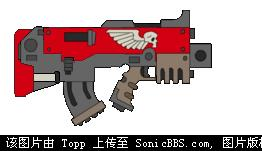
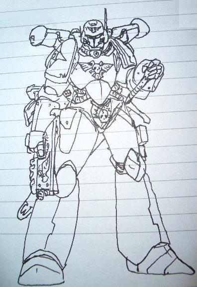
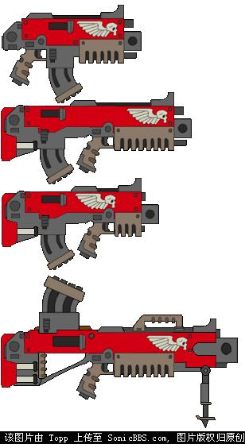

# 新YY 艾尔文军团

新YY 艾尔文军团

Topp

艾尔文军团：被庇护的军团虽然艾尔文军团重归帝国的怀抱是在第41千年的末期，但是军团智库长“瑞尔兰德&#8226;青松”所持有的战团记录中，除了未知的基因种子来源和神秘的原体外，战团的历史可以追述到皇帝刚刚进入黄金王座的时代。那是远在阿斯塔特圣典成书前的时代，伟大的罗伯特&#8226;基里曼已经提出了分割星际陆战队战团的想法，（记录缺失），新组建的战团“庇护者”被派往太平星域警惕精灵铸造世界和黑暗精灵海盗的行动（异族审判庭记录 746 M41 SMC-AA“鉴于组建战团所需要的时间，在如此短暂的时间中组成一支战团被认为是不可能的。我们有权利怀疑（记录缺失）且因为当时各军团并没有人员派遣记录，因此（记录缺失）。总而言之，约1000人的阿斯塔特修士及平民，帝国卫队及圣职人员，机械教机构等约30万人（记录缺失）等失陷于空间风暴的记录。。。。。”）后不久，就与精灵铸造世界（来源不明）的殖民部队及黑暗精灵海盗交战，随后，因为突发的小规模异空间风暴导致该无名星系（暂名 定居点1-1-4）与帝国的一切通讯断绝。审判庭与帝国航法部认定其可能毁灭，撤消殖民-警戒计划。虽然记录已经大量缺失，在之后的十个千年中定居点1-1-4的情况并不完全被掌握，部分情况被异族审判庭所禁止查阅，但是我们还是能从艾尔文军团母星艾佛密特行星（前定居点1-1-4，农业卫星X2，森林型蜂巢都市行星，人口70亿，包括卫星144亿，商业交易点仅允许在星系外围人工港口进行，组有帝国卫队‘爱佛迷1~8团’）的古老诗歌中得到一些信息“当黑暗的风暴席卷而来，我们伟大的父亲和伟大的母亲停止了争斗。‘为何要在这里流干我们宝贵的血？无论是皇帝还是凡人都不忍心看着我们的毁灭’。于是带着智慧的父亲们和带着灵魂的母亲们用神给予的智慧创造了我们。‘愿我们的儿子如你一样强壮而勇敢’‘愿我们的女儿如你一样美丽而智慧’于斯，而生我等。皇帝庇佑，树灵不灭”755 M41出于未知的理由，围绕1-1-4号的亚空间风暴彻底消失。由于发现其上有灵能通讯（帝国旧式）的信号，审判庭本拟加以考察，然而第一次虫巢舰队攻击打断了这一可能。756 M41红色海盗混沌陆战队袭击了太平星域的农业世界“维尔兰图斯5”。当地的行星守备队和民兵进行了英勇的抵抗，但是依然无法抵挡被腐蚀的超人军队的推进。在绝望中，行星守备队的警戒卫星突然发现一支奇怪的高速舰队逼近，原本以为是可怕的黑暗精灵海盗来火上加油的时候，一群穿着似乎是改造过的圣战式或钢铁式动力铠甲的神秘星际陆战队员乘坐着似乎是精灵驾驶的快速飞行器（机械教报告 892 M41 根据艾尔文军团所递交的样本所分析，这些装置的基础与STC有一定差距，但是基本未采用异族科技）呼啸着掠过那些掠夺者。他们呼喊着皇帝之名，然后自称为“艾尔文军团”。并希望当地政府通知审判庭和最近的星际陆战队战团，自称为“游子归来”M756~779 大审判艾尔文军团的精灵随从以及他们诸多充满精灵风格的装备自然而然引起了异族审判庭和异端审判庭的注意。不顾他们拯救了维尔兰图斯5上十六亿帝国臣民的功绩，审判庭氅下的帝国海军舰艇 包围了艾尔文星系，但是却被大量旧型舰艇组成的防卫网阻截，同时，艾尔文星的人们和他们的陆战队战团主动交出了基因种子样本和推选的代表接受种种审查。（ORDO XENO RECORD 761 M41 ELVEN SYSTEM  毫无疑问，我面前这个生物是人类的后裔。并非混沌的影响也非突变。然而不可否认，她确实拥有着精灵的特性，基因分析非常显著地证明了这点。女性的精灵特性比人类特性更强而男性则更偏向人类。帝王在上。但是不可否认的是这个生物的信仰是如此坚定。即使那些能将人的灵魂拷问到极限的手段也只能得到同样的回报。即使她是个异族，如此坚定的对皇帝的信仰也无法不令人动容，只是（信息删除）。。。至于基因种子，他们的基因种子是如此多样，以至于我们可以在（消息加密）中都找到他们的源头，皇帝啊，他们难道是那些忠于您的仆人在对抗他们（加密）后留下的后裔么？）情况对艾尔文星系的人们非常不利，无可否认，他们的祖先利用基因技术调整了自己的种族，从而使之延续至今，并且普及了皇帝的信仰。大多数艾佛迷上的居民都是虔诚的信徒。更特别的是，他们似乎有天然的对抗混沌侵袭的能力。（ORDO XENO RECORD 770 M41 “生殖实验。。。证明对象与人类。。。。以及另一对比体皆可诞下健康幼体，且特征随交配对象而定。。。然而其人类特性亦显著。。。”）不过审判庭依然以他们的基因为原由，决定对其实行“清洗”。但是就在审判下达前一天，主审判官被宣入王宫，其离开王宫后，只召见所有审判官，留下一句“彼等为帝王所庇佑，其为至纯，至善者”并宣布艾尔文星系为帝国领土，其上人民为忠实臣民后，便拒绝为此再说出任何相关的言论直到其10年后去世。然而，帝国还是部分封锁了艾尔文星系，仅有机械教和国教会与其保持善意联系。帝国商队被禁止直接登陆爱佛迷或其卫星，所有的交易仅仅被允许在驻留的战斗修女会“我们的伟大母亲”要塞的民用平台进行。同时。当时已经形成军团规模的艾尔文军团被禁止拆分为战团，禁止其扩编。同时帝国海军的舰艇在保护这个星系的同时也封锁了它。不过对于大多数艾尔文人来说，他们漫长的一生也确实不需要离开这个富庶的星系。编制艾尔文军团的编制参照太空野狼遍成大连，每个大连1000人，艾尔文军团拥有11个大连，以及8个“我们的战斗姐妹”的女性辅助连。艾尔文军团的第一大连终结者连是所有大连中的战斗英雄集合的部队，同时，无畏也被遍入这一大连。与一般战团不同的是，艾尔文军团的牺牲者们的灵魂和精灵一样会进入他们所制造的灵石，而这个军团的无畏中并没有战士残破的身躯，有的只是纯净的灵魂。而第十一大连，则被称为“奥秘兄弟”（BROTHER ARCANIUS）由灵能者组成强大的专门部队，同时也是战团的智库。艾尔文人长期发展的灵能以影响动植物，自然环境和直接攻击的方式为多。虽然有人诟病其接近混沌之力。然而这只是无稽之谈而已。所有的艾尔文人都相对一般人类略微瘦削，有着尖长的耳朵和俊美的相貌，同时他们的年龄能够达到700岁前后。艾尔文军团的战斗兄弟也比一般的战斗修士来得矮小。所以他们的动力铠甲往往使用融合精灵技术的轻型材料。而显得相对灵活。从第二到第九大连分别来自8个不同的氏族，只经过少数改造和黑甲克值入的同氏族女性辅助部队则同时一一对应，他们的生理特征如下第二连“耀日” 这一大连的战斗兄弟有着古铜色的肌肤和铜色到黑色的头发。他们的性格有些高傲，但是也是最古老最强悍的氏族。大多数智库团员在进入第十连前都来自这个氏族。同时他们也是负责管理所有战团军械的技术修士出身的氏族第三连“明月”有着白皙到苍白肌肤，水色或兰色双眼，银色或金色头发的明月氏族则组成了战术大连，负责常规作战，同时快速突击部队也主要由他们组成。同时这个氏族的成员占据了战团仆役和舰艇组员的大部第四连“碧木”的战斗兄弟的肌肤呈现铜色，有着墨绿到灰黄的头发，他们是潜行的能手，也是无敌的神射手。他们组成独特的狙击猎杀小组，披着高级迷彩以神出鬼没的战术闻名。战团少数的航空兵力和装甲武器也由他们负责操纵。第五连“幽暗”的战斗兄弟有着独特的漆黑肌肤和白色头发，他们红色的眼睛有独特的热感能力，而对强光则非常敏感。他们对灵能有异常强大的抵抗能力，同时擅长于潜伏和近战突袭。快速突击部队和暗杀部队是他们的任务，同时也盛产教团牧师第六连“荒野”的战斗兄弟最为强壮。他们有着黄色到浅黑的皮肤和棕色的头发。他们负责整个军团大多数的重火力。同时也担负起肉搏主力的重任。对于战团来说，他们就如同是战线的核心。但是经常漠视纪律和战术往往打乱他们与其他大连的配合第七连“天翼”。来自这个氏族的艾尔文人如圣吉弩斯一般背生双翼，他们在进行改造时将双翼的神经与特制的背包相连接，其飞行能力在所有战团中都是首屈一指。但是他们脆弱的身体不得不迫使他们以飞行射击代替一般的突击作战。第八连“灰龙”。一旦这个氏族出现在战场上，那么灵能和魔法的风暴就会席卷整个战场。这个氏族无一例外的都是灵能者。战团和卫队所属的航法者和通讯师，占卜师都来自这个氏族。他们鄙视机械的威力。而偏好奥秘之火。虽然他们中诞生的智库比较少第九连“沧海”这个氏族的成员有着奇怪的两栖习性。他们在陆地上会感到不适和痛苦。因此他们的铠甲中特别设置了水呼吸装置并湿润他们的鳃。不过在几次增援海洋星球的行动中，他们发挥异常出色，其中不少人都获得了荣誉的终结者十字。在增援索尼克星球时，第四，五，六，八连的战斗兄弟和战斗姐妹们各被抽出两个标准连随一个团的艾尔文卫队投入了战线。并以自己的牺牲和勇敢（四，五连损失过半，六连80%，八连30%），面对优势的敌人以灵活的战术一点点消磨着对方的战意，同时也和索尼克行星的政府及后来的卫队形成了良好的关系。现在索尼克是少数几个允许艾尔文人自由来去的星球之一。大约有3万艾尔文人（大部分来自明月氏族，少数来自幽暗和耀日氏族）居住在索尼克。同时爱佛密出产的优质农产品（主要是酒类）则换来了索尼克大量的STC成果和矿产。同时其与羽阴战团也有一定的交流。战吼：一般时艾尔文军团偏好冷静寂静中射来的一枪致命的子弹。但是当正面搏斗时，他们会唱起一些战歌。这些歌往往来自皇帝之前的时代或是精灵的传说。但是往往配上新的歌词。政委：艾尔文的陆战队和同氏族的卫队往往一起行动。因此部分陆战队员受过政委训练并担任此职务。不过大部分与艾尔文军团一起作战过的帝国卫队政委往往抱怨他们太过宽容或“以祈祷而不是怒吼激发士兵的勇气，这只对他们自己有效”艾尔文人本能地厌恶混沌和绿皮。对于一个艾尔文新兵来说，独自取回一颗绿脑袋往往是他成年的标志。而幽暗氏族的则更偏好猎杀混沌信徒或煽动者。实际上，战斗修女和艾尔文军团的关系也一直不错。不过死亡看守军团和灰骑士往往顽固地拒绝与这些“混血猴子”一起作战。

招募新兵由于艾尔文人绝长的寿命,所以艾尔文军团从不急于招募新兵.每个大连都独立从各自的氏族挑选合适的人员.唯一一点共同的要求是,成为"我们的天庭兄弟姐妹"的人员必须年满115岁,父母之一为"我们的天庭修会"成员并在行星防卫队或帝国卫队中服役满50年的现役军官.且必须是纯正的艾尔文人.任何与精灵或普通人类混血的艾尔文人无法接受改造.尽管他们加入修会的许可也会得到批准,但是他们只能和没有完成试验或改造的志愿者一起作为部队的随员服役.艾尔文军团的基因种子至今没有发生变异.但是在纯人类奴仆身上的实验的结果与在艾尔文人身上得到的结果完全不同,前者只能形成非常标准的阿斯塔特战士而无法出现强调各大连之能力差异的变异.甚至会消除接受者本身的灵能潜力而非如军团一般加以增强.完成改造的艾尔文修士和修女(只经过少数改造).往往回归原IG或行星防卫队职务继续服役.只有每个大连1000人10个大队的常备兵力驻守星系中的机动家园

帝国卫队艾尔文第五师骑乘游骑兵装备:爆矢步枪,TAU族冲击卡宾(可选),猎杀长矛,链锯军刀,精工甲壳铠甲,星标手枪(可选),COMLINK(可选) 本地骑乘蜥蜴

第九大连普通巫师装备:斥候型精工甲壳铠甲,动力杖,灵能笔受,SERVIATOR,等离子手枪,大量灵能和额外灵能(卷轴任意六个,灵能闪电50发)

军团标准BOLTRIFLE和BOLT CARBINE(代替一般的BOLT PISTOL)

