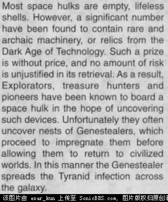
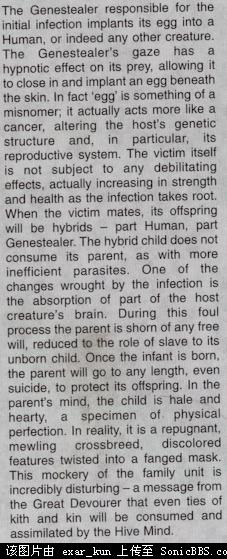

# 基因窃取者教派

基因窃取者教派

OzAlphaX 翻译自Codex - Genestealer Cults感谢以下前辈的指正：CZ75Exar_Kun炽天使军团注意：本书可能很老了……感谢Exar_Kun大大的提醒。基因窃取者崇拜在人类帝国的各个角落，某种隐伏的威胁在几个世纪以来一直在缓慢的发展。一颗又一颗的行星，一个又一个的星系，曾为帝国所控制的的世界正在逐步沦入叛乱分子之手。他们并非为软弱的肉体所征服，或是屈从于不洁的欲望，而是由于这些人先天所带的基因对他们产生了难以想象的作用，驾驭了他们的头脑。看上去，那群怪物——基因窃取者——就如同风中的种子一般，随便飘散到了银河之中某个宁静平和而毫无疑心的世界。只要他们能在毫无准备的群众当中获得一个落脚处，他们就会准备驱使人们去与真正维护他们利益的人做对。在大多数情况下，这颗行星注定会有一个悲惨的结局。当行星的防御力量被极大地削弱之后，那群基因窃取者们贪婪的虫族头子便会抵达那片不幸的土地，在将全部有机物横扫一空之后，在身后为我们留下一块巨大、荒凉而又死寂的岩石。基因窃取者之道基因窃取者教派通常会有一只由基因窃取者及其后裔所发展的军队。当越来越多的居民为基因窃取者所感染的时候，教派就将逐渐在本地生根发芽。这一邪教会强迫他们受其束缚，并且还试图确保他们将来的子孙也因基因的力量为教派所束缚。通过它们那长鞭般的舌头内部的产卵管，基因窃取者都可以腐化大量的居民，永久性的破坏他们基因的构成。依靠虫族的集体意识，母巢能将一切带有基因窃取者所留下的痕迹的人们结合在一起。而后，届由此种强大的灵能，身为父母的他们就会如同被催眠一般，照料他们那非人的子嗣而没有任何异议。此后，这些新一代的、混血的基因窃取者就会继续去感染其他人。由于他们那混合了怪物和人类特点的基因，从怀孕到成熟，这些人的生殖周期明显短于普通人。尽可能的传染更多人这一使命是至高无上的。在这种任务中，可能发生在宿主身上的危险被有意识的忽视了。对于这群家伙来说，只要同类越来越多就可以，其他的一切都是次要的。这一邪教集团的实际权力掌握在一群头头们组成的小圈子手里。邪教头子们指挥着他们的走狗去占领一个地区，一颗行星，乃至于一个星系，而完全不顾他们的死活。在正常宗教组织的伪装之下，那些邪教头子们绞尽脑汁的确保以下两个目的能够实现：不受外界冲突影响，以及获得越来越多的重视走狗。只要能阻挠帝国的净化行动的话，这帮家伙们就会毫不犹豫地把自己的追随者们派出去送死。他们会假惺惺的和派出去的炮灰们送别，有时也会象征性的参与战斗。但是，实际上，对于他们来说确保少数特权阶级的生存比什么都重要。尤其是长老，这个面貌最接近于人类和最强大的家伙。假如说基因窃取者或是长老（特别是他，因为对于他来说，藏身在人类社会当中非常容易）能长时间逍遥法外的话，这一邪教将再次生存下去。对于帝国来说，这正是最麻烦的一点——只要有一个邪教分子能侥幸逃脱，更为强大的基因窃取者教派就会在几个世纪之内重新浮出水面。基因窃取者长老们拥有一种强大的灵能，这种灵能可以被用来催眠和控制自己的跟班们。这种能力一部分是他的主子留给他的遗产，另一部分则来自于集体意识之中邪教分子们精神力的流动。基因窃取者的血统越纯，精神链接就越强，最终他们可以通过母巢感应来指挥大批军队。邪教头头们会组织起一大群武装叛乱分子，但他们不过是一群愚昧的盲从之辈。这群叛乱分子们全部都准备好了为所谓的“事业”而牺牲，但他们却不知道这不过是一场骗局。乃至于，他们根本就不知道那群头头们的真正面目。基因窃取者们仅仅服从于他们的虫族头子。他们传染他人，散布混乱，保护种子，一切的行为不过是为虫族的到来而服务罢了。邪教分子们所用的武器和装备要么是偷来的，要么是在黑市上买的，要么干脆就是自制的——结果是，他们的军备种类乱七八糟。他们通常能弄到多种多样的武器和载具（从人类叛变的军队或是政府官员手里得到），但是往往没办法保存下来，因为他们根本就没办法对其进行正常的维护。载具多半是有限的那几种容易偷到的，或是比较容易制造的。这群邪教分子没有多少专业的军事载具，所以他们必须依赖于较为普遍的载具。通过袭击军火库或是将高层官员拉入邪教集团的手段，他们偶尔可能会得到一些更为稀有、更强大的武器。不过，此种行动花费巨大，而且多半只能得到一些常见的军备。邪教分子们必须依赖于自制的战争机器，在这种情况下，他们将许多民用车辆改造为军事载具。邪教分子的豪华驾车能让他们在不暴露真实面目的情况下在城市里到处转悠，而且假如说增加一些额外装甲，将这种民用车辆改装成为轻型装甲载具的话，在战斗中使用也很合适。往往是在没有任何真正的军事训练或是指导思想的情况下，邪教分子们就准备投入战斗了。他们不过是一群乌合之众，邪教分子们要么骑在马背上，要么骑上摩托车或是其他的杂七杂八的载具，而大部分的地面部队则是以任何他们能找到或是偷到的武器武装起来的。假如这一邪教集团已经拥有了足够的实力（此时他们多半会经常参与武装战斗）的话，他们发出的信号就能够吸引一只在行星间四处游荡的虫族母巢舰队。从这一傀儡集团的头子到跟班，邪教分子们都被投入消耗战。他们会被驱使着去打倒一切地方或是行星的军队，以确保他们的安全和发展。而后，这种邪教分子与帝国军队间的战斗使得信号更为强烈。最终，“此地食物丰富”这一信号会如同灯塔一般明显。当虫族到来之后，一切都结束了——仍然存活的邪教分子们进入母巢舰队，而后被吸收。在行星上的基因以及有机物都收集完毕之后，行星也被放弃。就算虫族被击败，这颗行星多半也已经分析崩离。就算侥幸逃脱厄运，他们也将迎来帝国为确保没有基因窃取者存活而发动的病毒炸弹轰炸。一颗又一颗的行星……世界看上去正在被这种在银河当中四处传播且不可阻挡的瘟疫所击败。（完）

英俊的小张

关于尤里亚·雅可布斯打虫族的问题

尤里亚·雅可布斯是一个在银河南方的巴卡（Bakka）以西的世界传教的传教士。五十岁时，他已经让十五个新世界皈依了帝国国教，在这个可居住世界稀少的地区，这是一个非常客观的成就。他在一个半冰冻的世界——至点星（Solstice）上取得了更大的成功。他在这个科技与社会发展到了风间阶段的世界上花了三年时间研究当地居民之后，开始把国教的教义传授给当地的组织水平还很落后的宗教。

当他与一个王国的国王会见时，他看见了该王国的神的偶像，这使他很担心，这种偶像是一只有四只胳膊的死神。雅可布斯认为当地可能已经被基因窃取者教派所渗透，便退回对他更友好的王国，然后说服了这些王国的统治者们联合起来，去进攻那个叛变的国王。正如雅可布斯所料，当他率领着一支由弓箭手和骑兵组成的大军抵达时，他的军队遭到了一群基因窃取者的袭击。尽管大量基因窃取者在箭雨中被射倒，它们还是轻而易举地把步兵撕成了碎片。

雅可布斯把他的骑士分成两队，一队留做预备队，他带着另一队绕过基因窃取者的侧翼，袭击了它们的后方。骑士们碾碎了披着人皮的同巢兄弟（Brood Brother，基因窃取者教派的基层士兵，往往利用他们的人类外表渗透进当地行星上的人类部队里），直捣邪教的心脏。最终教主（Patriarch，基因窃取者教派中最年长、地位最高者）被杀死，尽管它的尸体旁边也堆满了为了杀死它而倒下的人类尸体，而长老（Magus，基因窃取者教派中的高位者，具有灵能力，负责向教众传达教主的意志，以及当基因窃取者教派发动叛乱时，在周围的社区中传道，以招收信徒）也被长枪刺死。基因窃取者在失去了其头目之后立刻陷入混乱中，剩余的骑士见状继续进攻，在一次光荣的冲锋中彻底剿灭了已经晕头转向的敌人。

在至点星之战后，雅可布斯成为了一个传奇人物，无论什么人反对他，他都能得到皇帝的帮助来挫败他们。后来，他又成功地让六个世界皈依皇帝，他最后在死亡世界戈郎（Gorang）上死于一种破坏肺部的病毒之手

上面这一段文字我想大家都看过，我的问题是，虫族不是很牛吗？ig和sm拿着暴矢枪和他们打都不轻松，为什么弓箭手和骑兵却打赢了？？？弓箭这种东西对虫族应该没什么用的呀

霸业肱股齐竖刀 

打的是基因掠夺者，估计就比平民强上一些些。虫族底层的虫虫，SM也能一挑三，但关键是数量，更何况后面还跟着暴君这样的BT。以及比BT还BT的BT。

CZ75

雅可布斯成功的关键是不惜代价灭了教主和长老，否则他是根本不可能打赢的。

还有一点：由于各地的生物能力、基因窃取者渗透的时间长短等不同情况，各地的基因窃取者能力也不是完全一样的，可能那个星球上的基因窃取者并不是太强大。

TEMPTION

有一点必须注意：基因盗取者的产生。

它们并不是由母巢舰上的Norn Queen生出来，而是通过孢子感染的方式——————Tyranid释放无数孢子到宇宙中，如果落到有生命的星球上，就会感染当地生物，令其逐渐变形成为基因盗取者。

不过到底是像生化危机里那样直接变异，还是一个漫长的渐变过程，就不知道了。

CZ75

过程很长，至少需要几十年。

兔子半妖

基因贼皮很薄的...只要能戳到，长枪挑了也不算奇怪

他们主要是近战牲口

矢锋

基因窃取者的强度因当地生物而定，并不会比当地生物强大多少。它们的主要作用是寻找可以征服的新世界并且充当第五纵队，至于毁灭这个世界那是虫巢舰队的事情。

CZ75

但是奇怪的是，虫族规则书里的基因窃取者可是S4T4，体质跟SM一样，按理说不同地方的基因窃取者体质不应该完全一样的。

exar_kun

Genestealer不是通过孢子感染来的

一个由GENESTEALER发展来的BROOD里面只有一个STEALER是虫子的正版,其他都是杂种.经过几代杂交,这些杂种中,有些可能和人类外型一样,拥有相同的智慧,,有些外型上就是人虫杂种,只有极少数是GENESTEALER.

AzraelJames

不要小看ig的手电筒

数量多起来很可怕的

至于弓剑之类的，以多敌少，同样有武器，同样体质

那有输的道理？
