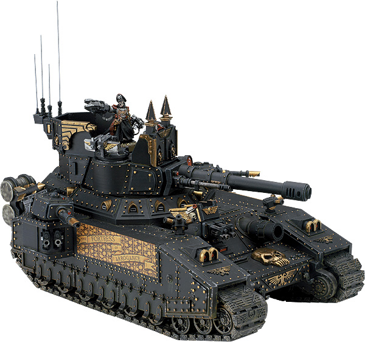
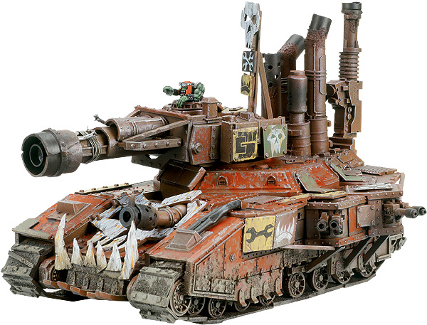
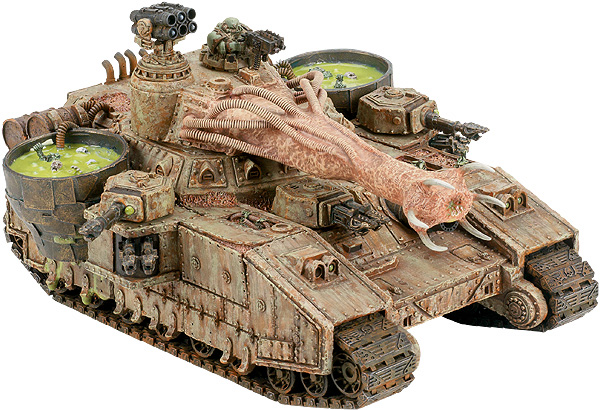

# GW的毒刃变形车

GW的毒刃变形车

苏联坦克 

以下内容来自于GW的官方网站，几款GW塑料版帝王毒刃的变形车，这些车辆收录入了启示录的规则书中，但似乎还没有成品模型出售。傲慢堡垒The Fortress of Arrogance

在ORK第一次入侵哈米吉多顿后，雅瑞克政委追杀兽人军阀Ghazghkull Thraka来到了异星世界Golgotha（译注：某教主被钉死在十字架上的地方）。就是在那儿，这位哈迪斯蜂巢的英雄第一次霸占了帝王毒刃“傲慢堡垒”号作为自己抵抗绿皮掠夺者的座驾。但是这辆超重型坦克被Stompa击伤，随后被抛弃在战场上。当Ghazghkull第2次入侵哈米吉多顿的威胁临近时，雅瑞克请求回收仍位于Golgotha平原上的傲慢堡垒号。一支机械神教探险队找到了这台古老毒刃的残骸，用一条教会方舟把她运回了哈米吉多顿进行修复和加强。如今，雅瑞克再一次屹立于傲慢堡垒之上，率领装甲大军向着绿皮部落发起突击。头骨锤SKULLHAMMA

对于一位尽职的技师来，吱嘎作响烟雾缭绕外面点缀满枪炮和小子里面塞满屁精和齿轮的战斗堡垒是个相当流行的建设项目。典型的战斗堡垒的体型差不多是战斗碉堡的两倍大小，而且通常会更大，一个战斗堡垒就是一个堆满了武器的移动要塞。和其他兽人车辆一样，战斗堡垒没有标准的形态，它们拥有各式各样的外型和尺寸，但毋庸质疑，最流行的亚型号就是头骨锤了。头骨锤是一种特殊的战斗堡垒，大多由Speed Freek Mekboyz拼装。一台涡轮增压三倍的发动机占据了底盘的大部分空间。当头骨锤全速移动时，增压就开始工作，提供更快的前进速度，四脚不着地的一路绝尘而去。兽人们深深的迷恋上了这种速度，因此头骨锤的成员们都不肯离开自己的爱车——他们吃住在车上，在车上就是他们的生活，他们决不离开——除非被炸下车。NURGLE瘟疫收割机THE NURGLE PLAGUEREAPER

瘟疫收割机是种被半侵蚀的超重型坦克，属于Nurgle的军团，是个流淌着瘟疫，笼罩着毒云的堡垒。装在车辆后部的大缸盛满了从死于瘟疫的尸体上蒸馏出来的粘液，这些粘液通过鼓鼓囊囊的管子输送到主炮塔。瘟疫收割机的脓汁炮喷射出这种要命的混合物，被这种东西喷上的敌军士兵大多死的很难看：他们的皮肤上会立刻张出湿润的疖子，他们的血肉会从内到外的被吃光。任何白痴到胆敢冲锋这个恶臭的庞然大物的家伙，都会遭到来自Nurglings的攻击，这些东西依附在底盘上，在车内大量滋生。这个畸形的东西是敌军最不想面对的玩意之一。
