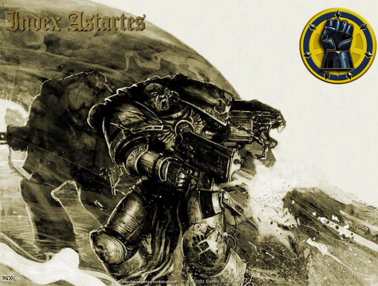

# Imperial Fist - 帝国之拳

Imperial Fist - 帝国之拳

caifan0

帝国之拳

基因原体：Rogal Dorn战吼：“原体，先祖啊——为了你，还有地球上那位圣者的荣光。” ('Primarch, Progenitor - To your glory, and the glory of Him on Earth.' )颜色：黄色为主，红色镶边

在战锤四万的世界里，帝国之拳是首批建立的星际战士军团之一。他们是最受帝国中许多机构尊敬的战团，也被认为是信仰最坚定的战团。

历史

Rogal Dorn

人们对Rogal Dorn的早期生活和他的家庭所知不多。不过，据信他是最早重新加入帝皇的那些基因原体中的一个。Dorn和帝皇第一次会面时，将移动太空要塞Phalanx作为礼物带给了帝皇，以协助他进行大远征。帝皇欢迎了Dorn的到来，并且很快便发现他是自己二十个基因工程孩子中的一个。于是作为回报，帝皇将第七星际战士军团的指挥权交给他，还将Phalanx交还给他作为他的基地。帝皇被何露斯重伤过后，Rogal Dorn也是第一个发现他的人。

“给我一百个星际战士。要是不行的话，一千个其它战士也成。”("Give me a hundred Space Marines. Or failing that, give me a thousand other troops")——Rogal Dorn, 帝国之拳的基因原体

大远征

第七军团，也就是名为帝国之拳的军团，在大远征的前期一直作为帝皇武装的预备队，他们的表现极其成功。由于可以快速而可靠地投入战斗，他们在许多战役里都扮演了挥出最后一击的角色。而这个军团在攻城战里，不论是作为进攻方还是防守方都表现得尤其出色。在何露斯之乱之前，新任的大战司何露斯曾经开玩笑说他的战团与帝国之拳间如果开战的话，战斗将会不分胜负而无绝期，这就是“最强的矛遇上最强的盾”。这种名声在远征的后期给了帝皇很深的印象，于是这个军团便与黄金王座卫队(Adeptus Custodes)一起成为了帝皇的禁卫军。

Rogal Dorn和他所代表的帝国之拳军团士兵都被认为是真诚，忠诚，勇敢以及谦卑的典范。不过，钢铁战士军团的Perturabo却认为Dorn和他的军团士兵们自大而且过于骄傲。一件小事最终让这种情绪爆发了：那是Dorn和Perturabo的一场争执，内容是关于谁应该为指导在圣土上建造帝皇的宫殿的功绩而受到表彰。这争执升级成了两个军团之间的恨意，而且最终将会变成彻底的仇恨。

何露斯之乱

处于外层空间的Phalanx要塞发现了一艘漂浮在附近的护卫舰，这艘护卫舰名为爱因森斯坦(Eisenstein)号，处于仍然忠于帝皇的死亡守卫士兵Nathaniel Garro的控制中。Garro和舰上的其他幸存者是亲眼在Istvaan III见证了何露斯的背叛的人，他们被接上了Phalanx，而爱因森斯坦号则被摧毁了以防止其上的瘟疫蔓延开来。当Garro告诉Dorn他的所见之时，基因原体Dorn暴怒了，他认为Garro的话是对何露斯的恶意诽谤。因为Garro谴责他被他对基因原体兄弟的爱蒙蔽了双眼，他差点就杀了这位忠诚的战士。最终让Dorn相信了大战司的背叛的是一卷放在记录器(rememberancer)里随Garro一起逃出的全息影像(holo-vid)——它上面忠实地记录了何露斯推翻帝皇的宣言，Istvaan的大轰炸和爱因森斯坦号的逃离。

在回到圣土并向帝皇报告了自己所知的情报过后，Dorn被任命为帝国军队的全权最高指挥官。接下来的事情早已是流传于世的史诗传奇：帝国之拳以及其他两个忠诚的军团参加了帝皇宫殿大围攻作战，他们的英勇防卫让混沌始终也无法攻陷帝皇之宫。

Dorn乃是在帝皇与何露斯那场雄伟的决斗后发现他的身躯之人，也是Dorn，将帝皇的躯体带回圣土，让其回归于黄金王座内。深恨自己辜负了帝皇，Dorn继续带领他的军团走上了与叛徒们作战的战场，直到军团被召回到圣土。

新帝国

Dorn最初是反对极限战士军团的罗伯特基里曼拆分星际战士军团的主张的。但三件事让他改变了主意。首先，他认识到尽管帝国之拳再也不能像以前那样为帝皇效犬马之力，但他们仍然必须对帝皇的理想保持信仰。第二则是因为铁笼事件(Iron Cage incident)——这是次灾难性的攻击作战，为了将Perturabo和他的钢铁战士军团从他们在何露斯之乱后逃跑并占领的要塞里驱逐出去，超过四百个帝国之拳战士长眠在了战场之上。最后，是另一个事件——帝国海军队对攻击巡洋舰”糟糕天使”(Terrible Angel)号开火。

借着铁笼事件的契机，帝国之拳军团分为了三个战团，他们分别是继承了军团名号的帝国之拳战团，黑色圣殿骑士战团以及深红之拳战团。（第四个战团，饮魂徒战团，按照推测是源自帝国之拳军团的宇宙突击连，这可以参考下面的饮魂徒之谜(Soul Drinker Contradiction)。在《饮魂徒》这本小说里似乎还暗示了其他几个二次建军(the Second Founding)战团也一起建立了。）借空间修院要塞Phalanx之利，帝国之拳战团有能力对整个帝国的求助或者事件做出快速反应。而正因此种能力，帝国内许多组织都欠下了帝国之拳战团人情，帝国之拳战团对某些事情也就能比其他星际战士战团在帝国内拥有更大的影响力。

关于Rogal Dorn的命运最广为人知的一点是，他比其他的忠诚基因原体都要长命。他的最后一战是一次意在阻止混沌舰队进攻卡迪亚的作战，尽管这次作战的结果非常成功，但他却倒下了。有关他死亡的细节还不清楚：最新的消息指出，能找到的Rogal Dorn的遗体只有他的双手，而这现在成为了帝国之拳战团最珍贵的宝物[1]。不过，这消息和以前的旧材料有矛盾之处：这些旧资料里记载说Dorn的遗体被找回了而且他的整套骨架都在Phalanx，还有，他到底是死是活在这些资料里都没有记录[2]。（据这里提及的资料描述，Rogal Dorn那已失去生气的躯体被找回Phalanx，他的骨架被封在一块琥珀里，但是他的双拳依照战团传统被取下来并作为帝国之拳所拥有的最珍贵的宝物之一而留存。）

帝国之拳的战团长享有将自己的纹章刻在Rogal Dorn的手骨上的特权，不过纹章必须刻得尽量小。据说，即使刻在这双手骨上的纹章都小到连星际战士都很难看清的程度，手骨上面也已经几乎找不到没有被战团长的图案覆盖的地方了。

组织结构

原初帝国之拳军团的构成非常死板，每个连在组织结构上都相同，而且连长们也都顽冥非常。不过在二次建军以后，战团在这方面所受的批评减少了，另外，帝国之拳也是在极限战士军团之后第一个遵照阿斯塔特圣典进行改组的军团。

帝国之拳在许多世界都有前哨站，但他们并不以统治者的身份出现，或者对这些世界征收什一税。他们总是以受尊敬的客人身份，而不是主人的身份出现。Rogal Dorn自己对此曾宣告道“我要自由人，不要奴仆！”(“I want recruits, not vassals!”)。

母星

虽然有说法认为Rogal Dorn来自Inwit行星上的冰窟，但Dorn的母星事实上不为人知。旧文献内提供的信息是，军团和后来战团的母星就是圣土。（在沙盘游戏何露斯之乱里，帝国之拳的一个要塞就连接在巨大的帝国皇宫的最西端。）现在的文献则将帝国之拳描述为一个移动战团，从Phalanx的巡逻路线上的一系列战团要塞征募新兵。这些战团要塞位于不同的世界上，这其中就包括圣土，Inwit和Necromunda。

征募条件

作为一个扎根在宇宙中的战团，帝国之拳在几个世界里都设有前哨站，从这些地方得到他们的新修士，而不是仅仅是靠从一个世界里招募新兵。Inwit,圣土和Necromunda就是这些世界中的几个，但只是其中的一小部分而已。

基因种子

绝大部分常见的星际战士基因改造手术都还保留在帝国之拳中，但有一些植入程序却在这些漫长的千年里失去了功能或者完全遗失了（资料来源不清楚）。帝国之拳不再拥有可以正常工作的Betcher’s Gland（一个可以让星际战士分泌有毒唾液的器官）。还有，Sus-An membrane（一个让星际战士可以暂时性停止他的生命活动进入假死状态的器官）也失去了功能或者不再存在了。

帝国之拳战团的牧师在战团内布道，让战团的战士相信他们不应该被这些损失所困扰。“我们会为这种损失叹那么一口气么？不！我们是帝国之拳！我们不搞冬眠，我们也不吐口水，我们只粉碎我们的敌人！”

除此之外，帝国之拳还被他们的基因种子的一个微妙的缺陷影响着——帝国之拳的战士可能会被强行压制疼痛的感觉迷住，不管这是以自身意志做到或者被强迫的。由于这个原因，帝国之拳们可能忍受住会让其他军团的战士变得虚弱的严重伤势而继续很好地战斗，但另一方面，有些帝国之拳士兵却会想办法让自己在战斗中受伤。

肉体的疼痛因此成为了帝国之拳的修院要塞内宗教仪式的重要组成部分。当他们空闲时，战士们可能会用测痛计来测试自己，看看他们能抵抗多大程度的疼痛。他们的新兵在加入战团六个月后要进行一个传统的新人典礼，在该典礼中他们必须穿越一个“恐怖隧道”。在这个大隧道里通过神经感应手段的模拟，他们要感受难以忍受的疼痛，达到白炽程度的高热，让人冻僵的寒冷和高强度的真空。相似的技术也被用在刑具上，被判定触犯了规条的战士可能会被强制穿上“神经套”（有时也被叫做“疼痛之套”），这种用弹性织法制作的紧身衣(an elastoweave body-glove)可以引起全身性的疼痛。

战斗规章

在整个大远征中，帝国之拳都是被当作战略预备队使用的，他们在其他军队压制敌人和寻找敌人弱点的时候默默等待。当时机成熟，帝国之拳将会像锤子一样，在其他星际战士军团结成的砧板上一举打碎敌人防御的支撑点。

在何露斯之乱后，帝国之拳立刻就以明显更加狂猛的方式进行战斗了，他们常常直到交火时都还没有从侦查中获得情报，而且即使在战术撤退是更佳选择时也不后退半步。这种行为在军团接受了阿斯塔特圣典的规条后得到了缓解，因为那些狂热的战士自愿加入了新建立的黑色圣殿骑士战团。

在帝国之拳长达万年之久的岁月中，军团未有片刻失却他们围城战王者的水准，在其他任何对敌作战情形下也是游刃有余。不过，即使一百个世纪已经悄然逝去，帝国内首屈一指的攻城好手仍然是那些石之人(?)(Men of Stone)。

战吼

"Primarch, Progenitor - To your glory, and the glory of Him on Earth."

外观

帝国之拳的甲胄形貌从建团之日起便从未改变，一直是黄色饰以红或黑。战团的标志是为一只紧握的黑色拳头，置于白色或黄色背景之上。

为了展示自己对人类之帝皇的绝对拥戴，帝国之拳的成员们都会将大量的圣洁图章和表示热爱的图案绘在动力装甲之上。

不过帝国之拳在涂装上有一个明显的例外，那就是他们的老兵头盔有一根红色条纹——极限战士和其他的圣典战团所用的颜色通常都是白色。

著名成员

Vladimir Pugh：现任帝国之拳战团长。他并不是一位富于灵感的领袖，而是和帝国之拳曾经有过的其他战团长一样是一位小心谨慎，喜爱计划好一切的人。另外，他看人的眼光远超常人，他对谁可以提拔，谁可以信任了然于胸。只有智库馆员们进行大规模探心术(probing)的结果，才能比Pugh团长随便打量几眼的结论更精确。拥有这种过人之处使得Pugh可以对他的下属保持绝对的信任，因而可以将全部精力投入到对战斗的指挥上去。流传甚广的说法称，他曾经因为某个军事失败而把自己的味蕾切除，作为自我惩戒。

牧师Lo Chang: 这个圆脸的牧师脸上有个标志性的碗状伤疤，他的头盔没能抵挡住造成这个伤疤的猛烈攻击。这种形状的伤疤在帝国之拳战士中很常见，通常是决斗留下的痕迹(duelling scare)。当Lo Chang布道时，他是如此地虔诚，如此地投入，他的热情足以让任何帝国之拳的星际战士将自己的一生都投入到成为Dorn真正子孙的奋斗中去。

智库馆员Franz Grenstein：皮肤微黑的Grenstein脸上布满了决斗留下的伤痕。他身上充满了激情，非常勤奋，他致力于保护帝国之拳的安全不受到拥有灵能的敌人或者恶魔的威胁。在某些罕见的情况下，帝国之拳的星际战士会遇上被混沌所污染了的敌人，这个时候Grenstein就会担负起帮助这些士兵保持稳定精神状态和确保他们没有被污染的责任。在已经绝版的小说《星际战士》(Space Marine)（Ian Watson著）中，Grenstein在随同帝国之拳部队执行一个猎杀(search-and-destroy)任务时攻入了一艘Tyranid虫巢舰，并在其中不幸身亡。

队长Lysander：Lysander最初出现是在第三版的星际战士规则书(3rd edition Codex: Space Marines)中，那时候他的身份是一名老兵军士(veteran sergant)。他被描述为老练地指挥他的小队长时间维持爆矢火力，在异教徒的进攻下将一座桥固守了数天。第四版的规则书中，在攻取了“Khaine之血”后他被任命为第一连的队长。

队长Lexandro D'Arquebus：Lexandro D'Arquebus来自于Necromunda上Trazior巢穴的一个高密度聚居区，他在星际战士中晋升得相当快。他是Trazior三兄弟(Three Brothers of Trazior)中唯一幸存的，他的左手手骨上刻有其他两位亡故兄弟的姓名，作为对他们永久的纪念。他是Ian Watson在1993年出版的小说《星际战士》里的主角之一，也在Ian的《裁判庭战争》(Inquisition War)三部曲中出现过。

队长Eshara：Eshara在第41千年的后期带领第三连。在保卫帝国的仅有的两个基因种子生产地的其中一个的战斗中，他协助了帝国卫队和机械修会。他最后被钢铁战士名为“战争铁匠”的恶魔王子所杀。

队长Bannon：Bannon出现在《远东的战士》(Warriors of Ultramar)一书中，作为裁判官Kryptman的手下，指挥一支异种审判庭的死亡监察灭绝小队(Ordo Xenos Deathwatch Kill Team)。他最后牺牲了自己，让Uriel Ventris和他的队伍得以从被围攻的帝国设施中逃走。

队长Tialo：在阿巴顿的第十三次黑色圣战中担任第二连的队长。在Kasr Vasan，他在因伤倒下之前独力抵抗了数百个变种怪，堵住了被打开的缺口。令人惊奇的是他还活着，他的身体被保存在静态力场中。之后，他可能会被埋入无畏机甲中，继续为帝国效力。

队长Octavius：死亡监察的继任者，在小说《战士之巢》(Warrior Brood)和《战士的聚会》(Warrior Coven)中被提及。他对自己的战团引以为傲，对前面提及的Bannon队长也怀有深深的敬意，将他看作责任和荣誉的标志。需要说明的是，在极限战士中有一位同名的队长。

饮魂徒之谜

根据黑图书馆小说《饮魂徒》，在第二次建军期间，帝国之拳还分出了第四个战团。这本小说内陈述说，饮魂徒战团是在第二次建军时，从帝国之拳的轨道突击部队创建的。

但是，该战团从第二次建军起的存在，在任何有关星际战士的规则书，包括那些在小说出版后发行的规则书内，都没有提及。现在，饮魂徒作为二次建军战团的正当性没有得到任何确认。

在第二版战斗修女(Sisters of Battle)规则书中提及了饮魂徒，在黑色圣殿骑士规则书中也捎带有提及。但是这两处没有明确记载说他们是星际战士战团，更没有说他们是来自帝国之拳的二次建军战团。

更增添了饮魂徒神秘性的是，在第一版战锤40K的导航者之书(Book of the Astronomican)中（现称导航者首书）描述白色疤痕军团组建了一支名为灵魂饮者(Souldrinkers)的突击专家小队。这本书也是第一本详细介绍白色疤痕游戏系统的书。有趣的是，现在的饮魂徒纹章样式（装甲颜色和战团徽章）有许多地方都与这个导航者之书中描述的灵魂饮者相似。

在黑图书馆出版的一本集合了所有三本《饮魂徒》小说的《饮魂徒精选集》中，声称在第二次建军中，帝国之拳军团不只分化出四个战团。在何露斯之乱中帝国之拳军团并未遭受严重损失，这之后有7到16个战团从该军团中分出。其他的那些战团的现状不明，而且如此多千年过去了，无数的事件发生了，新的后继战团可能诞生了，一些战团也可能在帝国内持续不断的战火中减员甚至消失了。

不过，由于饮魂徒曾经的背叛而后来脱离混沌的历史已经足以让他们被从帝国的知识中抹消了，这是作为帝国支柱的规则的一种基本行为。事实上，饮魂徒的资料在圣土的图书馆内被擦除这一情况，被记录在了黑图书馆出版的所有小说里。
