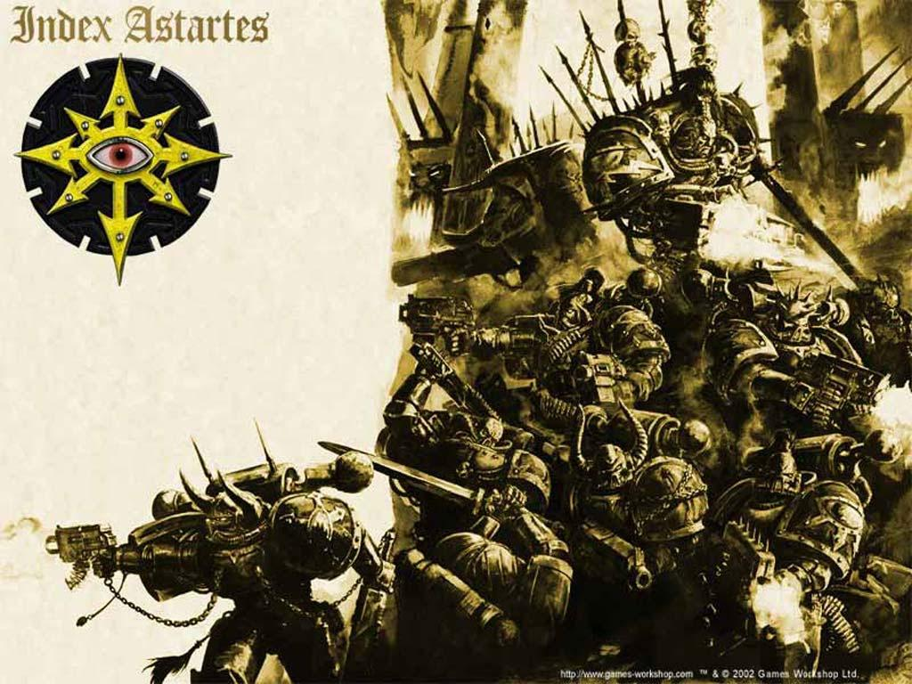

# Lunar Wolf/Black Legion - 影月苍狼/黑

Lunar Wolf/Black Legion - 影月苍狼/黑色军团

Exar Kun

起源    随着时间的无情流逝，初创军团早期的历史如流沙般消逝。而在何露斯大叛乱之后，帝国档案中关于那些叛乱军团的记录和细节（尤其是关于大背叛者何露斯的），都被删除了，以避免这些事件记录伤害帝国公民脆弱的心灵。实际上，只有若干手握大权的人才知道一部分这些事件的内情，而且没有一个人了解完整的来龙去脉。仅有的相关信息野史粗略不整，有些被记录在异端典籍中，被一些审判官小心看守着，而另外一些则由那些依然忠诚的军团保存着。    这些记录中，提到了，影月战狼军团兵员都来自瑟奥尼亚，一个充满混混和流氓的星球。这个星球所处的星系，据说是那些离地球最近的星系中的某一个。瑟奥尼亚离地球非常近，那些没有亚空间引擎的飞船也能不费力很快到达。于是很可能在宇航时代的开端期，这颗星球就被人类殖民，建设，并且挖掘坑道开采矿产。正因如此，瑟奥尼亚的自然资源在数千年前就被消耗殆尽，古老的采矿科技也被机械教重新发现并且移作他用。因此，这颗星球就显得多余而遭到遗弃，行星表面布满古代坟墓，锈蚀瓦解的古老工厂和荒芜的采矿坑道。    众多暴力帮派就居住在这些深邃的洞穴中，在帝国严厉的民政管理系统以外的地方享受着自由。但是，在军团初创时期，他们提供的人种基因资源是没有人能忽视的。一份报告提到，征兵部队围捕成千上万的暴徒，把他们拴在一起，关进运送囚犯的飞船中，运到月球上的基因实验室中。在那里，他们被植入基因原体何露斯的遗传信息以进行改造。通常来说，星际陆战队的兵员都来自那些野蛮未开化的星球，然而，在经过惯例的心理催眠灌输信仰之后，影月战狼军团的新兵们凭借着他们的出色表现和强烈忠诚感脱颖而出。

何露斯    关于何露斯本人的资料更加难以找寻。有人认为，他飘散至的地方离地球最近，在很小的时候就被皇帝发现，所以他是皇帝最先找回的基因原体。因此，在很长时间内，何露斯一直是皇帝唯一的儿子，他们之间的关系非常紧密。皇帝花了很多时间来教育鼓励这个门生。很快何露斯就开始统帅影月战狼军团—10000个根据他的基因进行改造的星际陆战队。大军在握，在大远征刚开始的30年中，何露斯陪伴着皇帝，为初生的人类帝国开疆拓土。    这两个强者许多次并肩作战。在雷里斯，一个人类定居点拒绝接受皇帝的恩泽，他们的防御部队利用秘密隧道渗透至围城的帝国部队后方，成百的突击队冲进指挥所，皇帝和何露斯措手不及，甲胄未披，两人背靠背抵挡着敌人的进攻，直到一发等离子击晕了何露斯，把他轰倒在地。皇帝守护着何露斯拒绝投降，直到援军赶到，击退敌人。在兽人肆虐的戈热行星，当皇帝被一个巨大狂热的兽人军阀扼住喉咙几乎丧命的时候，何露斯斩断了那只绿皮的臂膀，从而偿还了欠皇帝的那笔人情债。    终于，皇帝在邻近星系探测到了第二个基因原体的存在并立即动身前往找寻，留下何露斯暂时统令大远征的庞大军团。之后，何露斯为他的兄弟的归来而感到高兴，但也坚信皇帝永远会视他，皇帝的第一个儿子，为最大的骄傲。    随着其他的基因原体一个个的被找回，皇帝越来越忙于其他的事务，一个个陆战队军团拥有了他们命定的指挥官，何露斯就很频繁得到总体战略指挥的权力，这正是他长久以来最喜欢的位置，从而可以一次次的证明自己是一个出色的将军，不断的通过成功的征讨来赢得皇帝的称赞和勋章。他也赢得了其他军团的赞同和敬爱，包括其他的基因原体。    据称作为一个伟大的战士和战略家，何露斯惊人的聪明。他魅力十足，能言善辩，而且天生就懂得心理学。他可以读懂人的内心以发扬他们的优点或者利用他们的弱点。这些技巧不仅使他成为了一个众人拥戴的领袖，而且让他在某些情况下，找出非军事的解决方案，不像其他人那样冲动的发动进攻。在许多次战事中，他可以对许多行星施展毁灭性的军事实力，但是一天时间的和谈就足够让何露斯和平收复这些星球。如果何露斯认为遵从当地的风俗习惯和交往礼仪可以在他到来时降低爆发敌对冲突的可能性，那他就会不厌其烦的照做。他这种参与本土仪式，为将来的收复行星作基础的做法，很快就成为帝国的一贯政策。    何露斯也擅长于让其他基因原体和他们相应的军团发扬最大的战斗力。许多军团精于某些特定的战斗，而何露斯就鼓励他们保持这种独特性，并将他们派到最适合他们的战场上去。如果需要发动突然袭击，何露斯就派遣白色伤疤或者暗夜领主。如果预期到一场持久战，那死亡守卫或者火蜥蜴军团就会上场。如果要进行精确的按时打击或者隐蔽行动，阿尔发军团就受到青睐。如果仅仅是一场普通的激烈战斗，那么就轮到其他军团上阵。如同一个小队指挥官指挥他手下的星际陆战队士兵一样，何露斯灵活的调动着所有的星际陆战军团，把一个个军团派到最适合他们的位置上去，让他们赢得自己的荣誉。也有证据表明，何露斯派遣吃世界团的部队去参加属于血天使的肉搏战，而有时候他又反过来做，显然是要在各军团中培养一种竞争气氛。相应的，我们也猜测何露斯很清楚太空野狼和暗黑天使之间的夙怨。这两个军团总是频繁的被部署进联合作战行动中，刺激他们为胜过对方而表现出更好的军事素养。    他自己的军团享有作为最伟大的基因原体的私人卫队的所有荣誉，并且也同样享有基因原体本人的信条：为做到最好而奋斗。在何露斯鼓舞人心的指挥下，影月战狼总是战斗在最新的战役的第一线，不断的拓展帝国的疆界，一步步杀入银河的深处，为了比其他军团收复更多的星系而奋斗。在阿伦托，克斯卡斯庭和安多夫星系，影月战狼一制服一个行星上的抵抗势力，就马上杀向下一个行星。协同作战的极限陆战队和钢铁战士总是留下来解决剩下的抵抗势力，在新近被征服的行星上建立守备队。影月战狼的军官断然拒绝指派任何部队去参加这些行动，声称他们所有的部队都要去参加持续进行的远征。在影月战狼离开后，一系列叛乱在他们新近征服的星球上爆发开来，据说，为此极限陆战队的基因原体罗保特基里曼和何露斯有过口舌之争。在那个时候，何露斯告诉基里曼，他显然比何露斯更加善于处理这些事情，从而平息了基里曼的不满。而在基里曼的《阿斯塔特圣典》——这本很久以后才写完的大作中，他花去很多笔墨来详细规定如何镇压一个叛乱星球的战术条令。

叛乱    何露斯在乌拉诺尔战役中，击败了一整个兽人帝国。最终皇帝宣布，这是强大的人类帝国目前所取得的最大的胜利，并为了影月战狼以及他们的基因原体在战役中做出的贡献，对其大行封赏。其中最引人注目的就是军团名称的变化。皇帝圣旨道：“今起该军团改名为何露斯之子，特以表彰军团领袖何露斯之不世之功。” 何露斯则得到了战帅的称号，真正成为了皇帝属下武装力量的最高统帅。尽管获得了这么多的荣誉，何露斯似乎仍表现出些须的不满意。皇帝的圣旨显然将所有的胜利归属到自己的名下，而圣旨则显然是政治口号般的虚华辞藻——毕竟，何露斯是皇帝和人类帝国忠诚的属下。而在何露斯的眼中，皇帝现在只是花大量的时间待在地球安全的皇宫中，而他自己却在远方为了帝国征战不休。似乎，一种深深扎根于何露斯心中的不满已经逐渐显露出来。    在他回到地球，正式取得他的新统帅地位前，何露斯在一个叫做达文的小小的原始星球上染病了。在他康复过程中，他前往一个战士会所参加一次仪式纪念活动。这是他屡试不爽，用来和原始星球建立积极联系的手段——当那些来自星辰间的战士和原始人成为兄弟之后，这些原始人将是很好的帝国后备兵源。然而这一次的情况就不同了。接下来几天中，何露斯之子的军官们发现战帅的个性发生了改变。因此有人推论道，那个所谓的战士小屋其实是个混沌据点，而在这个据点中，不知发生了什么，使战帅受到混沌的蛊惑。何露斯之后持续的将这个战士聚会组织引入他的军团中，同时也引到其他那几个受他指挥的军团那里。战帅所忠诚信仰的对象发生了改变，他的军团相信他已经被恶魔附身。不论这是否属实，此时的何露斯已经全身心地和混沌力量结成了盟友，而他对帝国也有了新的看法。这些事件是混沌邪神暗中策划的，抑或是一个孤立的混沌信仰小团体进行的，人们不得而知。但是很显然，基因原体生病这种事情是闻所未闻的。而只有极端恶性的疾病才能使一个基因原体受到感染，这或许显露出了一个更大的阴谋。    何露斯之子，这支早已极端忠诚于他们的战帅，并且深切的以战帅为荣的军团，毫不犹豫的抛弃了他们对皇帝的忠诚，转而投入了战帅和混沌诸邪神的怀抱。很快，堕落和腐化在何露斯所到之出散布开来，甚至包括一部分机械教组织，而经由机械教，混沌的腐化又延伸到了泰坦军团和塞博尼卡军团（机械教中负责制造和维护机器人的专门部门）。其他那些基因原体们，何露斯早对他们的人格了然于胸，并早已熟知如何激励诱导他们。何露斯对他们奉上荣誉，许下给予强大力量的诺言，同时又利用他们之间以往的人情和积怨，成功的获得了半数基因原体的效忠。随之而来的战争则是人类帝国有史以来最恐怖的一次，而且最终几乎要摧毁整个帝国。在地球上，星际陆战队和星际陆战队厮杀，泰坦则和泰坦对撼，皇帝的皇宫要塞则遭到了围攻。    历史记载，在皇宫围城战的第55天，拥有压倒性优势的帝国援军到来了。何露斯试图在局势无法挽回前杀死皇帝，就关闭了他战斗旗舰上的护盾，放任他的创造者经由超空间传送来到其上。但最终是何露斯被杀死，随他死去的则是这场叛乱。战帅的死亡，对何露斯之子来说是沉重的毁灭性打击。他们一直为之奋斗的一切都化为尘土。军团立即放弃了对皇宫的围攻，杀回他们的战舰上。这种懦夫的行为显然引起了其他叛乱军团的仇恨。而在何露斯的旗舰上，何露斯之子军团第一连的连长，发动了一次凶猛的反击，赶走了战舰上的帝国军队，而后带着战帅的尸体逃进了恐惧之眼。

流亡    和其他叛乱军团一样，何露斯之子在恐惧之眼中找到了自己的避难所，并且在那里建造了自己的堡垒，以此为基地，向帝国发动新的入侵。他们为他们死去的战帅建造了一座要塞般的陵墓，甚至依旧将他视做军团的领袖。没有人继承战帅的权力地位，军团的连长们不断的在何露斯的神殿中献上祭品，并祈求他的指引。在其后的几个世纪中，何露斯之子是各个叛乱军团中最活跃的，因为他们可能要维持以往那种比别人成就更多更多的传统，或许也可能是为了弥补他们在地球战役中显露出来的失败。在这段时间内，他们的信仰在四个邪神中交替变换，以何露斯为榜样，热切的让恶魔附体于他们身体之上。但是，随着每一次的“总把新桃换旧符”，被替换掉的“旧符”的那些恶魔，总是很快就脱离他们的寄主，留下一具具毫无生气的躯壳。军团的人数不断减少，岌岌可危。经过军团中的混沌巫师，也就是以前的智库馆长孤注一掷的实验，终于发现了一种可以保证寄主存活的恶魔附体的方法。    军团终于得救，但是在人数上已经处于劣势。何露斯之子们为了争夺恐惧之眼中的资源，权力和高于他人的地位，向其他叛乱军团发动了一系列血腥的战争。冲突逐渐加剧，最终他们先前的盟友们，包括帝王之子，集结了一支大军摧毁了军团的要塞。但是更糟糕的是，何露斯的尸体被掠走，随之而来的报告说，一个自称是继承者的神秘人物正在同帝王之子合作，试图克隆死去的战帅。面临着何露斯被夺走并被他们的敌人所玷污的困境，残余的军团最终向他们的新领袖——阿巴顿，第一连的连长——效忠。    阿巴顿知道，有关战帅何露斯的回忆已经成为整个军团的精神镣铐，将他们锁在过去的失败上面，因此他的第一个举动就是去处了何露斯的字眼和军团古老的称号。阿巴顿带着剩余的部队坐上唯一的一艘战斗旗舰，向帝王之子发动闪电般的进攻，摧毁了战帅的尸体和整个克隆实验室。在这次行动中，以及在以后的行动中，军团战士都穿戴着涂成黑色的装甲。自此之后，阿巴顿的黑色军团不断的向帝国发动进攻，在沿途的各个行星上，播撒着毁灭和不幸。

家园行星    军团的家园瑟奥尼亚已经不复存在了。它明显失去了地质结构的聚合力，在大叛乱后的几个世纪后就逐渐破碎为无数小行星。显然，这个曾经富含矿产的星球被无数的矿坑隧道钻了个透,连已经冷凝的星球内核都被钻成蜂窝煤。（实际上，那些为数众多，最后构成星球主要人口的流氓们原本是作为工人引进到这个星球，用来维护那些脆弱的采矿隧道。）但是有人揣测，瑟奥尼亚是被故意摧毁的。    在军团于恐惧之眼中的要塞被摧毁之后，黑色军团就不再以某个特定的星球作为他们的基地，而是长驻于不同的战舰上面。不同的战队可能占有一艘来自原本军团的古老战斗旗舰，也可能是一艘强征或者捕获的战舰。特别是阿巴顿，掌握了许多艘在何露斯叛乱中暴动的海军战舰和一系列他下令建造的更新的战舰。

战斗条令    影月战狼是一支灵活的战斗力量，他们能很快适应不同的战斗情况下，并且表现良好。整个军团被训练为能够针对战帅的战术命令做出迅速而决定性的反应，并因此在整个军团中建立了高效的链式指挥体系。在流亡的最初几年中，由于没有领袖，这个体系受到了重大打击，但是阿巴顿通过利用恐惧感和残忍惩罚那些不听话的指挥官，花了很大力气重建了战斗纪律。何露斯最喜欢的“割掉敌人的喉咙”的斩首战术，仍然是军团常用的做法。

组织结构    在何露斯死后，军团中连排级的指挥结构瓦解了，而他们乘坐战舰分散逃命进一步加剧了军团的瓦解。目前，一个黑色军团的冠军战士——可能是叛乱前的高级军官或者是通过残忍作战获得混沌青睐的战士——可能带领着任何大小的战队。在某些特定时候，这些战队可能为了发动一次针对他们仇恨的帝国的大规模袭击，聚集在某个更加强大的冠军战士的旗帜之下，甚至是阿巴顿本人。但是，对不同的混沌邪神的信仰会导致内部的政治倾轧和冲突。恶魔附体则被认为是受到混沌的高度眷顾，而军团的许多成员都拥有这种“荣誉”。

信条    在战帅死亡之前，军团首要的信条是保持他们以及战帅的至高无上。他们持续不断的试图证明自己是最伟大的军团，单纯从数字上算，影月战狼的确为帝国收复了最多的星球。但是他们最后的溃败和流亡给整个军团的自负感沉重的一击。这让他们新的领袖阿巴顿费尽心力来重建整个军团的骄傲感，并让他们重新集中力量去完成他们的终极目标——颠覆伪帝所建立和创造的一切。

基因种子    在Davin事件之前，军团的基因种子是纯净的。但是在他们堕落于混沌后，星际陆战队就显露出一系列的随机变异现象，而且这种污染已经直达基因种子的程度。他们经常试图找寻恶魔附体的做法可能也加剧了这种现象。但是，这种变异被视为混沌邪神的眷顾，因此他们总是骄傲的炫耀变异现象。

战吼    直到何露斯的尸体最后毁灭前，军团的战吼都是：For the Warmaster!    但是在这个事件之后，分裂出来的各个战队都使用他们各自的战吼。阿巴顿麾下的战队使用的是这个战吼：We are returned!

掠夺者阿巴顿    在大远征中，阿巴顿是影月战狼第一连的连长，他跟随何露斯从古老的地球一直征伐到遥远的星系。他像敬神一样崇拜何露斯，而何露斯将他视为己出。实际上，有些谣言说，阿巴顿是战帅本人的克隆体，是早期基因实验的产物。    当叛乱发生的时候，很显然，阿巴顿的忠诚只是对于战帅一人，而不是在遥远地球的人类皇帝。在伊斯塔万，雅万，和地球皇宫围攻战一系列战役中，他率领何露斯之子的终结者部队。何露斯最终的失败和死亡给他带来的痛苦远超他人，使他深深陷入疯狂和仇恨中。他吼叫着拔下何露斯盔甲上的电抓，怒号响彻整艘巨大的战舰。    阿巴顿为了重建军团的荣耀和声誉而不断战斗，亲自带着他的个人部队杀入最危险的战场中。最初他仅仅得到其他军团的勉强尊重，但随着他的行为越发暴力残忍，他也赢得了其他军团的支持。他狂热的话语激起了其他军团郁积的对帝国的愤恨，因此其他军团的战士们聚集在他的旗帜下一起战斗。    阿巴顿小心地集结了自己的力量，统帅着来自其他军团的忠诚的冠军战士们。那些反对者们都遭到了毁灭。那些跟随他的则增强了这支恐惧之眼中空前绝后的大军的实力。利用对帝国的袭击，阿巴顿测试了自己军队的实力，随着每次胜利，他的力量也接着获得增强。    当阿巴顿第一次杀回来时，他亲自带领着一支恐怖的大军，在帝国集结足够的力量阻止他前，毁灭了恐惧之眼周围的整个星系。在这第一次“黑色远征”中，阿巴顿和混沌力量签下了许多血腥的契约。在乌尔兰寂静之塔下面的地穴中，他获得了一把拥有巨大力量的恶魔剑。嚎叫魔剑在手，他几乎势不可挡。整座整座城市被作为祭品焚烧，献给永远饥渴的恶魔。整支整支军队被呓语的亚空间恶魔撕碎。随着混沌邪神奢侈的奖赏，阿巴顿的力量不断膨胀，远超人类所及。他残忍恐怖的行动，吓坏了所有敢于敌对他的人。    他最近一次，也是破坏性最大的一次入侵行动是哥特战争。在这次入侵中，阿巴顿几乎使整个星域臣服于他的恐怖之下。他的舰队得到一艘新的旗舰的增援，也就是人所皆知的“行星杀手”。除此以外，他不知通过何种手段，控制了黑石要塞，这些在帝国建立前就出现的神秘太空建筑物。这些要塞可以合力进行巨大的毁灭性攻击。在哥特星域被亚空间风暴隔绝，得不到援军支援的时候，阿巴顿发动了进攻，重创了帝国海军舰队，顺路毁灭了许多星球，并且掠夺了更多的星球。只有在得到艾尔达舰队的支援后，帝国海军才得以阻止混沌舰队的前进步伐。    地球的高领主们成天活在惶恐中，生怕某日阿巴顿联合了所有的叛乱军团，组成一支不可阻挡的超级军队杀回来，来完成一万年前由战帅何露斯所发动的阴谋叛乱。

乌拉诺尔大远征    兽人大军阀乌拉克.乌尔格统治着整个乌拉诺尔星域。他依靠征服和奴役数十个人类定居行星而建立了他的帝国。战帅何露斯知道兽人热爱战斗，因此他使出调虎离山之计。他命令其他的星际陆战军团在新成立的IG的支援下，去夺回外围的行星。而当兽人舰队前往抵挡进攻时，影月战狼将直取兽人帝国的中心。    降落仓一个个砸在乌拉克.乌尔格的堡垒宫殿四周，重型穿梭机运来兰德袭击者和掠食者坦克,星际陆战队员向四周推进以组成环行防线。接着，当成百上千的兽人向环行防御墙发动冲锋时，何露斯和一整个由终结者组成的第一连直接传送到了乌拉克.乌尔格的中央巨塔脚下。当影月战狼的强大火力摧垮那些外围卫队时，成群的兽人急忙掉头从防御墙那边赶过来保护他们的首领。何露斯留下绝大多数终结者抵挡兽人的反击，他则亲率10个终结者杀上塔楼.在塔楼的尖顶上，他们看到乌拉克.乌尔格以及他帝国中最强大的40个兽人战士，正等在一个大厅内。何露斯挥舞着他盔甲上的两把电爪，一路切过那些强壮的兽人，直冲中心。那些终结者在这样的近战中不敢随便开火，生怕伤悼他们的军团长，因此也冲进兽人堆开始搏杀。逐渐的，他们劈开一条血路，直到何露斯亲自面对乌拉克.乌尔格。这个大军阀是个巨大无比的兽人，但是还是比不上基因原体的技艺和超人的力量。何露斯先是打瘸了他的敌人，然后架着兽人军阀破碎的躯体走上房顶，然后把不断嚎叫的兽人军阀向着激战正酣的地面一把扔去，重重砸在仍然向着塔楼冲锋的兽人群中。    强力领袖的突然死亡给兽人带来了巨大的恐慌，因此他们开始纷纷撤退。但是转头间他们就发现自己无路可退，因为外围的防御墙已经被影月战狼的进攻所击破，战斗就转眼就成了屠杀。当何露斯走回大厅时，发现里面基本每一个终结者和兽人都已经死了，除了身上占满凝固鲜血的第一连连长阿巴顿，四周布满破碎的尸体。    当大军阀之死的消息传播开来以后，他的帝国土崩瓦解。帝国的部队因此很轻松的就摧毁或者赶跑了剩余的兽人势力，在一年内，就成功的将这个星域重新带回帝国的统治之下。（很自然的，影月战狼再次声称他们在接下来的战斗中，征服的星球远远多于他们的盟军。）