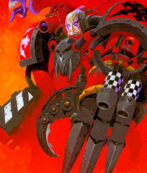
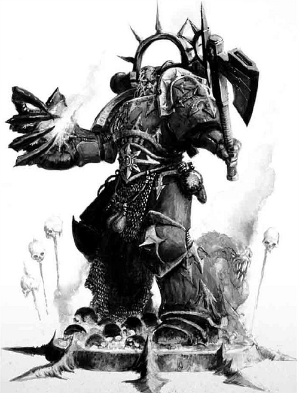
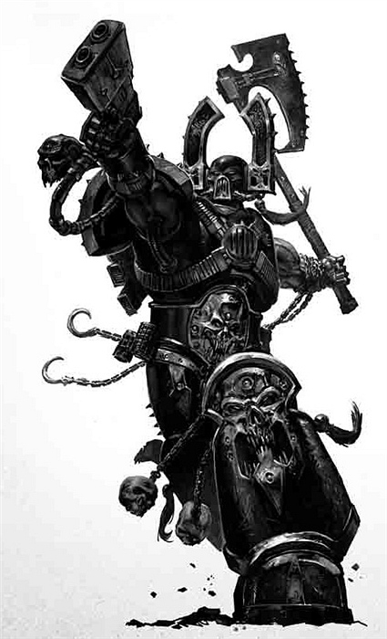
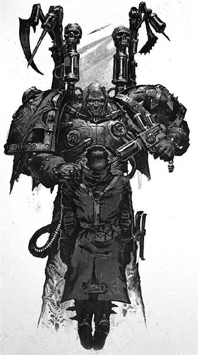
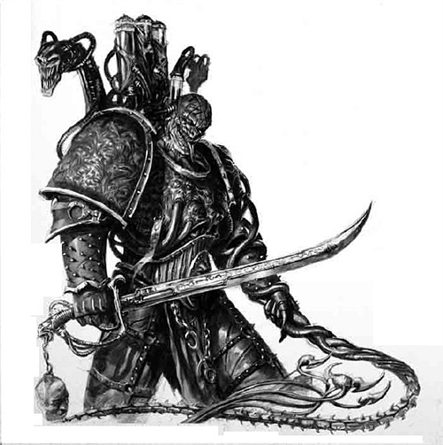
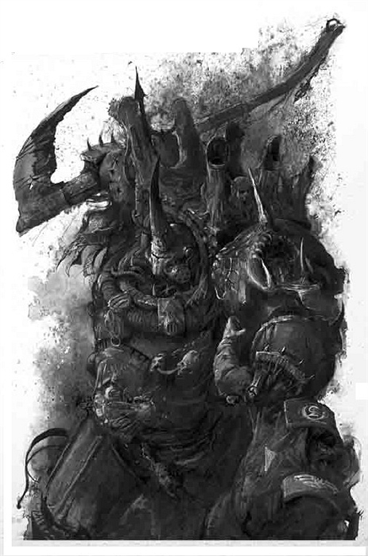
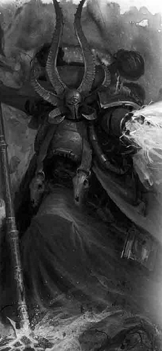
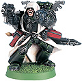
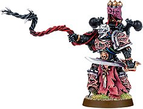
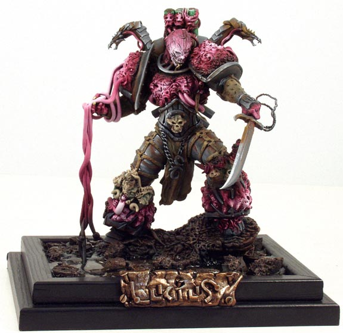

# 几个特殊人物的介绍

几个特殊人物的介绍

pierrekbdw

LUFGT HURON

Lufgt Huron,前Badab（战团母星）的统治者，曾经的Astral Claws战团的领袖。他曾是个成功的人，强壮而有智慧，但他对于帝国的信仰就没有这么强了，一个这样的人被提升为战团长是决不应该发生的。。。901.M41,他率领着Astral Claws战团攻击了一支机械神教派来的帝国调查舰队，舰队来此是为了调查为何他们没有上交每个军团都应作为什一税上交的5%的基因种子，同时他们也想知道为什么Astral Claws战团在过去一百五十年中拖欠了如此巨额的税务。Badab战争是帝国近代史上较为严重的一次叛乱，除了Astral Claws，还有数支星际战士战团加入了叛乱。到了903.M41,已有 Mantis Warriors, Executioners 和 Lamenters 与Astral Claws结盟，这几支战团一起对附近的帝国航运进行攻击和劫掠。904.一艘火鹰战团的船只被Mantis Warriors攻击，火鹰立刻展开报复。帝国又从远东星域调来Marines Errant 支援火鹰，但Marines Errant 几乎将全部战力都用于保护帝国航运，无力对Badab发起有力攻击。于是在906.另外两支战团红蝎（Red Scorpions）和米诺陶斯（Minotaurs）加入了战争，帝国航线受到的威胁才基本消除了。907.红蝎和火鹰回到了远东地区去执行他们原有的任务，Novamarines 和 Howling Griffons 被调来接替他们对Badab的平叛任务。星之幻影战团（Star Phantoms ）被授予了围困Badab的任务，另有2支战团被派往Mantis Warriors 和 Executioners 的母星进行调查。Lamenters战团在908.被米诺陶斯打了个埋伏，并在血腥的舰对舰的战斗中被击败，最终投降。至此，战争的主要形式变成了攻城战，最终在912.暴君Huron被击败，Astral Claws被击败，Badab重归帝国统治。战争结束后，Mantis Warriors, Executioners 和 Lamenters 得到了帝皇的宽容，恢复了星际战团的身份并加入了为期100年的远征来为自己赎罪。Mantis Warriors 和 Executioners的母星被没收，并作为奖赏授予了Space Sharks 和 Star Phantoms，以奖励这两支战团在平叛中所起的重要作用，其他参战战团也获得了搜刮战利品的权利。。。（土匪阿。。。）而Huron则带领了大约200名Astral Claws 战士突破了封锁，逃入了“大漩涡”（Maelstrom）之中。在此他们改名为红海盗（Red Corsairs），在几乎已经被完全生化改造了的Huron（也改名了，现在叫Huron Blackheart ）的带领下，对大漩涡周围的区域和帝国航运进行劫掠。Red Corsairs不断接受其他战团的背叛者来补充自己的兵员，其中甚至包括深红之拳和太空野狼。

pierrekbdw 关于红爪团长的介绍，这个是比较详细的

前一阵在一位朋友的贴子里写的是从wiki搞下来的， wiki上的介绍比较简单，这篇是照着CSM新的codex上的人物介绍翻的， 内容比较丰富，最近比较忙，草草翻译了一下，大家凑和着看看先， 其他人物的过一阵再翻。 

 

黑心王休伦——红海盗头领

 

     

Huron Blackheart

     

master of the red corsairs

 

         Lufgt Huron,Astral Claws战团战团长，Badab的暴君——Huron Blackheart，“红色海盗”（Red Corsairs）的首领,大漩涡之主，血腥剥夺者。同一个人——却在两个不同的时间都扮演了帝国最疯狂和最渴望力量的敌人的角色。在Badab攻略战接近尾声的时候，Huron在他的荆棘之殿（Palace of Thorns）里的最终决战中受了致命伤。Astral Claws的战士们曾发誓要为战团长和他们的家园战斗到死，但当看到Badab的沦陷已成定局，他们也只能分乘几艘小艇，在帝国军队的重重包围下为自己杀出一条生路。在逃出了Badab星系之后，为了躲避帝国战舰的追击，他们逃进了大漩涡（Maelstrom），与以此为巢穴的异星人，叛逃者和异教徒一样，潜伏了下来。 

   这位暴君活了下来。他的一边身体几乎全被热熔波烧掉了，在Astral Claws的舰艇在大漩涡内飘忽不定的气体和尘埃中漂流的时候，机械军士和医务兵不眠不休地对他进行生化改造。第八天时，Huron终于可以重新站起并穿上他的动力盔甲。他那些狂热的追随者们为他奇迹般的康复欢呼雀跃，然而对帝国而言，这却是一个黑暗的奇迹。 

   

Huron的部队虽然不多，但也足够攻下他们遇到的第一个海盗要塞，并对原来盘踞在这里的海盗展开屠杀。幸存的海盗发誓效忠于暴君并自愿成为他的奴隶，并很快领教了他的狂暴。Huron Blackheart从此诞生。有了更多的舰艇和人手，黑心王又能开始着手建立一个敬畏于他的统治的帝国。 

     通过不断把背叛者和异教徒招至麾下，Huron的势力迅速扩张。在用血红色的染料覆盖了他们盔甲上原有的帝国纹章和标志之后，他那恐怖的星际战士战团也正式成为了红色海盗。这一做法深得Huron的欢心，于是所有叛变的星际战士一加入他的部队就把自己的盔甲也刷成这个颜色，以示对他们新领袖的效忠。 

   

数十年间，红色海盗渐渐成为一支不可小觑的军事力量，他们也越来越频繁地——也更加残忍地——向大漩涡外进行劫掠。最糟的是，审判庭对于星际战士不断失踪，有时甚至是整小队地失踪的现象越来越头疼，这些失踪者再次出现时都是在黑心王Huron的队伍中。 

   近年来大漩涡附近的航运都采取了护航措施。商船都是在帝国海军护卫队的保护之下航行在那些危险的航线上，例如到Morgan's Reach,Tarturga VI,Verkruz和Zathatethus Grand的航程。这使得Huron和他的海盗们的日子有些难过了。 

     红色海盗的攻击也变得更加有耐心，他们会挑那些迷航的船只下手，或是在护卫舰队被其他威胁吸引走时才发动攻击。但当Huron亲自领导一次袭击时，红海盗们就大胆多了。他们会袭击护卫严密的船队，依靠自身的速度和在局部压倒性的力量，趁其他随航船只没来得及反应时掠夺战利品。以这种方式，红色海盗的力量还在不断增长，而Huron Blackheart的恐怖之名也早已响彻各个星域。 

 

 

         WS  BS  S  T  W  I  A  Ld  Sv       Huron      6  5      4  4  3    5  3  10  3+ 

 

装备 动力盔甲，动力武器，破片手雷和热熔手雷，个人标记，暴君之爪。 

 

特殊规则 独立人物，无畏，免伤保护 5+. 

 

The Hamadrya:Huron有一只不明物种的宠物，他称其为Hamadrya(沸狒？)。这只野兽似乎有一定的智慧，总是跟Huron呆在一起，通常呆在他的肩上，在危险时会藏在他背后。这个生物从不参与战斗或直接给与Huron帮助，但它似乎具有奇怪的精神能量，Huron可以加以利用。 

 

暴君之爪：暴君之爪是一只巨大的，熊掌般的生化义肢，安装在Huron肩部以代替他原有的臂膀。这是一个内置了重型喷火器的动力拳。   亵渎先兆        

THE UNHOLY HARBINGER与星际战士战团和军团的古老战舰一样，混沌星际战士们利用space hulk在亚空间穿行。Space hulk是的由小行星，宇宙垃圾和其他飞船残骸被亚空间应力拼凑而成的巨大飞船。大部分space hulk都在亚空间边缘自由漂流，但有时混沌叛徒们会将古老的引擎重新点燃，借助混沌巫师的力量操纵space hulk向特定的目标飞去。审判庭得知的最为声名狼藉的一艘space hulk是亵渎先兆号（Unholy Harbinger）。此舰被一支规模很大混沌军团的分遣队当作移动基地使用，这支部队包括了来自Black Legion,Death Guard,Sons of Vengeance,Anointers of Blood和Pyre的战士。它第一次出现在记录中是在来自Cloras星系的求援信息中——但他们并没有及时得到支援，Black Tenplars战团4周后到达那里时，整个星系成为一片废墟，半数的居民被屠杀。亵渎先兆号也被报告说在Gothic War的后期被目击，就在太阳星域长达三世纪之久的被称为痛苦之泪的分裂期间发生的Garipedes之劫之前，这艘恶名昭著的飞船在卡迪安之门附近被多次目击，或许是被阿巴顿发动的第十三次黑暗远征吸引到这个区域的。它也被审判官Czevak确认作为舰队的一部分参加了对Belis Corona的攻击，并且被认为参与了Dentor附近的舰队活动。Badab战争简介      

THE BADAB WAR587.M41 - Astral Claws战团进驻Badab，维护大漩涡西南边缘的安全。723-900.M41 - Astral Claws战团对用作分析的基因种子的呈交工作做得很消极。Badab的行星什一税没有完成。900.M41 - 审判庭向Badab派出武装舰队。901.M41 - Astral Claws的战团长，Lufgt Huron，下令摧毁进入Badab轨道的帝国调查舰队。超过23000名帝国代表死亡。Huron自立为“Badab的暴君”，并宣布他的星系脱离帝国而独立。902.M41 - 第一支派帝国讨伐部队被Astral Claws消灭。903.M41 - 第二支被帝国派出讨伐Badab的部队被消灭。903.M41 - 另外三个战团——Mantis Warriors,Executioners,Lamenters——宣誓支持Astral Claws，叛乱活动愈演愈烈。904.M41 - Fire Hawks战团的一艘船只被Mantis Warrios掠获，Fire hawks立即展开报复，五支整编战团卷入其中。905.M41 - Marines Errant被从远东星域调来参战，但他们疲于应付保护帝国运输线，无力进行其他作战。906.M41 - -更多忠诚的战团被调集来稳定局势，他们的加入几乎完全消除了帝国航运所受的威胁。907.M41 - Ork蛮人在Ultima星系的扩张使几支星际战士战团和帝国海军不得不调离，他们保障航线的位置需要另外的部队代替。于是Badab星系被完全封锁，个个星球都遭到帝国军队围困。另外几支战团对被Executioners和Mantis Warriors占领的星球进行试探性的进攻。  908.M41 - Lamenters战团的主力部队遭到伏击，在一场舰对舰的血腥战斗后，他们投降了。这是Huron方遭受的一场重大损失。908-912.M41 - 攻城战的不断胜利使Badab暴君的据点不断地减少，最终只剩下Badab行被团团包围。912.M41 - Astral Claws在荆棘之殿被最终击败，大约二百名幸存者带着受伤的Huron逃入了大漩涡。912.M41 - 如今，幸存下来的Lamenters,Mantis Warriors,Executioners被惩罚进行一场一个世纪长的征战来为自己的背叛行为赎罪。芬里斯之狼

THE WOLF OF FENRIS    红色海盗那些恶名昭著的传奇里最著名的一个要数俘获芬里斯之狼号了。在Paremxes附近的激烈战斗中，这艘太空野狼的突击巡洋舰遭遇伏击而被落入叛徒之手。  对于Huron和他的红色海盗而言，最迫切需要的资源不是别的，正是战舰。没有了舰队，潜藏在大漩涡中的这伙叛军就没法对帝国行运发起掠袭，也无力躲避前来讨伐的帝国舰队。他们最需要的是能够穿越亚空间进行星际航行的船只——以及能够操纵这些船只的船员。Astral Claws原有的古老舰艇是他们舰队的核心，但他们其他的船只大部分都是由商船改造来的，只勉强称得上战舰。在前去掠夺Parenxes星球的途中，当Huron的侦查艇回报说星际战士的巡航舰队正在等着拦截他时，血腥剥夺者决定为自己的舰队俘虏一艘舰艇。Parenxes之战    预先得到警报的Huron留下了几艘舰艇作为预备队。他采取了一条更加迂回的航线，到达了星系的另一端。在Death Hawks和Space Wolves的舰队前往拦截红色海盗时，Huron的援军从背后发起了攻击。星际战士舰队被两支叛军舰队夹击，只能各自为战，力图突围。这是场近距离的激战，有几艘星际战士战舰成功突围。Huron并没有像他以往的做法那样前去追击，而选择了集中力量攻击没有突围的两艘舰艇。  

Huron派遣了手下一艘战舰去监视撤退的星际战士舰队的动向，以防他们重新杀回。同时，他调动他的舰队张开一张大网，迫使那两艘被围困的战舰向Parenxes星靠近。Huron料到了他们会掉头前来作最后一搏，也很可能会自沉战舰以免落入他的手中，他故意在包围圈上留下了一个缺口。只是看上去有个缺口，实际上Huron的旗舰就埋伏在此，开到了最小动力，这样在远距离就不会被察觉。星际战士战舰果然注意到了这个“缺口”并向这里突围。其中一艘Flame Hawks巡洋舰在突围中损伤严重，Huron放走了它，因为他们没有能修复它的资源。另一艘战舰，突击巡洋舰芬里斯之狼号，它的引擎被打得脱离了舰体。如果太空野狼们意识到了他们可能被捕获，他们还是有机会自沉战舰的，因此Huron的旗舰还是隐藏着。Huron并没有发起全面的攻击，而是派遣一百二十名红色海盗搭乘载人鱼雷直接登舰攻击。初阵    红色海盗的载人鱼雷分成三波，在太空中几乎无声的漂流着。其中的五枚，搭载着五十名叛军士兵，采取短距离突进的推进姿态，向芬里斯之狼号的船尾前进。他们的任务是占领动力室和等离子反应堆，这样太空野狼们就无法用最快的方法摧毁战舰。  

这些鱼雷在到达距离战舰不到六公里的地方才被发现。几秒钟内，防御炮塔向他们发出了凶猛的火力。虽然拦截炮火是如此的猛烈，但只有一枚鱼雷被摧毁，其余的四枚正中目标。随着强有力的一击，载人鱼雷击破了攻击巡洋舰的装甲。装在鱼雷前段的破片弹发射器爆炸了，发射出一阵风暴般的散弹以清除舰舱内的防御者。穿着轻型护甲的战团奴工——星际战士战舰中主要的船员——成群的倒下，像被收割的庄稼一般。接着闪光弹爆炸了，发射出炫目的闪光，侥幸躲过刚才弹雨的人不是瞎了就是被震昏了，鱼雷前端如花瓣般打开，红海盗们蜂拥而入。  

他们的自动感应器并没受鱼雷发射的闪光弹影响，叛军们倾斜出冰雹般的矢弹弹幕。没被扫射打死的奴工也很快被冲到跟前的链斧和链剑砍杀，红海盗们不到半分钟就占领了等离子反应堆周围的控制室。太空野狼的一位钢铁牧师组织了一次反攻，但当红色海盗们的镭射加农炮和热熔枪投入了战斗后，反击很快瓦解。海盗们还使用了热熔炸弹破坏住反应堆室的入口，在第一波进攻后五分钟内，Huron的手下就完全控制了芬里斯之狼号的船尾部分。主攻    凭借对星际战士战斗方式的了解和对攻击巡洋舰舰体结构的知识，Huron发起了第二波的进攻，目标是距离舰首跃1/3舰长的地方。三十名红色海盗攻入了位于此处的储藏舱，在狭小的舱内他们遇到了两个太空野狼小队的抵抗。双方狭路相逢，先是在近距离用矢弹枪互相开火，接着就是激烈的肉搏战。双方的战士混战在一起，用矢弹手枪，链剑，匕首，甚至牙齿——仅限太空野狼一方——向对方攻击。这场战斗血型而短暂，最终海盗们占领了这个舱室，并迅速扩大战果。正如Huron预计的那样，野狼们正要集结力量对动力室的叛军进行反击，这里是必经之路。红色海盗们迅速设置好了临时路障，并架设起重型武器，重型暴矢枪和镭射加农炮对准了入口。野狼们正撞在了枪口上，他们被打得七零八落，只能被压制在等离子反应堆室周围的几个区域。  

正是这时Huron发起了第三次进攻。血腥剥夺者一马当先，带领着海盗们直接向舰桥发起突袭。Huron引导着他的登舰小队在距离控制甲板不到50米的地方打开了突破口，他冲在队伍最前面，率先冲向通向舰桥的那扇厚重的装甲门，无情地收割着挡在他前面的太空野狼战士的生命。入口周围的防御被清除后，红色海盗们弄来了一具相控力场发生器来打破那扇强化钛合金大门——这具仪器一直由前Astral Claws的首席机械军士Armanneus Valthex来维护。在架设仪器时，Huron带领着手下随时准备应付野狼的反扑。剑桥内的野狼指挥官们向在动力室附近的部下呼叫支援。他们留下几个小队以防备舰尾的海盗发起进攻，同时开始准备进攻围困舰桥的Huron。这时在第二波进攻中登舰的三个小队的红色海盗发动奇袭，野狼们遭到了他们和在舰首的血腥剥夺者的后卫部队的两面夹攻。在几分钟内野狼就遭受了惨重的损失，他们不得不放弃进攻Huron，而转向甲板上的机枪平台突围。Huron又派遣了两个支援小队，他们连续不断的火力压制让野狼们动弹不得。狼之殇    在后卫部队的保护下，Huron的机械军士们成功启动了相控力场发生器。这架仪器生成了一个小型的虚空力场，在大门装甲上生生蒸发出一个完美的圆形缺口。红海盗们照例是一串破片手雷开路，在Huron的带领下旋风般冲进舰桥。舰桥内的高级船员只有寥寥数人，但他们仍力战至死。战舰指挥官Gnyrll Bluetooth（蓝牙）挥舞着动力斧与Huron力战数合，但却无法伤及暴君厚重的装甲分毫。作为对这样一位对手的回应，Huron用他的暴君之爪将这位野狼指挥官斯成了碎片，并拔下了他的长牙作为此次战斗的纪念。占领了舰桥和动力室后，Huron下令将整艘舰停了下来，并发信号让他的旗舰全速靠近进行全面的登舰作战以肃清残敌。  

海盗们在人数上有了压倒性的优势，从舰首到舰尾的残余抵抗被很快扫清。一位伤痕累累，头发已经变灰的野狼牧师仍在领导着那些被压制在机枪平台中的野狼们，在他的战吼声中，在他对叛徒们的仇恨的感召下，这些野狼战士凭借意志和决心奋勇作战，以一当十。局面一时相当复杂，有一个时刻看上去他们几乎将要把海盗们赶下甲板了。突然，毫无预兆的，一些野狼战士将枪口转向了他们的兄弟们，他们屈服在血腥剥夺者的威势之下。他们背叛了曾向他们的战团，向狼王Leman Russ和帝皇所立下的誓言，转而向Huron发誓效忠。作为对他们的奖赏，Huron授予了他们芬里斯之狼号的指挥权。  

此次登舰作战行动历时近四个小时，很多红色海盗在行动中丧命。他们的基因被收集起来，与那些阵亡的太空野狼的战士的基因一起被交给了Garreon，他曾是Astral Claws的首席医官，如今则以死尸大师Corpsemaster之名为众人所知。    这就是黑心王Huron最引以为傲的战利品，芬里斯之狼号。

windyday

支持，那个Hamadrya确实长得象狒狒的说……给你补张图：

其他的混沌英雄：

背叛者卡恩

怪叔叔法比乌斯

不灭的露西斯

瘟疫散播者泰弗斯

阿里曼

redkane

食世界团的卡恩，一个疯子和杀人狂，狂乱后砍自己人。帝王之子的卢休斯是一个杀不死的40k版杰森。。。可惜没有冰球面具

exar_kun

Huron最后被车的只剩半边身体,靠机械活下来.卡恩被叫背叛者是因为那家伙在某次战场上,把所有人都杀掉了,包括皇帝儿子团的敌人和自己的吃世界团

兔子半妖

卡恩的故事GW方面都有数个版本，从砍全部人到砍自己人到拿喷火器喷房子逼人砍人之类Kharn的没有明确解释，是说要么是大神爱他，要么是他的砍人魂拒绝离开

pierrekbdw

抽空又翻了篇文章。 译自某期《白矮人》的Heros & Villains栏目。 介绍一位堕落的黑暗天使Cypher，其形象见小弟的头像。。。 其实文章里大段都是黑暗天使的战团史。。。 堕天使Cypher  “我不知道他是帝国未来最重大的威胁还是最伟大的希望。我只祈求我们在能确定之前先阻止他。”                   

——审判官Bastalek Grim     Cypher是一个谜一般的不祥之人。他总是神秘地出现，带来死亡和毁灭，然后又如来时一样突然地消失。然而奇怪的是，Cypher本人极少直接挑起这些总是伴随着他的出现而发生的暴行。他更像是一剂催化剂，将仇恨和误解催化为无法控制的狂暴怒火。 

Cypher也是一个沉默寡言的人。当他开口时，所说的话也都是简洁明了。他的真名已无人知晓，与他接触的人也没有胆量去问他的名字。然而，他所穿的僧袍下偶尔露出的黑色动力盔甲表明，毫无疑问的，他是一名堕天使。在很多方面，他都是堕落的黑暗天使的命运的集中表现，在无尽的时空中徘徊，永无回归故土之日。 堕天使们诞生于荷露斯之乱结束之后，黑暗天使军团的基因原体Lion El'Jonson回到母星Caliban之时。当Jonson的舰队毫无防备地进入星球轨道时，遭到了防御火力猛烈地打击。Jonson被这莫名的攻击打懵了，只好撤退并试图弄明白母星上到地方生了什么事。 

一艘被俘获的商船很快地供了答案。在Jonson参加大远征而离开Caliban的日子里，Luther,他的副手与一生的兄弟，被留下来领导留守母星的兄弟。与Luther在军团中的重要地位不同，这一任务并不适合他满怀雄心壮志的个性，很快，这种在一个快被遗忘的偏僻星球上充当管家的角色就看上去更像对他的侮辱而非信任了。嫉妒的种子在滋长，使Luther变得越来越迷乱，并最终越过了理智的界限。他成了混沌诸神的牺牲品，他们用自己恐怖的力量使Luther成为了他们的信徒，并变得难以置信的危险。运用他著名的雄辩口才，Luther使留守的天使们确信他们遭到了羞辱，帝皇已抛弃了他们。在大远征期间，Luther不断地向他麾下的天使们灌输他那由嫉妒而生，由混沌滋养的邪恶意识。当Jonson归来之时，这种恨意以公然背叛的形式爆发出来。 

Jonson和依然忠诚的天使们对这一背叛行为怒不可遏。Jonson立即亲自带领了一支部队向Luther的指挥团队发起了一次攻击。两位半神一般的领袖不相上下，风暴般强大的重击不断落在两人身上。他们的打斗也在不断撕裂着他们所在的修道院，直到将这座宏伟的建筑夷为平地。同时，舰队的巨炮也在不断轰击着这个星球，Caliban的大地终于无法承受这样的打击，开始崩裂和扭曲。 

就是在Caliban开始分崩离析之时，Jonson与Luther之间的战斗也进入到了顶点。借助混沌的力量，Luther发出一记威力巨大的精神攻击，重创了Jonson，将他打得跪倒在地。垂死的基因原体挣扎着想要站起来，昔日高贵庄重的仪表，如今在剧痛的折磨下只有痛苦扭曲的表情，这时，似乎Luther眼中有一片浓雾消散了。他仿佛意识到了自己的所作所为，意识到了他对挚友，对军团，对帝皇的背叛。现实让他的心智彻底崩溃，刚才狂热的战意一下全部消散，Luther颓然倒在他挚友的身旁。 

Luther内心痛苦和绝望的哭喊也投影到了亚空间中，这让邪神们明白，他们又一次失败了。在挫败感带来的狂怒之中他们出手了，宇宙中出现了一道裂缝，一阵空前强大的虚空风暴吞没了Caliban。随着一阵强大的精神洪流漩涡，亚空间侵入到了物质世界之中。 

那些曾追随Luther的“堕落的”黑暗天使们，以及Luther的秘密教会的大导师们被从Caliban吸入了亚空间之中，他们又从那里辗转逃向了银河的各个角落。而本就被轰炸的脆弱不堪的Caliban，也被撕裂成碎片并被吸入亚空间之中。 

这段关于变节与背叛的往事是黑暗天使军团最不为人知的隐秘伤疤。只有极少数人知道事情的真相，即便是在军团内部，也很少有人了解那改变命运之日的确切情况。只有当一名天使被允许加入死亡之翼连队时，他才会听到关于Luther的背叛的故事。更加恐怖的是，他们也会获悉仍有许多跟随Luther一同叛乱的天使仍然活着。这些被诅咒的战士就是堕天使。 

并不是所有的堕天使都同样地屈服于混沌的力量。他们中的确有很多人信奉黑暗诸神并已完全转变为混沌军团中的一员。然而，另外有一些堕天使则认为他们在Caliban毁灭之日的背叛行径是一个可怕的错误。但由于曾受到混沌邪神的腐蚀，他们遭到同伴的唾弃而无法再回到军团之中，他们只能孤独地游荡。他们中的很多人成了雇佣兵，无依无靠地在银河中漂泊。还有一些人希望能够弥补他们的罪过，希望通过这样的努力能够重新成为人类帝国的一员。 

但是，堕天使们在Caliban之殁之后的行为在黑暗天使的眼中都无关紧要，他们相信只有找出所有的堕天使并保证他们都被干掉或是让他们忏悔，才能彻底洗涤所有黑暗天使身上的耻辱，恢复他们在帝皇眼中的荣耀与忠诚。这一使命异常艰巨，堕天使们散布在时空的各个角落，都是单独一人或是集成极小的团队，黑暗天使们可能追寻数年也得不到一点能找到堕天使的线索。一旦他们循着这样的线索成功抓到了堕天使，他们会将他带回军团的主修道院，天使之塔。在它深深的地牢之中，审讯牧师会试图使堕天使做出忏悔。偶尔他们会因忍受不了痛苦而忏悔，然后得到痛快的死亡。然而更多的情况是，堕天使们拒绝忏悔，在这些能够拯救他们灵魂的牧师手里承受着漫长而备受折磨的死亡。 

而有一些私下里的传言说，Cypher实际上是堕天使们得到救赎的唯一希望，他的行踪看似诡秘，实际上他是在穿越银河向地球前进，向着帝皇本人前进。循着这一思路推测的人同时指出，Cypher随身携带着一把剑，但他从未在战斗中拔出或使用过它，这把剑应该就是传闻中的狮王之剑，就是那把狮王El'Jonson本人亲自挥舞着斩杀了无数帝国敌人的宝剑，人们本以为它在基因原体与叛徒Luther的最终之战后永远遗失了。这种推测是否正确还不得而知，然而可以肯定的是，Cypher每在一个地方出现，大批的堕天使也会随之前往，但没人知道他们为什么而聚集。 

或许正是因为如此，黑暗天使军团内部圈层的成员们比起其它堕天使来更加憎恨和惧怕Cypher，他们不惜采取一切手段，哪怕这手段是多么的卑鄙下流，也要将Cypher捉拿或处死。但他们至今仍未成功，这也充分说明了Cypher逃脱的本事有多高明。 

Points/Model WS BS  S  T  W  I  A  Ld  Sv Cypher        151        5  5  4  4  3  6  3  10  3+ 在游戏中CSM或是IG都可以使用Cypher,作为一个特殊人物。他算作一个精英，独立人物，但在游戏中不能使用任何一方给予他的其它装备和物品。 战争装备：Cypher装备着一支大师级矢弹手枪和一支大师级电浆手枪。 特殊规则： 星际战士：所有星际战士的特殊增益Cypher和其它堕天使们也都同样享有。 堕天使：如果你的部队中加入了Cypher，你也同样可以加入一队堕天使。他们可以看作是一队混沌星际战士，与CSM拥有同样的规则。堕天使对于黑暗天使有着强烈的恨意，所以在进攻回合中他们必须优先攻击处在他们攻击范围内的黑暗天使部队。如果Cypher加入了一队堕天使，而这队堕天使在规则约束下强行攻击黑暗天使，那么Cypher也必须跟着攻击。 憎恨：Cypher的出现总是会为他带领的部队带来混乱与敌意。当Cypher加入一个小队时（除了堕天使小队），每回合开始时都要投一个D6。当投点为1时，这个小队的成员就开始起争执，并在接下来的这个回合内遭受Ld-1的惩罚。这一规则不适用于其它独立人物或车辆单位。 神圣护佑：当Cypher被杀或W减至0时，他会从战场上消失，需要从游戏中移除。移出Cypher会为对方玩家增加他的胜利点数。如果任务需要对方玩家抓获Cypher，那么在他被“干掉”时要投一个D6。投点为6时，Cypher将被抓获。当然很快他就会逃脱了，在他神秘的守护神的护佑下疾驰而去。 枪手：Cypher是一个大师级的神射手，他可以同时双手持枪瞄准射击。这项能力使他可以在射击回合中用两个武器射击：大师级的矢弹手枪和大师级电浆手枪各一次。当他没有移动时，他可以同时使用两支手枪进行快速射击（Rapid Fire），一共射击四次。Cypher的手枪技术在他进入肉搏战时同样能发挥作用，在近战中他相当于装备了动力武器并获得相当于装备了两把近战武器的+1攻击奖励。 被黑暗天使追杀：Cypher这个名字承载了太多黑暗天使的仇恨。自Caliban之殁后，死亡之翼与乌鸦之翼连队就在全银河内追猎他。在进攻回合中，所有的黑暗天使人物都必须优先攻击Cypher。 一些传闻：     帝国的每一个星域，事实上是每一个行省都有一段关于Cypher的传奇，其中有些故事甚至可以追溯到几千年之前，悬赏捉拿他的赏金已积累到足够买下一个区（subsector,就是比行省sector低一级的行政区，详见CZ75兄的《人类帝国概况》一文）。很明显，Cypher的传奇如此广为流传，与帝国中某些不信奉国教的异端有关。这些自欺欺人者执着地相信帝国统治层试图压制人性，同时，出于反抗心态，他们也下意识地对这名独来独往的神秘人物心怀崇敬。 

Cypher已成为这些神经质的激进分子的精神偶像。他以兜帽遮面，这很清楚地表明他是一名不想被人出来的逃犯，这一行为相当的愚蠢，因为人人都能一眼认出他来！事实上，大部分对Cypher的目击都是将一些装扮与其相似的人臆想为其本人。任何煽动叛乱和反抗镇压的人都被大众在想象中冠以Cypher之名。所有的传说着重描述了Cypher惊人的枪法：通常他都被描绘成手持双枪弹无虚发的形象。这种双枪客通常是居住世界中的游荡者的特有形象，尤其是一些逃犯，与Cypher一样行踪神秘。这一类的“目击”显然只是一些缺乏教化的人胡乱想象的产物，而非准确的观察。最后，也是最让人感到困惑的是，对于Cypher所携带的剑的大量描述。并没有确切的那把剑曾拔出过的记述。然而，在传闻中那把剑通常被描述为一把断剑，而且似乎与黑暗天使军团早期的历史有关联。这与黑暗天使是否有关是很难证实的，这是阿斯塔特修会最隐秘的情报。但据我们所知，黑暗天使们和他们的大导师有时会称自己为“未获原谅之人”，而且常常在即使未获官方批准的情况下也前去追猎帝国叛徒和变节的星际战士。有人猜测Cypher是黑暗天使曾经的一员，他所携带那把剑或许是黑暗天使上古时代的神圣物。这纯粹是对帝皇最忠诚的战士的诽谤和侮辱。 

摘自《异端学说大全》         

——Elyass Vallkante主教著     在灭绝世界Cthelmax之上，我们的机械神教探险队到达了破碎荒芜的岩层之下的废墟中。几只先前到达此处探索的探险队已神秘失踪了，但这次的探险是在一个整编连的老兵和一队星际战士的护卫下进行的。在我们到达了上一支探险队的探索遗址时，眼前的景象深深震撼了我们：这里正进行着一场战斗，一方是一群身穿黑色盔甲的战士，另一方是有着奇怪的银色皮肤的金属物体。他们在一个通向黑暗的有着玉质脉络的曲折门廊前战斗，一个有着闪光的金色皮肤的东西在很轻松地屠戮这些战士，它的手臂随意地挥舞一下，就有一名战士倒地。 

但我又看到，在这些黑甲战士当中，有一人在战场上穿梭奔跑，他手中的两支手枪不断地射击，所有的攻击都被他躲开了。当那个金色生物转身面对他时，他用一把闪亮的银色匕首斩向它的躯干。利刃一击中就被从他手中拉脱出来，并完全没入那金色生物的身体中。战斗依然持续着，突然一股黑暗的纱幔罩在了战场之上。我再看过去时，那里好像什么都没发生一样，刚才的战场已空无一人。 

探险家Majoris Doreth于.M41来自Cthelmax-第一现场的目击报告[被查禁]     你可以说他根本不存在，但我比你知道得更清楚些。当我在73年在矿石运输船上工作的时候，有一次我们停留在Dagohma星作休整。这时矿主派来了他们的雇佣兵来清除来自Shantos Hills的殖民地居民。居民们都准备整理行李逃命去了，这时他到了这里，他的神勇表现和话语给了居民们莫大的勇气。不久之后，雇佣兵营地被居民们包围。他没有留下来到攻陷营地的那一刻，但自那时起，没什么能阻止得了居民们了。他们席卷了所有的矿区，将矿主们吊在他们挖矿的机器上。没人能做到像他那样——所以就算大家不知道他的真实姓名又怎样呢？几周后星际战士的死亡天使战团来了，他们是来搜寻他的，但人们什么也没告诉他们，即使他们被判叛国并受到严刑审问。没人会忘记他为他们做过什么。他们是带着尊严和自由而死的。 

Arsann Crowe     

惯犯，异教徒 发送方：Phaleg追猎舰队 接收方：天使之塔 收信人：大导师Azrael 截取/转发：没有被截取/严格限制在内部圈层成员间 日期：367/999/M41 传送通道：书记员Kheros Ref:FLN/30724592/IP 发信人：审问牧师Phaleg     塔罗牌的占卜还是如往常一样正确地指引着我。在Amistel,我抓获了三名“帝皇之声”异端组织的三名成员。他们证实了很多情报。他们接到了来自他们的组织活动最活跃的Lelithar来的命令。他们对他们的异端偶像Magos的描述与堕天使100号的特征非常吻合。我敦促您立即带领天使之塔现有的和我们战团所能动用的全部战力立即赶往Agrapinna行省。100号的诡计已使整个行省动荡不安，并激起了来自教会的强烈反应。秘密抓捕行动已不可能成功，我们必须倾尽全力来搜捕他。他在距离Caliban的遗迹如此近的范围内多次如此公开地露面，我们的时间已经不多了。 

大门即将要封闭，我们清算与堕天使的宿命纠葛的时刻即将到来。

Typhus,the Traveler,Herald of Nurgle

“看着我，我可随意取你性命。你没有机会，除非，回望你内心深处的那抹黑暗，在那里，瘟疫之父Nurgle在等着你献上生命向他屈服。拒绝他吧，你就是我的了。” 

当死亡守卫的基因原体莫塔利安率领着他的军团加入战帅贺鲁斯反抗人皇的大军中时，他没有意识到，他将为此付出多大的代价。然而军团中却有一人完全了解，他就是提丰，他已在基因原体成长的蛮荒世界Barbarus随很多人加入了军团。 

在年轻时，莫塔利安就已推翻了母星上这些怪物的统治。然而，他们的许多混血后代却活了下来。血缘很难查清，莫塔利安也有很多更紧迫的事要关注。提丰就是延续着这血脉的一员。他拥有异常强大的心能，这使他可以在Barbarus星球上裹尸布般的迷雾中自由行动。这股能量在当时很大程度上还处在潜伏期，在后来的训练中不断地被激发出来。 

当死亡守卫开始在Barbarus募兵时，提丰的战斗技艺让他脱颖而出。在现代，募兵过程比那时要刺激得多——也应该如此。这很大程度上是由于要保持基因种子的纯洁性，因此一支千人的星际战士战团对那些受选者要挑剔得多。而在大远征时代，军团需要的新兵只要是身体健全并有勇气跟随基因原体奔赴战场就可以了。因此当人们发现提丰是一个灵能者时，欣然接受了他，因为当时军团正在组建智库馆员队伍以增强实力。这就是死亡守卫如何容留了一个被污染了的灵魂。即便是在莫塔利安带领着军团在大远征的征程中时，提丰也与黑暗之力有着紧密的联系。他们已选中了他，在混沌诸神的帮助下，提丰升任Captain-Epistolary,成为战列舰Terminus Est号以及一整连死亡守卫的指挥官。当军团加入贺鲁斯叛军时，是提丰以军团导航员仍忠于帝皇为由杀死了他们。是提丰同时向莫塔利安保证，以他的灵力可以带领死亡守卫穿过亚空间，向地球进军，亦是提丰带领着他们走向永久的诅咒，无助地在亚空间中漂流。 

向地球进军的航程是这支变节的军团第一次为背叛帝皇付出代价。这是一段将他们引向恐怖地狱的噩梦之路。时间在亚空间中的流逝变化莫测，提丰将他们引入的折磨可能持续几天，也可能长达几个世纪。最终，死亡守卫旗舰Termunus Est号上的所有成员已无法分辨他们被困了多久。当恐怖的阴影完全浮现时，他们已无力抵抗。       

死亡守卫们被一种毒性如此猛烈的瘟疫一个接一个地感染了，即使他们的多肺和卵石肾脏也无法保护他们。他们意识清醒，却又昏昏沉沉，无力做任何事，只有忍受着遍布全身的灼烧感。只有强烈的生存本能支持着他们。 

这种本能被痛苦压制到了最低限度，亚空间防护装置发出的嗡嗡声突然消失，取代它的是来自遥远地方的振颤，并且在不断地加剧。突然，这振颤变成了上百万对翅膀扇动时发出的轰鸣，无数黑色的鳞茎状的，亚空间孕育出的飞虫涌进了每个舱室。Nurgle最为污秽的瘟疫，毁灭者降临了。飞虫满覆昏迷的死亡守卫的身体上，吸食他们的汗水，感染他们的伤口，在口鼻中滋生。 

全船的死亡守卫们的身体都变得不听使唤，瘟疫飞虫们在他们的体内产下了卵。脓血充满了他们的身体，甚至盔甲都膨胀了起来。他们的身体不断胀大直到爆裂，只有内脏悬挂在残破的身体上，脓液感染了全身的皮肤。舰桥上，提丰是第一个被感染的人。挺过了死亡的毒沼，他又站起身来，从灵魂深处发出了一声巨大而又冷静的吼叫——“More.” 

整艘舰内的飞虫都离开了他们的宿主而飞向提丰。它们潮水般涌入他的身体，那巨大的身形不可思议地仍然屹立——那已不是提丰了。现在，他是毁灭蜂巢的宿主，莫塔利安最宠爱的儿子。现在，他是Typhus。 

他已收到了他真正的主人，腐败之主Nurgle的奖赏，甚至在莫塔利安堕落之前，他就开始侍奉这位邪神。即使Typhus归属于莫塔利安的麾下，也只有Nurgle才是他真正的主人。 

在恐惧之眼中，莫塔利安再造了一个类似Barbarus的恶魔世界.Typhus对这种伤感的怀旧情结弄得非常恶心。他的忠诚只属于Nurgle，而只有凡人在死亡的恐惧前颤抖时，Nurgle的力量才达到极盛。于是Typhus带领着他的追随者和战舰回到了物质世界，旅行者，Nurgle的使者的传奇由此诞生。Nurgle授予他的奖赏就是宣告了几十个星球的毁灭和无数被折磨的灵魂。 

WS  BS    S      T    W    I    A  Ld  Sv Typhus        5    5    4    4(5)  4    5    3  10    2+ 战争装备 Nurgle印记，终结者装甲，个人标记，人类收割者。 特殊规则 独立人物，无畏，无痛感， Nurgle使者：Typhus是一个灵能者，拥有混沌之风与Nurgle之腐两项精神能力。另外，Typhus在使用这两项能力时，总能成功通过灵力检定（因此也对Perils of the Warp的效果免疫）。

人类收割者：这件致命的武器的外形是一把巨大的镰刀。人类收割者既是一把恶魔武器，也是一把Force weapon。这把武器一般被当成普通的恶魔武器，额外的，如果有任何人物被这把武器伤害而未致死，在Typhus一次成功的灵力检定后也会被杀死，也遵守普通的force weapon的规则。即使Typhus已在此轮中使用过一项精神能力，他也能进行检定。 毁灭蜂巢：Typhus的身体中栖宿着恐怖的瘟疫飞虫，这些飞虫会从他盔甲的破洞中涌出。这算作Typhus使用破片和细菌手雷。 卡迪安星系，2675999.M41     Terminus Est号的传送舱中满是蠢蠢欲动的不洁生物。曾经满是先进电子仪器的舱壁上如今不断地渗出粘液，诡异地翻腾扭曲着。Typhus就站在房间正中。 

他蜷缩着。头盔上的独角有规律地一点一点，五支畸形的绿色蜡烛摆成了五角型，每支都躺着蜡油，并散发出污浊的浓烟。随着浓烟慢慢升起，Typhus周围大量的飞虫从盔甲上的破洞涌进他的身体。在他脚下，一层地毯般的尖叫着的Nurgling（一种Nurgle恶魔）不断向他聚集。蜡烛发出的浓烟在他周围形成一个圆环，并且在他身边越转越快。Typhus用他那把巨大的镰刀柄敲了下地板，浓烟汇聚成了一股。第二下敲击，房间里突然空无一物，Nurgle的使者传送到了别处。 

那是个无月的夜晚。大雨模糊了视线，炮火的轰鸣声震耳欲聋。Typhus站在一处精心修筑的通讯站壕中，两边是惊恐地注视着他的卡迪安士兵。瘟疫的力量自他体内发动，并蜂拥而出，一片黑云吞没了这些卡迪安军人，那是来自Nurgle的毁灭飞虫。有些人甚至在Typhus亲自动手前就迅速地死于感染，他们的身体因病变而变成了脓血。

Typhus大步在这片毒瘴中穿行，他的镰刀在他身前呈8字形地挥舞，轻易地将一个个身体撕成碎片。大片Nurgling跳跃着冲在它的前面，爬满了倒下的士兵的面孔，死死拖住那些试图逃跑的人。 

卡迪安军人尽力反击，但他们的激光枪在Typhus巨大的终结者装甲表面甚至留不下伤痕。没人能逃脱人类收割者的死亡之网。他沿着战壕一路行进，一路收割着卡迪安军人的灵魂。军官们高举着精工动力剑冲向他，但一个个都被肢解。不一会儿，就只剩下了雨，只剩下了飞虫和恶魔的尖叫，那巨大的，独角的死亡化身行走在战壕之间。就如同传说中的海洋巨兽，Nurgle的使者以十计，以百计地屠杀着人类。在他身后，留下一条死亡之路，无数的尸体上长满了脓包，脓包破裂后又飞出更多的飞虫。这篇战场上的杀戮方式又多了一种。疾病已开始生根，蔓延，曾经固若金汤的防御据点已成为一块脓疮。 

Typhus满意地点点头。卡迪安军人都是勇猛顽强的老兵。他们无法将这次的失败归咎于“无数的混沌部队”。他们很清楚，是一位Nurgle的勇士屠杀了整个连队，他们也感受到了恐惧。这种恐惧会始终侵蚀着他们。这段故事会被广为传播，许多人会逃走，剩下的人就只会颤抖。距离卡迪安的陷落又近了一步，Typhus和他的邪神热切地盼望着这一天。 

Terminus Est号     Terminus Est号是帝皇亲自为死亡守卫设计的一艘最重要战舰。它有着大远征之前时代的独特设计，参照着这一设计，掠夺者级于M36被建造出来。但人们普遍认为，这艘早先建造的战舰要比他后来的复制品要强大得多。 人们对Terminu Est号在贺鲁斯大反乱之前的情况知之不详。仅有的资料显示，它主要被作为一艘行星攻击舰。这种说法应该比较准确，Terminus Est与星际战士军团中用作相同用途的战舰的设计非常相符。许多这种战舰都在大远征中由于系统故障而报废，直到今天帝国也无法修复。因此，许多这类战舰上的操 控系统被替换成了效率较低但很好维护的版本。

Terminus Est在大反乱时期的用途就知道的更清楚些。在Istvaann，它遭遇并摧毁了暗鸦守卫的旗舰帝皇之影号。这次遭遇也有可能是最早有记录的专门 装载攻击机的战列舰间的战斗。这次战斗非常迅速，并使仍保持忠诚的军团在接下来的屠杀事件中完全丧失了空中支援。   当Terminus Est被目击加入了贺鲁斯向地球进军的舰队时，这艘船完全改变了。Nurgle的标志出现在它和其他所有死亡守卫的战舰上。当莫塔利安带领部 队攻击雄狮之门空港时，Typhus指挥着瘟疫舰队并且，这段记载有些争议，对帝皇宫殿进行了轨道轰炸。

随着贺鲁斯战死，忠诚的战团的援军也已到来。 Terminus Est舰上强大的攻击机预备队被派出作为向舰上撤回的死亡守卫的后卫部队。他们与剩下的变节 军团一道逃进了恐惧之眼，从人类的记载中消失了几个世纪。     在恐惧之眼中，据说背叛军团之间爆发了战斗。让死亡守卫们自豪的是，他们的基因原体被晋升为恶魔亲王，并在恐惧之眼内征服了大片领地，按照自己的口味加以改造。在M35，Terminus Est和死亡守卫第一次被再次目击，他们将瘟疫带到了Agripinaa星系。他们成功地击败了前去征讨他们的帝国舰队，这在帝国海军中引起很大反应。M36，一支机械神教探险队在毁灭世界Barbarus找到了混沌战舰的设计图，并开始制造剥夺者级战舰。机械神教对核心技术知之甚少，剥夺者级的亚空间防护盾的设计存在致命的缺陷。在接下来的几个世纪中，这一级的战舰不是在亚空间中失踪就是叛变，掉转炮口开始攻击自己人。 Terminus Est与Typhus并没有在哥特战争中扮演重要角色，在Anvil 206附近的一次目击是他们仅有的一次现身。但是，从后来的事件追溯到Anvil 206,很显然当时Typhus的任务已经完成了。现在，M41,Terminus Est是帝国史上已知最古老的一艘战舰。Nurgle的力量包裹着它古老的船体，毒性最猛烈的瘟疫在它潮湿的船舱中翻滚。Nurgle令Terminus Est在它受诅咒的船长的指挥下在星际间传播死亡。帝国海军将不懈地追猎Terminus Est，直至他被彻底摧毁的那一日。 

redkane

typhon这个名字其实该叫“提丰”熟悉希腊神话的应该知道有一群超级废柴的怪物帮。typhon这个家伙就是怪物帮的父亲，包括尼米亚巨狮和九头蛇许德拉，奇美拉和哈迪斯的宠物犬都是它的儿子。早年和宙斯干架被雷劈死后尸体还被镇在奥林帕斯山下，他的儿子们则被宙斯的暴走肌肉男儿子掐死，用木棒砸死，用火烧死。。

卢修斯——打死我也不死Lucius The Eternal

Slaanesh的champion，也被称为灵魂盗取者，富根的champion，血之子嗣。大叛乱之前

-----------------------------------------------------------起初，他是帝皇之子第13连的连长。他以剑术高超而闻名，据说在整个大远征中在剑术上未逢对手。唯一的一次比剑失败，是输给了影月之狼的一位连长Loken，但当他们再一次较量时，卢修斯是胜利者。（Loken并没有叛变，而是仍然忠于帝皇）帝皇之子中的其他人认为卢修斯是一个骄傲的，有勇无谋的，有时有些孩子气的人。他在军团中最亲密的朋友Saul Tarvitz 也对他心存提防。在伊斯塔文III号的叛变事件中，卢修斯发现他所爱的军团背叛了他，于是他与Saul Tarvitz和军团中其他仍忠诚于帝皇的战士并肩战斗，但当Saul Tarvitz在忠诚者中获得了声望后，嫉妒心使他选择了加入背叛者一方，对名声的渴望胜过了荣誉感，他攻击了本来归自己指挥的三十名战士，但他不是一个人在战斗！~（这段挺贱的。。。）当时Solomon Demeter 连长碰巧路过，卢修斯大声呼救，于是这位连长就以为卢修斯是在跟背叛者战斗。。。。。。在干掉了三十名战士后Solomon Demeter 觉得有点不对劲了，于是这两位本来就互相不怎么喜欢的哥们又开始互掐，最终本来就受伤的Solomon Demeter 被干掉鸟。。。。。。。卢修斯脸上的疤是他自己划的（自残团阿），本来他是个很帅的人，但他很不喜欢被战友们说他“太漂亮了”，帝皇之子堕落后，他被第一次在脸上动刀子，（看来还不只自残了一次）被一个同样已经堕落的记述者，remembrancer,Serena D'Angelus动了第一刀，在被划的时候，卢修斯坦然接受，而且自己又在另一边脸上画了对称的一刀，因为他觉得自己完美的脸蛋已经被第一刀和那个再也放不对位置的鼻子破坏了，于是此后每次的战斗胜利，他都会在脸上再添一道疤，这导致他脸上覆盖着纵横交错的伤疤（既有战斗留下的也有他的胜利庆祝留下的），五官已经分辨不出来鸟。。。。。在背叛后，他的战斗技巧很受瞩目，于是很快地被提升为富根的护卫中攻击小队的头领，并授予Lord Commander的头衔。大叛乱后————————————————————————————————————

在投效Slaanesh之后，卢修斯仍不断地磨练自己的战技，当军团无法在其他世界发泄他们对于享乐和杀戮的渴求时，富根会在他们的母星上组织斗剑比赛，卢修斯在这种比赛中所向无敌，直到碰上Lord Commander Cyrius，卢修斯死了，他的死所带来的前所未有的愉悦感让Slaanesh都注意到了（真变态阿）：不能让这么有前途的信徒英年早逝阿，于是在随后的几天中，Cyrius开始发生变化：皮肤上开始出现纵横的疤痕，头发开始脱落。卢修斯复生了，而Cyrius所留下的仅仅是精工盔甲上一张扭曲的尖叫着的脸。从此，这样的事不只一次地发生：每当有人杀死了卢修斯，并因此而感到一丁点兴奋时，他就开始变成卢修斯，而他们自己最终只会成为一张扭曲的脸，一个卢修斯盔甲上的印记。卢修斯的武器是一根寄生着恶魔的鞭子和一把华丽的马刀，他的盔甲上由于封印着上千灵魂而获得异常的保护能力，他如一个恶魔般在战斗。

liberator

卢修斯只是剧情不死，战场上还是能杀掉的.....而且如果杀掉卢修斯的人没有感到快感，S大也没法让他变身........总的来说大概和DDM里的黑刃之仆很像，杀了他的人要过意志豁免以免被腐蚀......
