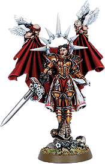

# 塞莉斯汀圣女的资料，来自wiki

塞莉斯汀圣女的资料，来自wiki

fenixbj

圣女Celestine

这位于Palatine远征中英勇牺牲的烈女，曾是侍奉于the Order of Our Martyred Lady的悔过修女。在Palatine远征波及叛教世界Eurytion时，她在进攻星球首府的战役中以无畏的勇气战斗着，然而终究还是不支倒下。在战斗以失败而告终后，其他姐妹收集了她的遗骸并将其带回，据见证者描述：“她在突袭中被切成了上百块…在敌人凶残地将她和姐妹们大卸八块之时，她们呼喊着祈求帝皇的宽恕。”次日，Celestine从之前显而易见的死亡中复活了，而且毫发无伤。在她的带领下，首府不日即告攻克，远征军很快便能够踏上新的征途。在攻向Palatine星系的首府行星前，Celestine来到Sanctus Lys世界，并进入了一个被称做“炽热之心圣坛”的地方，当她归来之时，她身披精工打造的黄金甲胄（Katherine圣女的铠甲）并佩戴着一把光芒夺目的宝剑（Ardent之剑）。其他奇迹伴随着她出现，这使得Ansgar领主和其它托尔派（Thorian）宣布她为一位现世圣女。然而这没有持续多久，因为她之后被宣布牺牲了，叛变的大司战（Warmaster）Forrax在战斗修女会袭来时引爆了他的宫殿。（注：老荷当年逆天时的头衔就是Warmaster）Katherine姐妹（找不到她的图……）Katherine圣女曾是Alicia Dominica的副指挥，以及the Order of the Fiery Heart的建立者。该修女会得名于Katherine的暴躁性格，以及她对毁灭异端的强烈渴望。她领导着姐妹们在银河中穿梭，散播帝国的神圣信仰，最终她们访问了Sanctus Lys世界，她将自己的黄金动力装甲及Ardent之剑藏在了那里，直到被圣女Celestine发现。在Katherine因邪教徒刺杀而殉教后，她的修女会改名为the Order of Our Martyred Lady，以表追随她的姐妹们的无尽悲痛。（再注：修女MOD里的圣女无敌研究就是Katherine铠甲，然而研究后圣女无敌时是变成银色……）（最后注：the Order of Our Martyred Lady就是MOD里修女的第一个可选派系）哪位兄台通晓战棋的请帮忙补下圣女Celestine的逆天规则，我就此打住了:D以下是CZ75兄的标注，感谢指出：Thorian是指托尔派，审判庭和教会内的一个派系，得名于塞巴斯蒂安·托尔。Order of the Martyred Lady：“我们的殉教圣女”教团，也是战斗修女中最典型的教团。Order of the Fiery Heart：“炽烈之心”教团。

freeriver

好邪恶的说.....人家基因原体的头被砍下来都挂了，这个女人居然连分尸都拿她没辙.....

夜影如歌 

基因原体是男性

男性和女性有些奇妙的差别

以上为推测原因

nakun 

强人就是强人,你分我尸没关系,我拼起来还是猛女!汗一个
