# 战锤40k世界中的“野怪”

战锤40k世界中的“野怪”

kaneqc

在下第一次翻译，才疏学浅，疏漏难免，还望各位高人不吝赐教。Arachnospila

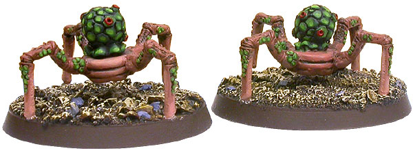Arachnospila的聚落是少数倒霉的帝国星球必须面对的祸害。这些奇怪的四脚虫类居住在具有泥土环状突起特征（被它们分泌的信息素染成微红）的巨大巢穴中，如果一座巢穴被入侵者打扰，它们会愤怒地从巢中蜂拥而出团团围住入侵者。只有薄弱外骨骼的Arachnospila只有一种攻击方式：死。当一只Arachnospila死亡的时候会爆出雨点般的酸液，这种腐蚀性液体的爆发通常足以杀死任何愚蠢到胆敢闯入巢穴的人或生物。因为Arachnospila的繁殖力惊人，所以消灭这种生物十分困难，有报告暗示说它们的种群在扩大，但未经证实。Chiaro Ash Croaker

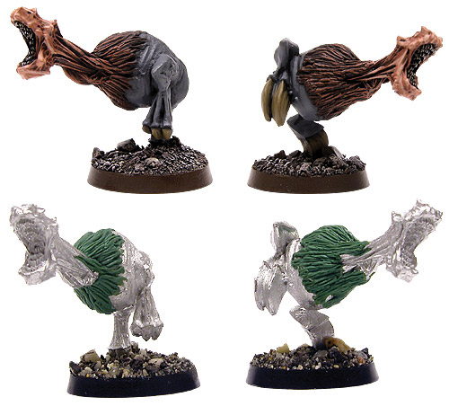Ash Croaker是众多动物中的一种，只不过跟其他大多数比起来它们更顽强也更致命。它们在Chiaro 27号上的废墟里被发现。很容易就能长到一个成年人的大小，Ash Croaker从本质上说就是一个有着尖牙、利爪、和很强攻击性的“球”。当它们追踪猎物时会在彼此间来回发出可怕的嘶吼，因此得名“Croaker”（嘶吼者）。它们的声带扭曲声音之后便发出一种奇怪的腹语声。因此，（它们的）猎物没有能力辨明声音传来的方位，直到自己大祸临头。Cuthellian Cudbear

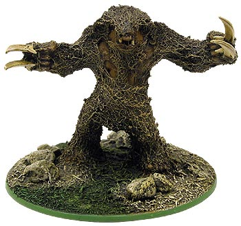Cuthellian IV上的本地生物，可以在覆盖该星球表面的蕨类森林深处找到它们。作为一种胆小的生物，仅仅了解道Cudbear只有在受到威胁或是保护幼崽时才会攻击。它们会用巨大强力的锋利前爪在地上挖掘植物根茎作为食物。这些爪子磨出了剃刀般的利刃来让它们挖穿森林地下的岩层。这种野兽的皮毛缠结成块且十分浓密，也非常坚硬，保护它们不收敌人侵害。这种保护是十分必要的，只有这样，这些生物才能熬过Cuthellian IV上严酷的冬季和频繁肆虐的冰雪风暴而继续生存下去。Mordinian Duplicator

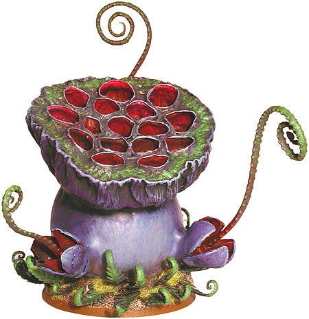死亡世界Mordin上茂密、肥沃的丛林拥有一些银河中最独一无二且最致命的植物。Mordinian Duplicator毫无疑问便是其中之一，同时也是帝国野外生物学家们极感兴趣的研究课题。这种只有在Mordin丛林的最深处才有的巨大植物一般有4~7米高。它拥有一个球茎躯干及顶部分布大量球形腔室的花冠。围绕着所谓“身体”的是2至4支伸出身体，由某种奇快的膨胀压力操控的藤蔓。更另该样本如此奇特的是它无性繁殖的方式。通过巨大的，藤蔓状的触须地猛烈鞭打，Duplicator可以捕获倒霉的丛林生物并将它们置于顶部花冠内的腔室中。一旦在腔室中“安顿”下来，这些可怜的受害者的生物机理就会被强力的腐蚀性酶立刻破坏。这种生物“混合汤”结合了Duplicator自身的DNA，使之成为一个在几秒种内便完成的快速进程。然后，Duplicator开始将“原料”凝结改变成种子状的荚，并将其从顶部腔室中射出，这些荚一旦落地就立即扎根。这些荚破裂并成长，它们模仿母体的形式，以惊人的速度成长为另一株Duplicator。用不了多久，一株成年的Duplicator就会屹立在离母体几米远的地方，准备继续周而复始的循环，不用说，遭遇一株单独的Duplicator的情况还是非常罕见的，大多数时候，人们往往遇到的都是占地很广的扩张性集团。Glovian Stinger

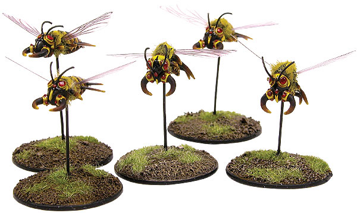同类的小飞虫在地球十分常见，但Glovian Stinger却是重约50公斤、翼展惊人可达2米的怪物样本。这种生物居住在由干涸淤泥及杂物所修建的高耸尖塔中。这些尖塔主宰了Glovia地表上相当大的部分，并使得穿越Glovia表面荒地的旅途变得十分艰难。当躁动不安时，它们会变的强而有力，剧毒的针刺甚至可以放倒最坚韧的干涉者。这些生物很少孤立与蜂巢之外，通常都是5只或更多结伴外出。虽然Stinger通常不具侵略性，但当它们被逼致绝路或蜂巢受威胁的时候还是会变得相当具有敌意。Kalathrax Fiend 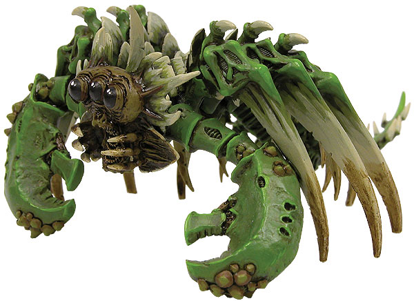这些怪物一般的大虫子被视为真正的恐怖，它们在丛林地下安家，利用强力的爪在土中深挖地洞，以便对猎物发动突袭。这种生物是出了名的坚韧，那些遭遇Kalathrax Fiend后活下来的幸运儿在讲述经历的时候都会提到亲眼目睹Kalathrax Fiend身上那些重创留下的伤痕。Magmakin

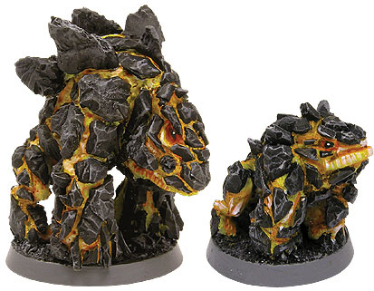顽强的Magmakin在高热的极端地带安家，一般可以在喷气口和活火山附近看见它们。Magmakin靠着吸收热量和用熔岩流中的碳来增加体积而茁壮成长。它们的表皮细胞层是由坚如岩石韧如甲壳的干熔岩组成的。它们具有高度的领土意识，会为了保护领土及幼崽而猛烈抵抗入侵者，经常会什么都不管地一头冲向敌人。Venus Mantrap

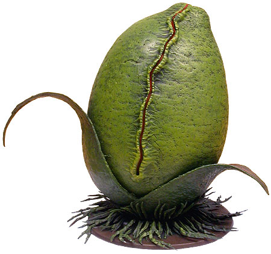潜伏在水汽蒙蒙的死亡世界——甚至更普通的、银河中的其他气候温和的森林中的，便是臭名昭著的Venus Mantrap。这种巨型植物会侦测到附近的猎物，并释出卷须诱捕受害者，再将其拖向死亡。与Venus Mantrap战斗是几乎不可能的，因为它根本不知疼痛为何物，而且拥有难以置信的坚强表皮。这个怪物唯一的“仁慈”便是它进食时会很快（把“肚皮”）装满——满了就会停止攻击。（记得好像丛林男的故乡有不少这种东西）Nivolik Bloom

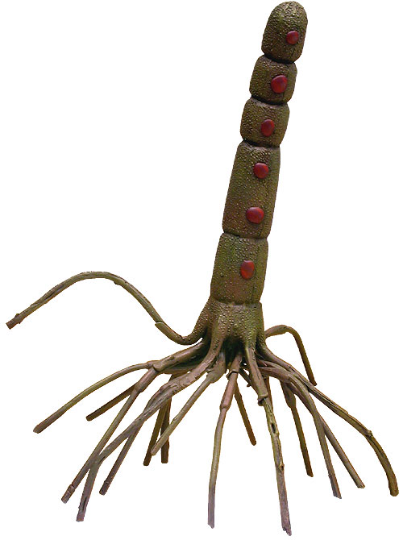Nivolik Bloom非常...值得庆幸的罕见，因为它们是非常诡秘的植物。它们在宇宙各处的树丛、沼泽、和雨林中行走，狩猎。它们的主要攻击手段是各部位投射的毒针及形成的有毒孢子云雾。一旦目标被放倒，Nivolik Bloom众多触手中的一只就会卷起受害者，送入它身体下面隐藏着的嘴中，一旦进入了Nivolik Bloom体内，受害者便会被缓慢的消化，这一过程持续7天。尽管Nivolik Bloom是独行猎手而且天生胆怯，但还是会毫不留情的攻击任何入侵者。Pentarant

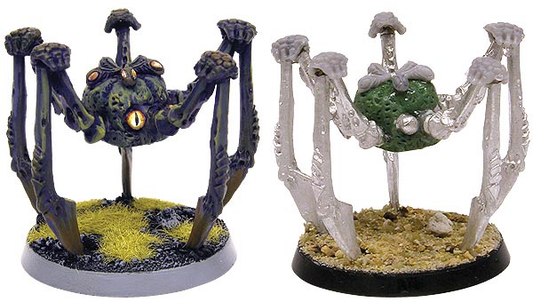Pentarant是一种高度进化的蛛蛛类生物，除了表面上与普通蜘蛛的相似之处，Pentarant与那些地球上常见的种类大大不同。它们选择了5条腿的生活方式，而非8条腿，另外它们有5只眼睛，每一只都有单独的视野——5只眼间隔分布在Pentarant圆形身体的周围。已经有人假设认为它有5个单独的认知中心，每个分别控制1只眼和1条腿。Physokerme

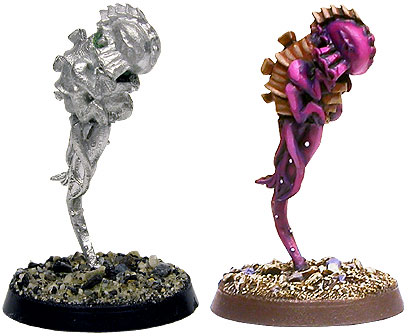没人知道Physokerme到底怎么来的，关于它是否属于某种被遗忘的泰伦虫族生命体抑或只是一种可憎生物的理论比比皆是。Physokerme悬浮在空中，被某种精神屏障保护着，并会使用纯粹的异空间能量进行鞭击。它们与泰伦灵化脑虫（Tyranid Zoanthrope）的相似之处显而易见，尽管前者还远远达不到危险（的程度）。它们通常以5只一大组出没，随意爆击任何会动的东西，设法吸收猎物的营养成分——据信它们通过这种方式进食。Pyro Spores of Durga IV

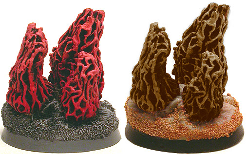只有在最极端的环境下才能看见神秘样本的蓬勃繁衍。Pyro Spores——这一位于荒凉熔岩世界Durga IV陆地上的点缀景观其实是行星测绘师和本地生物的严重障碍。这种硕大的圆锥形真菌喷出的易燃性蒸汽很容易被蜿蜒遍布行星表面的挥发性熔岩浮块点着。毫不奇怪，这些气体经常可以迸发成一团足以把任何愚蠢到冒失靠近真菌丛的倒霉生物烤焦的烈焰。通常，它们孢子的遗传物质对于高温有很强的抗性，这种特性使得利用炸药开路变的徒劳无功——仅仅是在帮它们播种而已。更糟糕的是，任何试图摧毁或连根拔起Pyro Spores的举动都会带来灾难，因为它们在受到重创时会瓦解并释放出大量可燃性气团，“点燃”极其痛苦的死亡。Razorback Hound

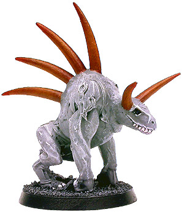数世纪前，一小群克鲁特被意外地留在了一个杳无人迹的的星球上开始了丛林生活，尽管开始时杳无人迹，但后来不断涌现出了各种.....蜥蜴，其中一些巨大，致命，充满敌意。为了自卫，克鲁特杀死并吞食了很多攻击它们的巨型蜥蜴，渐渐地，克鲁特们开始依靠蜥蜴为食，数世纪后，克鲁特们缓慢进化为一个为了专门适应新世界而生的种族。这些新进化后的克鲁特极其擅长猎杀本地蜥蜴和与后者的战斗，对于这群流浪克鲁特的生存来说，Razorback Hound已经成为了不可或缺的部分。Spined Rhodox

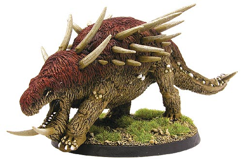虽然不象它的近亲戈洛兽一样多，Spined Rhodox在银河的各个星系之中还是非常常见的，尤其是在那些绿皮数量众多的倒霉世界。尽管不太情愿被臭绿皮驯化，一种有意思的关系还是在这种生物和兽人氏族之间建立起来了。某些兽人氏族采用猎杀这种生物作为发掘潜在氏族领导人的方式，那些在遭遇Spined Rhodox之后活下来，并带回一副Rhodox角作为战利品的兽人都会得到大家的高度尊敬，并会被赐予“老大”甚至“战争头目”的氏族头衔。Scuttlehag

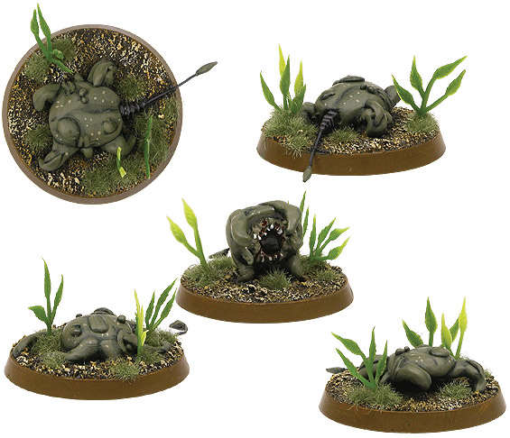这些讨厌的小东西一般居住在沼泽和湿地附近，它们天生就擅长在主宰这些地区的昏暗水域中巡游。Scuttlehag们是狡猾的猎食者，它们会依靠变色皮肤隐藏在灌木丛中，并用尾巴将猎物吸引到攻击距离。奇怪的是，它们是靠迅速震动尾巴来发出难以明状的声音旋律来吸引猎物靠近，而并非（用尾巴）来模仿小型生物的动作。Scuttlehag是值得深入研究的样本——如果研究其周围自然环境真能获得什么的话。Silkava Gar

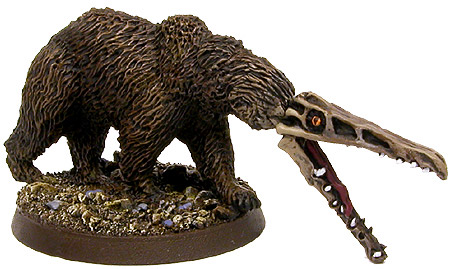Silkava是一个为其所在星系内周边行星提供多种农作物的农业世界。分布于大陆上的多座山脉是不少强壮生物的家乡，其中之一就是可怕的Silkava Gar。作为一种半迁徙半定居物种，Silkava Gar每60年换一次地盘，一旦这种熊一般的生物发现自己身处农场或其他有人居住的地区，那么麻烦就来了。所有工人和奴工都会被视为闯入者并立刻遭到攻击，鳞次栉比的牙齿施力于受害者身上以致它的撕咬十分致命。更难缠的是：它会无视痛苦并奋战至死。Stragali Stalker

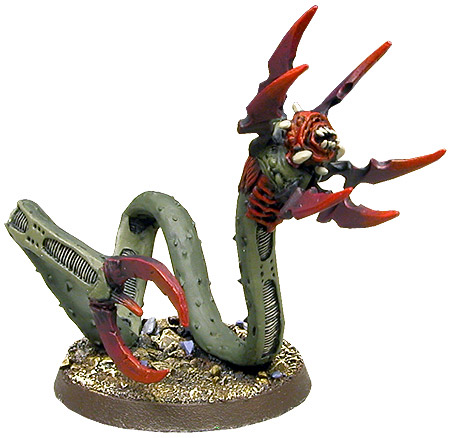在Chutra上的平原上，侦察部队必须留神声名狼籍的Stragali Stalker。这种蛇形怪物可以躺在松软土砾之下等待6天之久，就其攻击距离和速度（而言），受害者很难了解是什么在攻击他们。一旦位于开阔地，Stragali Stalker会使用一种次级催眠术，让可能的攻击者瞬间放松警惕——“瞬间”对于这种怪物解决敌人来说已经足够了。Stragali Stalker通常3只一起狩猎，而且如果目标难于对付，它们会选择撤退并改日再战。Wuzzit Mud Demon

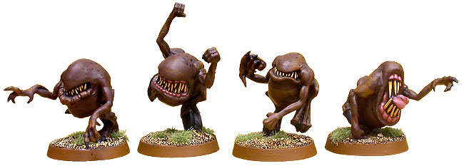Mud Demon在湿地和沼泽附近安家，它们会深挖地洞，偶尔上来一次也仅仅是为了空气和食物。这种生物的新陈代谢方式与蛇类似，一个月大约进食一次，通常都会攻击比它们大得多的生物。Wuzzit Mud Demon会成群地狩猎，并且因为它们会朝猎物眼睛投掷泥巴使其在它们进攻前无法防御而臭名远扬。它们如何视物，如何在甚至不发出一点声音的情况下彼此沟通我们无从得知，大多数人相信它们会使用某种心灵感应能力。Zigadenus Brain Eater

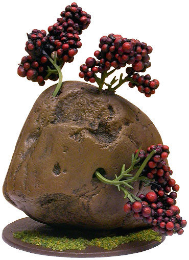Zigadenus Brain Eater是银河中众多奇怪植物中的一种具有灵能特质的（植物）。在这种情况下，Brain Eater表现出对受害者的暂时精神控制力。尽管它已经是审判廷某些派别的热门研究课题，但这种有机物如何、为什么会拥有异空间力量我们还是不得而知。Zigadenus Brain Eater通常静止并等待某些生物失足靠近，然后便会试图支配该个体的意识，并随意触发其物理能力。对于拿枪的士兵来说，Zigadenus Brain Eater无疑是个噩兆，因为有人会失去对身体的控制转而攻击自己的伙伴。
