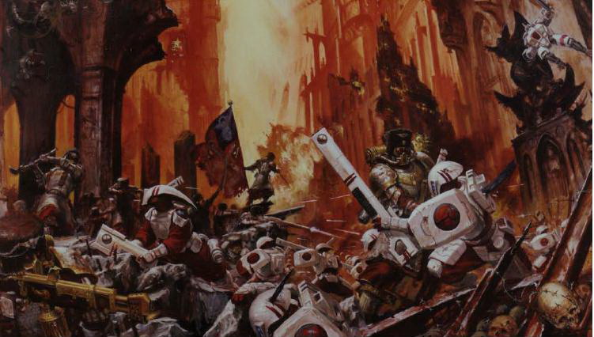
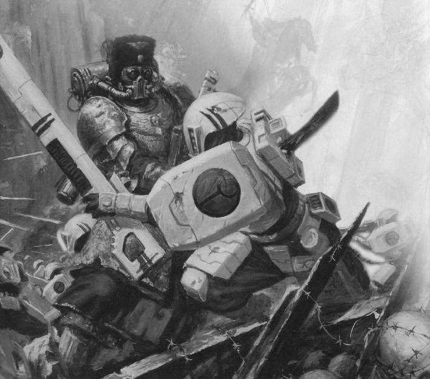

# 翻译:珀里亚之战

庆祝复活!翻译:珀里亚之战

panzerwzh

珀里亚之战

关于位于宁伯萨星球上的珀里亚之战的战地资料是最近才被收入帝国官方记录的。这份残破到几乎无法辨认的资料更突出的反映了大规模城市巷战疯狂绝望的本质。

在这个星球上，帝国守卫沃斯托尼亚长子团的战士们与由TAU指挥官亮剑领导入侵者之间进行的史诗般的浴血奋战将永远为人所铭记…

第二次天体扩张

当虫巢舰队Kraken入侵Ultima星系之时，人类帝国舰队的主要注意力都集中在帝国东缘的广阔战线上而忽视了TAU第二次扩张这一新的威胁。TAU也意识到这是他们扩张自己势力范围的绝好时机，他们马不停蹄地吞并了边界上一系列的人类帝国星球，宁伯萨就是其中最为重要的人类星球之一。

当人类帝国卫队和帝国海军的绝大多数力量被调往东线以应付虫子的威胁时，庞大的TAU入侵舰队在宁伯萨开始了登陆行动。在登陆场稳固后，TAU的总指挥官---亮剑马上开始了对当地平民系统性的屠杀。当时在宁伯萨上唯一能与TAU入侵者对抗的帝国武装就只剩下了沃斯托尼亚长子第九团的战士们。在团长格拉夫.托时琴科的领导下，长子团的战士们在工业中心珀里亚建立了防御阵地。面对数量占绝对优势的侵略者，长子团的每一个战士都清楚的知道他们唯一的希望就是尽可能久的坚守阵地以拖住TAU的攻势争取足够的时间等待那些需要几周甚至几个月才可能到达的增援部队。

珀里亚本身是一个由海量的车间，厂房，管道系统和高耸入云的帝国建筑组成的工业城市。其心脏地带由一个迷宫般蔓延了6个街区的内政部大楼，帝国国教大教堂和巨型铸造车间组成。

到达珀里亚后，沃斯托尼亚战士们马不停蹄的开始了防御公事的修建。一系列视野开阔射界交错的防御据点在高效率的土工作业下马上建立了起来，他们将做为防御战略据点在TAU的攻势前发挥作用。城市内部的围墙都被推倒，以期能让防御者在据点之间更迅速的转移阵地。无数工厂车间里的机械设备被征用拆卸，改装成简易的路障来封锁每一条道路。期间在个别具备战略意义或者能充当坚实掩体的建筑里被小心翼翼的布满了陷阱，而剩下那些被认为不具备防御价值的房屋则由工程师大量布置炸药以保证在必要的时候它能和敌人一起化为尘埃。

弹药给养被分散储存在城市心脏部位的三个关键建筑里，大铸造车间本身就由固定着大量高射炮的防空天顶加固而其地表下是整个城市地铁系统的中心，能方便的连接每一个防御据点。据此托时琴科和麾下的军官们选定大铸造车间为自己的指挥中心，不久以后，它就被长子团的战士们戏称为托时琴科的“要塞”。

亮剑的攻势

当亮剑的先头部队抵达到珀里亚城下，出呼意料地发现这里的帝国部队已经以逸待劳做好了防御准备。或许其他没那么冲动的TAU指挥官会试着劝降防御部队，但作为以进攻性闻名的远见指挥官的高徒，亮剑根本没这打算，这位同样以攻击性著称的指挥官马上带领麾下战士投入了进攻。大群满载着火战士的魔鬼鱼运兵艇排好了进攻队形向珀里亚冲去，同时天光导弹艇尖哮而去的飞弹群和锥头鲨精确而致命的远程轰击把一个又一个帝国前进阵地化为灰烬。负责蛙跳作战的寻路者小队从盘旋的运输艇上直接索降在建筑物顶部，并在血腥的近距离火力压制中一个屋顶一个屋顶的肃清防御者。

当TAU部队成功地在长子团的防线上清理出突出部之后，亮剑希望用远程火力的密集轰炸逼迫防御者投降。可惜帝国大教堂和托时琴科的“要塞”的坚固程度不是TAU的地面火力能对付的了的。在持续数天的狂轰滥炸之后，坚强的长子团战士们仍没有丝毫缴械的迹象。亮剑见速功不成便采取Kauyon的“耐心猎手”式打法，派遣Kroot小队以期把长子团从他们坚固的防御工事里赶出来。最先欢迎这些Kroot战士的是一阵密集的激光步枪，很快，Kroot的进攻队形被这阵突如其来的打击撕碎了速度慢了下来。但是来自装备着轨道来复枪的寻路者小队的精确射击压制了防御者的火力，并最终掩护Kroot摸到了进入帝国教堂的通道。然后野蛮的Kroot武士冲入了沃斯托尼亚防御者之间疯狂地砍杀撕咬并贪婪地吞噬着受害者的血肉。

反击

托时琴科意识到他的敌人正在一个个系统的切断每个防御据点之间的联系，然后在把孤立无援的据点连根拔起。如果不能发起一次有效的反冲击那么离失败就不远了。“上刺刀，准备冲锋！”简短的命令传达到了每一个长子团的防御据点。2000多名沃斯托尼亚战士咆哮着冲出了自己阵地和隐蔽所。他们冲过了满目弹坑面目全非的街道，向着自己同胞曾经被惨无人道地虐杀的大教堂冲去。被复仇的怒火烧红了眼的长子团士兵在近距离的交火和逐屋的争夺中风暴般席卷了大教堂里的敌人，却发现那些食人生番在承受他们的愤怒前全面撤退了。

这明显的胜利激励了防御者；托时琴科集合了所有幸存的士兵在最后几辆LEMAN RUSS的支援下继续前进。直到长子团的战士们反攻到珀里亚的主干道之前，都只是遭遇了轻微的抵抗。他们距离胜利是如此之近，在托时琴科的前锋距离前面的隐蔽所只有几米之遥时，亮剑收紧了陷阱。

隐秘在四周建筑物顶上的Crysis Battle Suit突然冲出，向暴露在开阔地的帝国战士居高临下的扫射。殿后的LEMAN RUSS一辆接一辆被埋伏在建筑里的寻路者小队引导的制导导弹击穿了最脆弱的后装甲，然后化为一座座剧烈燃烧的钢铁坟墓。装备着速射加农的隐形小队用密集火力把整个营的沃斯托尼亚战士分割开。

托时琴科的最后一搏

一直处在沃斯托尼亚突击队型最前端的托时琴科指挥小队在开阔地遭受了最密集火力的射击。无数道灼热的电磁脉冲从四面八方射来，在此起彼伏的爆炸中，托时琴科身边的人一个接一个地倒下，直到他自己也被一道脉冲击倒。当满身血污遍体鳞伤的长子团指挥官挣扎着从早被炸成粉末状的泥土里站起来之后，他从死去的旗手的手里攫取了军团的战旗并把它高高举起如同一座不朽的纪念碑一样激励每一名还活着的帝国士兵奋战到最后！残余的士兵纷纷集合到了团长的身边准备向入侵者发起最后的冲锋。同时TAU的火战士们认为此时的敌人已经被完全击败便收起离子步枪开始追击。一场惨烈的大规模白刃战开始了。

在拿起链锔剑上好刺刀的帝国的士兵们咆哮着冲入火战士的行列之后，数百的火战士成了刀下亡魂。尽管沃斯托尼亚长子团的战士在最后的时刻表现了最后的英勇和悲壮，但最后就是最后，他们已经没办法逆转整个战局了。亮剑带领着自己的护卫队也投入了战斗第一线，在战场上空呼啸而过的同时用XV8战斗服上的全部武器向长子团团长所在地做了次齐射，顽强的托时琴科倒下了，随他而去的还有帝国胜利的希望。

当帝国最后开始收复宁伯萨的时候，黑色圣堂战团的福尔克堡主曾经向托时琴科和沃斯托尼亚长子团已知最后的阵地派出过一支侦察小队。根据lodhuvicus兄弟现场的报告，在珀里亚的残骸间到处散落着数以千计帝国卫队士兵的遗骸连同他们的武器和被击毁的装甲车辆都保留着最后决战时刻的情状，没有改变，而在残橼断臂之间TAU的痕迹已经被彻底清除了。

