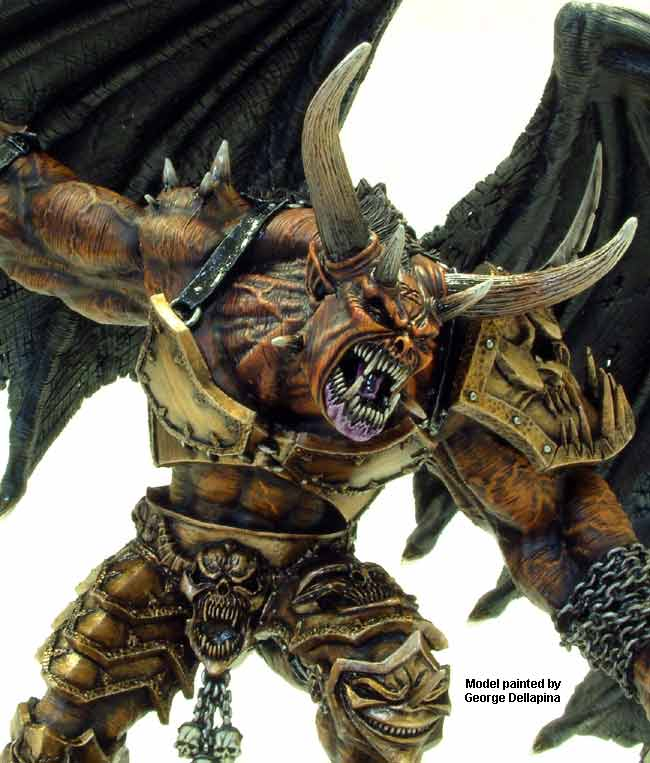
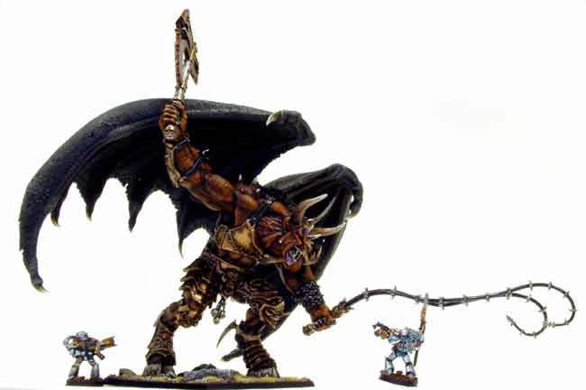

# 嗜血者 BLOODTHIRSTERS

[ACE翻译的蹲守]嗜血者 BLOODTHIRSTERS

trivel

BLOODTHIRSTERS,THE RAGE OF KHORNE INCARNATE 嗜血者，恐虐狂怒的化身 Nothing, on any of the many battlefields of the war-ridden 41st Millennium, can match the fury and fighting prowess of the Greater Daemons of Khorne, the dreaded Bloodthirsters. No one, not even the Greater Daemons of the other Dark Gods, can hope to defeat a Bloodthirster at close quarters. Nowhere, in an entire galaxy of worlds at war can a deadlier opponent be found by glory seeking fools. 在41千年世界里众多充斥战斗的战场中，没什么能和恐虐的大恶魔，致命的嗜血者狂野和超凡的战斗能力可以相提并论。没人，即使在其他邪神的大恶魔中也没有一个有希望在近身肉搏中战胜嗜血者，在整个银河系世界的战场上不会有一个能与其生死相搏的对手被那些搜史追荣的蠢货们找出来。 

Bloodthristers are the perfect embodiment of Khorne’s infinite anger, of his unparalleled martial discipline and of his inextinguishable lust for blood. They are the commanders of Khorne’s legions, leading them into battle and unleashing the blood-hungry hordes of their master without mercy of compassion, and yet with an implacable tactical efficiency. 嗜血者是恐虐无尽怒火，空前战欲和永无满足的嗜血贪欲的完美体现。他们是恐虐军团的指挥官们，引导、释放其主子的嗜血魔群于战场，不带任何怜悯与同情，并在其中扮演不可替代的高效角色。 

Bloodthristers appear as muscular giants, towering above mortal and Daemon alike, with snarling, bestial faces with long fangs, a wild mane and wickedly sharp horns. They have great leathery wings that carry them majestically across the Battlefield in Search of more enemies to slaughter, in the vain hope of meeting an opponent worthy of their prowess. 嗜血者外表看上去是个满身肌肉的巨人，塔立于凡人和恶魔之中，不停的犬嗥发自有着长长犬齿的口中，兽头上长着邪恶的双角和狂野的棕毛。他们有一对巨大的皮翼可以带他们威风凛凛的飞过整个战场以寻找更多的屠杀目标，那些看上去能满足其自负标准，值得一战的敌人。 

They wear ancient, ornamented armour of brass and wrought iron, upon which the glowing-red runes of Khorne attest the favour of the Blood God. These are a solid bulwark against both treacherous psychic powers and cowardly ranged weapons that their puny enemies often employ in a desperate attempt at bringing them down at a distance. And indeed this tactic is often an opponent’s only chance, because if a Bloodthirster manages to close in and engage his enemies in mele, their fate is sealed. 他们穿着古朴的，黄铜色的精甲，其上装饰的鲜红醒目的恐虐血印标示着血神的眷顾。这些坚固的实体保护，能阻挡阴险的灵能攻击和卑鄙的远程武器打击，那些软弱敌人们经常希望远远干掉他们而使出的手段。确实这种方法是其对手的唯一机会，因为一旦嗜血者靠近他们，进入肉搏，其失败的命运已经注定。 

As well as the razor-sharp claws on their mighty hands, the Greater Daemons of Khorne carry great axes, forged in the heat of the rage of the Lord of War and imbued with the essence of Caged Greater Daemons. Perehaps the most fearful weapons ever created, these gigantic axes can cleave battle tanks in two or hamstring a charging Carnifex with a single blow. Not only they destroy a foe’s body, but often consume his soul too, offering them to the Lord of Battle. 同他们有力双手上剃刀般的利爪一样，恐虐的大恶魔们都带着锋利的巨斧。在战争之王的怒火中加热铸就，渗透着囚禁的大恶魔们的邪恶精华。或许是被创造出的最可怕的武器，这些巨斧能将战斗坦克劈为两半，可以一挥就将冲上来的刽子手（注1）切断。不仅可以摧毁敌人的肉体，还经常能将其灵魂吞噬奉献给战斗之王。 

Obsessed with dealing as much death and destruction as possible in the name of their demanding god, the Bloodthirsters hunger to deal death to their foes, even at range. To this end they can strike down a distant foe with a long barbed whip, throwing axes or simply the shattering power of their deafening bellow. These weapons, though not as satisfying as cleaving apart a foe with a hefty axe-blow, do allow the Bloodthirster to reach and destroy even the fastest and most agile opponents - those that might be wisely trying to keep their distance.

嗜血者着迷于以他们的苛求之主之名，尽可能多的制造死亡与毁灭，即便在远距离上也渴望能杀死敌人。这使得他们会使用带刺的长鞭抽杀远距敌人，扔斧子或干脆通过怒吼放出粉碎敌人的能量。这些武器虽然不能同重斧一刀两断的威力一样另人满意，但确能保证让嗜血者碰到，并毁灭那些最快最灵敏的对手----那些足够聪明到希望和他保持距离的家伙。 

WS BS S T W I A Ld Sv Bloodthrister  10  4  7 6 4 5 5 10 4+ 

Unit type: Monstrous Creature 

Daemonic Gifts: Iron hide, Daemonic Flight 

Special Rules: Daemon, Furious Charge. 

“Gut them! Slaughter them! Slay them! Butcher them! Kill! Kill! Kill! Never stop, never tire! Keep doing the Lord’s work!” “赶上他们！屠了他们！杀了他们！宰了他们！ 杀！杀！杀！永不停止，永不疲倦！继续去为主人干活！” Khar-Har the Undefeatable 

注1：虫子的一种，刽子手就是一部活动的毁灭机器，不管在闪电突袭，强行登舰还是群体搏斗，它能在重重围困中撞开一条血路，将对方的防线、坦克、碉堡统统掀翻。几乎没什么东西能阻挡它的前进，步兵或者车辆在刽子手面前变得像小孩子的玩具一般脆弱。（转自[http://blog.sina.com.cn/s/blog_48c217a0010003xv.html](http://blog.sina.com.cn/s/blog_48c217a0010003xv.html)，不知原创何处）
