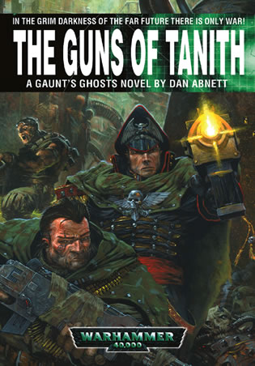

# 亚伯拉姆·冈特政委生平

[ACE翻译]亚伯拉姆·冈特政委生平

no.ace

文章很长 未完工部分更长.. 希望大家时刻关注更新情况 o(^_^)o -- ACE 生平做好了, 顺手发个歌听 ;P

之后要发的还有冈特系列小说集列表[施工中]

以及冈特系列小说集出场人物简介.[蓝图中..]

Ibram Gaunt 亚伯拉姆·冈特 

Colonel-Commissar Ibram Gaunt is a character in the fictional Warhammer 40,000 universe, in which he is the commanding officer of the Tanith First-and-Only. He is one of the main characters in Dan Abnett's Gaunt's Ghosts novel series, and is also featured within the Warhammer 40,000 game as an Imperial Guard special character 

上校-政委 亚博拉姆·冈特是战锤40,000背景系列小说中的人物,坦尼斯唯一第一团(Tanith First-and-Only)的指挥官.  丹.阿伯尼特(Dan Abnett)小说集&lt;冈特的幽灵&gt;(Gaunt's Ghosts)中的主人公.同时也是战锤40.000系列游戏中,属于帝国卫队的的特殊人物 

life and career 生涯经历 

Like almost all Imperial Commissars, Gaunt is a strong man, but unlike most: he is portrayed in the books as a kind soul with a controllable trigger finger, Gaunt was an orphan, a son of an Imperial Guard officer. He was raised and indoctrinated on the Schola Progenium world of Ignatius Cardinal, where he was occasionally visited by his uncle, General Aldo Dercius of the Jantine Patricians. He learned that his father had been an Imperial Guard hero, but had died and the circumstance were hidden from him. 

象很多帝国政委一样,冈特可以说是个很强硬的人,但是有一点不象其他政委:他在书中被刻画成是一位心地善良并且...手指能控制扣下扳机冲动的政委(ACE:作为一个忠实的帝国小兵这一刻我泪流满面..),冈特是一名孤儿,一位帝国卫队高官的子嗣.他是在坚定殉道者世界(Ignatius Cardinal)的忠嗣学校(Schola Progenium)被培养长大的,在那里他很偶然的拜访了他的&quot;叔叔&quot;,詹亭贵族军(Jantine Patricians)的将军奥尔多·德塞由斯(Aldo Dercius).在那里他得知他的父亲曾经是一名帝国卫队的英雄,但是他父亲的死因对他来说依然是个谜 

As a Commissar-Cadet he served under Commissar-General Delane Oktar, gaining full rank status of Commissar at Oktar's death-bed on Gylatus Decimus. He had served as a political officer with the Hyrkan 8th Regiment, from the regiment's foundation to their victory on Balhaut, a world reclaimed by the Imperium during the Sabbat Worlds Crusade. After this victory, Gaunt was granted the rank of Colonel-Commissar by Warmaster Slaydo (another death-bed promotion), along with command of the three new regiments from the world of Tanith. 

作为政委学员期间,冈特一直跟随着将军-政委迪兰·欧克塔(Delane Oktar)作战,在吉拉塔斯·狄塞姆斯(Gylatus Decimus)星球上,欧克塔在临终前授予了冈特正式政委的地位.从那以后,他一直作为一位正式政委在海尔坎(Hyrkan)第8独立团服役,在帝国发动的萨巴特远征(Sabbat Worlds Crusade)军事行动中,第8独立团在巴哈特(Balhaut)星球上的胜利成为了帝国此次战役的重要转折点.这一次战役结束后,大司战斯莱多(Warmaster Slaydo)正式授予了冈特上校-政委的头衔(ACE:同样是临终前授予的.冈特个丧门星...),同时也授予了他坦尼斯1-3独立团的指挥权 

Gaunt had discovered the fate of his father in wintry Darendara two years prior to Commissar-General Oktar's death. Major Gaunt of the Jantine Patricians had served on a mission on an enemy-held world called Kentaur leading the elite attack, but had been abandoned by General Dercius and left to die. Tracking down his uncle, Gaunt exerted his authority as an Imperial Commissar to execute him for his failure. He dueled Dercius with only their chainswords. While killing Dercius, Gaunt suffered grievous injuries and has a scar across his stomach. This event earned him the hatred of the Jantine Patricians for some years after, which leads to the first novel, First and Only (Abnett, 1999). 

在将军-政委欧克塔去世的两年前,冈特得知了他父亲在达兰达拉星球上最后的命运.在肯塔诺(Kentaur)行星面对一次兽人入侵时,德塞由斯将军和他的贵族军放弃了冈特中士(冈特他爹)的部队,让他们留在那里等死.后来在冈特追击他叔叔的过程中,他首次展现了作为一个政委的威风,他同德塞由斯提出了决斗要求--只使用他们各自的链锯剑.当然,德塞由斯最后被冈特大卸八块,而冈特自己也受了重伤,并且在他的腹部留下了一道长长的疤痕.这个举动使得他被贵族军仇视了很多年.(以上部分参考自系列小说第一部&lt;唯一与第一&gt; ,-作者阿伯尼特.1999年出版-) 

The Tanith 坦尼斯世界 

Tanith was a world in the fictional Warhammer 40,000 universe. It is the lost homeworld of the Tanith First-and-Only Imperial Guard regiment, having been destroyed by Chaos during the Sabbat Worlds Crusade. 

坦尼斯是战锤40,000背景系列小说中的一个世界.在萨巴特远征中,坦尼斯被混沌势力彻底摧毁而使得帝国卫队坦尼斯唯一第一团从此无家可归. 

During the founding of the First, Second and Third Tanith Regiments, a Chaos splinter fleet managed to slip past the Imperial Navy's picket line, which had folded on itself as the new Warmaster Macaroth eagerly pressed into the Sabbat Worlds to take advantage of the victory at Balhaut. Left defenceless, Tanith fell to a surprise Chaos attack. Gaunt ordered the forces of Tanith to retreat, depriving them of the chance to fight and die for their homeworld. The retreat was costly; from three entire regiments there were less than four thousand survivors, and not a single officer of the three regiments made it off Tanith.

在坦尼斯第一,二,三团的建立过程中,一支与大部队分散混沌舰队企图溜过帝国海军的封锁线,刚好同一时间,新任命的大司战马卡洛斯(Warmaster Macaroth)为了扩大巴哈特星球胜利的战果而急于带领部队进军萨巴特世界.几乎毫无防守的坦尼斯遭遇了一场完全意外的混沌势力的进攻.冈特被迫命令他的部队撤出坦尼斯----也就是说剥夺了他手下为他们的家园战死的权利. 这次撤退是损失惨重的;3个完整的独立团到最后只剩下了不到4000的生还者,几乎所有3个团的军官都没能逃出坦尼斯 

While waiting for orders, Gaunt was instrumental in the reorganisation of the survivors, reorganising the men into the Tanith First-and-Only, and promoting the non-commissioned officers and soldiers who had shown initiative and leadership during the retreat and subsequent reorganisation to officer positions. The Tanith were ordered to the world of Blackshard, and during their successful first engagement were dubbed &quot;Gaunt's Ghosts&quot;, a moniker that would stick with the regiment for the duration of its existence. 

在等待进一步指示的过程中,冈特投入了生还者重组的工作,他把所有人都编入了坦尼斯唯一第一团,同时很多在撤退,后续重组过程中表现出主动以及有领导能力的士兵以及候补军官,都被冈特提拔到了军官的位置上.很快坦尼斯军团被调往了黑色碎片世界(world of Blackshard),由于在重组后的第一次作战行动中的出色表现,第一团开始被人称做&quot;冈特的幽灵&quot;,一个会永远伴随这个独立团存在的称号.. 

Gaunt is considered to be an unconventional but effective leader, slowly winning the devotion and respect of the soldiers who initially hated him for letting their homeworld fall to Chaos without a fight. He is feared among the upper echelons of the Imperium almost as much as he is feared by the forces of Chaos, as he is a model for honour and defiance of corruption in all forms. He is respected by many soldiers and commanders because he leads from the front, attacking the enemy alongside his men. He gained great respect with his men and the new recruits for the Tanith First-and-Only when he killed the Chaos warlord Heritor Asphodel during the battle for Verghast. 

冈特一直想成为一个与众不同的,有效率的领导,他渐渐的获得那些原本憎恨他----因为冈特未经战斗就抛弃了他们的家园---的士兵的信任与尊重.并且在无论在帝国高层还是混沌势力中,他都被视做一位可敬畏的人物,同时他在各方面也被认为是荣誉以及蔑视堕落的模范.因为冈特身先士卒的指挥作战风格,他也被很多士兵与军官所尊重.他在第一团中的声望于威法斯特战役(battle for Verghast)之后到达了顶点---他亲手做掉了混沌战争领主赫瑞托·阿斯法第尔(Chaos warlord Heritor Asphodel) 

However, some characters in the novels, such as Commissar Pius Kowle(&quot;Necropolis&quot;) consider his unorthodox approach and rank problematic, as in many ways he fails in his duty as a Commissar, being compassionate and understanding rather than draconian and unswerving. His dual position as a unit commander as well as a political officer is unique both in the novels and the Warhammer 40,000 continuum; in Honour Guard Lord General Lugo comments on the situation after Gaunt is blamed for a disastrous assault on Hagia: 

很多时候,小说中的一些人物,比如皮由斯·科勒政委(Commissar Pius Kowle 出现在小说&lt;大墓地&gt;中&quot;Necropolis&quot;) 认为他的方法太不同寻常以及不符他的地位,他认为冈特在很多地方有负于他作为一个政委的职责,比如不应该过分富有同情心以及理解,而应该显得刻板并且不妥协.他的双重身份----部队指挥官以及政委,无论是在小说里还是在战锤40,000的世界里都在一直延续,在&lt;荣誉卫士&gt;(Honour Guard)一书中,由于对哈吉亚的突袭导致了灾难性的后果,冈特受到了指责,大将军罗锅(Lord General Lugo ACE:我承认我想不到别的字眼了..恩)对他作出了这样的评价 

&quot;Your command status has often been thought of as strange, Gaunt...Many have wondered how you could perform both those duties when the primary rationale of a commissar is to keep a watch on the unit's commander.&quot; However, Gaunt's ability as a leader is rarely questioned, indeed in The Guns of Tanith he is offered a promotion to Lieutenant-General, but to assist his duties as a commissar, Viktor Hark was introduced to the regiment in Honour Guard. 

&quot;你的指挥地位总是很奇怪,冈特....一个政委的主要任务应该是监视部队的指挥官,很多人都好奇你是怎么同时完成政委与指挥官这两项职责的?&quot;但无论怎样,冈特的指挥技术的确很少受到质疑,在&lt;坦尼斯之枪&gt;(The Guns of Tanith )一书中冈特被许诺可以晋升为少将,但是为了确保他能胜任这个职务,维克多·哈克政委(Viktor Hark)被安插进了冈特所在的独立团的荣誉卫队中. 

Thus far, up to and including the novel Only in Death, the Tanith First-and-Only have been fighting in the Sabbat Worlds Crusade for approximately thirteen years. They have seen combat on several worlds, including Fortis Binary, Menazoid Epsilon, Monthax, Verghast, Phantine, Hagia, Herodor and Ancreon Sextus. However, due to the inevitable casualties, and the lack of a homeworld from which to draw new recruits, the regiment is constantly dwindling in size. This fate was held back for a time by the mass-recruitment of survivors from the hive-city of Vervunhive, on Verghast, but even with these reinforcements, it was only a matter of time before the Ghosts shrunk below the size of a feasible military force. To solve this problem, the Tanith First was disbanded and folded into the 81st Belladon Recon under Colonel Wilder to form the 'Eighty-first First'. 

到现在为止,根据&lt;至死方休&gt;(Only in Death)一书中的说法,坦尼斯唯一第一团已经在萨巴特远征军事行动中战斗了大约17年了,很多世界都有他们战斗过的身影,包括Fortis Binary, Menazoid Epsilon, Monthax, Verghast, Phantine, Hagia, Herodor and Ancreon Sextus(ACE:这一系列世界名我就不音译了..),由于必然的伤亡导致人员减少,以及缺少一个母星来征募新兵,第一团的规模在一点一点的缩小,尽管在威法斯特世界的维文蜂巢的大规模征兵行动使得这一情况有所缓解,但幽灵们总有一天会因为没有后备兵源而失去作为一个正常的军事力量所应有的行动能力.所以终于,坦尼斯第一团被解散并且编入了第81贝拉顿侦察部队(81st Belladon Recon),听命于威尔多上校(Colonel Wilder)的指挥,这也就是后来的&quot;第一八十一团&quot;的雏形 

Recently, the upper echelon of the Imperium's suspicion and unease with Gaunt's unorthodox command approach had reached a boiling point after his return from his Vermillion-level mission (coded EZ for Extremely Hazardous/Suicidal) on Gereon. Afraid that he and his team were &quot;tainted&quot; during their extended stay on a Chaos held world, and because the Tanith First was folded into the Belladon 81st and technically did not exist any more, many high ranking officials decided to strip Gaunt of his command position and revert him back to his original Commissar status. Gaunt eventually manages to regain command of the Eighty-first First, but only after Wilder grants him field command before sacrificing himself in a heroic rearguard action. 

当冈特结束了他在格里昂(Gereon)的朱砂级任务返回后(代号EZ,也就是说极度危险/自杀性的任务).帝国高层对他长久以来非常规的指挥方式的不接受与不信任达到了顶点,帝国高层害怕冈特与他的手下在一个被混沌控制的世界上进行额外的逗留而被混沌&quot;污染&quot;,另外也因为坦尼斯第一团被编入贝拉伦81侦察部队,从技术上来说--唯一第一团已经名存实亡,所以他们决定取消他的指挥权而让他重返最初的政委地位.之后冈特一直在为重新获得&quot;第一八十一团&quot;的指挥权而努力,直到威尔多上校牺牲在一次英勇的自杀性的断后行动中,在死前授予了他战地临时指挥官的权力,冈特才算是回归了他的双重身份(ACE:叫我说你什么好...又死了个..瘟丧啊..)

Gaunt manages to keep his command, and renames the unit back to the original Tanith First-and-Only. He leads the newly reformed unit to help liberate the Chaos-held world of Gereon, where he led the insurgency raid to assassinate the traitor general Noches Sturm. There are two reasons for the imperial guard wanting to return Gereon, Gaunt wants to return because he left several members of the original infiltration team behind on Gereon to help train members of the resistance. But the real reason behind the Guard wanting to return is that the Inquisition believe there may be something on the planet that will help the imperium to fight the taint of chaos. There have been chilling hints through dreams and premonitions described in the books that Gaunt will die sometime in the near future. 

冈特计划一直保留着他的指挥权,并且打算重新将他的手下更名为最初的坦尼斯唯一第一团,他带领着这支重新编组的军团返回了混沌控制的格里昂世界,帮助在那里进行的解放行动,格里昂世界也是他曾带领手下刺杀叛变将军诺查斯·斯图姆(general Noches Sturm)的地方.帝国卫队企图重返格里昂世界的原因有二,对于冈特本人来说,回归的主要原因是他的一些部下被他留在了格里昂世界,帮助那里组织反抗力量.但是对于帝国卫队来说,他们的真正意图是因为审判庭坚信在那个星球上存在一些可以帮助帝国对抗混沌污染的圣物.在书中,有一些令人吃惊的提示反复出现在梦境以及某些先兆中,预示着冈特将死于不久的将来.

During the Tanith's actions on the Fortress World of Jago, at Fortress Hinzerhaus, Gaunt is captured by Blood Pact forces during a heroic defense of the Fortress' ramparts, and is tortured by the enemy. These tortures resulted in Gaunt losing his eyes, requiring them to be replaced with augmetics. He is rescued by Ezrah ap Niht and Scout-Sergeant Mkoll during a revenge mission. 

坦尼斯军团在要塞世界扎古,辛萨豪斯要塞的行动中,冈特在要塞的城墙防守战中被血契部队活捉,并且被敌人拷打.后果是冈特失去了他双眼(ACE:很好 你以后就是传说中的上校-政委-认证灵能者冈特了),被替换成了两只义眼.最终他在伊扎拉·埃·尼哈特(Ezrah ap Niht)与中士侦察兵马克(Scout-Sergeant Mkoll)的一次针对血契的报复行动中获救 

The First-and-Only 唯一的第一 

The Tanith First-and Only is an Imperial Guard regiment formerly from Tanith.

(The Tanith First-and-Only are also the primary focus of the Gaunt's Ghosts series of novels, written by Dan Abnett) 

坦尼斯唯一的第一团是隶属于帝国卫队的军事组织.初创于坦尼斯星球 (唯一第一团同时也是&lt;冈特的幽灵&gt;系列小说中描写的主要军事力量,作者丹·阿伯尼特) 

Tanith Imperial Guard uniforms (both dress uniform and battledress) are dull black in colouration, including trousers with at least two pockets for items, and a long tunic, complete with matte gray body armour, webbing, a pack, and a helmet. However, most Tanith go bareheaded or wear the standard issue beret. The Tanith can also be identified by two 'trademark' items, the combination of which is unique to the regiment; a long knife known as a straight silver, and a camouflage cloak. The symbol of all Tanith Imperial Guard regiments was a small wreathed skull pierced by three daggers, although two of the daggers were removed when the original three regiments were amalgamated (even though it is stated in the novels that &quot;The skull was backed by three daggers originally. One for each of the original founding regiments. The Tanith First, the Tanith Second and the Tanith Third. Only the Tanith First made it off the home world.&quot; hinting that the Tanith Second and Third were destroyed) into the First-and-Only Also, in conversation in a later novel with the verghast, one of the ghosts comments that they snapped the 2 daggers off of the cap badge, as they are the first and only. In earlier novels, the cloak was described as being a &quot;piebald, absorbent material the Ghosts rubbed local mud into&quot;. However, in later books the cloaks are made from Cameleoline, an unexplained material that changes colour depending on the location of the wearer. 

坦尼斯帝国守卫部队的制服(常服与作战服)在颜色选择上通常都是深黑色,裤子上至少有两个装备袋,以及一件长下摆的,粗糙灰色的防弹衣,网式战术背心,战术背包,以及防弹头盔.但是大多数坦尼斯士兵都是不戴头盔或者只戴常规贝雷帽的.坦尼斯士兵也很容易通过两件'标志性'装备来确认,这种组合是军团最特别的地方;一种被叫做直银军刀(straight silver)的长战术刀,以及一件迷彩斗篷.所有坦尼斯军团的士兵标志是三把匕首刺过一个被花环围绕的头骨,当3个战团被合并为唯一的第一团以后,标志中的两把匕首被取消了(小说中的情况是&quot;最早头骨的背后是3把匕首,象征初建的第一,第二,第三团.但是只有第一团成功的撤离了他们的家园&quot;也就是说二,三团实际上已经被消灭了),当然在小说中也有有争议的说法,在后来的小说中,威法斯特战役的一段对话里,某个幽灵描述到&quot;他们所有人从帽徽上取下两个匕首,来保证他们现在不分彼此,都是属于第一唯一团的人.&quot;在早期小说中,斗篷被描述为一种&quot;斑驳的,吸附性材料制成的东西,可以允许幽灵们将他们所在地的泥土混入编织物的斗篷&quot;.但是在后来的小说中,这个斗篷又被说成是一种由&quot;卡梅莱林&quot;---一种无法解释的材料,可以根据穿着者所在地随时改变颜色---制成的(ACE:这么说来地球的otacon博士其实是坦尼斯星人..恩 metal gear是狗坦的一种. 恩恩..fox hound战团的基因原体是BIG BOSS! 恩恩恩...我的思路现在好清晰 好清晰....) 

The tenth year of the Sabbat Worlds Crusade was the first time the Tanith had been called upon by the Imperium to levy Imperial Guard regiments to support the crusade. The majority of the men who joined the Imperial Guard were militia-men, although some former criminals were present, and it can be assumed that other non-military members of the population were included. The soldiers were organised into three two-thousand man regiments; the 1st, 2nd, and 3rd of Tanith. A small number of artillery and armour units were also created, although they were intended for supporting roles. Following the reformation of the Hyrkan 8th, Colonel-Commissar Ibram Gaunt was assigned to lead the three regiments. 

在萨巴特远征进行到第10个年头的时候,坦尼斯得到征兵令,需要组建一些帝国卫队军团加入远征的旅程.帝国卫队的成员主要是普通步兵,当然也有些前罪犯出现,可以假设应该还有很多非军事人员也加入了军团(ACE:根据文章后面的意思来看 没有女人 ).所有士兵被编成了3个2000人编制的独立团,坦尼斯第一,第二,第三团.同时也建立了一小部分炮兵/装甲单位,虽然他们只是被期望能起到些支持作用...在海尔坎第8团的变革发生以后(ACE:死个老政委又死个大司战 俩人死后还都托孤给冈特.),上校-政委 亚伯拉姆·冈特被指定为所有3个团的指挥官. 

During the Founding of the three regiments, a Chaos fleet scattering from the recent Imperial victory at Balhaut manages to evade the Imperial Navy picket and head towards Tanith. Gaunt decides to abandon the world, trying to salvage as many fighting troops in the process instead of wasting them all in an effort to hold Tanith. The regiments are hastily loaded onto troop transports and shuttled to carrier-ships in orbit, but the Chaos attack occurs earlier than predicted. Of the six thousand men, less than four thousand are saved. The vast majority of the heavy equipment, along with the entire officer corps, is lost when Chaos makes planetfall. Gaunt survives, being one of the last off the planet, and reorganises the survivors into a single infantry regiment, the Tanith First-and-Only (more colloquially known as Gaunt's Ghosts. It is known that 'Mad' Hlaine Larkin was the first to use the term During the first Book Ghostmaker and it is a continuing thread through-out the next two books that Gaunt tries to truly make them 'his'). 

就在3个团的建立过程中,因为帝国在巴哈特取得的胜利,一支被同大部队打散的混沌舰队溜过了帝国海军的封锁线而直扑坦尼斯星球.冈特为了保存战斗力而决定放弃这个世界,不为努力守住坦尼斯而做出太大牺牲.所有集团军的士兵被匆忙的装进运兵船,送进了轨道上的母舰,但是混沌势力的进攻来的远早于预料.最终,全部6000人只有4000不到活了下来.绝大多数重武器装备,几乎全部的指挥团成员,都在混沌势力进行行星着陆之后被消灭了.冈特活了下来,他成了最后一个活着离开行星的人,之后他将幸存者重组为了一个步兵团,也就是坦尼斯唯一第一团 [当然也有另一个为我们熟知的简称--冈特的幽灵,最早是在&lt;鬼魂制造者&gt;(Ghostmaker)一书中,首先由'疯子'海林·拉金('Mad' Hlaine Larkin)使用这个词来形容他们自己,在后来的书中,冈特自己也延用了这个说法,因为他确实想让这些人成为&quot;他自己&quot;的部下] 

The Tanith are unparalleled scouts, marksmen, masters of stealth tactics, and excellent light infantry, and are said to possess an unerring sense of direction, traits developed for survival on a planet where the forests actually move to conceal the path taken. 

坦尼斯培养了很多无与伦比的斥候,神枪手,以及潜入战略大师(ACE:恩恩恩 比如SNAKE..),以及一些很优秀的轻步兵,传说他们从来不会失去方向感,这个特性是在某个星球的生存训练中被发现的--那里的森林会自己慢慢的移动而隐藏起人曾经走过的小路 

The regiment took heavy losses in its early actions, including the loss of three hundred during a friendly fire incident at Voltis Watergate. Heavy casualties were also incurred during the effort to recapture the Forge World of Fortis Binary, so much so that by the time of the Ghosts' deployment on Monthax, they number less than 2,000. The casualties taken at Monthax and later Verghast were replaced by recruits taken from the destroyed Vervunhive, at which time female soldiers first joined the Tanith. The soldiers from Vervunhive use a different pin, adorned with the axe rake that Vervunhivers used in mining before their hive was destroyed. 

第一团在早期行动中遭受了很多重大损失, 沃尔提斯水闸(Voltis Watergate)战斗中,第一团甚至被友军火力轰飞了300条汉子(ACE:帝国作风!).在重新夺回锻造世界弗提斯·比纳瑞(Forge World of Fortis Binary)的过程中军团也遭受了重大人员伤亡.所以当幽灵们在蒙萨斯展开行动的时候,他们的总人数已经不到2000.从毁掉的维文蜂巢世界招募的新兵补充了一部分蒙萨斯战斗以及后来的威法斯特战斗中的伤亡人员,这一次征兵也是第一次有女性士兵(ACE:帝国..女性.. 我放弃继续想下去的打算了..)加入坦尼斯军团.从维文蜂巢招募的士兵有他们独特的小标记,一把斜放的装饰过的斧头.那是在维文蜂巢被摧毁以前,那里的工人大量的一种矿工斧 

Ten years after &quot;the Founding and the Lost&quot;, the Tanith have been involved in numerous campaigns for the Sabbat Worlds Crusade. After Gaunt and some hand-picked specialists are dispatched on a &quot;suicidal&quot; mission to Gereon, a world held by Chaos, the Ghosts are merged with another recon regiment, the 81st Belladon, to form the 81st/1st Recon. 18 months after making planetfall on Gereon, Gaunts mission team is retrieved by crusade forces. After inquisitorial scrutiny, the team members are sent back to the newly formed 81st/1st, while Gaunt himself is stripped of command rank and sent to be senior prompts the withdrawal of the imperial forces from the Mons. political officer of the Fortis Binars serving at Sparshead Mons. Shortly after taking his position with the Binars, Gaunt begins suspecting that the potentially sacred sites that the Imperial Guard is fighting over may actually be chaos artifacts. With evidence mounting, he contacts his Gereon team and determines that the artifacts are in fact, enormous Chaos traps. Gaunt is eventually reunited with his ghosts, and his evidence 

在&quot;创建与失去&quot;10年后.坦尼斯军加入了数次萨巴特远征中的战役.在冈特带领自己钦点的幽灵战术专家们去执行葛里昂星球(被混沌势力控制的世界)的&quot;自杀性&quot;任务的那段时间.幽灵被编入了了81贝拉伦侦察部队,也就是&quot;第一的八十一&quot;侦察部队的雏形.在降落行星表面进行了长达18个月的行动后,冈特的任务小队撤回了远征军.在经过审判庭的详细审查后.队员们被送回了新成立的&quot;第一八十一&quot;团,但冈特本人被取消了指挥权,并且被送到了弗提斯·比纳瑞(Fortis Binars )世界的斯帕西德·蒙斯(Sparshead Mons),重新担任高级政委的职务..他在比纳瑞接任不久后,冈特开始渐渐怀疑帝国守卫所争夺的那块隐秘圣地里存在的东西,可能是混沌的圣物.在证据越来越符合他猜测的情况下,冈特联系上了他在格里昂的部队,并且最终证实了那圣物,是混沌埋下的大陷阱.冈特最终跟他的幽灵们团聚了,这也是他与蒙斯部队日渐决裂的迹象..

Caught in a desperate rearguard action, and with time counting down to an orbital bombardment by the Imperial navy, Gaunts Ghosts are hard pressed to escape utter destruction. Only the valiant sacrifice of Colonel Wilder, the 81st/1st commander, his commissar, and the Belladon 1st company allows the 81st/1st as a whole to escape. Following his actions, Gaunt is again granted command of the Tanith, along with their Verghastite and Belladon compatriots. The regiment was reorganised so that the Tanith, Verghastites and Belladons were fully integrated with each other. Additionally, each group of men was represented by an officer directly below Gaunt; Major Rawne of Tanith, Major Kolea of Verghast, and Major Baskevyl of Belladon. 

受困于绝望的断后行动中,面临着已经进入倒数记时的帝国海军轨道轰炸,冈特的鬼魂们被逼迫到了面临灭顶之灾的地步.直到威尔多上校作出了一个英勇牺牲的决定,作为第一八一军团指挥官的他,他的政委,以及贝拉伦第一集团军执行任务坚守到死.这才换来了&quot;第一八十一&quot;军团的完整撤退.这次行动后,冈特重新被任命为坦尼斯部队的指挥官,同时指挥着威法斯特,以及贝拉伦的兄弟部队.这个团被重新整编以保证坦尼斯士兵,威法斯特士兵,以及贝拉伦士兵能够成为一个整体.另外,所有三个军团也各有一位代表被任命为权力仅次于冈特的军官代表,他们是:坦尼斯的瑞恩少校(Major Rawne),威法斯特的科力少校(Major Kolea),以及贝拉伦的巴斯克威尔少校(Mjor Bsckevyl) 

At the end of the regiments action's on Jago, the total manpower of the Tanith 1st is around 1300. 

在加古的最后一次行动的统计显示,坦尼斯第一团的总人力大约在1300左右
