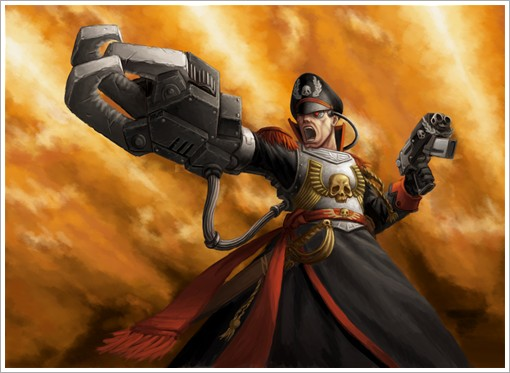

# 自己翻译的雅瑞克政委生平

[ACE翻译]新兵报道-- 附自己翻译的雅瑞克政委生平

no.ace

拜完东村拜西村吧 大家好我是新人 以后多多包涵... 

Commissar Sebastian Yarrick 

塞巴斯第安·雅瑞克政委 

Commissar Sebastian Yarrick is a fictional character from the tabletop miniature wargame Warhammer 40,000 To the people of the world Armageddon he is a hero, saving the world not once, but twice from the Ork Warlord Ghazghkull Mag Uruk Thraka. 

塞巴斯第安·雅瑞克政委是著名桌面战棋游戏《战锤40.000》中的独立角色 对于Armageddon的人民来说 他是个英雄,因为他不只一次的从兽人大酋长碎骨者·斯拉卡(Ghazghkull Mag Uruk Thraka)的手中拯救了这个世界 

Early life 

早年生活 

Like most Imperial Commissars, Yarrick was taken from his parents at birth to be raised and indoctrinated by the Schola Progenium. He learned the Ork language while fighting them on V'run. Since that time, he has extensively studied the Ork mind, and is considered one of the Imperium's leading experts on Orks.

象大多数帝国政委一样，雅瑞克从一生下来就从双亲身边被带走，在忠嗣学校(Schola Progenium)被培养长大。在弗伦(v`run 注2)战斗的那段时间里，他学会了兽人语。同时，他开始渐渐掌握了兽人的思维模式，所以他后来被认为是帝国卫队中理论最领先的兽人问题专家。 

His years with the Imperial Guard were eventful ones, serving in over a dozen warzones and with regiments from Necromunda, Luther McInytre, and Armageddon. His final assignment before retirement was to run the recruitment program for the rebuilding of the 4th Armageddon Regiment. 

在帝国卫队中服役的早年，他的生活是充满挑战的，曾在Necromunda世界 Luther McInytre世界 与 Armageddon世界的数10个团中服役，经历了不下上百次战斗。他在退役前做的最后一项征兵项目是重新建立了Armageddon第4独立团 

The Second Armageddon War 

第2次阿吉米多顿战争 

Fulfilling his duties on Armageddon during the Second War for Armageddon, Yarrick rose to fame defending Hades Hive from the Ork Waaagh!. He had been exiled to the Hive after conflicts with the planet's governor, Herman von Strab, a move said by some to be von Strab's only beneficial decision during the whole war. 

第2次阿米吉多顿战争中，雅瑞克由于他在哈迪斯蜂巢防御战中的出色表现，为自己首次赢得了声望与尊重。战争开始之前，因为同星球总督赫尔曼·冯·施特拉布(Herman von Strab)发生私人冲突，雅瑞克被流放到了哈第斯蜂巢世界-----有人说这是赫尔曼总督在整个战争期间做的唯一一个正确选择. 

While the forces of Armageddon were devastated by both the savage Ork advance and von Strab's sheer inability to command, the forces at Hades Hive were able to halt the Orks, stopped by the well ordered defences hastily erected under Yarrick's order. Even so, the initial Ork attack, led by WarBoss Ugulhard would have succeeded if not for Commissar Yarrick's presence. 

战争开始后,阿米吉多顿的防守力量处在被野蛮的兽人与赫尔曼无能的指挥技术双重摧残的恶劣状况下而不能组织有效的反击,哈迪斯的的军队却在雅瑞克的命令下,依靠迅速有效的组织起防御工事,成功停滞了兽人的进攻.但是即便如此,兽人酋长乌古哈德(Ugulhard)带领的兽人先锋依然有希望获得战争的胜利....如果不是因为雅瑞克接下来的表现..

WarBoss Ugulhard 

兽人酋长乌古哈德 

During the first assault on Hades Hive, the Ork WarBoss drove the bulk of his forces towards Yarrick's position, and was able to engage the elderly Commissar in single combat. Ugulhard fought Yarrick, who stood his ground bravely despite being weak from the fight combined with his advanced age. This resulted in the warboss using his Power Klaw to sever Yarrick's right arm at the elbow. The Warlord's victory was cut short, however, as Yarrick, fighting the pain and shock like no mortal man, swung his Powersword and severed the Ork's head. 

在对哈迪斯蜂巢的第一波袭击中,兽人酋长率领自己的亲卫队冲向了雅瑞克政委的战斗指挥部,紧接着他得到了与那个年老的政委一对一肉搏的机会,虽然乌古哈德认为自己面前这个老头看起来只能很勉强的站在地上,并且这个人已经是早就不是适合战斗的那个年纪了.但是战斗的结果是,这个兽人酋长成功的一击就切下了雅瑞克右小臂,而它的整个动力爪和它的脑袋成为了这个年老的政委的战利品,在战斗中,这个老人如同不是凡人一般的战胜了失去臂膀的痛苦与冲击,利落的用他手里的动力剑砍下了那个大酋长的脑袋 

Yarrick was said to have picked up and brandished the Ork WarBoss's Power Klaw, inspiring fear in the Orks and prompting the Imperial defenders to surge forward and leap upon the aliens. Battlefield legend has it that only after the Ork assault was routed from Hades Hive did Yarrick &quot;allow himself the luxury of passing out.&quot; 

传说雅瑞克在战胜了乌古哈德之后,左手挥舞着兽人酋长的动力爪,骄傲的站在两军阵前,这一超凡的行径极大的震惊了兽人,绿皮的部队开始溃散,并且这同时激起了帝国防御部队的狂热.他们如潮水般涌向面前的异形对手...而真正的传奇是雅瑞克一直坚持在前线指挥,直到兽人的突袭部队被完全的赶出哈迪斯蜂巢,他才&quot;奢侈的允许自己昏倒在地&quot;

News of this incident spread like wildfire amongst the Orks, and wherever Yarrick fought, the aliens would flee in terror. Yarrick exploited this to the full, having Ugulhard's Klaw modified to suit him as a prosthetic limb. He had a pulse laser eye bio-implanted, playing on the Orks' superstition that he had an 'evil eye', and could kill an ork with a single glance. If the orks said he had an evil eye then an evil eye he would have. 

这件重大事变如野火一样在兽人中传播开来,之后无论雅瑞克出现在战场的什么地方,那里绿皮都会开始陷入恐慌而逃跑.雅瑞克把这个效应用到了极致,他将乌古哈德的动力爪改造成了适合他使用的义肢.并且为了配合兽人中流传的一个谣言&quot;雅瑞克拥有一只邪眼,可以只用一瞥就杀死任何一个兽人&quot; 他给自己安装了一只可以放射激光的生物植入假眼----既然兽人都这么说了,为何不这么做呢? 

The Siege of Hades Hive

哈迪斯围攻战

For six months following the first assault, the defenders of Hades Hive held out against further attacks. Although recollections of the siege vary, it was almost unanimously considered that Yarrick was the man who made it all possible; he was the one who held the defenders together, the one who brought them back from the brink of defeat countless times, and the one whose belief gave others the strength to go on. 

第一次突袭的六个月后,守军们成功的抵住了接下来的进攻.尽管让围攻停滞不前的原因有很多,但是所有人都一致认为雅瑞克才是使这一切成为现实的那个人;只有他才能把所有守卫部队团结起来,只有他能让很多濒临失败的战斗奇迹般的发生转机,也只有他可以用自己无比的忠诚激励起其他人勇气 

The time he bought at Hades Hive, tying up a vast portion of the Ork Waaagh! and distracting Ghazghkull himself from his ultimate goal, made all the difference, allowing time for the reinforcing Imperial Guard and Space Marines to muster and launch a counter attack. 

在哈迪斯进行抵抗的那段时间,雅瑞克成功了在大大小小的地方给兽人部队制造了麻烦,捆住了他们的手脚.由于他的存在,碎骨者的全部计划几乎都被这个人打乱了.这给帝国卫队以及星际战士的增援行动提供了异常宝贵的时间,反击即将开始..

Yarrick was one of the few survivors of the final battle for Hades Hive, and it took many months for him to recover from the injuries he sustained during that final assault. He accepted nominal retirement, along with a training post on Armageddon. However, the knowledge that an Ork like Ghazghkull was still at large proved too much of a distraction, and only months later he reported back for active duty, vowing that he would not rest until Ghazghkull was hunted down and killed 

最终,雅瑞克成为了极少数在哈迪斯战役中的幸存者之一,最后的突袭结束以后,他用了几个月的时间恢复自己的状态.并且接受了名义上的退休,进入了阿米吉多顿的新兵训练营负责指导.但是他对兽人的了解让他意识到碎骨头者依然强大的实力始终会是他心头的隐患,所以又过了几个之后,他申请复职.矢志于追杀碎骨者的任务,他感觉到如果不这样做,他永远不可能得到安息.

Golgotha 

受难地 

The tables were turned on Yarrick during the battle for the planet Golgotha. Ghazghkull devastated the Squats with such ferocity that even the Commissar himself could not stand against it. Yarrick was defeated and captured by Ghazghkull, who later released him, saying &quot;Like ye humies need food, we orks needz good enemies.&quot; Yarrick left the planet, but soon returned with a force from the Adeptus Mechanicus and the massive Ordinatus Golgotha, and routed the Orks from the world. Ghazghkull again escaped to fight another day.

在受难地星球(planted golgotha)上,战争的厄运转换到了雅瑞克政委一边.碎骨者强大的战力以及残忍暴行般的进攻迅速的摧垮了雅瑞克的装甲部队,甚至让他自己也失去了对抗碎骨者的勇气.最终雅瑞克被碎骨者生擒,但是很快他又被放走了.碎骨说&quot;你们人要食物,我们兽要可战的人!&quot;雅瑞克离开了那个星球,但是很快他就带领着一批新的军队以及机械神教提供的大量 受难者大规模导弹发射器 回到了受难地,这一次他彻底的从这个星球上清理了全部兽人,除了碎骨者...后者猥琐的逃跑了,准备来日再战.. 

The Third Armageddon War 

第3次阿米吉多顿战争 

Fifty seven years to the day of the previous invasion, Ghazghkull led another Ork Waaagh! to Armageddon, this time the largest Waaagh! ever known in the history of the Imperium. Yarrick, following the trail of his nemesis, returned to Armageddon, and was granted supreme command over all Imperial forces stationed to fight the aliens. A distress call was sent to High Marshal Helbrecht of the Black Templars Space Marine chapter, who rerouted his crusade and two others to bear down three whole crusades onto the Ork Waaagh! forces.

距离上一次入侵57年以后,碎骨者带领一票新的绿皮大军重返了阿米吉多顿,这一次是帝国历史上有记载的最大规模的兽人进攻.雅瑞克,这个一直追寻着他复仇道路的人,也回到了阿米吉多顿,并且被授予了帝国卫队最高指挥官的权力来与绿皮大军殊死一搏.一封来自阿米吉多顿的紧急求救的文件送到了黑色圣堂战团的大元帅赫尔布雷希特手中,于是他停下了手头的事物,与另外两只远征军一起加入了这场针对兽人的圣战..

During what came to be known as the Third War for Armageddon, billions lost their lives in a gruelling war of attrition. This period also saw the Marine chaplain Grimaldus elevated to &quot;Hero of Helsreach&quot; after a two month conflict ended with the Marine's fortified basilica collapsing, killing all but Grimaldus who climbed from the rubble a day later.

有关第3次大战后来的历史是人所共知的,以数以亿计的牺牲为代价,战争艰难的取得了胜利,这期间同样发生了诸如星际战士牧师格瑞玛度斯被授予&quot;赫尔斯利奇英雄&quot;头衔等事件--- 一场持续达两个月的冲突彻底摧毁了一座保有圣物大教堂,几乎杀掉了所有坚持防守的星际战士,但是格瑞玛度斯凭借惊人的毅力在一天后从废墟中爬了出来 

Ghazghkull was repulsed by the Imperium through acts of nearly-impossible bravery, the Helsreach battle being just one of many. Templar's High Marshal Helbrecht gave chase to Ghazghkull's battle barge flagship, vowing to defeat the warlord once and for all. Yarrick requested permission to join the High Marshal's crusade fleet, a highly unorthodox request for an Imperial Guardsman to travel with Marines, yet such was Helbrecht's regard for Yarrick that his request was allowed. 

碎骨者被帝国战士们近乎&quot;不可能的英勇&quot;而抵挡住了,赫尔斯利奇的战斗只是无数场惨烈冲突中的一个,黑色圣堂战团的大元帅赫尔布雷希特追赶着碎骨者的旗舰--古巨圾,矢志于彻底消灭这个大酋长,雅瑞克请求加入大元帅的旗舰指挥部,这是非常罕见的--有帝国卫队成员主动要求跟随星际战士作战,出于对这位老政委声望的尊重,赫尔布雷希特接受了他的请求 

It should be noted that this is the most current status of Yarrick's storyline (See Black Templar's Codex) and no further information has been written/released, leaving him currently alongside High Marshal Helbrecht aboard his battleship, presumably searching for Ghazghkull. 

这些就是到目前为止,所有有关雅瑞克政委的记录,(参见黑色圣堂核心规则书)没有任何新的线索被写下或者放出,他目前应该正站在大元帅赫尔布雷希特的旗舰上,与后者一起追寻着碎骨者的下落 

注1：哈米吉多顿（Armageddon）：（位于太阳星域），帝国的一个聚居世界。这里发生过三场进攻帝国的大战。在第一次哈米吉多顿战争中，混沌军队在恶魔基因原体安格隆（Angron）的率领下入侵哈米吉多顿，但最后被包括太空野狼战团和灰骑士战团在内的帝国联合部队击退。第二次和第三次哈米吉多顿战争中，兽人酋长碎骨者·斯拉卡（Ghazghkull Thraka）率领他的兽人进犯哈米吉多顿，试图控制这个世界，尽管它们让帝国遭受了巨大损失，但最终还是无功而返。安格隆和嘎兹卡尔都分别发誓要杀回哈米吉多顿以证明他们的破坏力！脚注：在哈米吉多顿赤道附近的丛林中找到过至少一个亡灵族金字塔。 

注2：弗伦（V'run）：（位于暴风雨星域）兽人的一个母星。雅利克政委在他从军生涯的早期曾在这里战斗过，并学会了兽人的语言。
