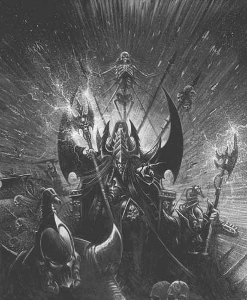
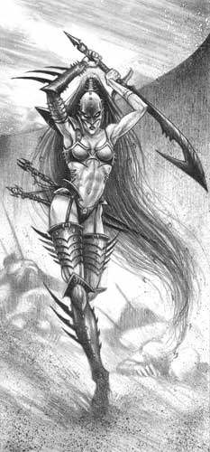
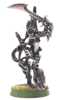
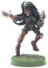
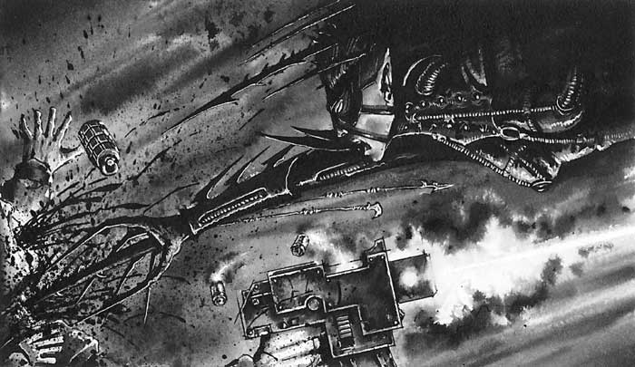
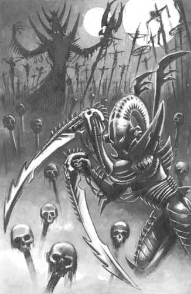
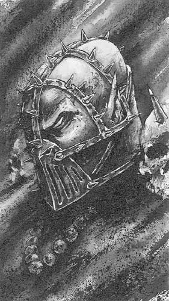
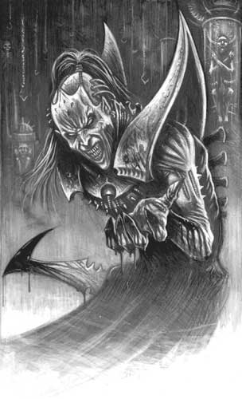

# 踏足黑暗的领域——黯灵族特殊人物

踏足黑暗的领域——黯灵族特殊人物

eliphasfan

阿斯杜巴尔，黑心教团的最高领主

文件: DE/4695/653

归类: 2/a/de

存档日期: 4784373.M.39

副分区: Imp 272

分区:异星人/DE 45b

警告:未封

使用权:仅为授权者

有效期:未知

发送站:不明

“我对残酷的命运把我们放在这个位置上真的感到很是失望。例如，我真的没有除了让我的战士攻击你们人口中心的其他选择。你们若是将保护你们的资源并返回到你们的家园和亲人团聚的愚蠢希望搁置，有多少流血和悲哀是可以避免的。 

然而…，现在还有时间，我给你我的话，任何现在离开的人将被赦免可以自由地穿过废墟。这项大赦的提议将会在恐怖重新开始之前持续两个你们的小时。我只希望你们仔细考虑你们所处的位置。如果你们愿意的话派一名代表来讨论进一步的条款，如果你们不能信任一个人为剩下的人说话就多派几个。我相信，所有的人都可以被招待的……”

――发现于德尔塔９星大屠杀的通话记录

阿斯杜巴尔.维克特

２７７点，WS6 BS6 S4 FA14/11 SA14/11 RA14/10 I7 A5

阿斯杜巴尔可以加入至少２００分的黑心教团军队；他记做军队的执政官，并且其它的执政官将不能被使用。他算作一个ＨＱ选择。他必须按照以下规则使用，并不能获得任何黑暗灵族军备库中的额外装备。

装备：毁灭王座

毁灭王座：Asdrubael的座驾是一架为其重要身份特殊定制的华丽的掠夺艇。Asdrubael，王座和其保镖共用一个反映了总体能力的战斗数据。对手不能选择攻击王座上的乘员，同样地，Asdrubael和其保镖也不能下车。只要你将他们视作一个特殊的掠夺艇就不会出错！以下规则适用于Asdrubael，王座和其保镖：

类型：快速，悬浮，开顶

能量盾：王座被一种特殊的能量盾保护；其对任何方向的远程攻击具有１４的装甲值。近战攻击仍使用正／侧１１、尾１０的正常装甲值。

火力：王座拥有两个解离枪和一个黑暗光矛，其外Asdrubael和其保镖拥有碎晶手枪，他们使用正常的开顶悬浮车辆乘员射击规则。所有武器ＢＳ为６.

近战：若王座于移动期内移动了１２寸或更短，它可以冲锋６寸之内的敌人。王座像无畏机甲一样近战，使用以上数据，（此时攻击为Asdrubael和其保镖所做）。双武器的额外攻击已被计入，不应再次加成。因为Asdrubael和其保镖具有能量武器，近战伤害忽视装甲。注意：因王座是为车辆所以即使是在近战失败的情况下它也永不后退。

特殊规则：独立人物：Asdrubael是一个独立人物，使用规则书中所有的独立人物特殊规则，他绝不能加入另一部队。

<h6 class="quote">Quote:</h6>

死乃吾食；惧乃吾饮

------阿斯杜巴尔，黑心教团的最高领主

<h6 class="quote">Quote:</h6>

引用第15楼vol.13于2008-04-14 15:57发表的  :

小E你真是勤奋..

我最近被ASSIGNMENTS压垮..

没能力翻东西了..

特别感谢李子兄弟

“从未有过这么多外星人的血淋湿了角斗场。这怎么能被比拟呢？人群仍呼喊着要求更多的，没有止境的表演。然后莉莉丝自己跨入竞技场。人群为�的美貌和优雅而寂静；她的肉体┞蹲牛�仿佛嘲讽着剑刃以吸取她的血液；她的头发松散着，仿佛诱惑她的对手去抓住它打出致命的一击。这就是她喜欢的表演：那么平静，那么自信，那么冷酷。观众们为她挥舞着她的武器——死神之吻时的一抹闪动冷沥银光而目瞪口呆。随后，外星人被放到场上；不是一个，也不是两个，而是十个袭击者每人仅一道伤口。人群轰鸣叫好；这娱乐将会在无常之夜中长久！?

——黯灵族领主萨斯萨卡对死亡女士莉莉丝的回忆

莉莉丝.希斯帕拉克斯巫灵女妖的领袖

分数：９０WS7 BS6 S3 T3 W3 I8 A3 Ld9 Sv6+

一个至少１５００分的黯灵族巫灵女妖军队可由莉莉丝领导；如是，她记作部队的执政官，并不能包含其它执政官。她必须按照以下规则使用，并不能获得任何黑暗灵族军备库中的额外装备。

装备：致痛刃，碎晶手枪，影盾和一整套致命的巫灵女妖兵器

特殊规则：

独立人物：除有卫队以外的情况下莉莉丝是为独立人物并使用战锤４００００规则书中所有的独立人物特殊规则。

巫灵女妖兵器：这是个为她们所使用的广泛的致痛器具类别；其中包括刺网，穿透矛，九头蛇刃和剃刃陷阱。其具有如下功用：

任何与莉莉丝近战的成员不能算为装备有额外近战武器。

所有基础力量低于６者与她对攻时ＷＳ减半（向上化整）；基础力量６或以上者不受影响。

巫灵女妖部队：莉莉丝仅能作为巫灵女妖部队的领袖，她的军队从黯灵族军表中选出，并具有如下变化：

巫灵女妖算作部队而非精英选择

武士和掠袭者算作精英而非部队选择

执政官，人彘师，割肉人偶，利爪蝎不能被使用

莉莉丝的卫队：莉莉丝可以像黯灵族领主那样带领卫队，其必须是巫灵女妖而非武士或梦魔妖灵。每个女妖值１２分，最多有１０个女妖。所有通常选项，升级和特殊规则均与普通女妖一样；不过因为莉莉丝的女妖卫队是精英选择，所以你可以自己选择战斗药剂的效果。

编者注：莉莉丝仅能作为巫灵女妖部队的领袖，不能加入普通黯灵族军队。当你只是想要在普通部队中使用莉莉丝时会造成问题；不过如果你使用战锤４００００规则书第１３１页的联军规则的话，你就可以将由莉莉丝和两个５人女妖小队的分队算作黯灵族部队的盟友加入。

＋＋＋下载完成＋＋＋ ＋＋＋灵族海盗“可鲁拉”记录＋＋＋ 出处：KTV651/019-6712 alpha

调查历史：书记员帕且 信息即是力量 塔罗矩阵：黑暗中潜伏着的掠夺者 

目标信息： 名称：亚空可鲁拉 所属：剥颅教团 尊号／假名：污秽者，颅骨女士，阉割者，扒皮，狱火女士 

最早帝国遭遇：6129967.M38 状态：活跃 位置：未知 威胁等级：极高 建议方针：尽力灭杀 

目击者描述： 

目击者：安东.摩斯曼上尉，帝国守卫军，第８７“蓝血”师 

“他们不知从哪里一下子冒出来，帝皇保佑，我受伤了，我要死了，是不是！”【讯问者重复问题】“好的，好的，我告诉你，我去你妈的看到了，他们不知道从哪里冒出来的…那女的带着他们一下子冲了出来，从地狱来的婊子”【咳嗽和干呕】“她身材高挑；噢，原体作证，她可真漂亮；坚韧又柔软，迅捷得致命……想想那笑声就仍让我浑身发冷。她…她有那个家伙……她把它打到的人的生命都给吸走了……剩下的就是些干壳子罢了，她吸干了他们后就把他们扔在一边……她在他们的痛苦中作乐，那东西填充着她……使她充满了狂暴，让她更快，更危险……比我见过的所有活物都邪恶。帝皇保佑。她乃是吾之死灭……”【对象陷入精神错乱中的喃喃低语不可辨闻】

下载终止＋＋＋ 下载终止＋＋＋＋＋＋ 

污秽的可鲁拉 

１２５分ＷＳ６ＢＳ６Ｓ３Ｔ３Ｗ３Ｉ７Ａ３（４）Ｌｄ９Ｓｖ５＋ 

可鲁拉可以加入至少１５００分的剥颅教团军队；她记做军队的执政官，并且其它的执政官将不能被使用。他算作一个ＨＱ选择。她必须按照以下规则使用，并不能获得任何黑暗灵族军备库中的额外装备。 

装备：地狱面具，恐慌执行者（及咒亡榴弹），剥魂刃 

特殊规则： 

剥魂刃：可鲁拉装备着被称为剥魂刃的独一无二的武器；从她的双手延伸出的两个致命的尖刺以刺穿对手并汲取其生命精华。剥魂刃算作两套毒刃，所以可鲁拉的攻击次数加１（已含），并总是能以２＋造成伤害。任何与她底盘接触的被杀活物的生命精华被吸取，下一轮中可鲁拉的攻击次数加１。 

咒亡榴弹：可鲁拉的恐慌执行者可以正常使用或发射特制的咒亡榴弹；其属性如下： 

射程：６寸Ｓ４ＡＰ３突袭１／爆炸盖板 

独立人物：除有卫队以外的情况下可鲁拉是为独立人物并使用战锤４００００规则书中所有的独立人物特殊规则。 

卫队：可鲁拉可以拥有一支她最精锐的战士组成的卫队；可以是武士和／或梦魔妖灵，就跟黯灵族军表中描述的一样。

本部分内容设定了隐藏,需要回复后才能看到

补个图：

可鲁拉女士

——————————————————黑暗变态的肢解吸命分割线——————————————————

巴扎克一边为他的小子们倾泻的屠杀粗旷地大笑着一边一枪打进了一个尖耳朵的脸中；抢块和他的大枪打下了飞车，把敌人的老大搁浅在了战场中间。巴扎克的小子们一举冲破了敌线，准备好了砸碎倒霉的敌人。兽人老大握紧了动力爪，邪笑这朝着混乱中被吓得目瞪口呆的尖耳朵老大在小子中挤了过去。他狂吼一声收拳准备打出致命一击。

突然间，仿似从无处而来的刀锋在他手肘上面一点切穿了他的胳膊。巴扎克转过来看到了一个高高的，穿着铠甲的尖耳朵。在他能抬手射击之前，敌人再度出击；他致命的双刃穿过了老大的胸部中间，鲜血四溢；感觉着他可观的力量从他身体里溜走，巴扎克跪倒在地。仰望着那战士的面具，他昏暗的目光对上了一双闪闪发光的无情的球体；刀锋最后一次往复闪烁；巴扎克就什么也不知道了。

丹查尔

９０分WS6 BS6 S4 T3 W3 I6 A2(3) Ld9 Sv3+

丹查尔可以加入任何黯灵族卫队；他取代一个正常的梦魔妖灵的位置。他必须按照以下规则使用，并不能获得任何黑暗灵族军备库中的额外装备。另外，丹查尔只能在双方同意时被使用。

装备：折磨之盔，肢解之刃

特殊规则

肢解之刃：丹查尔拥有一对叫做肢解者的独特武器；其是为一个动力武器，并且每个成功集中将导致两个致伤而非一个。他的额外攻击次数已被计入。

保镖：为表现他在敌人的攻击下挺身保护主人，在突袭段里丹查尔可以和他保护的黯灵族领主互换位置。这在模型冲锋后，战斗开始前发生；黯灵族领主和丹查尔只是简单换了一下位置，战斗正常进行。注意：这可以在任何玩家的回合里发生。

斩首者，潜行人龙冠军

“注意啊，他们中间有一个叫科拉祖阿卡的——猎头之人——斩首者。一千个骷髅头骨铺盖着他的巢穴；一千条性命在他刀下迅速终结。他穿越虚影正如微风穿过空气，在斩首者的刀下谁也不曾安全。没有守卫能留意到他的经过；没有护盾能抵挡住他的打击。没人能阻止他获取自己的战利品；谁能说清对仇敌来说特定死亡的价钱呢？我说不了，但那传言讲述过千百倍的牺牲只为一敌之死……”

————————————————————恐怖故事（卷三），格阳出版社，第四次重印

斩首者

１１２分ＷＳ５（６）ＢＳ５Ｓ３Ｔ３Ｗ２Ｉ６Ａ２（４）Ｌｄ９Ｓｖ５＋

斩首者可以加入任何黯灵族军队；他算作一个ＨＱ选择。他必须按照以下规则使用，并不能获得任何黑暗灵族军备库中的额外装备。另外，他只能在双方同意时被使用。

装备：恐慌残链，断头（算作战利品架），碎晶手枪，副肢和斩首者

特殊规则：

独立人物：斩首者是一个独立人物，使用规则书中所有的独立人物特殊规则，他绝不能加入另一部队。

副肢：斩首者有一对移植的副肢；这提供他＋２的攻击次数和＋１的近战技术（均已被计入）。

斩首者：正是这武器给了他斩首者之名。其是为动力武器；如果斩首者在任何一个击中骰投出６，该攻击算作双倍力量。

影肤：潜行人龙的特殊变色能力即使是在空地上也能让他们能融入背景之中；潜行人龙总是算作在５＋掩体中。这也包含突袭段，除非对手拥有破片手雷的话，潜行人龙总是先攻。如果攻击忽视掩体的话这使用其正常５＋护甲。

渗透大师：斩首者是一位渗透敌军的超级大师；他无论在任何场景内都不使用正常方式部署。写下斩首者的藏身之处（必须是在双方部署区外）；你可以在任何时候通过出示记录来显现他的位置；但是你必须在三轮之内显现他的位置。

人彘大师乌里恩

在诅咒之城科摩罗的深深地下，乌里恩.拉卡斯，所有人彘的宗师进入了他的秘密实验室。在这里，在这完全的黑暗和炼狱般的闷热中乌里恩独自工作，疯狂的胡言乱语。实验室里的墙壁被提供给乌里恩作实验的俘虏铺满。被链子紧锁和箝口物堵着，有的已经死了，有的还活着。对于某一些人，他也不是那么确定。 

乌里恩研究了一下他的囚犯，并最终做手势示意以他的巨大的割肉人偶保镖把其中一人带向了他的内部圣殿。他选择了一个肌肉发达的男子，一名一朝为人皇服务的星际战士。无法挣脱巨大的割肉人偶的掌握和被蛇型的有机体拘束着，这名男子的充满仇恨的眼睛瞪视着乌里恩。乌里恩命令着把他绑在手术台上，然后拿过来他的工具。当乌里恩的一个利爪抽出鲜血时，俘虏呻吟出声。疯狂实验者明亮的眼睛因为他感到该男子的痛苦而高兴地闪过了一道绿色的辉光。他继续工作下去，人彘大师用刺耳的声音自言自语道：“你应当感到荣幸。等我切除你的皮肤时你会觉得多么的清凉。当我完成你的时候，你将为更伟大的目标服务。”

乌里恩停了下来，集中着精神去回忆；那也许曾经确实是有过一个目的，但它现在已被痛苦，暴虐，拷打和狂乱的大洋所冲走。乌里恩耸耸肩，重新回到了他的实验上。 

……痛苦的疾呼刺穿了黑暗。

乌里恩.拉卡斯

乌里恩

１００分ＷＳ４ＢＳ４Ｓ３Ｔ４Ｗ２Ｉ４Ａ２Ｌｄ８Ｓｖ５＋

超级割肉人偶

＋１５分ＷＳ５ＢＳ０Ｓ４Ｔ３Ｗ２Ｉ４Ａ２Ｌｄ５Ｓｖ５＋

乌里恩.拉卡斯可以加入任何黯灵族军队；他算作一个ＨＱ选择。他必须按照以下规则使用，并不能获得任何黑暗灵族军备库中的额外装备。另外，他只能在双方同意时被使用。

装备：酸液枪，刺钉枪，毒刃和怨灵囚炉

特殊规则：

独立人物：除有卫队以外的情况下乌里恩是为独立人物并使用战锤４００００规则书中所有的独立人物特殊规则。

人彘大师：乌里恩是他行业的宗师，他的武器是同类中最精致的；因其超越同济的质量，乌里恩的武器在击中的情况下自动造成伤害——不需要投伤害骰但仍正常使用甲防。

卫队：乌里恩可以拥有最多５个超级割肉人偶作为卫队；他们跟普通的割肉人偶花费一样的分数，但并不占用一个精英选择。这些都是乌里恩从他最好的创造中亲手选出的；所以他们的属性被提高到以上数据；除此之外他们跟普通割肉人偶使用一样的
