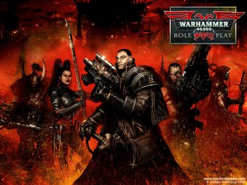
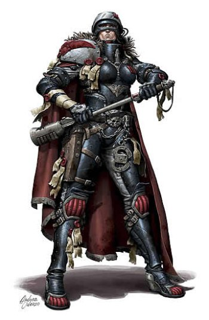
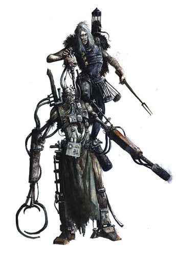
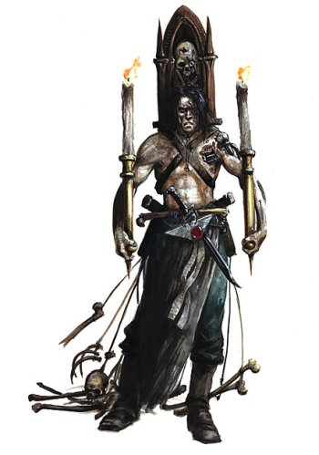
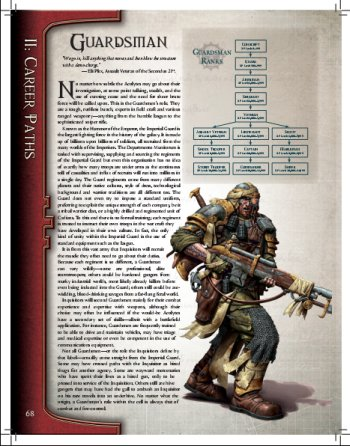

# 锤子40K官方TRPG——DARK HERESY 不负责简介

锤子40K官方TRPG——DARK HERESY 不负责简介

boltgun

不知道能坚持多少，作出来多少，按时间和热情走吧

游戏过程示范

GM一名，玩家四个

阿墨西斯（杀手）

维尔摩斯（卫军大兵）

塞鲁斯（文研员）

拉萨罗（仲裁庭执法员）

四个人受异族审判庭审判官怀特骆克雇用。审判官几日前收到一个十分奇怪的亚空间通讯，来源是自己在某研究站的眼线托马斯发出的。托马斯在那之后就再也联系不上了，于是脱不开身的审判官派遣四人前去调查情况。

GM：来到研究站半天了，你们一个人影都没看到，没人在登陆舱迎接你们，各个大门没人看守，各个大厅和实验室里没人操作。现在，你们来到了看起来似乎是控制中心的房间外，你们打算怎么办？

大兵：我来检查一遍走廊，把霰弹枪准备在手里。

杀手：等大兵给我没有敌情的手势之后，我走到门跟前，看看自己能不能把门打开。

执法：文员，咱们两个后退一点，做好掩护准备。

文员：好，好。

GM：好的，大兵检查了一下走廊，发现没有什么敌情，然后杀手发现门被锁住了。

杀手：果然。那么我用自己的破解保险技能试着解开它看看。（投一次破解保险技能测试）

杀手：通过了。

GM：OK，门锁不是那么困难就弄开了，生锈的大门向两旁打开，露出了指挥中心内部。你们首先发现的是房间内大量的血迹，然后，你们震惊地发现了血迹和腥味的来源，你们发现了三具尸体。

杀手：皇帝保佑……

大兵：有任何敌人吗？

GM：你们面前可见的范围内一个没有。

文员：我来检查一下尸体，看看是否有幸存者

执法：我看看能不能登陆数据中心，大兵，掩护我们一下。

大兵：交给我吧，我可不擅长跟机器打交道

杀手：嗯，没错，武器跟计算器是不对付的

GM：不对付到武器将计算器砸到烂的地步。思考设备已经被砸烂了，而且三个倒霉的受害者也没有幸存的。

文员：怀特洛克提起过这一带有些打游击的精灵匪徒，我应该见过精灵武器造成的伤口，我想辨认一下，尸体上的伤口是否是精灵的作品。

GM：想法不错，作个医药技能测试

（文员投测试）

文员：刚好通过

GM：你发现这些伤口完全不是精灵武器造成的，两具尸体上的伤痕明显是搏斗武器削砍留下的，或者是非常锋利的爪痕，第三具尸体没有了头，就好像脑袋爆裂了一样。

文员：矢弹可以在身体内爆炸，会是矢弹么？

GM：你的观察否定了这个结论，矢弹爆破至少会残留下一部分头的残骸，但是尸体上并不如此。你更仔细地观察之后，发现第三具尸体的鲜血之下，是一身星语者（注：亚空间发报机人间）的制服。

文员：执法，我看咱们那个失踪的星语者找到了……

执法：靠，脑袋爆掉的星语者，皇帝保佑，这事好不了。

GM：执法的话音刚落，外面传来了一声让你们感到血液都凝结起来的吼叫，气温似乎都降了下来，已经关闭的大门外，响起一下又一下沉重的脚步声，什么东西过来了。

文员：皇帝保佑……

杀手：找掩护！

执法：尽自己职责的时候到了，打他X的！ 

DARK HERESY是40K官方发布的TRPG系统，之前的那个审判官系统看来是完全成为个体版模型战棋了。

终于TRPG，玩家可以更自由地以第一视角去玩40K了，不用再局限在战场上了，HP也不再是千篇一律的1，能够作的事也更多了。

但是，相对40K战棋玩家一手指挥连排级兵力（变态的末日规则更多）、满地动力装甲和重武器来说，DH中玩家能控制的东西就要局限得多。

DH里，玩家扮演的角色，被限制在审判官所雇用的小弟这一范围内，游戏剧情则是小弟们为老大查案兼卖命的过程。

游戏的系统构成，注定扮演过程中将充满了调查、搜索、开枪对砍、追杀和逃命这些行为，而且少不了血腥、诡异和黑暗的元素。角色们甚至专门有一套系统来整理自己的心智健康程度、灵魂污染程度。

能够让GM拼命地把PC们搞疯，搞堕落，从这个角度来说，这个游戏也是有些变态。

DH的“职业”系统叫做生涯，玩家在创造自己角色的时候，可以在八个生涯中选择一个。生涯即意味着角色的生活事业、工作、和身份，所以既不能“转职”，也不能“兼职”。

八个生涯分别是：

卫军士兵、仲裁庭执法员、文研员、杀手、流氓、帝国灵能者、机械会神甫、帝国教会神甫

每个生涯有八个“等级”——阶级，升阶级靠的不是角色赚得多少XP，而是角色花费掉了多少XP——是的，DH系统中，技能和属性的获得方法，就是花费XP去购买。不同的生涯、不同的阶级，都会有不同的技能和属性供角色购买。

DH系统中，最重要的一个特点，就是一个角色的“HP”——WOUND，伤害承受，是在角色创造的时候就确定下来的，从这一刻开始，无论角色如何成长，伤害承受不会再增加。

无论角色的身体坚韧属性如何成长，能够影响的，也只是受到伤害时的减免，而不是WOUND的总数。

整个游戏系统来看，一个角色最多可能有的WOUND的数量是14，最少是7

能够影响一个角色拥有多少W，却是这个角色的出生地类型。

DH系统中为玩家提供了四个选择——野蛮世界生人、巢型都市生人、其他各帝国世界生人、星海生人。其中最后一种意思即为在太空船上出生成长的人。

这四种出身地，不但影响了角色的伤害承受，而且还从一些特别出生属性、以及可能收入这些方面来影响角色的种种。

至于DH系统中类似于“六围”基本的属性，则延续了锤子的特点，除了单独的WOUND之外，是：

搏斗能力

射击能力

力量

坚韧

敏捷

知智

意志

交际魅力

当然，这些基础能力，一部分也会受出生地影响的。 

DH在大部分时间使用D100（即两个D10，一个个位一个十位）来投各种测试，大致上表现百分比。

在很多细节上，要求的是玩家和GM的自觉，比如属性是在一定基础上投点，不买点。玩家想POWERPLAY，直接算计出最合算的组合模式，然后投点处都选最大值，谁也管不了。所以在公平竞技这方面，锤子又一次留下了可能让人诟病的把柄。但一般来说，如果不是喜欢40K的气氛和背景，也不会来玩DH的不是？对于背景和故事有爱的PC，POWER PLAY也该算是无聊的举动了

话说回来，DH是一个有战斗的系统，但更是一个有着很多专门给扮演功能作出来的组件、有爱的系统，简单看看手册之后，觉得要玩DH，一定要先了解一下最基本的40K背景常识，然后，在面对种种诡异和阴森的情景之时，玩家们才会100％理解自己看到的是什么，甚至，猜测到自己敌人的来历，会在灵能者释放灵能搞砸的时候意识到接下来的是什么危险，在看到多出一只甚至两只手的敌人之后意识到自己该逃出这个行星了（不过DH的环境设定在OBSCURUS星域的一个小节区里，离虫子的攻击方向差着十万八千里，第二种情形大概是不会出现了）

先不说有的没的了，上干货，人物创建第一步，选择出生地类型。

可以从野蛮、巢型都市、帝国其他、星海出生四种之中选择一个，也可以投D100来乱一个

01－20 野蛮 战战们的好选择

21－45 巢型都市 骗子们的好选择

46－90 帝国其他 生涯选择最广的综合型

91－00 星海出生 灵能和研究员适合

野蛮世界生人

野蛮世界的生存环境一般极为艰苦，生存不是一件容易的事，有些世界覆盖着到处充满了危机和陷阱的丛林，有些世界上满是干燥如火的荒漠，这里的居民以自己原始、粗犷的方式生活，不屑于所谓文明佬软绵绵的风格和科技。

有些野蛮世界上的科技水平甚至不会到达黑火药时代的水准，大部分甚至停留在铜、铁器时代，甚至有的退化到了石器时代。有时卫军会在这里招收兵员，教会他们使用自动武器或者光枪的使用方法——居民们可以很快学会并熟悉新武器的使用，但是理解或者制造则完全没门。有些野蛮世界则是环境恶劣危险到无法支持人类居民发展出足够的人口来建立高级文明，这种又可能被定义成死地世界的行星，则经常出产猛人强兵。

这里的人类居民，有的是流浪部落的后裔，有的则是灾变之后文明的遗留者，有些则是迫降殖民飞船的幸存者的后代。帝国在野蛮世界的行政一般也是通过总督完成的，除非是有不得不办的事，总督大人们也鲜少访问地面，他们大部分时间都是在行星轨道上的卫星城里度过的。

帝国教会倒是经常在野蛮世界上建立传教站，为这些迷信的家伙宣传帝国的真理和皇帝的荣耀。

有时候一些部队比如战斗修女会，甚至是阿斯塔特们，也会在比较危险的野蛮世界建立自己的训练场。这么一来，教会在清理那些本地不知所谓的异端信仰时，也方便了不少……

野蛮世界生人角色：

他们是能够走出家园世界，还仍然能够保持心智正常的家伙（至少大体上还没被吓疯）。他们对于亚空间现象、科技、帝国贵族式的礼节都不大适应，他们擅长的有两样——战斗和生还。

野蛮世界生人可选生涯：

杀手 年少时就被杀手训练组织带走，野蛮世界出身的杀手十分凶狠

卫军大兵 各部落向帝国尽义务上交的兵役人员，虽然给了把光枪，有没有训练过就不一定了……

帝国灵能者 大部分是前萨满之类的家伙

流氓 在文明佬的地盘混久了学坏了的家伙。除了抢偷劫骗，在帮派火拼里更是强人。

野蛮世界生人自带技能：

听说语言（野蛮世界方言）（智） 很寒的技能

野蛮世界生人特别属性：

钢铁肠胃——生活在一个挑食是一种犯罪的环境，野蛮世界生人习惯于吞咽任何能吃的东西。

奖励：角色在对抗败坏食物和吞食物引发中毒的时候，得到＋10的加成。这个加成也适用于强迫自己吞食任何让人不适的食物比如烂肉、牛粪、尸肉等等……

原始习惯——野蛮世界生人的生活中，没有时间去关心那些神秘的科技，也没有奢侈的余地去学习那些无用的社交礼仪和夸夸其谈的哲理信念。

惩罚：在 技术应用（智）技能测试时，接受－10的惩罚，在正式场合和文明环境中，投交际魅力测试的时候也要－10。

常有的事——野蛮世界的生活是充满危险和杀戮的，流血十分经常，野蛮世界生人已经习惯于处理流血的伤口了。

奖励：在持续流血的伤势中，野蛮世界生人的角色可以通过投一次知智属性测试来尝试止血。

野性知识——野蛮世界生人知道怎么猎到自己的食物。

奖励：导航（地面类）（智）、生存（智）、追踪（智）三个技能，对野蛮世界生人来说以基本技能对待

注：基本技能即常识性技能，人们就算没有修习过也可以尝试使用，但是投测试的时候要难度加倍，具体见后面技能部分（如果会撑到那个时候的话）。

——————————————————

巢型都市生人

巢都是人类帝国特有的生存环境，它是帝国重要的利益所在。巢都不但是人类的生存城市，更是庞大的工厂集合体，为皇帝陛下的军队提供着重要的军工材料，提炼种种矿物和帝国舰队需要的燃料。

巢都城市所在的行星，地表环境一般已经十分荒凉并且危险，有时，在几百年的持续污染之下，巢都之外的自然环境甚至可以称得上是致命的。每个巢都之中都生存着数百万、数千万，有时甚至多到数十亿的人口。每个巢都是一个相当独立的权力圈，一个个贵族家系一代一代地统治着他们的迷你王国，和其他的巢都进行各种交易、战争。

巢都尖尖的巢顶如同一根钢刺一样穿过云霄，直耸入天际，有些巢都的顶层甚至是当地行星的最高海拔的所在。上巢是巢都最为奢华的部分，新鲜的空气，底层居民不敢也无法想象的景色和生存空间，奢侈的生存环境。这里居住的，是一个巢都中最为富有的阶层，有的是大财阀，有的是帝国的大贵族家族。

在上巢的底部和巢都其他部位过渡的地带，是无数厚重的钢铁闸门，重兵看守的通道，还有无处不在的巡逻警戒。在这之下，就是巢都那臃肿庞大的劳作功能的身体 ——城巢。城巢之中的人口多到不可想象，养活这些人的食物和基本生活用品大部分来自外部进口，时常也会循环利用一些东西。这些巢都人的生活是毫无质量可言的，空气是从巢顶一层层循环下来的，越到下层就越是带着毒性和腐味，连用水都是利用上层排下的循环过滤产物，食物一向是工业产品，有时还是死尸再利用的产物。虽然如此，但环境污染和吃喝并不是巢都人最大的问题，在这里，尤其是比较低的层面，帮派械斗和各种规模的暴动几乎是每日的家常便饭。绝大部分巢都人只认识自己出生的巢都，他们从来没有到过任何其他的地方，从来没有见到过阳光，从来没有踏足过自己行星的地面。他们的一生就是在巨大的生产机构中服务的一生，努力地在周围各种犯罪和暴力中幸存。那些能够走出巢都的人，时时刻刻都会深刻地感受着自己正身处外乡，而且患有开旷地带恐慌症。

城巢再向下，是没有法律存在的地带，地下巢域。这里遍地是爆炸和输电中断等等事故和灾难造成的废墟地，坍塌的通道更是数不胜数，这里是犯罪分子和放逐者的天堂，是黑帮、流氓和疯子们找到自己的天下，各种秘密和黑暗的信仰也会在这里寻求存身。有时，一些地带也会因为事故和意外被切断了和上层的联系与交通，被迫成了下巢的一部分，这种及其少见的情况早就了下巢地带中唯一还有安宁与秩序的避风港，但就算是在这种地方，下巢中，枪永远是权威和法律的化身，在这里，不带武器行动的人几乎没有。

下巢本身也承担了接受整个巢都的污染和废弃物的功能，几个世纪的污染物和排泄积攒、堵塞在下巢的底部，大量的变异人或者更糟糕的东西在这里滋生，下巢的居民基本人人都带有一些轻微的变异。有时候，巢都里的一些宗教狂热份子，比如救赎派，会向下巢发动那么一次圣战，企图清除一些变异，但是基本上这些家伙就再也没有出现过了。

巢都生人角色：

渴望着更好的生活，渴望财富、自由、力量和冒险（或者只是受不了日复一日的无聊），这些巢都人经过无数努力终于离开了自己的家。巢都出身的角色都是非常机智和圆滑的人，比起暴力来，一般更喜欢用急智和三寸不烂之舌来解决问题。

巢都生人可选生涯：

仲裁庭执法员 巢都里经常是执法世家，这些人十分擅长驱逐暴动、镇压和控制通道。

杀手 解决一个对立的商业财阀，在某个贵族的酒里下毒，干掉一个帮派头子，总之，赏金杀手

牧师 在城巢中布道、在贵族之中担任顾问和私人忏悔神甫等等

卫军大兵 本地民兵，防卫来自巢外荒野的攻击，或者来自巢内的暴动。或者是贵族们的私兵。

帝国灵能者 多在贵族家族里服务，测谎、算命、探查情报之类。也有负责探查巢都内野灵能者的人。

流氓 黑帮马仔、小偷、骗子。甚至有贵族少爷因为没落、无聊或其他目的而成了黑帮头目。

机械会神甫 世代继承的、维持着巢都运行的一群人。也有深入下巢去搜索黑色科技时代遗产的家伙

巢都生人自带技能：

听说语言（巢都方言）（智） 其实也挺寒的

巢都生人特别属性：

习惯人群、拥挤——巢都人基本上每天就是在涌动的人群之中过日子的，他们对于怎样在人群之中穿梭自如很有心得。

奖励：拥挤人群对巢都人来说不算移动困难地形，当他们在涌动的人流中穿梭的时候也不需要投敏捷测试来保持自己不被挤倒。

穴居于钢铁之中——巢都生人每天都生活在钢铁、机械和工厂之中，神秘的科技之力对他们来说实在不是什么新鲜玩意。

奖励：对于巢都生人来说， 技术应用（智） 属于基本技能。

足不出巢——巢都生人很少经历那种暴露在空荡荡的、可怕的、没有边际的天空之下的恐怖经历。

惩罚：巢都生人在投生存（智）测试时承受－10的惩罚，在“非文明”的生存环境——即没有工厂制造的食物、没有封闭的室内空间、没有电力的情况下——他们在投任何智知测试时承受－10惩罚。

机警——巢都生人会在麻烦到来前的第一个预兆之中得到警报，不管是黑帮枪战、暴乱爆发还是地震……

奖励：巢都人在投主动权的时候得到＋1的奖励 

绝望地先给简洁版

其他帝国世界生人

从科技发达制度民主到技术落后封建专制，从专门的农业行星到机械会的锻造世界，无所不包。

可选生涯：所有

特别属性：

无知者有福——

惩罚：禁忌知识（智）的技能检测承受－10

熟读教典——

奖励：常识（帝国信仰）（智）、常识（帝国）（智）、常识（战争）（智）三样技能对他们来说是基础技能。

礼拜祈祷烂熟于胸——

奖励：读书写字（智）、听说语言（高歌特语）（智）对他们来说是基本技能

谁不认为老家好——

奖励：意志＋3 （恶寒啊）

星海生人

太空站、太空废墟、商船战舰等等，都是这个范围

可选生涯：除了帝国卫军大兵之外

自带技能：听说语言（舰船方言）（智）

特别属性：

诡异的好运——

奖励：花费一个命运点时，投一个D10，得到结果是9的时候，这个命运点是免费的。（爆掉一个命运点时不在此范围内）

生带凶兆——

惩罚：和非星海生人打交道时如果投交际魅力测试，承受－10

舰船上的老油条——

奖励：导航（太空）（智）、驾驶（太空船）（敏）对他们来说是基本技能

成长于茫茫黑暗之中——

奖励：对太空航行晕船类不适免疫，零重力和低重力环境对他们来说不是困难地形。

九个属性意义和投掷

搏斗能力 WS 拿链据和人对砍的技巧多纯熟

射击能力 BS 用光枪或者弹弓射人有多准

力量 S 力气有多大，K人有多疼

坚韧 T 你有多皮实，够不够小强

敏捷 Ag 反应有多迅速，动作有多快

知智 Int 理性、聪明、知识程度

感知 Per 洞察力、直觉和敏感程度

意志 WP 就是意志啦

交际魅力 Fel 接人待物、说话办事、总之打交道的能力

数值程度的一个参考

10－15 小婴孩的力量

16－20 肉牛的知智

21－20 野蛮世界里蛮子的交际魅力

26－35 人类的一般水平

36－40 巢都油条的交际魅力

41－45 兽人的力量

46－50 精灵掠匪的敏捷

51＋ 恶魔的意志力

属性加成 ——在计算到某个属性相关的行动结果，需要计算这个属性带来的加成时，请给出这个属性的十位数即可。比如一个力量41的人，力量加成就是4。具体情况以后会遇到。

投属性值的方法

基本 野蛮 巢都 其他 星海

WS 2d10 ＋ 20 20 20 20

BS 2d10 ＋ 20 20 20 20

S 2d10 ＋ 25 20 20 15

T 2d10 ＋ 25 15 20 20

Ag 2d10 ＋ 20 20 20 20

Int 2d10 ＋ 20 20 20 20

Per 2d10 ＋ 20 20 20 20

WP 2d10 ＋ 15 20 20 25

Fel 2d10 ＋ 15 25 20 20

其中投基本值的时候，每项都有一次重投的机会，但是如果选择重投，那么即使是得到更差的结果，也必须接受。

生涯选择

选择完出生世界之后，就是选择生涯

选择自己生涯的时候需要谨慎考虑，因为没有兼职一说，如果可能的话，先去研究一下各个生涯的具体发展路线，然后再做决定。

或者，你根本就无所谓，也可以投个D100……

职业 野蛮世界 巢都世界 其他 星海生

文员 —— —— 01－02 01－10

执法 —— 01－17 13－25 11－20

杀手 01－30 18－20 26－38 21－25

牧师 —— 21－25 39－52 26－35

大兵 31－80 26－35 53－65 ——

灵能者 81－90 36－40 66－79 36－75

流氓 91－00 41－89 80－90 76－85

机械神甫 —— 90－00 91－00 86－00

各生涯起始状态

（PS。除了起始状态就拥有的装备和属性之外，在进入游戏之前，各个角色还有400XP可以花费购买称心的技能，还有按生涯而不同的启动资金可以添补一些武器设备，这个时候购买武器可是不用担心装备的稀有程度，一定能够买到手的。）

文研员——

学者类型，语言和知识方面专攻，可能在战斗方面要困难一点，但是在调查和分析的时候是很重要的。

起始技能：

听说语言（低歌特语）（智）

读书写字（智）

生计（撰写）（智） 或者 生计（仆人）（交）

常识（帝国）（智）

学术知识（传奇）（智） 或者 常识（科技）（智）

起始天赋：

搏斗兵器使用训练（原始兵器） 或者 手枪使用训练（实弹） 【PS：实体枪弹枪械的意思】

浅层睡眠 或者 抗性（寒冷）

疾跑 或者 其貌不扬

起始装备：

短左轮加六发子弹 或者 长杖

总管庭制式长袍（一般质量衣物）

计时表 或者 玻璃沙漏计时器

数据板 或者 书式显示器

背包

起始阶级：

档案员

————————————

————————————

仲裁庭执法员——

城管完全不够班，警察也没他们级别高，仲裁庭主要是对抗反叛和镇压麻烦制造者，更是帝国中央权威在地方德代表。他们宪兵、是镇暴是特警是武警是爵德判官！！

好吧，没爵德那么班……

起始技能：

听说语言（低歌特语）（智）

读书写字（智）

常识（仲裁庭）（智）

常识（帝国）（智）

探查情报（交）

起始天赋：

基本武器使用训练（实弹）

搏斗武器使用训练（原始兵器）

瞬间拔枪 或者 快速换弹

起始装备：

霰弹枪加十二发霰弹

短棍

铜指套

小刀

链甲 或者 防弹背心 或者 纤维背心

制服（优秀质量衣物）

三剂兴奋剂

注射器

仲裁庭执法员ID

钟表

烟卷一包 或者 一瓶酒

起始阶级：

队员

————————

————————

杀手——

不是那个著名的杀手庭里的妖孽，是一般意义上的职业杀手。

起始技能：

听说语言（低歌特语）（智）

警觉（感）

闪避（敏）

起始天赋：

搏斗武器使用训练（原始兵器）

双巧手 或者 其貌不扬

投掷武器使用训练 或者 手枪使用训练（光枪）

基本武器使用训练（实弹）

手枪使用训练（实弹）

起始装备：

霰弹枪加十二发霰弹 或者 猎杀步枪加十六发子弹 或者 自动步枪加一个满弹匣

剑

小刀

光枪手枪加充能匣一个 或者 十把飞刀

三剂兴奋剂

护身符（头发）

黑大衣（一般质量衣物） 【恶寒】

起始阶级：

雇用凶手

——————

——————

牧师——

回想一下DOW游戏里帝国卫军那个高举大电锯的肉搏老头，嗯，想做到那么猛你还要努力……

基本上，交际能力高，上马能砍贼，下马能传销，激励人心的人

起始技能：

听说语言（低歌特语）（智）

常识（帝国信仰）（智）

读书写字（智）

表演（歌唱）（交） 或者 生计（撰写）（智）

生计（烹饪）（智） 或者 生计（男仆）（交） 【有点晕】

起始天赋：

搏斗武器使用训练（原始兵器）

手枪使用训练（实弹）

基本武器使用训练（原始兵器） 或者 投掷武器使用训练（原始兵器）

起始装备：

锤子 或者 剑

短左轮加六发子弹 或者 自动手枪加满弹匣一个

弩加十根矢 或者 五把飞刀

链甲 或者 防弹背心

天鹰项链

教会长袍（优秀质量衣物）

四根蜡烛

护身符（骷髅头）

背包

起始阶级：

新手

————————

————————

卫军士兵——

部队成员，战士，大头兵……兵痞，或者哪里的地方编制兵员

总之，擅长的都是杀人（或者其他什么东西）

起始技能：

听说语言（低歌特语）（智）

驾驶（地面车辆）（敏） 或者 游泳（力）

起始天赋：

搏斗武器使用训练（原始兵器）

手枪使用训练（原始兵器） 或者 手枪使用训练（光枪）

基本武器使用训练（光枪）

基本武器使用训练（原始兵器） 或者 基本武器使用训练（实弹）

起始装备：

剑 或者 斧头 或者 锤子

燧发手枪加十二发 或者 光枪手枪加充能匣一个

光枪一杆加充能匣一个

弓和十根箭 或者 滑膛步枪加十二发 或者 霰弹枪加十二发霰弹

小刀

卫军防弹衣甲

卫军制服 或者 潜行着装 或者 街头着装（一般质量衣物）

一周份生物淀粉压缩食品

雇佣兵执照 或者 爆破性防逃项圈（戴在脖子上） 或者 帝国步兵初级士气宣传手册

起始阶级：

动员兵 

帝国灵能者————

首先，他们是在被黑船带回地球之后活了下来的人，他们是经历了净化仪式幸存下来的人。帝国灵能者从此可以作为一个合法的灵能使用者活下去了。但是，和没有经历净化仪式的灵能者们一样，所有的灵能者都一样：每次使用自己的能力时，他们都是在拿自己的灵魂冒险。

起始技能：

听说语言（低哥特语）（智）

灵波探查（感）

祈颂（意）

生计（买卖）（交） 或者 生计（占卜）（交）

读书写字（智）

起始天赋：

搏斗武器使用训练（原始兵器）

手枪使用训练（实弹） 或者 手枪使用训练（光枪）

灵能评价1

起始装备：

斧子 或者 长杖

短左轮加三发子弹 或者 光枪手枪加充能匣一个

小刀（灵能者自杀用刀）

棉布背心

破旧的长袍（恶劣质量衣物）

《帝国英灵》一本 或者 牌一副 或者 骰子一副

灵能法器（帮助灵能者集中精神的道具，水晶球、乌龟壳、骨头棒或者小手杖什么的都有可能）

净化仪式通过证明

起始阶级：

新净化者

帝国灵能者特殊属性：净化仪式

他们曾经被黑船带回圣地地球，在黄金王座之下接受各种痛苦的考验，以检测他们的灵魂是否足够坚强，是否能够抵抗亚空间内的掠食者和诱惑。除了要投一个D100获得下表中的后遗症之外，帝国灵能者的起始年龄也自动增加3D10年。

净化仪式副作用——

01－08：重新加固的颅骨

净化仪式中，你的头骨被重新组合过。也许是因为灵能需要的颅内手术，也许是在考验当中被强大的外力敲碎。总之，你的脑袋里现在有相当大的一块金属植入物，有些部分还清晰地露在了外面。

你的智知因此受到－3的影响，但是这场不幸给你的起始资金里带来了5D10个王座（硬币）的补偿。

09－14：厉鬼缠身

净化仪式中的经历给你带来了一点恐慌后遗症。你在心志考验当中看到的一些东西被自己不自主地当成了现实的一部分。你相信那些在考验当中不合格而被处理掉的同伴们，重新站了起来，开始了一场对你的猎杀。你的理智当然明白这种幻想是相当可笑的（注：因为那些人的灵魂早被当作燃料烧掉了……），但是你依然拒绝在休息的时候背对着门口。

1D10失心点数。

15－25：可怕的回忆

每当有人提到圣地地球时，你的身体会明显地颤抖，你的面部会瞬间扭曲。

1D5失心点数

26－35：恐怖，啊，那漆黑的恐怖

你的头发变成了纯白色，你时常静静地抓紧自己的身体，无言地发抖。你每次进入睡眠都要经历可怕的噩梦。

1D5失心点数

36－42：神经注射

你右手背上布满了伤痕。你在秃顶或者身穿长袍的女人出现的场合中会深感不适。

43－49：牙齿问题

你的口腔中一颗牙也没有了。也许它们被敲碎了，也许它们被拔除了，也许它们是为了逃离你头颅之中那可怕的痛苦而自己脱落了。你得到了一副根据死去朝圣者齿形而制作的精美假牙。

市场价大概50王座的假牙。

50－57：义眼

你在净化仪式中的经历对你的双眼造成了严重的伤害。你的眼球被摘除，以一副一般质量的光学感应仪器替代。

58－63：声嘶力竭的哀号

你残破的声带被一副植入你喉下的发声仪器代替了。除了让你的声音带有机械气息之外，没什么其他影响。

64－70：类辐射

你亲眼正视黄金王座的力量。你付出的代价是，全身上下，包括面部，不再有一根毛发。

71－75：口舌缚

你的舌头、牙龈和上颚软组织上，刺着特殊的缚束铭文，你必须通过一次困难级别（－20）的意志检测才能口说邪神的名字（KHORNE TZEENTCH SLAANESH NURGLE）。每当说到恶魔时，都会异常口吃。

76－88：生命献与王座

为了将一生的精力献给黄金王座，你被阉割了。

你得到 生化阉割 天赋，外加一枚特制的价值100王座的戒指。

89－94：针笼

你浑身上下布满了成千上万的小伤痕，你对针和刺深恶痛绝。

坚韧＋3

95－00：催眠训教

严厉的训教让你在入睡后和无意识状态中自动悄声念诵佑护祷文。

意志＋3

流氓————

犯罪份子，流放者，黑帮份子，小偷……一个社会中底层的渣滓。

但是不管他们来自哪里，出身如何，这些人却能够提供很多相当有用的服务，完成一些对于一个队伍来说非常需要的、不太合法的任务。从撬门开锁到街头偷偷下刀子。而且他们也很狡猾，那些坑蒙拐骗的技巧经常可以让自己从麻烦中溜出去。

起始技能：

听说语言（低哥特语）（智）

废话攻击（交）

魅惑（交） 或者 闪避（敏）

欺骗（交）

警觉（感）

常识（帝国）（智）

起始天赋：

双巧手 或者 其貌不扬

搏斗武器使用训练（原始）

手枪使用训练（实弹）

基本武器使用训练（实弹）

起始装备：

自动步枪加一个满弹匣 或者 霰弹枪加十二发霰弹

自动手枪加一个满弹匣

铜指套 或者 短棍

小刀

棉布背心 或者 兽皮

街头装束 或者 破烂衣物 或者 肮脏的外衣（恶劣质量衣物）

起始阶级：

人渣 【………………】

机械会神甫————

机械会神甫……………………………………

把科级当作秘术来对待的，掌握着机械运作秘密的一群人。渴求寻找古老的科级遗迹，经常用机械义肢替换肉体。

最诡异的是，是……你们有机会去看他的一些能力好了

起始技能：

听说语言（低哥特语）（智）

技术应用（智）

读书写字（智）

暗语（科技类）（智） 【二进制编码、高低频和各种代码组成的神秘联络系统。暗语既是某种暗号系统】

生计（贝雕）（敏） 或者 生计（撰写）（智）

起始天赋：

搏斗武器使用训练（原始）

基本武器使用训练（光枪）

手枪使用训练（光枪）

电子嫁接接口使用

起始属性：

机械装殖

起始装备：

金属长杖

光枪手枪加一个充能匣

卡宾光枪加一个充能匣

小刀

防弹背心

热效应提灯

数据板

机械会长袍和制服（优秀质量衣物）

1D10个备用零件（电池、电线、记时计等等）

一小瓶机械会圣油

起始阶级：

仪表技师

属性：机械装殖——

在一系列复杂神秘的仪式之后，你被祝福和净化了，你的身体被认为成为了有资格的载体，可以装殖以下设备。

电子接口：

电子接口是一种连接到你的神经系统之中的界面，当你经过正确的训练之后，电子接口便可以允许你和机械的数据接口进行交流，并且连接到一些类型的数据网当中去。电子接口以多种形式出现，比如颅骨接口板，指尖探针，或者是脊髓接入插口。

电感组织：

这种植入看起来就像是巴掌大小的金属皮肤，在不了解详情者的眼中，它们就象是普通的纹身。电感组织和神经系统直接相连，也可以通过肉体的生化电流运作。它们可以通过多种方式释放或者吸收能量。电感组织可以是任何颜色，也可以出现在身体的任何部位——通常是手上或者是机械附肢上。

再呼吸设备：

这种植入一般会覆盖住你面部的下半部分，包括一系列的栅格和管子。这个设备会净化你呼吸的空气，在你对抗空气类毒素或者瓦斯武器时带来20％的抵抗加成。再呼吸设备也带有一套发音模拟系统，可以将你的声音以不同的样子变化改动。设备的外形或许是一个巨大的面具型口罩，或者是简单的金属格子。

机械装殖接口：

这一植入是由无数的金属部件、电线和脉冲转化器结合而成的，它覆盖在你的背部，深深地扎进你的脊髓和骨骼之中。它就是你今后机械附肢或其他装殖设备的锚接口。一些机械会成员甚至称这一设备为“真正的身体”。这套设备一般只能在一个机械会神甫脱成光膀子才能让人亲眼目睹——就是说，几乎没人看到过。

储压线圈：

和装殖接口连在一起的，电池类装置。这个设备可以储蓄能量，并产生多种场。储压线圈并不一定是线圈，它有可能是微小的水晶片叠堆，也有可能是巨大的车载型电储器。总之，机械会成员里，好多看起来驼背的家伙其实都是因为这个东西。

颅腔电路：

这一植入是一系列的处理器和思考元件，用来辅助你的精神状态和思考能力。大多数都是牢牢钉在头骨上，也有位于大脑内部的。日后你可以藉着这个植入将大脑内的一些无用做工——比如感情——去掉，为更重要的思考和运算让出位置。这种装置出人意料地外观原始，而且有些零件其实已经非常古老了。 

这个天赋………………

生化阉割：

通过化学手段或者手术或者其他治疗手段，你以后将对肉体欢愉的诱惑免疫，对你的色诱尝试自动失败。对你使用诱惑技能，将增加一个难度等级。（比如说+0的就变成-10）。

得到此天赋的同时你得到一点失心点数。 

下一步，各种点数，购买设备和技能

在进行购买之前，玩家们可能会先去翻翻各职业成长路线，考虑一下走什么路线，然后再购买合适的东西。不过，先把一些非购买的属性定下来吧。

承伤（WOUNDS）

这个属性类似于HP，当你的W数被轰光了之后，再挨打就会进入重伤，重伤基本上就是运气好失去战斗力，运气不好死翘的情况。具体运作以后有讲。

W数的决定

野蛮世界生人 D5+ 9

巢都世界生人 D5+ 8

其他帝国世界生人 D5+ 8

星海生人 D5+ 6

命运点

命运点反映的是主角模板的大能加成……

不过也没有太厉害的金手指可以用，DND里似乎有类似的辅助规则，不过这个还是削弱了一些。具体应用以后讲。

命运点投D10决定

1－4 5－8 7－10

野蛮世界生人 1 2 2

巢都世界生人 1 2 3

其他帝国世界生人 2 2 3

星海生人 2 3 3

移动距离

游戏中有四种移动方式，分别是：半回合移动、全回合移动、冲锋和跑动。而决定一个人移动速度的要素，是他/她的敏捷加成值（AG）

下表的移动速度里，数字代表的是米 【熟悉又陌生的单位啊……】

AG 半移 全移 冲锋 跑

1 1 2 3 6

2 2 4 6 12

3 3 6 9 18

4 4 8 12 24

5 5 10 15 30

（完全简单到家，半移的米数就是AG，全移是两倍，冲锋三倍，跑六倍）

起始资金，月收入，装备购买事项

没错，月收入……

这个游戏似乎不能靠砍人搜尸发财，而是需要靠工资——多少玩家已经开始咬牙切齿了呢？

DARK HERESY的舞台范围，帝国币——王座币，就是基本通用的货币单位，即使有些地方会用小贝壳或者信用系统什么的，游戏中玩家和GM也默认转换成等量的王座币来计算。

月收入么，后面有个社会阶层和收入的列表，到时候再列

而书中说明，这个月收入的运作方式为：每当角色获得400XP，他/她便收到一次月收入

当然，GM还是有权根据情节拦住或者缩减收入的

每个职业的起始资金表如下

文员 100＋1D10

执法 50＋2D10

杀手 120＋3D10

牧师 300＋5D10

大兵 70＋1D10

灵能 50＋1D5

流氓 10＋1D5

机械 150＋1D10

牧师好有钱…………………………游戏一开始，队友们会不会缠着牧师要装备呢……

装备么

之前每个职业的起始状态中列出的装备，都是免费拥有的。不过在创造人物的时候，如果GM同意的话，玩家还是有机会用手头上的起始资金，添加一两件东西，具体装备和武器的说明和价格，也是在后面。这个时候买东西的好处就是，不用考虑稀有程度，想买就能买到。

起始经验

所有角色在刚开始的时候，都有400点的经验值（XP）可以花费。这个游戏里，请一定要记录好自己花费了多少XP，因为角色的阶级晋升，是参考他/她已经花费了多少XP的。

至于可供购买的技能天赋等等，还请去看自己生涯和阶级的相应列表（在后面……）

如果GM想开一个能力稍微高一点的团，也可以给角色更多的起始XP

那么，关于起始的400XP怎么花费，书里还给了个快速启动建议

文员：

智知提升 初级（智＋5） 100

驾驶（地面车辆）（智） 100

常识（总管庭）（智） 100

身体孛儿棒 100 【靠，之前还说HP没法增加呢，这就来了个W＋1的天赋，有些阶级还可以反复加……】

执法：

射击能力提升 初级（BS＋5） 100

警觉 （感）100

审视动机（感） 100

身体孛儿棒 100

杀手：

搏斗能力提升 初级（WS＋5） 100

探查情报（交） 100

增强五感（视觉） 100

身体孛儿棒 100

牧师：

交际魅力提升 初级（Fel＋5）100

警觉（感） 100

探听情报（交） 100

身体孛儿棒 100

大兵：

搏斗能力提升 初级（WS＋5） 100

射击能力提升 初级（BS＋5） 100

手枪使用训练（实弹） 100

身体孛儿棒 100

灵能：

意志提升 初级（WP＋5） 100

禁忌知识（亚空间）（智） 100

常识（帝国）（智） 100

身体孛儿棒 100

流氓：

射击能力提升 初级（BS＋5） 100

敏捷提升 初级（Ag＋5） 100

交际魅力提升 初级（Fel＋5） 100

身体孛儿棒 100

机械：

坚韧提升 初级（T＋5） 100

逻辑（智） 100

尖锐噪音 100 【机械神甫的独门天赋，发出抓心挠肝的类似挠玻璃一样的噪音……敌我通吃】

一敲就好仪式 100 【念祷词，用仪式手法敲一敲卡壳的枪，枪就不卡了……很诡异，升级版本更诡异】 

以下是在DKC那里一位厚道的苦力大人的成果，我征得同意之后把原文转过来了

可能有些地方由于对40K的了解问题会有些无碍的小毛病，但是不耽误看懂。

看来是个人就比我勤快啊

_____________________________

第七章第一节 检定 及其他

符号解释与掷骰

P9

Warhammer 40,000 Roleplay：Dark Heresy 这本书包含了开始游戏需要的一切，除了骰子。十面骰（d10）是进行游戏需要的唯一一种骰子。每个人都需要准备至少两枚d10，并以不同颜色区分开来。

就像在桌面游戏或是桌面战棋游戏里一样，骰子的作用是为游戏引入不确定元素。

在阅读本书的时候，你将发现各种各样需要用到骰子以确定结果的场合。最常使用的骰子是百分骰（记作 d% 或 d100）。这一掷骰的结果是1-100之间的某个整数。为了进行这一掷骰过程，你需要两枚十面骰。选出一枚来表示“十位”，另一枚表示“个位”。“十位”骰给出掷骰结果的前一位数字，而“个位”骰给出给出结果的后一位数字。

例如：斯蒂芬投百分骰。他的“十位”骰结果是8，而“个位”骰结果是6。这样，斯蒂芬投出了86。

有时你会被要求投掷一定数量的骰子并将结果相加。在这种情况下，你需要投掷的骰子数目会被清楚的表示在d10缩写得前面。例如，2d10需要投两枚十面骰并将结果相加，4d10需要投四次十面骰并将结果相加，依此类推。

例如：斯蒂芬想知道他的激光炮究竟造成了多少伤害。他需要投5d10。他拿起五枚十面骰并掷出，得到了3，4，7，7，和一个2。他将之相加得到23（3+4+7+7+2=23）。

最后，在某些情况下你需要一个介于1-5之间的整数。这被称为掷五面骰，或d5。尽管你可以买到真正的五面骰，但你也可以通过一个简单的方法得到同样的效果：投一次十面骰并将结果取半，小数部分进位。

例如，斯蒂芬的人物被击昏d5小时。斯蒂芬投1d10，他投出了7并将其取半得到4（7÷2=3.5,进位，得到4）。很不幸，斯蒂芬的人物会昏迷4轮。

检定

命运骰

调查

战斗

造成伤害

损害与回复

移动

推拉与举起

照明

第七章 进行游戏

“你被选中，穷毕生之力服务于人类的神皇！但是，在你配得上以死亡荣耀他之前，有些事情你需要知道……”

——审判官 Saffena Sengir, 外星人猎手

为服务神圣的审判庭，侍从们被召集起来并委派以各种任务，例如铲除邪教徒，穿越亚空间与成千上万的人类敌人战斗。为完成这些指派，玩家角色必须充分利用他们的全部技巧与能力。既然已经建好人物，这一章就是要探索，为了服侍神圣的皇帝，你的人物需要做的各种各样的事情。

检定

“惟有失败值得畏惧。”

——战帅

Slaydo

你扮演的侍从承担了冒险的任务，去探索奇异的环境并揭露罪恶，那么他需要进行各种各样的行动。用激光步枪开火，攀登峭壁悬崖，闪开邪教徒的能量剑：这些只是在为审判庭服务时，你的人物需要面对的各种事情中的一小部分。为了有充分的理由判断你是否能完成这些事情，《Dark Heresy》采用了一套系统来模拟你在游戏中必须解决的挑战。

判断成功或失败的基本方法是通过一个叫做“检定”的过程。无论何时，若行为，作业，或努力会产生戏剧化的结果——影响故事情节，或是改变你的生命值，等等——则你必须进行检定。具体作法见第9页“符号解释与掷骰”。在之后将掷骰结果与最符合你尝试的行动的属性进行比较。如果你的掷骰结果小于或等于属性值，则成功。如果掷骰结果大于属性值，则失败。

如果d100结果大于属性，则失败。如果d100结果小于或等于属性，则成功。

技能检定

游戏中最常用到的检定就是技能检定。每一项技能（参见第三章：技能）都由一项属性支配。例如，敏捷属性支配闪避技巧。只要你使用技能——重复一次，在任何影响剧情的行动中——就必须进行技能检定，按前文所叙述的那样投百分骰。

范例

德雷克，一名拥有34点敏捷的帝国卫队老兵与一名巢都小头目战斗。那名卑劣的巢都流氓用手中的铅管成功的进行了攻击。德雷克拥有闪避技能，因此他可以尝试闪过这次攻击。扮演德雷克的玩家进行闪避技能检定，用百分骰掷出了42。由于这个结果大于德雷克的敏捷属性，不走运的帝国守卫检定失败，被流氓的武器正中要害。

有时即使你没有掌握相关技能，也能够进行技能检定。但只有当这个技能为基本技能时你才能这么做。高级技能需要特殊的训练与经验。如果你没有掌握某项高级技能，你无法尝试相关检定。

当你尝试进行一项未掌握的技能的检定时，如通常一样掷骰，但将相关属性取半（小数进位）。

许多天赋（参见第四章：天赋）可以提高你的成功机率，例如，以技能熟练（见P96）天赋为例，它可以为你的任意一项技能提供+10加值。

范例

处理头部的肿块时，德雷克试图压低价格从一位当地巢都商人手中购买医疗箱。他没有交易技能，但交易是一项基本技能，所以德雷克仍然可以尝试。德雷克的交际属性为34，但因为没有掌握相关技能，他必须将之取半。他必须投出17（34/2=17）或以下才能成功杀价。德雷克投出了15，成功！于是他说服了商人把价格放低。

属性检定

有些时候，你可能想要做一些没有配包括在技能里的事情（例如，用蛮力撞开门）。在这种情况下，你需要进行属性检定以取代技能检定。由GM来决定与你所尝试的事情最相关的属性。之后投百分骰并与该属性相比较。与技能检定一样，掷骰结果小于或等于属性则成功，大于属性则失败。

范例

凯瑞尔，一名死神刺客，在暴风雨中跑过空港上方狭窄的竖立架。竖立架既窄又滑，但由于被腥红联盟追赶，凯瑞尔不打算减慢脚步。GM要求进行敏捷检定。凯瑞尔的敏捷是37。她投出了26，足够安全穿过竖立架，将敌人丢在身后。

表7-1：属性检定

属性 检定范例

武器 WS 用肉搏武器进行攻击

弹道 BS 用远程武器进行攻击

力量 S 扭弯铁条，破门，推倒一只戈洛兽

坚韧 T 抵抗毒素或疾病，忍受极端的气温，忍受饥饿，抵抗变异

敏捷 Ag 决定先攻权，在狭窄表面保持平衡，在危险地形行进

智力 Int 回忆起重要的细节，认出一张熟面孔，解决迷题

感知 Per 注意到躲藏的敌人，发现密门，揣测他人的态度

意志 WP 抵抗灵能，折磨，恐惧

交际 Fel 给人留下好印象，引诱目标，让某人为你行个方便

属性的应用

对于任何没有包括在技能里的事情，你往往需要退回到属性检定。见表7-1：属性检定里的使用范例。

属性加值

除去武器和弹道之外，所有属性都由一个相关的加值。属性加值等于该属性的十位数字。例如，乔纳斯的坚韧是45，故他的坚韧加值为4。艾德瑞尔的交际为36，因此她的交际加值有3。由于这些加值是由属性决定的，它们有可能在冒险过程中提高或降低。如果属性受到惩罚，此惩罚也很可能影响属性加值。

范例

坚韧为45的德雷克中毒了，因此在所有坚韧检定时承受-10惩罚。这意味着他的坚韧被视为35。这样一来，只要惩罚依然生效，德雷克的坚韧加值下降为3。

属性加值的应用

属性加值有多种用途。通常是用来加在掷骰结果上得到一个修正值。例如，为确定棍棒一次成功命中造成的伤害，你要投1d10加上力量加值（1d10+SB）。

表7-2：属性加值

属性 检定范例

力量 S 用来决定肉搏武器的伤害

坚韧 T 用来抵抗战斗中受到的伤害

敏捷 Ag 用来决定先攻权

智力 Int 与技能配合使用，例如医疗技能

感知 Per 与技能配合使用，例如灵能学技能

意志 WP 用来集中能量以显现灵能

交际 Fel 进行人际交往时使用

（人类立于悬崖之上，一边是无法想象的辉煌国度，另一边则只有黑暗、死亡与永恒的诅咒在守候着。只有那些追随皇帝圣光指引的人才能拯救他们的灵魂。）

有时你需要在已经计算了属性加值的结果里加上或减去某一数值。例如，为确定战锤一次成功命中造成的伤害，你要投1d10加上力量加值再减一（1d10+SB-1）。

另外，属性加值还可用来打破平局——更多细节见对抗技能检定。

成功与失败的程度

在大部分检定中，知道行为是否成功已经足够。但有些时候，确切地知道你做的有多成功或多失败也是很有用的。尤其是在社交类技能——如魅惑与质询——的检定时。这给GM提供了一个方针来决定非玩家角色（NPC）的态度以及透露情报的多少。

衡量成功与失败的程度的方法很直观。将检定结果与你的标准相比较。每超过你的属性满10点，你得到一点成功度。相对的，每失败满10点，你得到一点失败度。你的GM会让你知道对于某项检定，成功或失败的程度是否重要。

范例

霍斯特神父正在夸耀——语气再真诚不过了——他在打击变种人方面取得的成功。他进行欺诈检定。由于欺诈是一项基于交际的技能，霍斯特神父必须投出低于自身交际属性的数值来让这群战斗修士觉得，他的言行的确像个“年长的帝国英雄”。霍斯特投出了12，对抗自身交际44。他不止成功了，还以3点成功度击败对手（44-12=32）。战斗修士们完全相信了他的话并且决定，既然霍斯特是如此一位英雄，他最好是被雇佣到当前战役的最前线。

长期检定

有些任务十分复杂且可能需要更多时间来完成。在这种情况下，GM可以判定为完成这一任务需要不止一次成功的技能检定。这就是长期检定。通常，我们技能描述里会注明是否需要长期检定，但GM可根据实际情况调整所需时间。

技能对抗检定

有时候，你需要进行技能检定对抗你的敌手。这就是技能对抗检定。例如，如果你想藏起来以躲避帝国守卫的搜查，则你需要进行躲藏检定而帝国守卫进行警觉检定。在这种情况下，双方正常进行技能检定。检定成功者胜出。如果双方均成功，则成功度多者胜出。如果成功度相同，则属性加值高者胜出。若仍然不分胜负，则掷骰数值最低者胜。

如果双方检定均失败，则会发生下列两种情况之一。要么维持僵局无事发生，要么双方重掷骰子直到分出胜负。

范例

在竖立架上躲过了猩红联盟的追捕之后，凯瑞尔试图潜行溜过他们的警卫并离开空港。GM要求她进行潜行检定对抗警卫的感知检定。玩家与GM同时掷骰。凯瑞尔必须低于37而警卫必须低于30。凯瑞尔投出24，成功；警卫投出了28，也是成功。凯瑞尔超过了她的属性13而警卫只比自己的属性低2。凯瑞尔由于更多的成功度而获胜，她躲过了警卫并消失在夜色中。

环境骰

并非所有情况下的技能检定都是一样的。举例而言，爬过一道栅栏是很容易的，而攀登陡峭的绝壁则很困难。GM需要视情况对属性检定或技能检定给予加值或惩罚。给出以下情况的检定调整供GM参考，但游戏中会有更多情况需要GM自己决定。做出这样的判断也是GM工作的一部分。

对于每次检定，GM都需要决定困难程度并参考表7-3：检定难度以做出合适的调整。GM可能会选用比表中所列举的更大幅度的加值或惩罚，但这样的调整只应当用在很极端的情况下。推荐所有的调整值都为10的倍数以保证数据简便。喜欢更精确的GM也可以尝试以5为单位进行调整。

范例

野性战士沃斯试图寻找一只他正在追捕的野生戈洛兽留下的踪迹。他进行追踪检定。正常情况下他只需要使用智力属性作为基本成功机率。但是，GM判断昨晚下的大雨冲洗掉了大部分痕迹。他认为这项任务很艰巨并对沃斯的检定造成-30惩罚。沃斯的智力为41，计算上惩罚，他必须投出低于11的数字才算成功（41-30=11）。沃斯投出了35，在正常情况下是可以成功的，但那一场雨妨碍了他并使得检定失败。更糟的是，沃斯以20以上的差距输掉了检定，于是GM判定沃斯在荒野里迷路1d5小时。

协助

有些时候，多名角色同时进行一项工作要比单独一人去做的成功率更高。征得GM许可后，一名角色可以协助他人完成任务。这样做时，拥有最高成功机率的角色进行检定。每一名进行协助的角色进行可以使检定难度下降一阶。若检定成功，进行检定的角色可以得到一点额外的成功度。

表7-：检定难度

难度 检定调整

容易 +30

常规 +20

普通 +10

挑战 +0

困难 -10

艰难 -20

艰巨 -30

协助规则的限制

角色在进行大部分任务时可以互相帮助，但有以下限制：

·为相互协助工作，两名角色都必须能够进行相应工作的检定。

·协助者与进行任务的角色必须相邻。

·你不能协助对方进行反射动作或自由动作。

·你无法协助他人抵抗疾病，毒素，恐惧，意外事件，或其他GM认为不合适的事情。

·最多只能有两个人相互协助。

范例

汉娜与伯瑞斯一起搜查一个房间。GM认为这是一项有挑战性（+0）的任务，于是伯瑞斯认为与其自己搜索房间，还不如帮助汉娜来做这事。于是伯瑞斯进行协助，检定难度下降为普通（+10）。如果拥有更高感知的汉娜检定成功，她将由于伯瑞斯的协助而得到一点额外的成功度。 

创造人物第五步，把角色变成活生生的人物形象

之前决定的一堆数字都是一种用来描述你角色能力的方法，直到现在，你的角色还没有一个像样的形象，没有一个背景和一个性格。是时候让你的角色真正活起来了，你要开始构思，这个角色是男是女？年纪几何？看起来是什么样子？高矮胖瘦？肤色深浅？性子如何？

一干数不过来的外貌特点，核心手册里甚至都给我们准备了一个个表格，如果你做不了决定，就按照表来投D100吧……

但是，但是————那些对游戏机制没有什么影响的表格，我就打死也不翻了:L ，好X多

不过要注意的有：性别

这个性别问题，游戏里规定是不影响属性和数值的，但是也提醒DM，有些特别的环境里，女性和男性受到的待遇是不同的。

主手副手问题————这个很重要，你要决定右手是主手还是左手是。在你拥有双巧手之前，如果重伤了主手，是很影响战斗效果的。

角色的过去————纯粹是敬业问题，还是给编一编好了，至少要和DM以及同伴交代一下，自己是怎么被这个审判官给雇佣的。

出身特色

野蛮世界的传统迷信

01－10：护身脏泥————洗澡会让敌对的灵体靠嗅觉找到你的所在。为了将厄运挡住，保有一层泥在身上是必要的。

11－20：不详的颜色————橘黄色会带来灾难和死亡（又不是绿灯侠………………我想，玩家应该可以自己选一个颜色的吧？）

21－30：猎人之誓————永远不要吃食你没有能力猎杀的东西，否则命运将会由于你的傲慢而带给你惩罚）

31－40：饥渴的兵刃————兵刃的灵魂渴望鲜血，每次你将武器拔在手中，一定要让它沾染鲜血，否则大厄将至。

41－50：灵魂镣铐————只要从被你杀死的敌人身上取得一件证物，他的灵魂就是你的所有之物。

51－60：战士之死————战士一样的死亡方式将给你的人民带来荣耀，懦夫一样的死亡方式将给他们带来羞辱，祖先之灵在冥冥之中望着你，不要让他们失望。

61－70：名字的力量————永远不要直呼你朋友和心爱之人的真名，魔鬼会偷听到。

71－80：孤独的死者————永远不要直呼已经逝去的人的名字，你将会把他们的鬼魂从黑暗之中召唤出来。

81－90：活生生的荣耀记载————将你的胜利纹在皮肤上，在你死后，它将会呈给皇帝陛下，让他看到你的荣耀。

91－00：宿敌————皇帝陛下已经将你的未来写定，在什么地方，有一头野兽注定要结束你的性命，你的命运就是去寻找这头注定的野兽，迎战你的宿敌，在这之前，你是不会在战场之上倒下的。 【好豪迈的信仰:o 】

巢都内的不同阶级

01－20：垃圾堆中的野狗————你出生在巢都最阴冷，最黑暗的地洞之中，每天为了食物、光亮和保暖而挣扎。为了生存你必须狠毒狡诈，你最看重的是财物和生活舒适。

21－40：帮派流氓————为了在肮脏的地下巢中求生，你和一伙暴力帮派份子一起生活。你亲眼见证过争夺领地的战争，你见证过背叛和忠诚（经常是同时出现在同一场枪战中）。你最看重的，是你的名号声誉，你的骄傲，地盘和其他帮派价值观。

41－60：工厂劳工————你的父母在巢都的厂房里劳作了一生，为了巢都的利益一直工作到死。你很穷，但是至少你是个正直的人，不象那些帮派流氓。你最看重的，是职责、正直和服从。

61－80：巢都中层————这里的生存环境十分狭小，一个人从来不会有多少自己的空间。不过至少你不用在危险的工厂中劳作过日。不管是吃睡休息，你永远都得和一大群人行动在一起。你最看重的，是独立、隐私和个人空间。

81－90：专业技工————你的家庭在巢都中属于特例。也许是因为他们知道空气净化设备那神秘复杂的操作方法，也许是因为他们担任着清理巢都外表的任务。总之，你虽然在巢都中成长，却从来不是巢都的一部分。你最看重的，是你的专长、经验、眼光和个人能力。

91－00：巢都贵族————你的家庭是居住在尖顶的少数特权人群之一，享受着其他人无法想象的奢华生活。你拥有自己需要的一切：空间、个人隐私、阳光，当然，还有领导的责任。你最看重的，是尊严、下人的敬意和力量。

其他帝国世界生人————的出生世界类型

01－20：农场世界————你出生的世界是一个专门生产食物的地方。也许它要负责附近巢都为主行星的食物来源，或许，只是因为谁也说不清的原因，帝国税务要求如此。新奇的事物和不同寻常的冒险对你们家乡的人有着莫大的吸引力，而所谓的冒险有时甚至只是跟平时的农务不一样的生活。

21－40：偏僻的边缘地区————你的家乡是一个几乎被帝国忘记的地方。它的资料被埋没在总管庭浩瀚的档案库里，它的位置让它跟整个宇宙的文明隔绝起来。你家乡的人倾向于自给自足，并且不轻易相信什么。

41－60：封建世界————你的家乡是一个比较原始的行星，有着比较简单的技术产物，比如马车、刀剑和黑火药。你家乡的人们都很忠诚、肯干，同时也相当的迷信。

61－70：战区前线————不管你的家乡原本是什么样子，现在，这里到处是烽烟、废墟和鲜血，还有挣扎着生存或死去的士兵，呼啸飞过的炮/飞弹。或者这里爆发了内战，或者闹了兽人。不管怎样，你家乡的人一般都不怎么温和，而且十分坚强，全身心地相信自己的原则。

71－80：衰亡世界————你的家乡，确切地说，在一颗鸟不拉屎的石头星上的那么一个居住点。也许它是一个空气稀薄的卫星上的矿区，或者，它是一个早已灭绝的外星种族的家乡，而你的同胞是被派遣来此勘察遗迹的远行队。你家乡的人，思考能力强，性格忧郁，绿地和自然风光对他们来说相当有吸引力。

81－90：教会圣地世界————你的家乡是在教会牧师管理之下的世界。也许它是一个宏伟的尖顶教堂林立、叹为观止的圣殿所在的地方，也许它是一个曾经的圣战战场，每天有无数的朝圣者来到这里，瞻仰传说中圣迹发生的地方。不管是什么情况，你家乡的人们大多是皇帝陛下教会虔诚的仆人，尽职尽责、可靠、诚实。

91－00：乐园行星————你有一个少见的、让人羡慕的老家。在你的家乡，天永远是蓝的，生活永远是安逸、容易的。除了被几乎全帝国的居民嫉妒外，这里出身的人还很奇怪地会对宇宙中的种种残酷体会出一种美感，经常带着天真的乐观主义思想，这一点被其他地方的人认为是傻得冒泡。

星海生人出生舰船类型与传统

星海中出生的人，和地面上那些出生在屋檐下的人一样，他们依赖着自己所在的舰船寻求庇护，求以生计，以它来定义自己的出身、身份。有些人，甚至从出生到死亡，都没有走出过这舰船一步。星海生角色的生活习惯和性格会和他们成长环境中的人息息相关，以下是不同种类的舰船和生活。

01－20：废弃太空遗骸————你出生的环境中，到处都是废料、碎片和被丢弃的物资。你生存的载体，拥有在太空空间维持存在的能力————仅此而已了。或者是某次可怕的事故中幸存下来的，而你们这些居民则不得不生存在这种近乎废墟的地方。你成长的世界中，能够见到的是有点泄露的密封门，漆黑阴暗的通道角落，闹鬼的甲板，还有从小就被告知有些“东西”存在与船上，你看不到的地方……

你的性格会很小心谨慎，迷信各种事物，而且有种在可疑的情况下立刻拔枪就打的冲动。

21－40：轨道站————你出生在一座体型庞大的、古老的太空站里。它停靠在一个恒星或是行星的轨道上，可能是一个科研工程的一部分，或许是一个隔离起来的避难地，也可能是一个军事基地。你成长在一个充斥着重复性工作和例行作业的环境里，太空站日复一日地围绕着轨道运行着，检查和维修的仪式也伴随这它的运转而重复。你是一个做事很系统化，很讲究程序的人，但是在你心底，隐藏着一股反叛逆的放纵渴望。

41－60：运输舰————你出生在一艘古老、巨大的贸易运输舰上。和船员们一起，在日复一日、从不改变的工作中成长，在阴暗的库房中生存，和那些自己一辈子也不可能拥有的巨大财富睡在一起。你在人们不安和迷信的眼光中降生，没有任何人欢迎你的出现，你就这样成为了舰船的一部分。你应该有一双买卖人精明的眼睛，同时用讽刺的态度看着人类的本性。

61－80：战舰————你在战火的轰鸣之中降生，在舰上的士兵与炮手中长大；你也许是挤在臭气熏天的士兵营房里，或是生活在军官们那些讲究得有些可笑的房间里。你对上级和权威有一种天生的尊敬，按章办事，对滑头们的态度一向十分强硬。

81－00：行商浪人————你出生在一艘不太讲规矩的太空船上，在这艘船上，只有一个的律法和命令是带有权威的，那就是剑桥上那位魅力十足的行商浪人。你在一段段没有头绪的探险、战斗、航行中长大，你们和任何种族、国家和势力谈判、交易。你的天性叛逆，对循规蹈矩和纪律很反感。

服役审判庭的占卜仪式

开始为审判庭工作的生涯，意味着你从此为帝国最有权力的机构之一服务。审判庭被视为帝国的支柱之一，皇帝的左手。很多人在加入这一行列的时候，选择在占卜仪式中询问自己在黄金王座的伟大计划之中的位置，寻求窥探自己未来的命运。烟雾笼罩的房间里，双目失明的预言者操作着全息映像桌台，将含糊不清的卜象整理成预言。这些预言有时是预示着一个生命甚至灵魂的陨灭，有时是作为座右铭的建言，有时，则是事发之后才能发现其含义的隐喻。

投D100接受预言，注意，预言的结果会对人物属性有实际影响。

01————“外表的变异，揭示着内心的腐化。” 以一个次级变异状态开始游戏。（变异方面以后有专门说明）

02－03————“只有疯狂者才有成功所需的力量，只有成功者才有权定义何为理智。” 以2点失心点数状态开始游戏。

04－07————“越是深藏于内心的罪，越是能够将一个人的一切腐化。” 以3点堕落点数开始游戏。

08————“所谓清白无辜，只是虚妄的假象。” 以1点失心点和1点堕落点状态开始游戏。

09－11————“黑暗的迷梦徘徊在心门之内。” 以2点堕落点数开始游戏。

12－15————“与天谴之堕落相比，子弹带来的痛苦无异极乐。” 坚韧＋1

16－18————“在外种族异形得以开口欺骗之前将其处死。” 敏捷＋2

19－21————“所谓事实，只不过是一种主观存在。” 智知＋3，以3点堕落点数开始游戏

22－26————“了解变异者；消灭变异者。” 感知＋2

27－30————“即使是一无所有的人，依然可以贡献自己的生命。” 力气＋2

31－33————“值得我们去完成的任务，就值得我们为之付出生命。” 得到狂暴天赋

34－38————“只有死亡才是职责终结之时。” W＋1

39－42————“没有使命的灵魂将在黑暗之中游荡。” 命运点＋1

43－46————“生存的战争之中，没有可以划分在外的平民。” 坚韧＋2，W＋1

47－50————“暴力可以解决所有问题。” 搏斗能力＋1

51－54————“战争，乃是人性。” 敏捷＋3

55－58————“即使是死亡不可避免的时候，精神也不可退缩。” 意志＋3

59－62————“枪炮自然比刀剑强大。” 射击能力＋3

63－66————“做你兄弟的福星，敌人的克星。” 交际魅力＋3

67－70————“人们牺牲自己，所以人类能够继续存活。” 坚韧＋3

71－74————“黑暗之中，追随圣地地球的光芒。” 意志＋3

75－79————“唯一值得畏惧的，是死去的时候还没有完成你的任务。” W+2

80－85————“思考引起异端邪说，异端邪说引起叛乱。” 力气＋3

86－90————“睿智者从他人的死亡中吸取教训。” 智知＋3

91－94————“猜忌多疑的心智是健康的心智。” 感知＋3

95－97————“相信你的恐惧。” 敏捷＋2，命运点＋1

98－99————“狂热，无可替代。” 坚韧＋2，意志＋2

00————“不要问为什么尽职，只问怎样去做。” 搏斗能力＋2，射击能力＋2 

pjiankang

帮楼主补图

