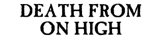
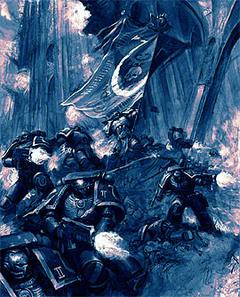
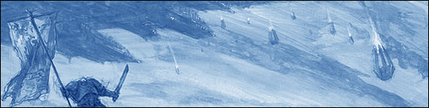
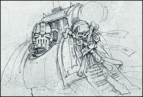

# 死从天降——极限战士在宁勃萨上的突击行动

【原翻】死从天降——极限战士在宁勃萨上的突击行动

eliphasfan

死从天降

极限战士在宁勃萨上的突击行动

没有人能够逃过神皇的圣怒。异星人的威胁出现了在一个遥远的世界，宁勃萨，——一个在帝国空间边缘的Tau前哨。极限战士被及时派出以平息可能的侵略者。

从跟随着克洛泽尔牧师的本堂圣职者们携带着的香炉里漂流出来香料的甜气懒散地转圈，充满了谢韦里安的发射港。这香味让阿格曼连长回想起了马卡各的北部高地，他在怀念了一下他的母星之后，思绪便回到了带着骷髅面具的牧师的祈祷上。他和数十个极限战士第一连的战士在登入空降舱开始突袭下面Tau的殖民地之前跪下接受牧师克洛泽尔的祝福。技术军士和面无表情的的奴工们照管着空降舱，用银制的洒水器往它们上面膏着祝福油，并取下了把它们连在谢韦里安甲板上的神圣守护钉。

“吾行于战火之中”

克洛泽尔起头道。

“吾击于争斗之砧”

星际战士们答道。

“我们是极限战士，神皇的斗士，我们的勇猛无有可疑！这是灵魂铸造的伟业，强过精金更于不朽帝皇一般坚韧。战火之中是我等崇拜之所，爆弹怒吼乃是我等祈祷之声，屠灭敌人则是对战争英灵的奉献！”

“我们的爆弹以死灭填充，”集合好的星际战士们诺道。“其乃神皇圣怒！”

克洛泽尔牧师点了点头，在傍边空降舱打开前停了下来；当他的侍僧们带着承载着克洛兹圣杖和玫瑰念珠的，朱砂线纹的圣物盒靠近时，他转了过来；克洛兹圣杖在被他从盒中提出来时闪闪发光，火把般的光芒在武器顶端带翼骷髅血红的眼睛中闪烁。克洛泽尔前倾了身体好让一位戴着金面具的圣职者给他戴上玫瑰念珠，守护挂件的沉重锁链与他盔甲上的黑色产生了尖锐的对比。

阿格曼站了起来，他连队中的战士也随之起身，发射港里回响着立正时靴子呯然相撞的声音。他前行到了克洛泽尔的身边，转过来面对这他聚集着的战士们。

“拿上你们的武器，兄弟们。”他说道。“我们去打仗了！”

宁勃萨上Tau前哨站上的天空是一团高射炮弹和尾迹混杂的脏乱，脉冲炮阵在空中画着火焰的花格。炎流划过天空；星际战士的空降舱深砍向它们的目标。燃烧的建筑中出来的黑烟在风中扭曲，噼啪作响的烈焰饥饿地吞噬着新建的异星人前哨。Tau的坦克在第一波的空降舱带着火箭发动机燃烧的喷流击入这行星的表面时滑过废墟。空降舱的装甲面咣地打开，阿格曼连长迅速地从空降舱中下到了宁勃萨的表面，他的终结者们跟着他形成了警戒线。

星际战士空降舱

“所有小队，聚集到我的位置。楔状队形。杀敌为先！”

混杂抢队的异星士兵们向刚到的终结者们开火，但是他们受到的祝福稳定的坚持住了。没有一个战士死亡。终结者们的回应火力划过了Tau的战士，并把它们以冰雹般的高反应爆弹撕成了碎片。越来越多的空降舱落了地。蓝甲的星际战士们按预定好的样式散开以确保降落地带及向Tau的炮兵阵地推进。雷鹰炮艇正带着更多的战士前来，Tau的防空炮被证明在击落帝国飞机上异常地熟练。这不能再这样进行下去了。阿格曼看着克洛泽尔牧师像用镰刀割麦般那样杀死Tau的战士，他的克洛兹圣杖带着令人目盲的金色电弧切过异星人的盔甲和血肉。他怒吼着的憎恨祷文刺激着他周围的人做出更大的努力，这屠杀看起来极是壮丽。

爆炸与枪炎充满了空气，脉冲炮的哀号和爆弹的咔哒交响成了吞噬一切的高潮。阿格曼和他的终结者们砸穿了保护着炮兵阵地临时入口的路障。一个蓝亮的光化脉冲在炮阵开火时点明了地平线，阿格曼知道他们没有太多时间。一组三个Tau族精英战士的机动战斗服进入了视野，强大的武器向他的战士们吐出了明亮的死亡之矢。赫里昂修士，伽巴拉斯远征的老兵倒下了，他的手臂成了一团鲜血淋漓的灭迹，血肉与盔甲熔在一起成了一块融迹。他的盔甲喷出止痛药膏，这位刚强的战士又站了起来；这东西能使老兵们无视可怖的伤痛继续作战。

“詹亭！”阿格曼大喊着。

“突击炮！”

詹亭修士挥转他武器上的多重枪管，引擎的哀号声穿过了枪弹的尖叫和轰隆的爆炸。被突击炮的枪管吐出的子弹激起了大量羽状的粉尘与异星人的鲜血；数百发子弹几秒钟内就撕穿了战斗服们。在异星战士已经死后很久，子弹还接着将他们撕成碎片。

“够了”阿格曼叫道。“无谓地消耗弹药是浪费。以松懈瞄准仪式之名给你自己三天斋戒。”

“是的，兄弟连长，”詹亭低下头说到。“这不会再发生了。”

阿格曼接受了詹亭的忏悔，说道：“我知道了，但是让我们继续推进，这炮阵是不会自己毁灭的。”

阿格曼看着最后的炸弹爆炸；炮阵的巨大炮管轰然倒下。火舌朝天猛蹿，赶往解放了的机场的帝国运输机的噪音震耳欲聋。他和他的战士们聚成一个圆圈以感恩他们的胜利并向他们装备上的英灵献出祈祷。异星人死亡的数目现在还是未知，但是阿格曼明白那将会很高。他们没有遗留下任何幸存者；阵地曾被完善地防守着——不过对于抵抗星际战士的力量来说不是那么完善。

他在克洛泽尔牧师靠近时完成了战士祷文并站了起来；牧师的克洛兹圣杖上的翅膀与骷髅被敌人的鲜血所染红；两个星际战士互相战士握了对方的手腕。

“你的人带着英勇与荣耀奋战。”克洛泽尔说道。

“嗯，他们做到了。你的英勇可为我等的楷模。”

克洛泽尔点头道：“在这困难的时节，战士们需要个模范去追随。”

阿格曼点了点头。除了勉励星际战士们去更伟大的英勇壮举外，牧师的神圣任务是照管他的连队的精神健康。战士们的士气在最近失去了第四连连长和他们的资深军士长后受到了沉重的打击，克洛泽尔花费了许多天去跟他们一同斋戒祈祷。

“你可愿跟我的人一同祈祷？”阿格曼换了个主题问道。

“那样我会的，阿格曼连长，”克洛泽尔说道。“我将给予他们战争祝祷。”

“我等将以你主持为荣。”阿格曼点头道。

－－－－－－－－－－－－－－－－－－－－完－－－－－－－－－－－－－－－－－－－－
