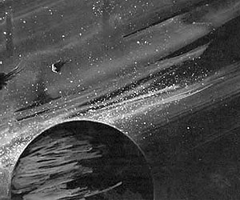
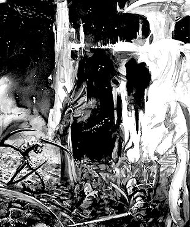
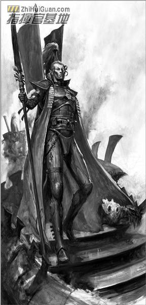
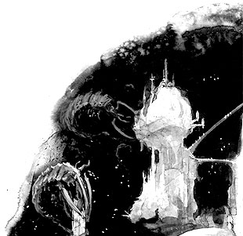
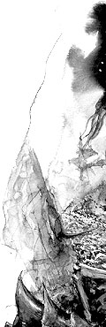

# Iyanden守卫战－为了方舟世界的灵魂而战

【原翻】Iyanden守卫战－为了方舟世界的灵魂而战

eliphasfan & vol.13

为了方舟世界的灵魂而战

绝望的方舟世界Iyanden守卫战是第一次灵族与泰伦虫族的威胁正面交锋，也是一次令方舟世界承受了无可挽回损失的战役。费尔．凯利记录了这场在最非同寻常环境下的广大巷战。 

死亡阴影

无数个纪元之前，灵族高度发达的文明被一场宇宙浩劫撕成了碎片。这灾难的力量不仅将空间扯出个洞来，还迫使灵族人开始了在巨型城船――方舟世界中的游牧生活。这些有机的世界级自载大气保护组合装置优雅地划过星空，承载着灵族的幸存者。它们中最大也是人口最为稠密的是Iyanden。 

虽然Iyanden的先知早已预见了未来毁灭的触手，但吞噬者的物理迹象还是由Iyanden的巡林客最先报告的。数十个被消化了的帝国世界出卖了虫潮舰队直往方舟世界的方向。许多Iyanden的巡林客在那严峻的噩梦压向他们平静的方舟世界的恐怖下默然失语。 

不过，一个巡林客，伊瑞丽斯，在决定Iyanden未来行动计划的秘密会议上慷慨陈辞，讲述了他们的发现。吉尔蒙先知，方舟世界的精神领袖，召唤了所有Iyanden的居民到回应之地；数个计划被讨论，有些要战，有的甚至要逃跑。在伊瑞丽斯的深切恳求下，她的同胞们相信了虫巢舰队的惊人数量；若不战便将被食。 

吉尔蒙先知下令整个Iyanden必须立即出动；路障和防线都阻止不了这场冲突。灵骨建筑被加固，舰队被召回，Iyanden也向其他方舟世界求救。支派主教们唤醒了战神可怕的化身。预知着Iyanden将付出的巨大代价，吉尔蒙先知召唤了幽灵战士；灵族人先祖的灵魂石想盗墓一般被从安息之地挖出，在灵骨身体中与他们在世的后代并肩作战。方舟世界Iyanden为战争做好了准备。 

“为了战争，让死者加入我们，不然恐怕我们就要加入他们。”

------------------------------------------------------------------先知吉尔蒙

海妖突袭 

二十天的惶恐过去了，虫巢舰队的先头开始了进攻。 

泰伦虫族第一波攻击的大群异形被守卫舰队迅速地清除了。优雅的Iyanden舰队在武器与战术计划上超越了虫巢舰队，在接连不断的战斗中维持了极少的人员伤亡。方舟世界的灵族似乎看到了一丝将整个虫巢舰队摧毁的微弱希望，但先知们却沉默不语。虽然事实上Iyanden舰队十分地顽强，但恶梦般的泰伦生物却无边无沿。慢慢地，一艘接着一艘，灵族舰队屈服在泰伦虫潮的规模下。当庞大的第二波进攻时被超过两倍的防御者最终未能阻止异形降临Iyanden。灵族舰队在吞噬者合拢的巨螯下遭受可怕的伤亡。 

在方舟世界上，登陆的虫族全部被包围消灭；方舟世界的灵骨通道与圣林也终被净化。灵族人的精神更加振奋，因为下一波虫潮小得可怜，与先前的相比之下几乎不见踪影。虽然Iyanden损失惨重的舰队不能阻止接下来的登陆战，但支派武士就解决了这些入侵。这一刻，方舟世界赢得了再次喘息的机会，并敢于希望他们安然度过这次风暴。

血战

接下来的的两波攻势Tyranid出动的舰群规模巨大，之前的攻势与其相比变得像是小规模骚扰而已。扭曲而臃肿的诡异虫族舰只就像是群星中的污点，自轨道中降落的同时不断朝着灵族人的家园呕出污秽的军团。厚重的胞子云很快将整个方舟世界围得严严实实并慢慢将其污染。灵族幽雅美丽的建筑物逐渐被胞子所侵蚀，变得扭曲而病态。一阵恐怖的心灵尖啸再次响起！预示着饥饿的疯狂虫群即将到来。

用刀子去挖掉这肿瘤已经太晚了－－是该用火炬的时候了

－－－－－－－－－－－－－－－－－－－支派主教库埃尔林卓

两波虫群部队组成了一股不可阻挡的死亡之潮，Iyanden的中心区域和道路很快就被Tyranid庞大的部队占领。战斗在方舟世界的每一个角落发生着：在古老而神圣的寂静要塞顶端，翔鹰部队的战士们在与不计其数的石像鬼跳着一只死亡之舞；突击蝎们则努力从暴虫的海洋中用他们的锯剑努力杀出一条血路，以确保交通枢纽的畅通；在被大群刽子手（Carnifex）围攻的泪之要塞，一小队猎鹰利用其机动性不断猎杀落单的敌人。尽管他们尽了最大的努力，泪之要塞华美的棱堡还是一个接一个的被攻陷；（别问我为什么灵族连棱堡都是“华美”的……）凶暴复仇者们在阿苏尔神坛与无穷无尽的角虫（Hormagaunt）展开血战，将通往神坛顶端的阶梯染成一条鲜血之路。尽管防御者尽全力抵御虫群的攻击，然而在无尽的虫海面前，他们的努力似乎仍显徒劳。即使灵族战士能以每人的生命换来虫群数十头Tyranid的伤亡，这个数字仍然不足以赢得胜利……

凯恩之怒

就在灵族战士眼看就要败退时，战神凯恩的分身加入了战斗！它燃烧着的庞大身躯激励着灵族人的斗志，它无坚不摧的强大力量扫除了眼前所有的虫群。灵族战士们很快以战神分身为核心展开反击，此时战斗也进入白热化状态。Iyanden为了战斗的胜利甚至放出了幽冥战士部队。守护者与幽冥战士肩并肩的与虫群战斗，一时间灵族气势如虹，勇敢的战士们化为一道狂暴的野火，烧遍了寂静要塞附近并歼灭了所有敌人。然而虫子的胞子群已经将整个植物园完全污染，苍天古树纷纷在寄生虫疯狂的咀嚼中轰然倒下。许多灵族人为这种悲惨的景象流下愤怒的泪水……

不过胜利女神现在似乎已经站在灵族人一边。以数千条生命为代价，虫群已经被迫开始后退。幽冥君王和猎鹰小队开始猎杀大型Tyranid，对虫群进行斩首行动。战灵者开始吟唱古老的咒文以驱散那些在虚空中纠缠死者灵魂的邪恶。吟骨者也安抚着愤怒的灵骨，召唤无尽之环的灵魂去对抗虫群所造成的虚空破坏。

就在这时，方舟世界舰桥（不能确定方舟世界有无舰桥一说，但是这里确实用的是bridge这个词）上的扫描器有了剧烈反应。上面显示一支数量无法估计的巨大虫群自虫群舰队被释放出来，向着方舟世界袭来…… 这一次，先知都陷入沉默…… Iyanden的灵族陷入了彻底的绝望之中，因为他们知道，当战斗结束后，没有人能幸存下来……

Iyanden陷入危机的消息传到了曾经是Iyanden舰队总指挥的Yriel王子耳中。一开始他对于Iyanden的危险置之不理，因为Yriel仍然对他的故乡对他作出的不公判决感到愤怒。然而最后他的怒火还是冷却下来，Yriel王子还是无法接受Iyanden被完全毁灭的未来。于是他下令让舰队全速前进，驶向Iyanden。

到达Iyanden后，Yriel的舰队就像凯恩的燃烧之矛一样深深插入了包围着Iyanden的虫群舰队核心。Iyanden舰队残余的舰只也加入了Yriel的舰队。Yriel发誓要用他的生命来保卫他的人民。在他的指挥下，灵族战舰撕裂了虫群舰队的核心部分，并将每一只试图登陆Iyanden的胞子囊摧毁在轨道上。这样的战斗不断重复发生在Iyanden的外层太空，不知过了多久，Yriel旗舰上的扫描器上没有了虫群舰队的反应。Iyanden终于解除了。

胜利的代价

尽管虫群舰队被彻底粉碎，方舟世界也付出了巨大的代价。成千上万的灵族人为了保卫Iyanden战死，黑压压的虫尸铺满了方舟世界的道路，无数堪称艺术品的建筑物被付之一炬。Iyanden曾经荣耀的强大舰队现在仅仅剩下寥寥几艘而已，大部分战舰都只剩下空壳，漂浮在轨道上，宛如一座座太空坟墓。最糟糕的是，那些被Tyranid破坏了灵魂石的灵魂将永远失落在虚空当中。Iyanden将永远无法从这场灾难中恢复过来，而它的经历警告着每一个低估Tyranid的人。

我们也许赢得了战争，可先祖们却失去了灵魂。

－－－－－－－－－－－－－－－－－Yriel亲王

 浪子 在泰伦虫族进攻的五十年前，海军上将Yriel以无可比拟的技能和决断领导着Iyanden的舰队。然而在一次将Iyanden置入混沌舰队危险下的豪赌之后，他因其傲慢而被指控；他的草率行动和拒绝承认自己的错误使他被提交审判。Yriel被革职并发誓永生不回Iyanden。被放逐的指挥官痛苦而愤怒地带着仍忠于他的舰队离开。多年来，他和他的追随者们建立了宇宙中最大最辉煌的海盗舰队。

脑残图片ｂｙＧＷ！！！

贴图见过，分六块的图见过吗？

你今天就见到了

 

