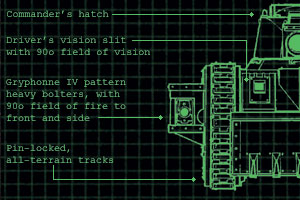
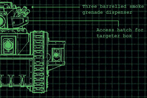
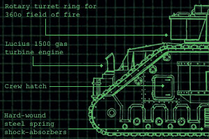
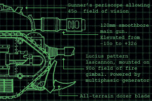

# IG著名装甲连指挥官

【原翻】IG著名装甲连指挥官

eliphasfan

感谢２２８团手枪主席和李子兄弟在译名上的帮助

著名装甲连指挥官

___________________________________________________________________________

许多伟大的指挥官曾携着装甲连的力量走向胜利，以帝皇之名在敌军火线中杀出一条血路；这段回顾着眼于这些最了不起的军人中的两个。

塔姆斯. 瑟罕上校

卡迪安第一百二十四团第三装甲连的一个最伟大的英雄是上校塔姆斯. 瑟罕，黎曼鲁斯主战坦克‘帝皇之砧’的指挥官。闻名于总是开着舱门与他的家传动力军刀投入战斗，他蔑视那些有注视将死之敌的荣耀时龟缩在他们的车辆里的人。因为无论何时都渴望带领他的车辆冲锋，在为期六个月的德拉希安战役中他的连队花费比整个罗阿克兰第二百三十五团在他们为期三年的洛德温地带解放战争的记录中更多的燃料和弹药。而且瑟罕上校是在卡迪安第一百二十四团唯一赢得马卡里乌斯骑士勋章的战士；在伍德肯浅滩战斗中他和他的连袭击并摧毁了一架混沌战斗泰坦。那泰坦守卫着装甲车辆可以渡过亚斯图河并袭击敌人后方梯队一处地点。帝国势力部署了强力的冲击，试图通过浮桥过河，但每一次尝试都失败了。帝国部队指挥官未曾注意这个位置，直到瑟罕的坦克抓获了敌人侦察连从北面渗透的突击部队，并且得到了他们如何能不被发现地接近帝国军的位置的信息。

瑟罕立即登上了他的坦克，征用了供给给第二连燃料和炮弹后轰鸣着开到到北面去搜查该通道。破晓之时，他的侦察车报告发现了浅滩，虽然因为他们试图强渡而吸引了猛烈火力。但决心不记成本地要利用这个浅滩，瑟罕带领他的车辆从他们的车阵和驾驶他的坦克直入水中。在坦克到达的河中心时，雷鸣般的震撼颤动着大地——一架泰坦高耸的形像从河谷岸边的背后出现。三辆黎曼鲁斯在其余则能够散开和反击之前被泰坦的巨炮以同样的时间（三秒）内炸成了碎片。巨兽的空虚护盾闪烁在炮弹的冲击下，但没有一发可以穿透其厚重的装甲；另一大片坦克在其摧枯拉朽的火力下爆炸。

瑟罕上校带队冲锋，他的坦克喷吐着烟雾从河中冲出；支援步兵等待在泰坦的阴影中，但随着越来越多的坦克从河中浮现，其压制火力开始付出代价。数辆存活着接近泰坦的坦克的炮弹近到足以穿过他们的敌人的盾牌；装甲板在接二连三的轰击下被弹幕破开熔融。意识到它低估了它的敌人，泰坦开始撤退——但瑟罕上校是不容忽略的；他开车直至泰坦，将他的剩余弹药打入了其脆弱的腿部关节。他最后一发炮弹引爆了这战争巨兽的关节，沐浴在熊熊火焰和爆炸的金属碎片中，泰坦轰然倒塌在了上校的指挥坦克上，将他和他的机组人员砸死。该连被打残的最后幸存者通知了团总部，并告诉他们发生了什么事。四小时内卡迪安第一百二十四团的侧翼部队越过亚斯图河，并在他们的敌人完全措手不及时赶上了，猛冲碾过了他们的储藏供应营地。每一个阵亡的坦克乘员得到了血红勋章；尽管一些军官认为他应该被军事法庭追审，瑟罕上校被授予马卡里乌斯骑士勋章。

虽然说这是个一个极端的例子，但瑟罕上校有着相当典型的装甲连指挥员心态：敢为人先，戏剧化而富有活力，始终在前线领导还有藐视懦夫。装甲连的男女士兵认为自己是帝国卫队的精英部队，而且常常对卑微的步兵不屑一顾；更加经常忽视了为实现胜利帝国卫队所有的不同部队必须共同努力。

帝皇之砧正面 

帝皇之砧侧视图 |  |  |
| --- | --- |
| 黎曼鲁斯主战坦克 - 帝皇之砧- 卡迪安第一百二十四团第三装甲连 |  |
| 重量： | 61吨 |
| 车体长度： | 7.08m |
| 车体宽度： | 4.86m |
| 高度： | 4.42m |
| 炮管长度： | 3.07m |
| 离地距离： | 0.45m |
| 装甲厚度： | 45 - 200mm |
| 最大速度： | 29kph on road / 19kph off road |
| 乘员： | 6 (驾驶员、指挥员、炮手、 装弹手、两个侧舷炮手) |
| 武器： | 炮塔装主战加农炮、车体装激光炮、两个侧舷装重型爆弹枪 |
| 主装弹药： | 36发储存于防火弹匣,装弹规格允许三种不同的弹种(反坦克弹,征服者,以及其他) |
| 徒涉深度： | 1.9m |
|  |
| --- |
| 战役与奖章 箴言： 使命不息 封盖： 673.M41 开始服役： 676.M41 初次战斗：突破格拉克斯防线 团级荣誉：   勇武部队奖章 678.M41   大嘉奖 682.M41   双头鹰勋章 (角山战役) 723.M41   追授马卡里乌斯骑士勋章于瑟罕上校(伍德肯浅滩战斗)934.M41   香飘带勋章 (冯.德.贝金世界) 974.M41   745枚钢十字勋章, 432枚铁鹰勋章, 234枚铜心勋章, 103枚勇猛作战血红勋章: 676 999.M41 |

米特罗凡.特斯拉上校

在瓦斯提洛尔前进据点战斗中，祖兰龙骑兵的装甲连在冲破了他们的步兵连壕沟时反攻兽人军阀戈拉什塔克.大杀手的部队。这反击顺利到反击的指挥官，该连上校米特罗凡.特斯拉，追击兽人通过分开两军的开阔地，回到各自的阵地上。在疯狂的匆忙追击中，特斯拉允许他的坦克分散开来，当兽人集合反攻他的部队时，许多被兽人坦克猎手解决了。这是一个对特斯拉能力的证明，他恢复了指挥和控制的措施，带着他的连杀出一条血路回到了跟随的步兵连中。带着支援步兵， 祖兰团最终砸穿兽人防线并摧毁数以百计的兽人战队，打开了前进据点并铺平了对兽人战争胜利的道路。
