# 萌版ShadowSun指挥官制作过程

萌版ShadowSun指挥官制作过程

eliphasfan

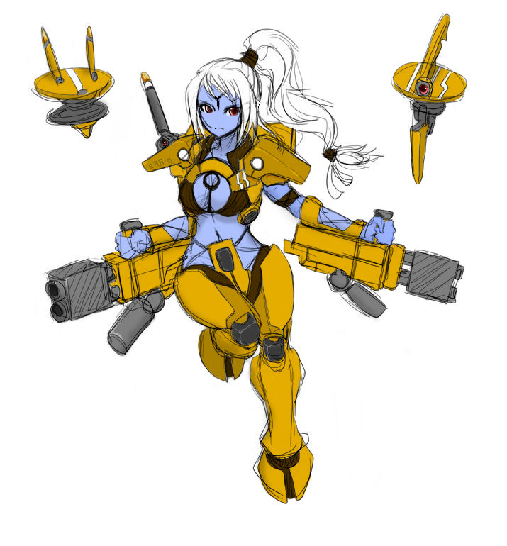

the Concept Art

the Model

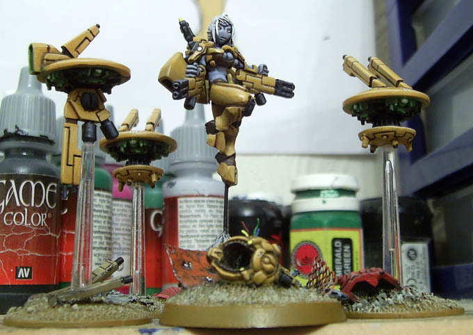

with drones

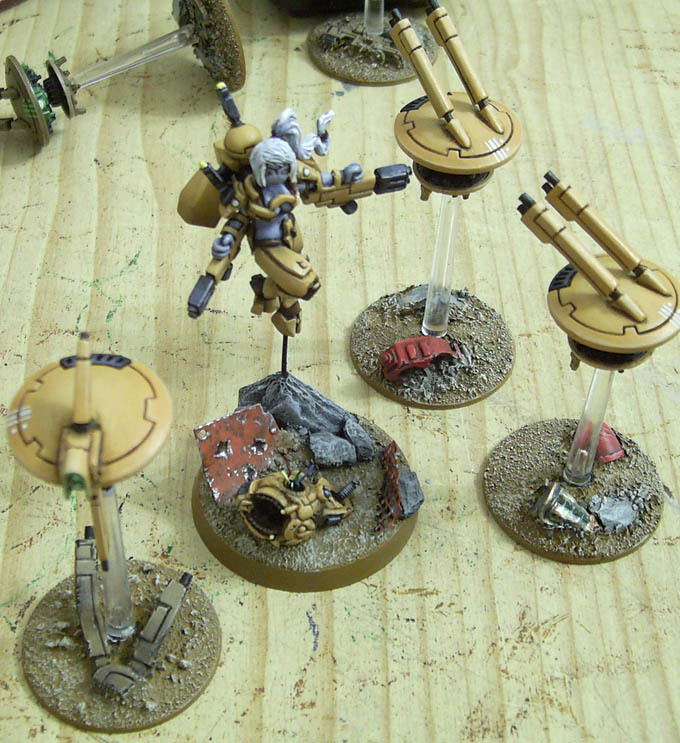

Thanks to gareth from the painted dragon for his awesome conversion job!

the progress:

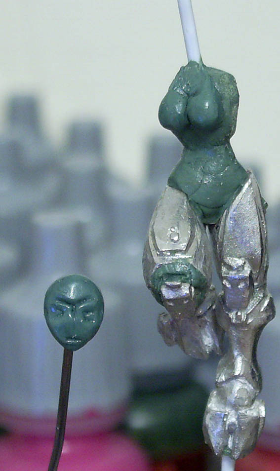

lower body

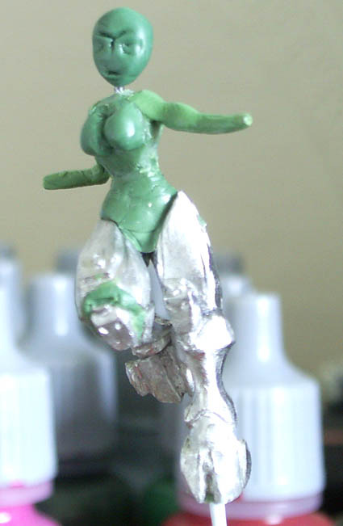

torso

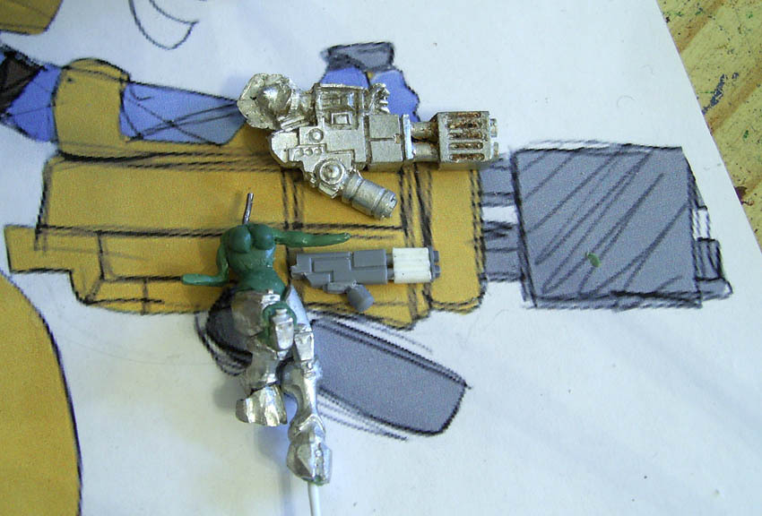

replacing the massive fusion blaster

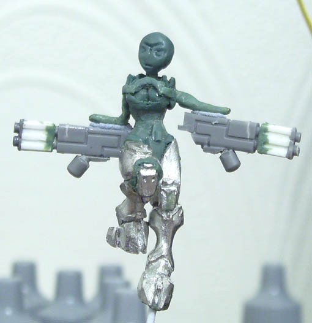

clothing

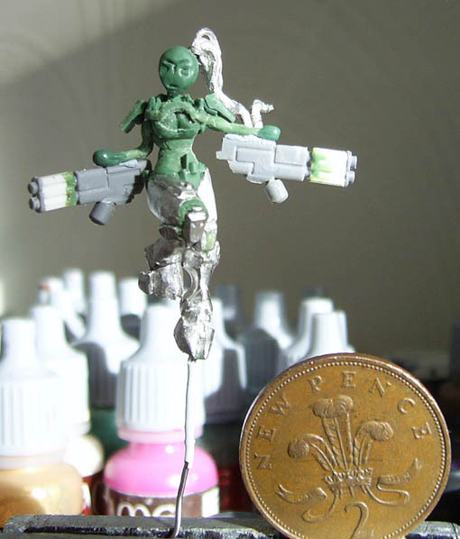

two pence for scale

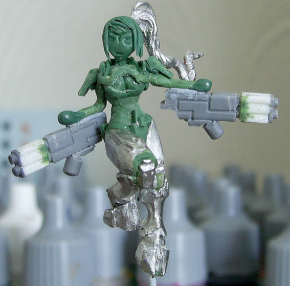

hair

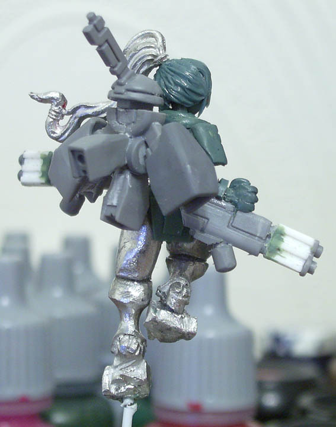

back pack

.................................................................................

Shadowsun

[http://www.thepainteddragon.co.uk/](http://www.thepainteddragon.co.uk/)

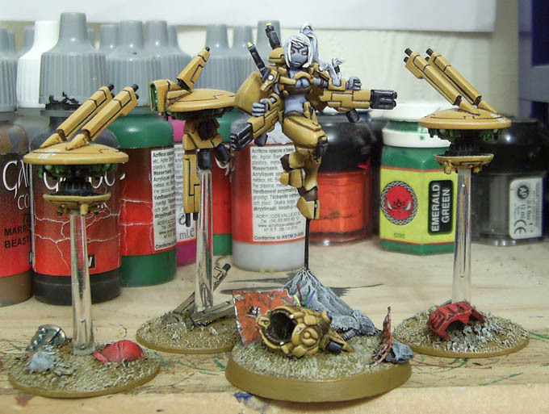
