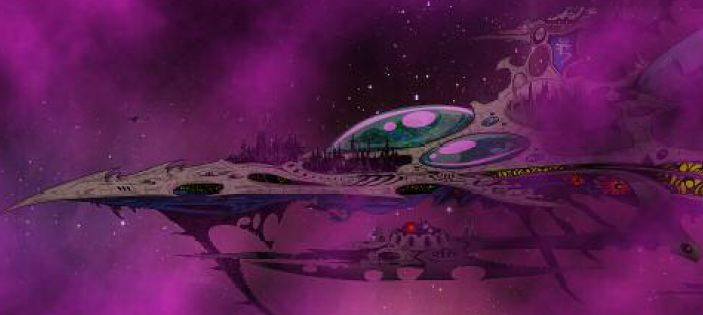
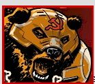
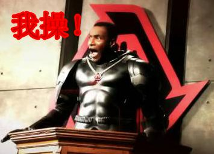

# 灵族方舟世界图片，真伪自辨

灵族方舟世界图片，真伪自辨

兔子半妖

我一直以为这是猴子方舟来着

Admiral Thraw

其实是的

因为这次猴子舰队战测试规则里

又放了这图

兔子半妖

（注：混沌四神之老T沾边的东西都不能较真……）

SovietRed

。。。。。

下面那个看的象ED坦克。。

Admiral Thrawn

你没看到船尾旗子吗

兔子半妖

没看到

SovietRed

没看懂

Admiral Thrawn

SovietRed

CZ75

什么动画？

兔子半妖

官网不放大图，可耻

兔子半妖

哥特舰队...

Admiral Thrawn

飚车世界的棋子..

估计这图最早在BFG MAGAZINE上面出来的

SovietRed

象动画片截图

CZ75

这不就是动画片么

Admiral Thrawn

……告诉你BFG了

SovietRed

40K有动画片吗。。

兔子半妖

真吝啬

兔子半妖

没有大图

Admiral Thrawn

……

算了

EMULE上下BFG MAGAZINE很困难

CZ75

源太少
