# [原创]自己做的U团灵能

<form name="modactions" method="post">

|  |
| --- |
| [原创]自己做的U团灵能 ms07b3 用maya做了一个礼拜完成的，最后做成了玩具地台的样子，为了整体看起来信息量更足，有些地方YY了下，愿皇帝宽恕我(头盔有点问题= =)  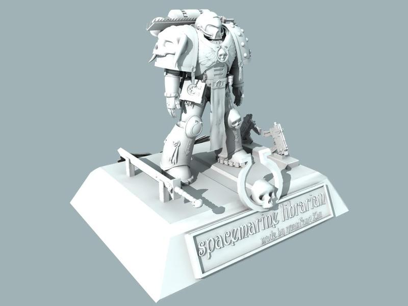 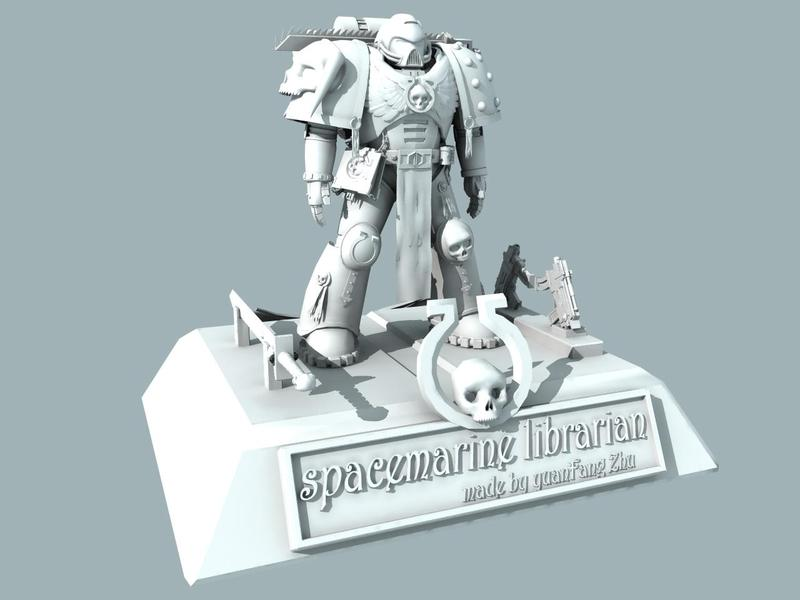 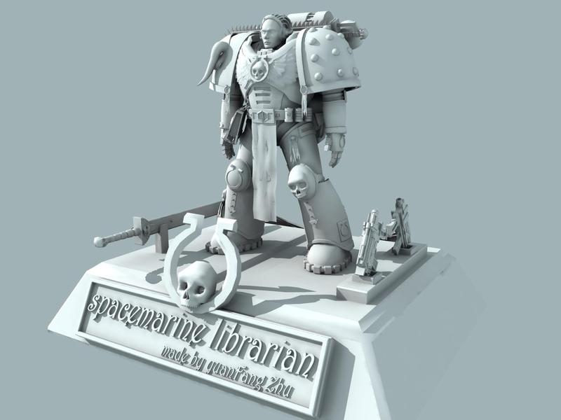 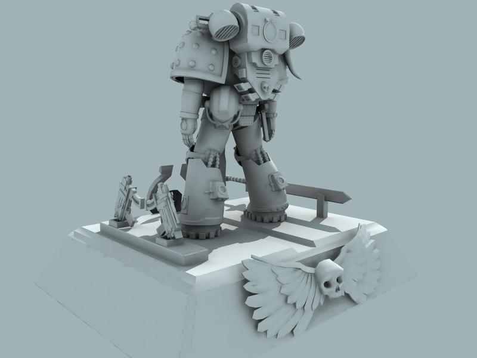 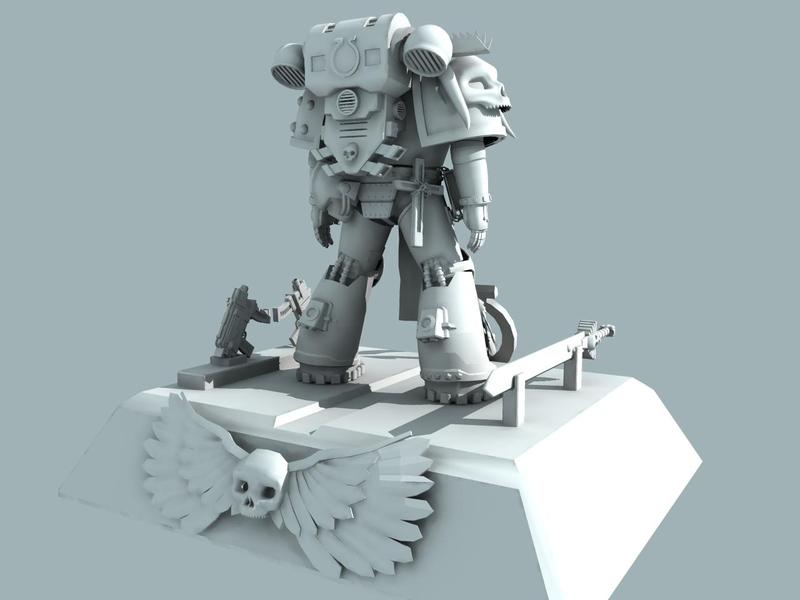 |

</form>

<form name="modactions0" method="post">

|  |
| --- |
| 添加新图一张 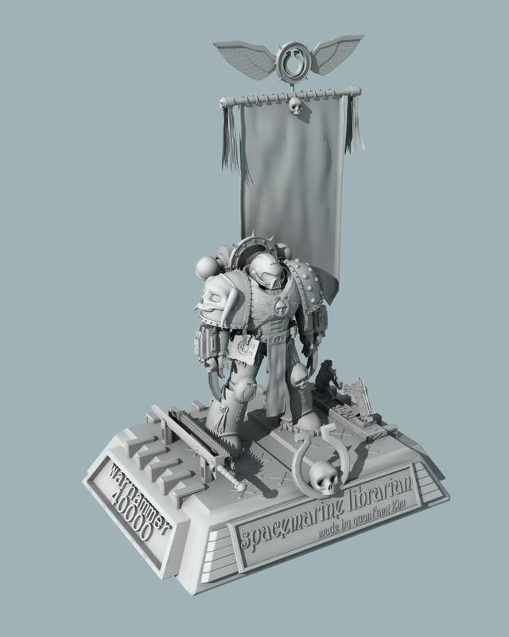 |

</form>

建了个骨架调了点动作，lib那个实在没动力绑了。。。绑个普通SM吧，这次没加战团标志，方便YY。。。

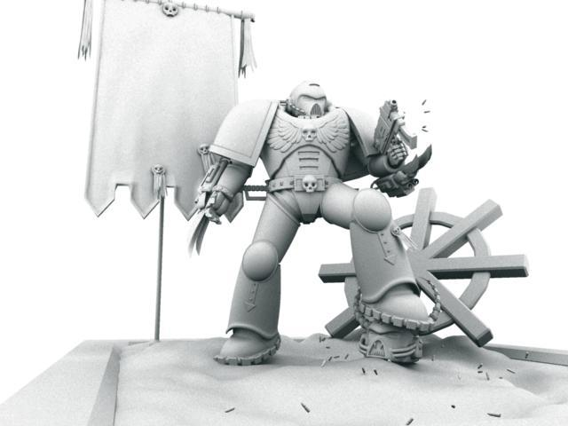

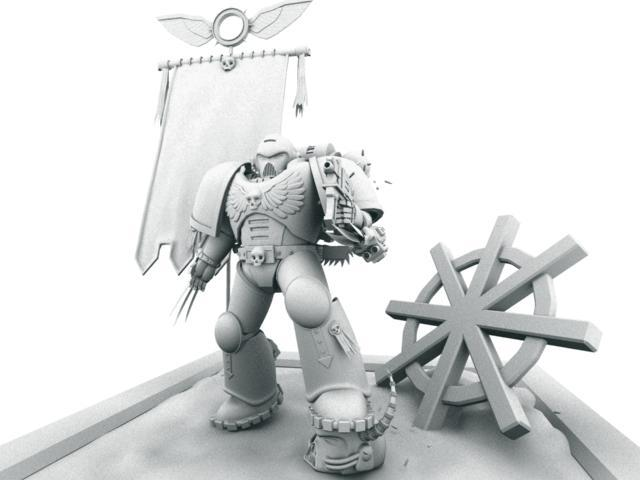

<form name="modactions1" method="post">

|  |
| --- |
| MAYA 把lib也绑了，更新3张band图 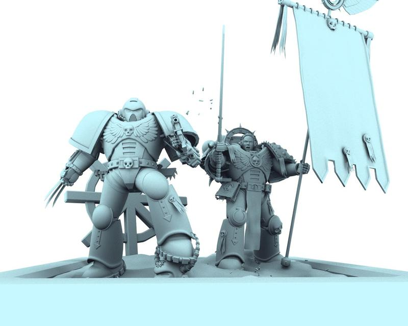 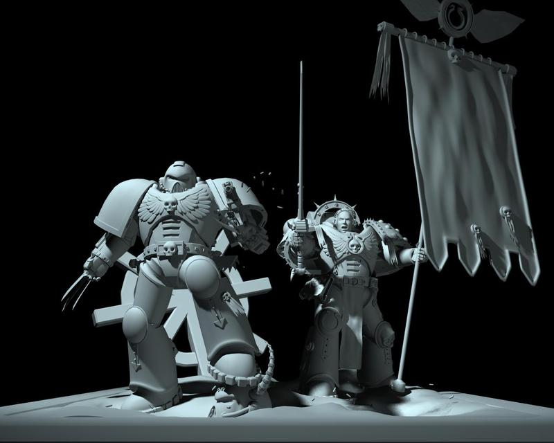 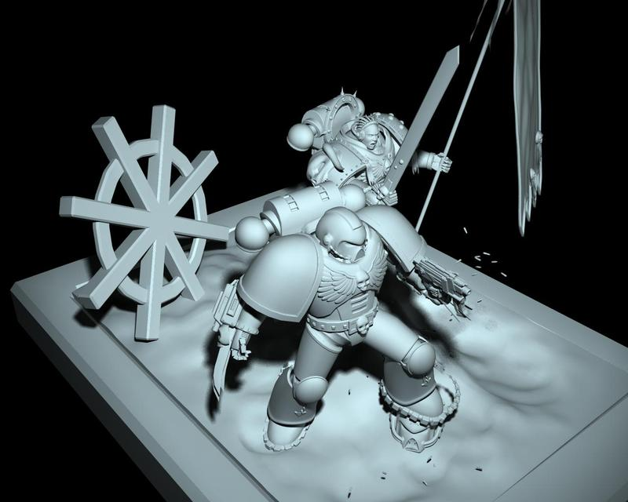 |

</form>
