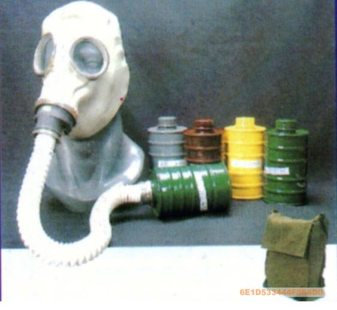
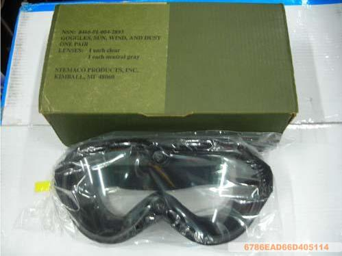
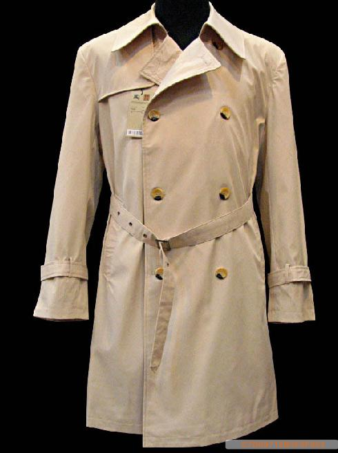
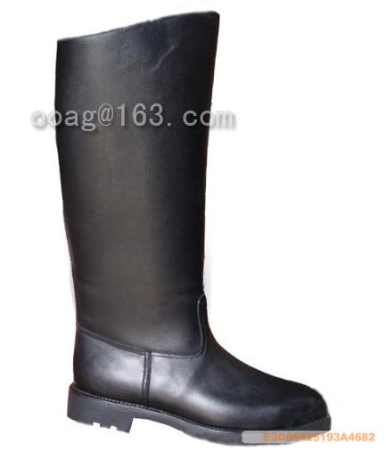
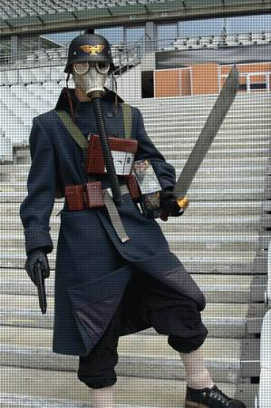

# 关于真人扮演钢铁军团士兵的可行性

关于真人扮演钢铁军团士兵的可行性

苏联红军政委

首先，最重要的防毒面具

需要稍微改改，按照风镜的式样剪掉那么一部分，反正国产货，比较便宜，弄烂了也无所谓，为了有点样子可以在里面垫些纸板什么的，不过个人认为这样已经可以了，对了，先要刷成黑色

然后是这个，风镜

霉菌军版，这个也不算是太贵，没什么好说的，基本和设定的式样差不多

用这件风衣不错，基本颜色式样都很符合要求，就是贵了点，对要求严格点的话，扣子也改了吧，这东西不玩的时候穿出去也很不错

最后，高筒马靴一双，这个是处理品，比较便宜，一般这种的都要400-500朝上，其他的也没什么好说了，基本都是直接往身上装就行了，价格嘛，没个1000-2000别想置办完，比较蛋疼，目前还是停留在想象阶段吧

哦对了，还有武器，貌似手电筒很难改，看来只能削个木头的出来玩了

lol

