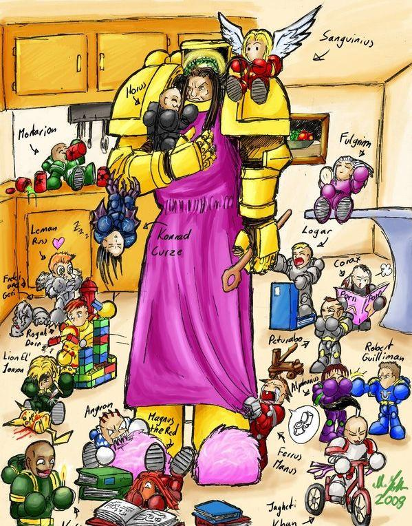

# 基因原体们的童年……

理智的思考者

统计一下:

和路司被皇帝爸爸抱着(最宠爱的儿子);

血天使在飞(长了俩翅膀);

帝王子在骚首弄姿(完美主义兼BT);

夜领主倒吊着睡觉(很有蝙蝠侠的风范);

死卫在喝毒药(真的是不怕死啊);

传道者在演讲(最狂热的家伙)'

乌鸦在看人体艺术(准备复制军团);

铁战士用玩具投石机砸帝国拳的积木(宿命的死敌啊);

极限战士在扁阿尔法(难怪老幺最讨厌他了):

铁手拽爸爸的衣服想上厕所(解不了裤子);

白疤在彪车(问题宝宝),吞噬者在咬书(问题宝宝),火蜥蜴在玩火(问题宝宝),独眼在看书(乖宝宝);

黑天使在解剖皮卡丘(不明白什么意思);

狼宝宝在发情????

问题来了,狼宝宝边上的是什么? 

Muckenberger

狼宝宝旁边的是两只狼，就是帝皇伪装会见他时冲帝皇兹牙的那两个

“

流浪者迫近了虬曲的王座上高大的国王，

他坚定地面对着Ｒｕｓｓ，

紧紧盯着Ｒｕｓｓ的双眼．

狼王巨大的咆哮在王庭上回响，

整座大殿静了下来．

Ｆｒｅｋｉ磨着他的牙齿，

而更年长的Ｇｅｒｉ明智地缩在一边，

因为这陌生人竟能毫不畏惧地面对狼王的凝视．

” 

BrazenMKK

两条狼的名字来自北欧神化中奥丁的两匹狼。 

luluvc 咱终于知道帝皇为何去睡觉了，原来是不堪家庭主妇任务的折磨

fenix023 哈哈哈哈~~真的是好搞笑啊~~看到好多原体可爱版的样子..反而把帝皇视为背景了
