# 黑图书馆第一吸金男--冈特系列小说集简介

[ACE翻译]黑图书馆第一吸金男--冈特系列小说集简介

no.ace

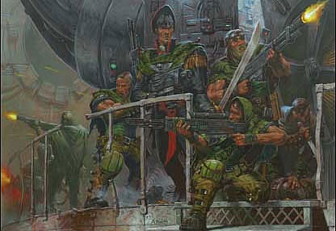

小说简介 

Gaunt's Ghosts is a book series written by Dan Abnett. It is a military science fiction series, set in the Warhammer 40,000 universe.

冈特的幽灵是丹·阿泊尼特所作的系列丛书.属于军事科幻系列,以战锤40.000的世界为背景

T  he series spans eleven novels, in which the efforts of the Tanith First-And-Only during the Sabbat Worlds Crusade are documented. There are dozens of named characters, but the protagonist is Colonel-Commissar Ibram Gaunt, one of the few political commissars of the Imperium to be awarded command of a regiment. 

这一系列丛书包括12本小说,记录了坦尼斯唯一的第一军团在萨巴特远征行动中所作出的努力.书中出现的有名角色超过数十个,但是主人公一直是上校-政委 亚伯拉姆·冈特

Other major characters include Colonel Colm Corbec, Major Elim Rawne, Sniper Hlaine Larkin, Brin Milo, Scout Sergeant Mkoll. The series alludes to other series by Dan Abnett, such as Eisenhorn and Ravenor, and has resulted in two spin-off works. 

其他主要人物包括,上校科姆·科贝克(Colonel Colm Corbec),少校伊利姆·瑞恩(Major Elim Rawne),狙击手海林·拉金(Sniper Hlaine Larkin),布林·米洛(Brin Milo),中士侦察兵马克(Scout Sergeant Mkoll).书中同样也隐含了一些丹·阿伯尼特其他小说中的人物,比如 检查官艾森豪(Eisenhorn)与检查官雷文纳(Ravenor),他们之间的合作在两边的故事线里都有记叙 

The series began as a continuing set of loosely connected short stories in the Black Library magazine Inferno! (issues 4, 8, and 30). Their popularity was such that what was to be the next short piece, entitled &quot;Vermilion Level&quot;, was written out to novel length as First and Only and published as the Black Library's first original novel (the book line up until that point consisting of reprints of novels from the pre-Black Library days and anthologies of short fiction taken from Inferno! magazine). The original short pieces subsequently appeared as flashback-chapters in Ghostmaker, the second book.

冈特的系列故事最早是出现在黑图书馆(Black Library) 的&lt;地狱火&gt;(inferno) 杂志刊登的一些松散的小故事(第4,8,30集).但是真正的开始在读者中流传的是短篇小说,&lt;朱砂级&gt;,这部短篇小说也被收录进了黑图书馆的第一部原创小说选集&lt;第一与唯一&gt;(这本书收录了很多重印的黑图书馆关于冈特的早期小说以及一些发行在&lt;地狱火&gt;杂志的短篇小说).这些短篇小说中的人物也经常以背景人物的面目出现在&lt;幽灵制造者&gt;一书中(冈特系列第2部)

The books remain probably the most popular and best-selling of the Black Library's line, with a wide range of other publications (ancillary novels devoted to minor characters in the main series and a mock &quot;historical book&quot; about the war in which the books take place) as well as merchandise such as badges, T-shirts, and special editions of the books themselves.

目前冈特系列丛书依然在黑图书馆发行线中保持着最广的流传度,相关出版物(比如一些次要人物的个人小说以及描述书中战场的虚构&quot;历史丛书&quot;等等)以及标徽,T恤,以及丛书的特别版本也保持着良好的销售记录 

Books in series

小说列表

这些小说可以归入3条故事大纲 

1.The Founding

建立

First and Only      &lt;第一与唯一&gt; Ghostmaker &lt;幽灵制造者&gt; Necropolis &lt;大墓地&gt; 

2.The Saint

圣者 Honour Guard &lt;荣誉守卫&gt; The Guns of Tanith  &lt;坦尼斯之枪&gt; Straight Silver &lt;直银军刀&gt; Sabbat Martyr &lt;萨巴特的烈士&gt; 

3.The Lost

失去

Traitor General &lt;变节将军&gt; His Last Command &lt;他的最后命令&gt; The Armour of Contempt

&lt;蔑视之甲&gt; Only in Death &lt;至死方休&gt; 

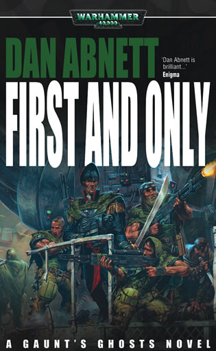

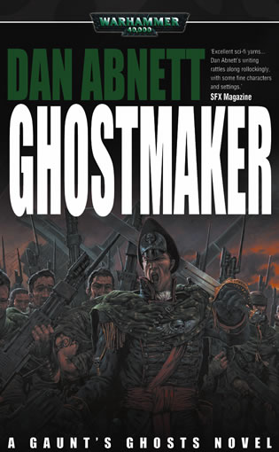

First and Only & Ghostmaker

&lt;第一与唯一&gt; & &lt;幽灵制造者&gt; 

The first two books are collections of short stories originally published in the cartoon fanzine Inferno!, published by the Black Library. They are not sequential; for example, the fall of Tanith in the first chapter of Ghostmaker occurs before the siege on Fortis Binary in First and Only, which in turn takes place before the assault on Oskray Hive in Ghostmaker (this latter timeline can be established by the mention of a cybernetic shoulder that was fitted to Serg. Varl on Fortis Binary, and Serg. Hasker who died on Menasoid Epsilon, but he mentioned in this book as a person alive). Disregarding the fall of Tanith, during which little fighting took place, the action of the two books is focused on four main theatres of operation:

小说集中的头两部实际上是地狱火杂志(黑图书馆出版)中的原创小故事的集合,所以故事看起来很不连贯;比如,第2部&lt;幽灵制造者&gt;一书中描述的坦尼斯陷落实际发生在第一部&lt;第一与唯一&gt;中描述的弗提斯·巴纳瑞围攻战之前----取代了&lt;幽灵制造者&gt;中奥斯科瑞蜂巢突袭战之后的故事..(幽灵制造者中之后的时间线看来,瓦尔中士能出现在弗提斯·巴纳瑞理论上是有可能的,但是哈斯卡中士应该是死在了曼纳索德·伊普色隆[Menasoid Epsilon]---书里却说他还活着).忽略坦尼斯陷落的章节,根据其他战斗发生的地点,这两本书实际描述了以下4个主要剧情

Voltis City, Voltemond

沃特蒙德世界,沃提斯城

Voltemond is described in Ghostmaker as a temperate world, similar to Earth, with extensive marshlands around Voltis City, the planetary capital, which was under Chaos control before the events of Ghostmaker. The chapter begins with the Tanith First &quot;Gaunt's Ghosts&quot; saving the Ketzok 17th &quot;Serpents&quot; artillery regiment from an ambush by Chaos Space Marines. The Tanith are then ordered to infiltrate and assault the main watergate and sanitation outfall of Voltis in order to mine the walls and form a breach for an assault by the Royal Volpone 50th storm troopers, known as the &quot;Bluebloods&quot;. The assault on the watergate is repelled when the traitors open the floodgates and flush the Tanith out; however, Sergeant Cluggan leads a successful attack on the sanitation outfalls, creating a breach for the armoured assault. As the Ghosts retreat, General Noches Sturm of the Royal Volpone and his adjudant, Major Gilbear, both of whom were disdainful of Gaunt and his &quot;low-born&quot; soldiers, order the Ketzok to bombard the Tanith as they fall back to their base. Three hundred men, including Sergeant Cluggan, are killed and another two hundred wounded. Gaunt almost faces a court-martial when he punches Colonel Ortiz, the Ketzok commander, but is let off when Ortiz claims that his injuries were caused by his Basilisk artillery vehicle's recoil. 

根据&lt;幽灵制造者&gt;一书中的描述沃特蒙德世界是个常温世界----类似地球----.大片的湿地环绕着首都沃提斯城,在&lt;幽灵制造者&gt;一书中描述的行动发生前,这是个被混沌控制的城市.这一章故事的开始,是坦尼斯的第一批&quot;冈特的幽灵&quot;拯救了被一队混沌星际战士所突袭的卡特佐克[Ketzok]代号&quot;毒蛇&quot;的第17炮兵团.之后他们接到命令渗透并突袭沃尔提斯城外的水闸以及污水管,挖倒那里的城墙,给皇家沃朋第50风暴突击队[Royal Volpone 50th storm troopers](部队代号蓝血)的突破创造机会.水闸的突袭部队被那里的叛军打开闸门冲了个无影无踪.但是克鲁根中士带领的污水管突袭行动得到了成功,使得一支装甲部队从那里突破了进去.在幽灵们撤退的过程中,皇家沃朋军的将军诺查斯·斯图姆(General Noches Sturm)以及他的军曹(adjudant,Major Gilbear)吉尔比尔中士,因为对冈特以及他的&quot;出身卑微&quot;的士兵的蔑视,命令卡特佐克部队炮击他们的营地---这时幽灵们刚刚撤回基地. 300多名士兵以及克鲁根中士在炮击中牺牲,另有200多人负伤. 冈特因为这件事大发雷霆而拳打了卡特佐克炮兵团的指挥官--欧提兹上校, 冈特险些因为这件事上了军事法庭,但最后欧提兹上校以被石化蜥蜴发炮的的后坐力所伤为借口帮冈特掩饰了过去.

Fortis Binary

弗提斯·比纳瑞 

Fortis Binary is described as a forge-world, a planet-wide factory that fell to Chaos. First and Only describes how the Ghosts manage to sabotage a Chaos ritual after Lord Militant General Hechtor Dravere orders them on a suicidal attack on an enemy trench line. This marks the first demonstration of the hatred of Colonel Draker Flense, the commander of the Jantine Patricians who suggested that Dravere give the assault order, for Colonel-Commissar Gaunt.

弗提斯·比纳瑞是一个铸造世界,遍布行星表面的工厂陷入了混沌的手中.&lt;第一与唯一&gt;书中描写了幽灵们接到陆军上将维克多·德拉维尔(Lord Militant General Hechtor )的一项自杀性的进攻命令---穿越敌军堑壕线,并且破坏敌军的一次混沌仪式.这是詹亭贵族军(Jantine Patricians)的指挥官上校德拉克·弗兰斯(Colonel Draker Flense)仇恨幽灵们的证据之一,正是他建议德拉维尔对上校-政委冈特下达这个命令 

Menazoid Epsilon

曼纳佐德 伊普斯隆 

A death world on the edge of the Menazoid Clasp, Epsilon was the site of three shrines to Chaos, designated Primaris, Secundus and Tertius by Imperial tacticians. Beneath Shrine Target Primaris was a Standard Template Constructor, a relic from over ten millennia before the events of First and Only, which made Iron Men, a pattern of robotic warriors; the traitorous General Dravere, assisted by the mutated, radical Inquisitor Heldane, Colonel Draker Flense and his Jantine Patricians attempted to seize power and overturn the commander of the Sabbat Worlds Crusade, Warmaster Macaroth, using the Iron Men. However, the machine was corrupted by Chaos and Commissar Gaunt destroyed it, despite the psychic puppetry of the Inquisitor, who died after his &quot;instrument&quot; - Imperial Agent Fereyd, the man into whom Heldane had extended his consciousness - was explosively killed. Colonel Flense also attempted to get his revenge on Gaunt and the Ghosts, as Gaunt has field-executed Flense's father, General Aldo Dercius, many years previously. The Jantine shock troops annihilated the Tanith Seventh platoon command of Serg. Blane, but were themselves killed to a man by Gaunt's allies, the Vitrian Dragoons. Gaunt stabbed Flense to death beneath Target Primaris, before escape along with his men.

伊普斯隆是个飘荡在曼纳佐德星系边际的死亡世界行星,那里坐落着三个混沌祭坛,帝国的情报人员分别将他们命名为&quot;第一&quot;&quot;第二&quot;与&quot;第三&quot;(ACE:-_-#  .........),在第一祭坛下藏有一个古老的通用建造模板(STC),这个古物被认为已经存在了有一万年了,里面含有机械战士--铁人的制造方法;叛变将军德拉维,与突变的很过激的检查官海尔丹(Inquisitor Heldane),詹亭贵族军以及他们的指挥官上校德拉克, 他们企图利用铁人的力量来颠覆萨巴特远征的总指挥官-- 大司战马卡洛斯 --的指挥权.但是这个被混沌污染的机械最终被冈特摧毁了,同时审判官的精神傀儡,---- 被他精神控制的帝国特工费雷德(Imperial Agent Fereyd)  ----也跟他的“战争机器“一起死在了爆炸里.上校德拉克·弗兰斯对幽灵的报复企图未果,因为冈特曾经在很多年前处决了弗兰斯的父亲,奥尔多·德塞由斯. 詹亭风暴突击队消灭了坦尼斯第7排指挥官,巴兰中士. 但是他们自己却被冈特的盟友,维特瑞安龙骑兵干掉了.冈特最终在&quot;第一&quot;祭坛下,刺死了企图带着他保镖逃跑的弗兰斯

Monthax

蒙萨克斯 

The jungle world of Monthax is the setting for the end of Ghostmaker, when Gaunt and his men encounter the alien Eldar as they struggle to wipe out a Chaos infestation. The Ghosts have to cooperate once again with the Royal Volpone 50th, and with an inquisitor who had accused Brin Milo of witchcraft. They discover an ancient portal leading to one of the Eldar's craftworlds, self-sustaining cities in space, which the inquisitor, Lilith Abferquan, closes after the alien Farseer guarding the portal dies. At the end of this war, the Ghosts lost an exellent leader, Serg. Lerod.

蒙萨克斯丛林世界的故事是作为&lt;幽灵制造者&gt;的结尾部分出现的,冈特与他的部下遭遇了一支灵族异形的军团,后者艰苦的试图清理那里的混沌污染. 幽灵们重新与皇家沃朋第五十军合作,以及一名曾指控布林·米洛(Brin Milo)是巫术使用者的检查官. 他们在那里发现了一个通向灵族方舟世界(灵族建造的在宇宙中漂浮的世界)的远古传送门,检查官莉莉斯·阿柏芬坤,在看守传送门的先知死后曾经检查了那里. 这次战争即将结束的时候,幽灵们失去了他们的一个优秀的领导,拉洛德中士

Aside from these battles, 'Ghostmaker' is interspersed with short stories (originally published in 'Inferno!') in other warzones such as Blackshard, Caligula and Oskray Hive which are used to develop individual characters; for example, the character and leadership qualities of Dermon Caffran are displayed in his actions at Oskray Hive, where he commands an infiltration force which causes the fall of the enemy stronghold, and continue to be exhibited upon his promotion to Sergeant in 'His Last Command'.

在这些战役进行的前后,&lt;幽灵制造者&gt;一书也零散的交代了一些小故事(&lt;地狱火&gt;杂志的原创小说),在其他一些战场上,比如黑色碎片(Blackshard)卡利古拉(Caligula)以及奥斯卡蜂巢(Oskray Hive),那里的故事着重描写了其他角色们的个性;比如,奥卡斯蜂巢行动的故事主要体现了德蒙·卡夫兰的领导力以及他的性格,他率领的一只渗透小队成功的潜入了敌人的一座要塞并且导致了后者的陷落.在&lt;他的最后命令&gt;里卡夫兰已经被晋升为了中士 

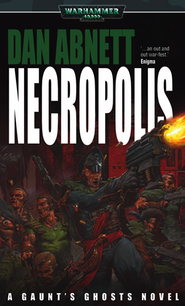

Necropolis

&lt;大墓地&gt;

Necropolis tells the story of the siege of Vervunhive, a megacity or &quot;hive&quot; on the planet of Verghast. It is set several months after the battle for Monthax, and marks the start of the books' chronology in the sense that the events in one book are sequential and immediately follow the events at the end of the previous book. In this book the first of occurrence of &quot;folding&quot; happens, where Vervunhive citizens are permitted to join Imperial Guard Regiments, or move to one of the two new &quot;hive&quot; created at the end of the book.

大墓地讲述了维文蜂巢的围攻战,维文蜂巢是威法斯特行星上的一个巨型城市,或者叫&quot;蜂巢城市&quot;.故事设定在蒙萨克斯战役发生的几个月以后,正是从这本书开始,小说的故事是一个接着一个发生直到小说结束. 在这本书里小说第一次开始有了&quot;异地征兵&quot;发生,维文蜂巢的市民们被允许加入帝国卫队军团,其余的人则被送往了小说末尾提到的两个新&quot;蜂巢&quot;里居住

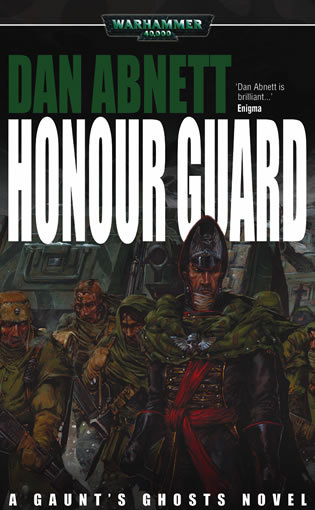

Honour Guard 

&lt;荣誉守卫&gt;

In Honour Guard, the Ghosts are sent to the Shrineworld Hagia, religious capitol of the Sabbat worlds and home of the Saint for which they are named. There they engage in battles with the Infardi, led by the psyker Pater Sin, a more unpredictable, cult-like enemy than the regular Chaos forces they had previously engaged. The book concentrates particularly on the clashes of armoured forces, including the Pardus armoured Imperial Guard regiment, and opposing them machines from the corrupted Forge World Urdesh.

在&lt;荣誉守卫&gt;一书中,幽灵们被送往一个神殿世界哈吉亚(Shrineworld Hagia),这里是萨巴特世界的宗教首都,同时也是圣者萨巴特的故乡,在那里幽灵们遭遇了因法迪(Infardi),一个由灵能者帕特·辛(psyker Pater Sin)带领的邪教组织,这个组织的行为甚至比他们之前战斗过的混沌势力更不可预测.书中最精彩的部分是一段装甲遭遇战,对阵双方是帝国帕度斯空降军团与来自堕落的铸造世界乌德什的混沌机械

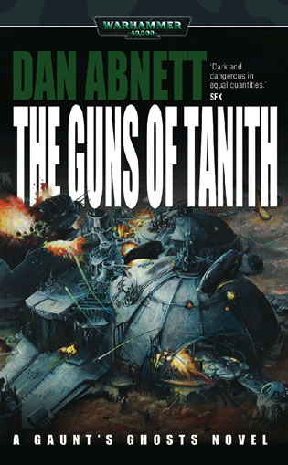

The Guns of Tanith 

&lt;坦尼斯之枪&gt;

Amidst the spires of the lethally polluted world of Phantine, a planet where dwellings are all above the Scald - a sea of polluted air, the Tanith must make an aerial assault to recapture Ourenberg and its valuable Promethium reserves from the elite enemy Blood Pact, and their allies the ruthless reptilian Loxatl.

在空气污染严重为致死程度的芬丁世界,一个所有建筑都固定在&quot;沸油&quot;----大量被污染的积沉空气----之上的星球.坦尼斯军团为了从血契部队手中抢回储藏有贵重物资的奥兰伯格,对那里发动一场了空中突袭,而那里的血契部队不但装备精良,甚至还带了一种危险的爬行动物作为他们的盟友----洛萨特蜥

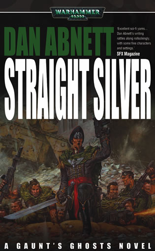

Straight Silver 

&lt;直银军刀&gt;

On the planet of Aexe Cardinal, the Ghosts form part of an Imperial Guard army sent to reinforce the ailing loyalist forces on the planet being worn thin by a 40 year war. However, the Imperial Guard are thrown into a war incompetently handled and must negotiate through the politics of the Aexe Cardinale hierarchy. The Ghosts are recalled from the planet marking the first time they haven't seen a war until its completion.

在阿克斯·卡迪诺行星上,幽灵们被送往那里支援在那里苦苦坚持战斗将近40年的忠诚的友军部队.但是帝国卫队只是被丢进一场他们无法改变的战争,并且任何计划都要通过阿克斯·卡迪诺贵族阶级官僚层层沟通研究决定. 最后幽灵们被从那里召回,这是他们第一次直到行动结束也没能见到真正的战场.

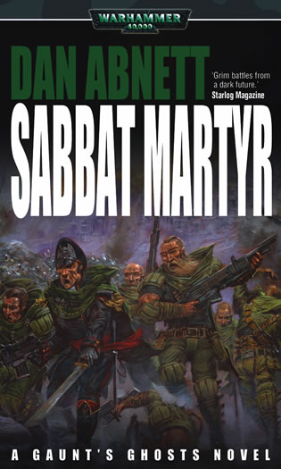

Sabbat Martyr 

&lt;萨巴特烈士&gt; 

The Ghosts are sent to Herodor, a seemingly insignificant world in the Sabbat World to be the honour guard for the reincarnated Saint Sabbat, a climatic battle ensues and the Chaos forces overwhelmingly attack the planet to kill the reincarnated saint and the Ghosts are forced to fight for their lives to hold the planet and keep her alive. This book marks the departure of some of the original characters such as Brin Milo (leaves with The Saint) and Colonel Colm Corbec (dies). 

幽灵被送往赫罗多,一个中并不起眼的世界,为重生的萨巴特圣者担任荣誉守卫,冈特的部队在那里遭遇了混沌的大规模进攻--目标就是重生的圣者.幽灵们被迫要为圣者,这个星球,以及他们自己的生存而战.这本书也标志着一些军团初创人物的别离,比如布林·米洛(跟随圣者离开了),以及上校科姆·科贝克(牺牲).

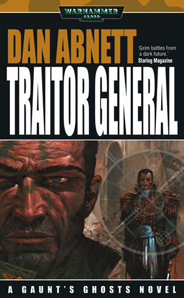

Traitor General 

&lt;变节将军&gt; 

When the disgraced General Sturm was captured by the foul forces of Chaos, Gaunt must infiltrate a squad of his most trusted men deep into enemy territory on the Chaos-held planet Gereon to prevent the General's secrets compromising the Crusade. Gaunt must keep his forces and their resistance allies together and resist the seeping influence of Chaos long enough to achieve their objectives.

当失去荣誉的将军斯图姆被混沌军团抓获以后,冈特接到命令带领自己的渗透小队进入混沌控制的星球格里昂(planet Gereon),阻止将军所掌握的秘密被混沌得知而影响远征进程.冈特必须将自己的部队与当地反抗力量联合,并且尽可能的阻止混沌对手下的影响直到他们的任务完成.

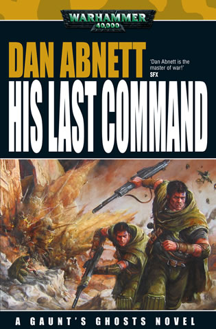

His Last Command 

&lt;他的最后命令&gt; 

Returning from Gereon, Gaunt and his team are accused of being corrupted, they are cleared of charges to find that their regiment has been merged with the Belladon 81st recon to make the 81/1st recon regiment under the command of a charismatic new commander (Col. Wilder). Gaunt eventually regains command of the regiment when the commander commits himself to a brave and suicidal rearguard action. His Last Command as a phrase is mentioned twice in the book, once in reference to Gaunt, and once in reference to Wilder.

从格里昂返回后,冈特跟他的小队被指控受到混沌污染,当他们证明了自己的清白以后,发现他们所在的团已经被编进了贝拉伦第八十一侦察部队,在有魅力的新指挥官(威尔多上校)指挥下,他们被叫做第一/八十一侦察团.冈特一直尝试重新获得独立团的指挥权,直到上校英勇的牺牲在一次自杀性的断后行动里.&quot;他的最后命令&quot;这段话在书中被提到了两次.一次是引用冈特所说的,一次是引用威尔多所说的.

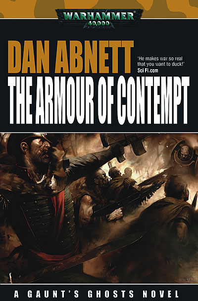

The Armour of Contempt 

&lt;蔑视之甲&gt; 

The Tanith 1st were sent back to the planet Gereon to join forces with the Imperial defenders and liberate the planet from Chaos. The Inquisition, however have other ideas. The brutality of the ‘liberation’ pitched Gaunt into opposition with his commanders, who believe victory must be achieved at any price, no matter how cruel.

坦尼斯第一团被送回了格里昂世界,加入了那里的帝国防卫军,试图从混沌的手里解放这个世界.但是审判庭却对这个星球另有打算... 在这野蛮的&quot;解放&quot;行动中,冈特一直在与他的指挥官对抗,因为后者相信胜利是可以付出任何代价的,无论有多残忍

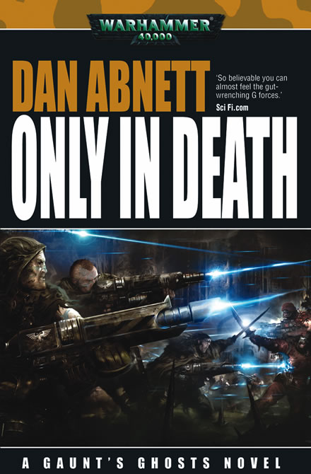

Only in Death 

&lt;至死方休&gt; 

As the crusade to liberate the Sabbat Worlds continued, Colonel-Commissar Gaunt led the Tanith First-and-Only into an unforgiving new warzone – the fortress world of Jago, where Lord General Van Voytz tasks the Tanith to defend the Eastern Flank, using the Hinzerhaus as a base. As the enemy assaults increased in fury, Gaunt and his regiment faced the terror of the present alongside the ghosts of their past, for only in death does duty end.

解放萨巴特世界的远征行动仍在继续,上校-政委冈特带领着坦尼斯唯一的第一团进入了他们永远无法忘记的战场 -- 要塞世界加古(the fortress world of Jago),将军-领主冯·沃提兹(Lord General Van Voytz)将东翼的防守任务交给了第一团,以辛扎毫斯( Hinzerhaus)为基地.当敌人的进攻开始变的越发疯狂,冈特与他的幽灵军团即将面对他们长久以来的恐惧----只有死亡能让他们的职责结束.
