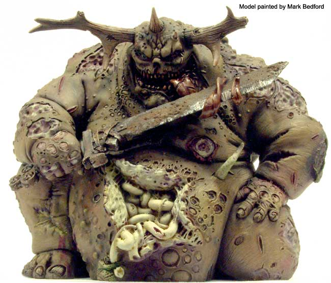

# 大不净者 Great Unclean ones

[想象力丰富者慎入、请备好呕吐袋] 大不净者 Great Unclean ones

trivel

 有知道这个特殊角色的在回复里提下吧，找半天没找到，以前看的忘记鸟~ 

Great Unclean ones. Nurgle’s lords of bounteous filth 大不净者，纳垢富含污秽的领主 The immense, bloated Greater Daemons of Nurgle tower above the babbling hordes of Nurgle like corpulent schoolmasters. Alternately jovial and stern, a Great Unclean One commands his legion with affectionate bellows of praise and bombastic cajoling. Fuelled by morbid energy, a Great Unclean One pays careful attention to all of his followers, delighting in the smallest boil, reveling in the variety and effulgence of their poxes. With gurgling guffaws, the Greater Deamon sends forth his legions with extravagant waves of his arms, extolling the virtues of plague and pestilence, booming words of encouragement or reproach across the battlefield. 

巨大而肿胀的纳垢大恶魔，塔立于咕哝吵闹的纳垢恶魔群中，就好像他们肥胖的校长。时而和蔼时而严厉，大不净者用高声的赞扬和夸张的哄骗引领着他的军团。充斥于病疫的活力之中，大不净者关注着所有他手下的方方面面，从最小的疮疖中获得了欣喜，又陶醉于他们多种多样闪着光辉的脓包之中。伴随着咯咯的粗野大笑，大恶魔用夸张挥舞他的武器方式鼓舞他的军团前行，对疫病优点的高声赞颂，合着鼓励和斥责的隆隆之音穿透战场。

It is not just the forthright personality of a Great Unclean One that gives him so much presence. Each is a huge creature shaped in the fashion of Nurgle; massively rotund, his fleshy form torn with rotting splits, his innards spilling into view as he strides forward. Clusters of buboes erupt from his green hide, birthing small swarms of Nurglings. Noxious juices seep from dozens of sores, leaving a glistening trail of mucus and filth in the Great Unclean One’s wake. Fractured, lichen-mottled antlers sprout from the Great Unclean One’s head, often hung with festive garlands of decaying intestines. Globules of yellowy-green spittle fly from his wide mouth as the Great Unclean One urges his minions onwards. Pallid maggots feed up the Greater Unclean One’s exposed flesh, growing into furry, thick-bodied flies that form a dark swarm around the Greater Daemon. Filled with unholy vitality, a Great Unclean One is Impervious to pain and physical wounds have little effect on it; plasma-burnt flesh quickly transforms into suppurating scars, bullet wounds become oozing pockmarks and tissue shredded by las-blasts forms into warty, crusted scabs. 

不单直率的个性令大不净者突显王霸之气。他们外形上也紧跟“纳垢风”；圆滚巨大，肉呼呼的身体上点饰着开裂腐坏的割口，在大步前行时可见其内脏翻滚成一团。一串串淋巴腺肿从他绿色的密部喷出，化为一群群微缩纳垢。片片溃烂伤口涌出的毒液，在大不净者身后画出一条污秽黏腻闪闪发亮的航迹。破裂的、苔生斑驳遍布的鹿角长于大不净者头上，通常还挂着蛆肠形成的桂冠。当大不净者激励下属前进时，黄绿的星沫，从他的阔口中飞散而出。苍白的蛆虫在大不净者外翻的腐肉喂养下形成一层白毛，短粗的苍蝇环绕大恶魔形成黑黑的一团。由于充斥着不洁的能量，大不净者对伤痛一无所觉，不为所动。电浆武器烧过的血肉迅速化为脓创，弹孔化为渗液的凹疤，激光爆裂的组织外表会长出覆盖厚皮的瘤包。

As monstrous and horrific as his appearance is, a Great Unclean One is possessed of paternal affection at odds with his nightmarish form. Gregarious and sentimental, a Great Unclean One takes pride in the achievements of his followers, and looks upon all the creatures in his legion as his ‘children’. Driven to organize Nurgle’s chaotic endeavours, the Great Unclean Ones seek to instill purpose and function on the daemonic rabble they command. 如同其怪异恐怖的外观所现, 大不净者在他噩梦般的外表上深受其原体神力的怪异影响。喜欢聚群又感情丰富，大不净者会对属下的成功极感自豪，并将他军团下辖的部属看作他的‘孩子们’。为设法组织起纳垢恶魔们混乱的努力，大不净者尝试在他控制下的恶魔乌合之众中注入共同目标和组织概念。 

With vociferous proclamations, a Great Unclean One heaps praise upon those who spread disease and filth, Who butcher the enemy and infect their corpses. With chiding grumbles, the Greater Daemon harries those who are tardy in advancing or who seem less energetic in the pursuit of Nurgle’s goals. 

用高声的宣赞，大不净者将大量表扬给予那些散布疾病、污秽，屠杀敌人又感染其尸体的家伙。用怨骂的斥责，大恶魔不断烦扰那些迟缓前进，对追逐纳垢的目标缺乏动力的家伙。

Just as spreading disease and decay fills a Great Unclean One with jovial vigour, opposing Nurgle’s great schemes rouses tremendous, righteous ire. Though ponderous, a Great Unclean One is all but unstoppable on the advance, wading into the enemy through ever the fiercest firepower. Whether armed with a rusted plagueblade encrusted with the festering blood of thousands, or swinging a flail made of skulls filled with burning ichor, a Great Unclean One flattens its foes with its fury. The Great Unclean One Unleashes its ‘stream of corruption’ against those that try to flee its filth, maggots and mucus that sweeps away the enemies of Chaos. 

在散播疾病与腐坏时，愉悦的活力会充斥大不净者，对纳垢伟大计划的反对阻挠，会极大的激发其内心的愤怒。尽管只能一路笨拙缓慢的前进，但大不净者的步伐无可阻挡，蹒跚着冲过最猛烈的火力，杀入敌群。不管是装备着被无数鲜血锈蚀、壳附的瘟疫之刃，还是挥舞着充满燃烧着脓水的头骨堆所化而成的连枷，大不净者都会含着狂怒扫平他的敌人。对那些试图逃离污秽的，大不净者会放出蛆虫与黏液混合而成的“腐败之潮”，将其冲刷而去。（感觉其实就是吐出一口浓痰啦）

WS BS  S  T  W  I  A  Ld  Sv Great Unclean One  6  4  6  6  5  2  4  10  4+ 

Unite type: Monstrous creature 

Daemonic Gifts: Noxious Touch 

Special Rules: Daemon, Slow& purposeful, Feel No Pain.
