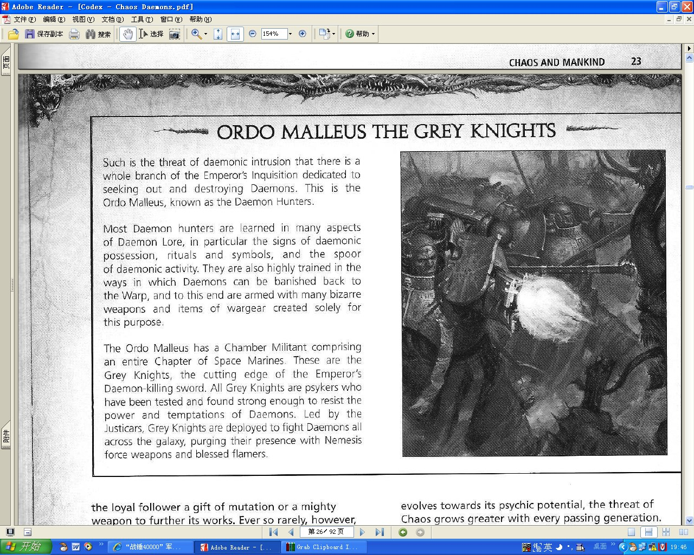
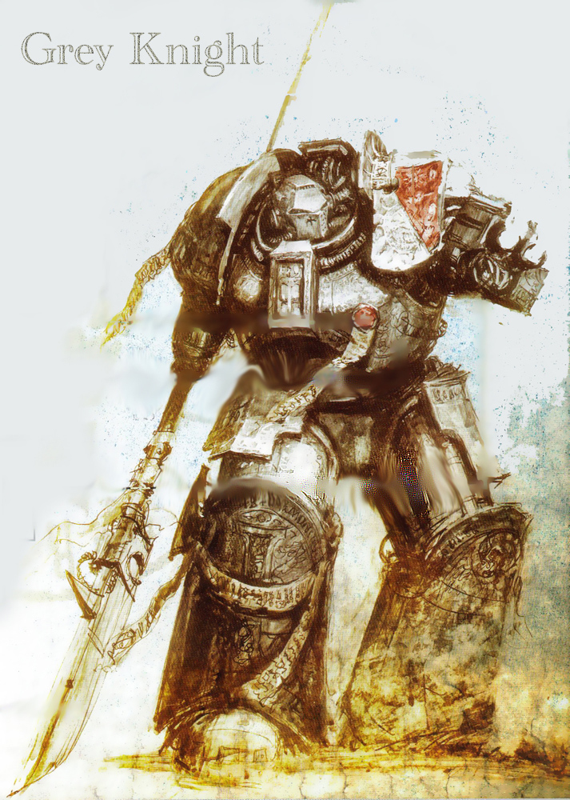

# 翻译——恶魔规则书中的灰骑士

<h4>翻译——恶魔规则书中的灰骑士（完成版）</h4>

qpzdahab

谢谢no.ace与兔子半妖老大提出的宝贵意见，再谢！ 

原文：恶魔规则书P24页 

恶魔审判庭——灰骑士 

因为恶魔入侵是如此巨大的威胁，因此有一整个帝国审判庭的分支致力于发现并消灭这些恶魔。这个审判庭就是恶魔审判庭，又以恶魔猎手而闻名。 

大部分的恶魔猎手博学于恶魔信仰的诸多方面：独特的恶魔印记、恶魔信仰的仪式与标志、以及追踪恶魔的方法。他们也接受高阶的，将恶魔逐回WARP的训练。为此，他们装备了许多奇特的武器以及为此而特制的战争装备。 

恶魔审判庭有一支直属部队，包括一整团的星际战士。他们就是灰骑士，帝王屠魔利剑之锋。所有的灰骑士都是灵能足以对抗恶魔的诱惑，并经受住考验的灵能者。灰骑士由审判官领导，被部署在整个银河里来对抗恶魔，使用他们的复仇女神与赐福之火来净化他们的所及。

附张电子书上的原文

再附张帅图（很好奇为什么规则书上没提醒出差在外的恶魔们小心灰骑......）

