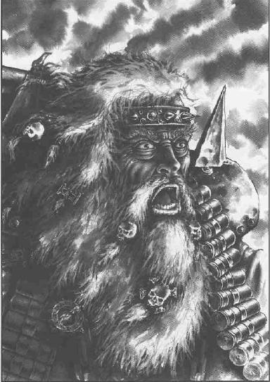
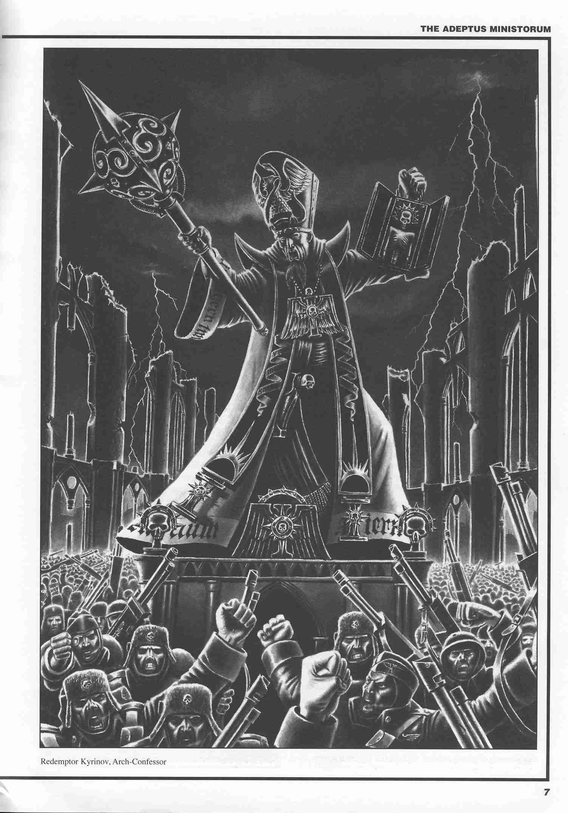

# 人类帝国概况

人类帝国概况（施工中，慎入）

CZ75

（感谢大能的75魔……前面的部分见电子书v2，或者直接去下面的地址催文^^）

[http://sonicbbs.eastday.com/topicdisplay.asp?BoardID=228&Page=1&State=4&TopicID=1798328](http://sonicbbs.eastday.com/topicdisplay.asp?BoardID=228&Page=1&State=4&TopicID=1798328)

第三节 居民、语言与宗教

一、居民

人类帝国的居民均为地球人类，此外还有少数由人类进化而来的亚人类（Abhuman），他们不被帝国认为是变种人，拥有帝国公民身份，比如奥格林人（Ogryn），他们是由被流放到监狱行星上的人类进化来的。

二、语言

人类帝国的官方语言为高级哥特语（High Gothic），通用语言为低级哥特语（Low Gothic）。

高级哥特语是人类帝国用于官方文件的正式语言，它是一种拉丁化的英语，大量采用了拉丁语的词汇和变格变位法，但许多源自拉丁语的词汇已经与原意相差甚远，比如adeptus这个词，在拉丁语中是adiposco（意为“获得”）的过去分词，但在高级哥特语中，却是指一个部门、单位、团体或机构；再比如高级哥特语中的assassinorum这个词，拉丁语中并没有这个词，它是由英语中的assassin（刺客）加上拉丁语后缀-orum组成的。

高级哥特语一般仅用于官方书面文件和上层人物之间的对话，掌握它的人很少，不过大多数的世界上都会有一小批学者或教派使用高级哥特语。高级哥特语与低级哥特语不同，它是高度规范化的，即使是分处银河两端的人之间都能流利地使用高级哥特语相互交流而不必担心会引发误会。

低级哥特语即现代英语，绝大多数的帝国公民都能掌握低级哥特语。由于帝国的疆域非常广大，不同地区的哥特语之间都有很大的差别，有时几乎大到让人认不出是两个来自不同地区的人说的实际上是同一种语言的程度。

此外，机械教的机械教士之间还使用一种非常独特的语言——科技行话（Lingua-Technis）。这种语言从来不向机械教之外的人传授。它跟高级哥特语一样是高度精确的。它使用的许多词汇来源于科技水平比较高的世界上使用的低级哥特语。

三、宗教

人类帝国是一个政教合一的国家，宗教在社会生活中扮演中非常重要的角色。

人类帝国的国教叫“帝国国教”（Adeptus Ministorum，或Ecclesiarchy）。

下文编译自：

[http://www.goblin-online.net/fortyk/14light.txt](http://www.goblin-online.net/fortyk/14light.txt)

1、帝国国教的起源

许多古老的文件显示，早在皇帝进行重新统一人类的大圣战（The Great Crusade）时，就已经产生了把皇帝当作神明来崇拜的教派。但在当时，皇帝并不鼓励将他当作神来崇拜的做法。但这些教派一直以地下形式存在着。

当皇帝艰难地击败了何露斯（Horus）之后，他也元气大伤，不得不进入黄金王座（the Golden Throne）。这一消息传开后，人们纷纷为皇帝做出的巨大牺牲而感动，许多世界中都产生了无数大大小小的崇拜皇帝的教派。这些教派分分合合，最终有一个教派占据了统治地位：救世皇帝圣殿派（the Temple of the Saviour Emperor）。

救世皇帝圣殿派起源于地球，它的创始人叫法斯梯迪库斯（Fastidicus），这个名字在人类的一种古老语言中意为“先知”，而他真正的名字早已消失在历史的长河中。他本是一位德高望重的帝国防卫军军官，在帝国宫保卫战中功勋卓著。该派创立后迅速传遍整个地球，然后又很快传遍了银河。法斯梯迪库斯在120岁的时候去世。他逝世时，该教派在地球上已经有了数以十亿计的信徒，在太阳星域内有数以百万计的神职人员。他死后，该教继续向银河扩张，当时银河中仍然有相当多地方陷于何露斯叛乱造成的无政府状态，该教派派出了传教团和军队去这些地方传播自己的教义。不愿或不能接受其教义的行省将遭到政治上和经济上的毁灭。

在帝国里，只有机械教和星际陆战队不是该派的信徒，他们有自己的偶像和仪式。

在第32个千年初期，帝国确认救世皇帝圣殿派为帝国的官方宗教，并改称其为“帝国国教”（Adeptus Ministorum），通称“国教”（Ministorum或Ecclesiarchy）。当时该派的信徒已经占了帝国人口的约2/3。两个世纪后，总主教维涅里斯二世（Ecclesiarch Veneris II）成为帝国元老之一。三百多年后，国教的地位已是举足轻重，使其能在帝国元老会议中占据一个固定席位。

帝国国教把全国分成几个主教教区（Diocese），每个主教教区由一位主教（Cardinal）掌管。主教直接向教廷最高会议（the Holy Synod）负责，下辖执事长（Arch-deacon）和执事（Deacon）等神职人员。教廷枢机会议（Holy Synod）向总主教（Ecclesiarch）负责。

2、光明同盟派

尽管国教不断地发展，还是有一个教派不断发展壮大，并构成了对国教的威胁，这个教派就是光明同盟派（Confederation of Light）。光明同盟派发源于迪马默（Dimmamar）行星，并以此为中心发展起来。它的忏悔教义、它关于贫困和朴素生活的观点直接与国教相抵触，而国教又很难动摇它。于是帝国元老会议经过投票，一致同意对其开战，第一次信仰之战（the First War of Faith）就这么开始了。

光明同盟派被宣判为异端。帝国的战争机器冲着它驶去。除了少数成员得以逃脱并隐藏起来之外，作为一个有效运转的宗教，光明同盟派已经不存在了。然而国教对之所知甚少的是，光明同盟派依然存在，当时来运转的时候，他们将再次登上历史舞台。

在第33个千年末期，除了跟国教订有紧张的“互不干涉”协定的机械教和星际陆战队控制的行星之外，帝国的每个行星上都建有显赫的纪念神圣皇帝（God-Emperor）的教堂或圣殿。来自国教的无数信徒的宗教税源源不断地滚入国教的保险箱，国教就用这些钱来进行维护它的统治的信仰之战（War of Faith）。

3、叛教时代（The Age of Apostacy）

随着国教权力不断增大，国教的影响逐渐渗透到了帝国生活的方方面面。下至最低级的书记员，上至帝国元老，都发现国教的意志对他们的生活和决策的影响逐步增强。不久，国教就直接或间接地执掌了帝国的法律和资源。帝国中的持不同政见者开始反抗这种控制，机械教制造总监开始反对国教的决定，星际陆战队的战团长们日益对帝国的命令冷眼相待，内政部也逐渐开始反抗国教。

内政部为了从国教手中夺回权力，开始改组自己，同时也拉开了已经持续了超过7000年，并一直持续到现在的内政部与国教的权力斗争的序幕。第34千年末第35千年初，国教的权力开始减小。由于连续出了几个软弱无能的总主教，内政部得以在幕后操纵教廷枢机会议。

总主教贝涅丁四世（Benedin IV）把这一切都看在眼里。为了躲开内政部的控制，他把教廷枢机会议和国教的权力中心迁移到暴风雨星域的奥菲莉亚七号星（Ophelia VII）上。躲开内政部的控制之后，国教的权力开始回升。国教组建了自己的宇宙舰队和陆军，叫做护教军（Frateris Templars，直译为“圣殿武士兄弟会”）。地球上的国教建筑被毁坏（注：原文未说明具体原因）。第35个千年中期，总主教格雷戈尔十一世（Greigor XI）宣称要进行改革，将教廷枢机会议迁回地球。尽管反对的声浪一浪高过一浪，改革的措施仍然进行下去了，重建教廷枢机会议在地球上的建筑的工程也开工了。为了完成该项工程，这些年来原本已经很高的宗教税又增加了不少。最后，当发布了几项激进的改革措施之后，格雷戈尔十一世死于食物中毒，他的更激进的改革也就没能进行下去。

然而宗教税仍在增加，许多世界爆发了反抗毁灭性的宗教税的公开叛乱，甚至连行星总督也扬言要这么做。可是这些呼声被国教漠视了，反叛的世界和星系的官员被宣布为异端，并遭到处决。高额的宗教税被用于购买最珍贵的金属和最稀有的珠宝以装饰总主教宫。动荡和反叛继续增加，然而每一次都被护教军镇压了下去。异空间风暴突然增加了，很快就把许多星系孤立起来，使得远距离航行无法进行。随着国教和内政部把注意力转向它们之间的权力斗争，国教不断用血腥手段镇压异端，再加上来自混沌邪神和外星人的攻击不断增多，帝国逐渐陷入了无政府状态。

4、范迪尔的血腥统治（Vandires Reign of Blood）

在第36个千年初期，郭格·范迪尔（Goge Vandire）当上了第361任内政部帝国元老（ High Lord of the Administratum）。他一贯反对国教权力，成功地操纵了总主教选举，把无能而又容易被他操纵的鲍里斯三世（Paulis III）推上了总主教的位子。然后又发动军事政变，宣布鲍里斯三世为人类的叛徒，杀死了鲍里斯三世，范迪尔随即身兼总主教和内政部长两职。国教内反对他的人在逃往奥菲莉亚七号星的途中失踪于异空间。范迪尔很快就控制了国教和内政部。

范迪尔是个疯狂的极端受害妄想狂，随着时间的推移，他扭曲的心智使他颁布了无数毫无必要的、残酷而血腥的法令，进行了无数次大屠杀。这一时期是何露斯叛乱之后帝国历史上最血腥的时期，人们称这一时期为“血腥统治时期”（Reign of Blood）。

此时，一个在圣洛尔（San Leor）成立的教派开始登上历史舞台。范迪尔了解到该教派完全由女性组成，奉行以武术和纯洁的心灵来侍奉皇帝之道，该派自称“皇帝之女会”（Daughters of the Emperor）。范迪尔以总主教的身份对这个不怎么重要的外省世界进行了一次访问，皇帝之女会会员们目睹了一场事先安排好的表演，以为范迪尔真的得到了皇帝的保佑，便向他宣誓效忠。她们成了总主教的保镖，改名为“皇帝新娘会”（Brides of the Emperor）。她们都是老练的战士，至少有一次保护范迪尔躲过了教廷枢机会议谋划的暗杀。

自从坐上总主教宝座后，范迪尔的残暴统治持续了70年。当他年老时，全身输入了各种药物，以试图延缓无法避免的疾病与瘟疫对他脆弱的身体的破坏。而靠着直接听命于他的皇帝新娘会的保护，他仍然能用铁碗统治着整个帝国。然而有一天，一个年轻的情报员出现在范迪尔的宫殿里，给他带来了一份来自银河北方的迪马默行星一带的消息：自从被消灭了几千年之后，光明同盟派死灰复燃，并宣布范迪尔为帝国的叛徒。在朦胧星域，有一个名字被人们一遍又一遍地提起，这个名字就是塞巴斯蒂安·托尔。

没有人知道塞巴斯蒂安·托尔是什么人。帝国元老——范迪尔的傀儡们为如何应对争论了个把月，而范迪尔自己也变得越来越孤僻。三个月之内，已经有八十多个星系向光明同盟派效忠。护教军受命将迪马默行星和它上面的一切生命消灭。然而舰队刚刚出发，就被一股异空间风暴毁灭了。据说靠得够近的人依然能听见这个风暴区内死人的狂吼声。这就是现在被人称作“皇帝怒涛”（the Storm of the Emperors Wrath）的风暴区。

随着护教军的主力被消灭，整个朦胧星域彻底陷入了叛乱状态。塞巴斯蒂安·托尔的名字仍在被人们反复传诵。对于身居地球的帝国元老们来说，这个名字听起来意味着国教的毁灭，甚至很可能是整个帝国的毁灭。这把他们吓得晕头转向。

托尔既不是恶魔的化身，也不是外星人的傀儡，他的目的不是毁灭帝国。他是一个人，他宣称皇帝托梦给他，让他走上讲坛传道，抨击国教的罪恶。由于他具有雄辩的口才，人民信任他，很快就有了一大批听他布道的人。帝国指挥官盖尤斯·维尔柯年（Gaius Welkonnen）率迪马默的军队投奔托尔，让托尔来指挥军队。这支军队在第二年就迅速增加到了500多万人，并开始缓慢地穿过银河向地球进军。

围绕着托尔的传说不断增加，一些可以通过他的演讲得到解释，而有些则不能，比如，当时异空间风暴已经在整个银河肆虐了几百年，然而只要托尔从一个星系出发去另一个星系，途中就绝不会发生异空间风暴。导航者家族长老（Paternova of the Navigators）授予他“异空间大师”（高级哥特语为Abstracta Preomnis，低级哥特语为Master of the Warp）称号。消息传开后，托尔进一步被人们当成神一般来崇拜。由于国教的军队已经被“皇帝怒涛”摧毁，国教只能眼睁睁地看着托尔靠着自己的如簧巧舌把一个又一个星系、一个又一个主教教区拉到他那边去。人民的愤怒都指向了范迪尔，他把人民逼得太急了，现在已经有一个领袖把人民团结起来了。

不安的消息不断传向范迪尔和他的帝国元老们。到目前为止，机械教和星际陆战队中并没有多少人卷入“叛教时代”，他们保持着中立，并在混乱之海中警戒着不让别人入侵有他们的基地在其中的行省。然而，现在他们也宣称要支持塞巴斯蒂安·托尔，机械教向帝国元老会议发了一份通告，答复了自己采取这种行动的原因，并宣告范迪尔为叛徒。范迪尔解散了帝国元老会议，命令自己残存的部队进攻起义的星际陆战队和机械教。许多军官由于拒绝服从这一命令，被宣判为异端并被绞死，他们的职位被更容易操纵的人代替了。然而范迪尔的背叛已经是昭然若揭。

火星上的机械教卫队（the Martian Tech-Guard）奉机械教制造总监加斯塔夫·赫德里亚特里克斯（Gastaph Hedriatix）的命令，前往地球，加入星际陆战队的行列，进攻帝国宫。此时皇帝新娘会仍有约10000名强壮的战士，她们在外界的进攻下成功地保卫着范迪尔的巢穴。但是来自内部的威胁宣告了范迪尔的灭亡：他们就是另一个与荒唐的血腥统治时代相隔离开来的、皇帝本人的卫队——禁军（Adeptus Custodes）。为了躲避无政府状态，他们切断了与外界的一切联系。只有只言片语传到他们耳中。他们直到星际陆战队和机械教宣布讨伐范迪尔时才意识到范迪尔的背叛。禁军的一位百夫长带着一队禁军，在离范迪尔的据点不远的某个地方会见了皇帝新娘会，他花了一个多小时劝说皇帝新娘会撤回对范迪尔的誓言，但皇帝新娘会拒绝了他的建议，他只好离开，带着皇帝新娘会领导人爱丽琪娅·多米妮卡（Alicia Dominica）和她的5个卫士，亲自觐见皇帝。

人们无法知道她们究竟看见了什么，因为禁军对此事守口如瓶。当她们走出阴暗的地道时，眼中燃烧着无比的愤怒和仇恨。爱丽琪娅·多米妮卡径直走进范迪尔的接见室，痛斥其背叛国教和帝国的罪过，尤其是欺骗了皇帝新娘会。此时范迪尔已经完全与现实脱节，全然忘了他已是四面楚歌，忘了全副武装的战士正在他的宫殿内，枪声正不断在帝国宫内回响。他突然迸出一串长篇大论，解释说哪几个星系必须被消灭，下命令进攻托尔和他的军队。然而他的办事员早已跑光，范迪尔得孤身面对着复仇心切的皇帝新娘会——此时已改回原来的名字——皇帝之女会。爱丽琪娅·多米妮卡宣判范迪尔死刑，然后斩下了他的头。

血腥统治时期结束了。

5、国教的重建

血腥统治时期结束后，帝国陷入了一片混乱。为了重建帝国，机械教制造总监赫德里亚特里克斯召集了残存的帝国元老们，重组帝国元老会议。一些机构，比如导航者和商贸船队被鼓励去净化他们的队伍；从反对范迪尔的军官中提拔了大量帝国指挥官；其他得到了同僚的辩护的最高执政官们保住了他们的位子。不过，总主教还没有产生。

塞巴斯蒂安·托尔接到消息，请他立刻到地球去一趟。他回绝了，说在他回到地球之前，还有别的事情要做。一艘快速运输船被派去接托尔，但他再次回绝了。被激怒的帝国元老们下达了一项命令，宣布托尔为叛徒，并将他带回地球受审。经过两个月的审判后，托尔被证实无罪。帝国元老们聚在一起，花了三天时间讨论该拿托尔怎么办。

由于托尔被证明无罪，而帝国此时又需要一个精神领袖，托尔便被推举为总主教。当他的支持者大声赞成这一决定时，他平静地推辞了这一职务。会场中一片混乱。禁军司令艾克塞尔索（Excelsor）把托尔拉到一边，并对他说了一些话。没人确切地知道他究竟说了什么，据说大意是“……你要么以总主教的身份离开地球，要么就休想离开地球……”。

托尔接受了总主教之职，但他提出了一些明确的条件。帝国元老会议必须同意他提出的一切要求。他将改革国教，而最高执政官们必须支持他的行动。他还要求能像以前那样在帝国中传道。托尔就任第292任总主教，史称托尔一世。

托尔在奥菲莉亚七号星上组建了教廷辅佐会议（Synod Ministra），作为教廷枢机会议的影子部门，而教廷枢机会议仍然留在地球上。然后，他把主教区拆分成许多更小的区。第36千年288年第一天（0001288/M36），《驯顺教令》（Decree Passive）开始生效，该教令禁止国教拥有任何“武装士兵”，所以护教军被解散了。不过，托尔知道国教仍然需要一支军队，便在《驯顺教令》中规定国教可以保留一支武装力量，根据该教令的条文，皇帝之女会不但没有被解散，反而成了国教的军事力量——修女会军事教团（Orders Militant of the Adeptus Sororitas）。

译注：英文中“武装士兵”（men under arms）按照字面意思，可以理解为“武装男子”，而皇帝之女会成员全是女性，托尔便钻了这个空子。

在地球上就任总主教10年之后，托尔再次前往银河传道。112岁时他最后一次回到地球，六个月之后蒙皇帝宠召而去。他去世后第一年就有7000万朝圣者拜谒了他的陵墓。至今，帝国人民仍然源源不绝地来到地球，拜谒这位皇帝最忠诚的仆人。

6、逆教之灾（The Plague of Unbelief）

在血腥统治时期结束之后，托尔刚当上总主教不久，主教布卡利斯（Bucharis）开始了“逆教之灾”。布卡利斯的主教区位于太阳星域的西南边，离地球不太远，以加尔塔莫（Galthamor*）为中心，该地区由于被异空间风暴与其他地区隔离开来，没有得到托尔发动圣战和就任总主教的消息。出于嫉妒他的同僚的成就，他要在主教区的主星上建造一座歌颂皇帝的宏伟圣殿。为了建造圣殿，他驱使加尔塔莫行星上的男女服苦役，并耗尽了加尔塔莫的资源。他需要更多的人手和资源。

*译注：在一些资料中，该行星叫做加塔拉莫（Gathlamor）。

布卡利斯征服了邻近的一个世界兰纳（Rhanna），获得了充足的补给，财富也滚滚而来，布卡利斯的腰包也随之越来越鼓。他跟一个叛变的帝国海军将军塞哈拉（Sehalla），还有里盖尔（Rigel）第23团的一个叫加斯托（Gasto）的上校狼狈为奸。靠着这批海军和防卫军，布卡利斯在地球西边建立了一个小小帝国。7年之内，布卡利斯的帝国已经统治了50个星系。

关于塞巴斯蒂安·托尔的消息还没有传到这一带。而当消息最终传来时，布卡利斯严密封锁了这一切，就跟他严密地控制了星际航行和星际通信一样。布卡利斯宣称国教已经被叛徒和异端所腐蚀，国教已经毁灭了，并宣布自己是皇帝真正的代言者和帝国国教的真正首脑。对那些听见了他的演讲的人来说，加尔塔莫成了国教的新中心。

在布卡利斯的统治下，逆教之灾在不断扩散。在他的帝国统治的世界上，人人相斗，弱肉强食。他的雇佣军向西边和北边扩展着布卡利斯帝国的疆域。在南边，他避开在卡迪亚和恐惧之眼附近部署有大量舰艇的巴卡海军基地（注：原文如此，疑有误，巴卡基地在银河南边，而卡迪亚和恐惧之眼则在加尔塔莫以北，两者相距甚远），而驻扎在海德洛夫的太平星域作战舰队已经向布卡利斯宣誓效忠。布卡利斯已经准备要攫取地球的权力，统治整个帝国。万幸的是，他已经自掘坟墓，报应就要来临了。

布卡利斯的帝国不断扩张，他在一次侵略中靠近了芬里斯（Fenris）附近的星系，芬里斯是星际陆战队太空野狼战团的母星。当太空野狼战团的巡洋舰“拉斯之爪”号正准备离开时与布卡利斯的舰队遭遇了，布卡利斯没把这当成一次单纯的机会，他径直冲入芬里斯行星所在的星系，理所当然地遭到了太空野狼战团的反击。他不顾他舰队的2/3已经被太空野狼战团占领，率军在芬里斯表面登陆，然后试图包围太空野狼战团的要塞——狼牙堡（the Fang）。这场攻城战持续了三年。当布卡利斯认为只要再来一次外科手术般的打击就能拿下要塞的时候，命运再次跟他开了一个大玩笑。在这千钧一发之际，太空野狼战团的一支作战舰艇中队正在赶回母星，正巧碰上了布卡利斯的作战舰队，一番激战之后，布卡利斯的舰队被摧毁了。布卡利斯乘一艘交通艇侥幸逃出，把芬里斯丢给了太空野狼。布卡利斯撤回了他在北方的部队，加强他剩余领地上的防御。

当布卡利斯被捆在芬里斯行星上时，他手下的指挥官们继续西进，那边有个棘手的行星奇洛斯（Chiros），由于距离遥远而能一直抵挡住布卡利斯帝国的攻势，最后侵略军的指挥官不得不向奇洛斯人投降。随后，矿业行星古利扬（Guryan）上发动了一场起义，成功地推翻了布卡利斯的统治。紧接着，多尔西亚（Dolsia）和佛斯特（Vaust）也成功地赶跑了布卡利斯的军队。起义军已经开辟出了一条能穿越布卡利斯的帝国，直捣加尔塔莫的道路。在柯尔查（Colcha），布卡利斯布下埋伏，当进攻他的起义军舰队刚从异空间出来，就遭到伏击，几乎全军覆没，布只有一艘交通艇逃出，然后降落在柯尔查行星表面。

当地指挥官注意到了这艘交通艇，便把部队驻留在当地，准备玩猫捉老鼠的游戏。一年过去了，一切似乎太平无事。突然，原本驯顺的柯尔查农民发动了暴动，烧毁农庄，袭击兵营并打败了他们的敌人。暴动从柯尔查开始，蔓延到一个又一个世界。而这时布卡利斯的钱包已经开始见底了，他的士兵不断开小差，内部意见重重，而起义又此起彼伏，他已是瓮中之鳖。最终，距离加尔塔莫最近的星系梅塔洛（Methalor）也失守了。布卡利斯把他的母星系的防御加强了一倍，去加尔塔莫的每一艘飞船都要停下来接受检查。很快，一位信使抵达了布卡利斯的宫殿，信使宣称他代表多兰·奇洛西乌斯司祭（Confessor Dolan Chirosius），要求布卡利斯立即投降。布卡利斯把信使杀了喂乌鸦，以此作为回答。多兰司祭很快就到了加尔塔莫，没多久他就被逮捕了。

多兰被戴上枷板游街，并当众受鞭笞。他被折磨了六个多月，每天忍受着残酷的刑罚，得不到睡眠，一天只能喝一点水维持生命。然而他始终没有屈服。布卡利斯命令公开审判这个桀骜不驯的人，给他安了一大串罪名：亵渎神圣、投靠异端、阴谋颠覆、煽动暴乱等等等等。布卡利斯要置多兰于死地，但又不想让人民把多兰视为殉教者而追随他。他要羞辱多兰，然后用残酷的手段慢慢地折磨死他。布卡利斯统治的地方都转播了审判。五个多月后，检举和起诉阶段完成后，多兰被允许为自己辩护——以示这场审判是完全公正的。在为自己辩护的几天里，多兰讲述了自己如何在无数的星球上鼓动人民起来反抗布卡利斯、控诉了布卡利斯的残暴统治并鼓励人民站起来拿起武器反抗布卡利斯。最后，布卡利斯宣布，多兰的辩解已经证明了多兰他自己是有罪的。随后多兰被带进地牢。八个月之后，多兰仍然没有向那自命总主教的暴君的手下屈服。最后当他死去时，他那已遍体鳞伤、无法识别的遗体被丢去喂狼和秃鹰。然而这些食腐动物并没能吃到这顿大餐——多兰的遗体马上就消失了，再也没有人找到。

布卡利斯想羞辱多兰，结果却适得其反。由于他让司祭为自己辩护，结果司祭的话传播得非常广，如果布卡利斯不允许他为自己辩护的话，本来是不会传得这么广的。多兰的死讯一传开，布卡利斯的帝国便陷入了暴动的海洋。他统治的世界几乎在同一时间里一个接一个地摆脱了他的控制，他的宫殿被枪林弹雨所包围，宫殿内的背叛者打开大门，让起义者攻进了宫殿。布卡利斯试图逃往宇宙港，那里有一艘运输船，只要他需要，随时能出发。然而他再也没能离开这颗行星。

7、帝国国教的组织体系

国教的神职人员统称为Frateris clergy，所有的神职人员一般可以俗称为僧侣或牧师（Priest），但牧师一般指基层的神职人员，如司祭（Confessor）、传教士（Missionary）和布道者（Preacher）。

国教的最高领导是由教廷枢机会议和教廷辅佐会议选举产生的总主教（Ecclesiarch）。

国教的中枢机关是两个会议——位于地球的教廷枢机会议（the Holy Synod）和位于奥菲莉亚七号星上的教廷辅佐会议（the Synod Ministra）。以前只有教廷枢机会议，但在血腥统治时期结束之后，塞巴斯蒂安·托尔成立了教廷辅佐会议，以免国教再次被地球上的世俗的行政机关（如内政部）所控制，由于奥菲莉亚七号离地球足够远，可以使国教免遭外界控制。

这两个会议都由主教（Cardinal）组成，只有他们才有资格讨论国教的发展前景并做出决定。他们在很多方面都受身处地球的总主教的影响（教廷枢机会议尤其如此，这一点不言而喻）。但总主教最重要的角色是在帝国元老会议中担任代表国教的帝国元老。有时，总主教会根据教廷枢机会议和教廷辅佐会议的建议，颁布一项命令，然后教廷枢机会议和教廷辅佐会议就会去执行该命令。

主教（Cardinal）分三级：最高一级是“宫廷主教”（Cardinal Palatine），他们没有自己的主教教区，而是在地球上的总主教宫内辅佐总主教工作。其次是“地球主教”（Cardinal Terran），他们的主教教区位于地球上。再次是“星空主教”（Cardinal Astra），他们的教区在地球之外。星空主教中又有“辅佐星空主教”（Carnidal Astra Ministra），这一头衔很大程度上是荣誉性质的，授予其主教教区位于奥菲莉亚七号星附近的主教，以及身为教廷辅佐会议成员的主教。

国教把银河划分为多个主教教区（Diocese），每个主教教区由一位星空主教管辖。辅助他的人有执事长（Arch-deacon）和执事（Deacon）。执事长和执事负责协助主教管理主教教区的行政事务（例如制定税率、建造神殿、征收税款之类），下辖总铎（Dean，负责协助执事处理行政事务）、传道士（Missionary）、布道者（Preacher）、教长（Pontifex）、司祭（Confessor）和司祭长（Arch-confessor）等。

司祭（Confessor）是布道者和传教士的上级，拥有教会授予的自由行动权，可以在他们想去的任何地方传教。司祭没有固定的教区。司祭中的高阶者叫做司祭长（Arch-Confessor）。

大部分传教士（Missionary）是银河传教团（Missionarus Galaxia）的成员，他们负责向重新被发现的人类世界传播皇帝之光，他们以其坚韧、顽强、不张扬却又坚定无比的信念著称。

神职人员中级别最低的是布道者（Preacher），相当于现实世界中的牧师（Priest），负责管理当地社区的一所神庙或圣殿，许多世界有几千所神庙和数量几乎与此相当的布道者。他们在司祭（Confessor）或传教士（Missionary）的指导下工作，负责在群众中传播皇帝的教义。布道者可以晋升为教长（Pontifex），教长一般负责一个堂区（parish，教务辖区的最小单位，一个堂区一般下辖几所神殿），教长的堂区范围可以大到整个行星，甚至是几个行星。教长又可分为几级：地球教长（Pontifex Terran），他们的堂区位于地球上；行星教长（Pontifex Mundi），其堂区包括整个行星；市教长（Pontifex Urba），负责一个城市的堂区；星空教长（Pontifex Astra），负责管理一艘或几艘宇宙飞船上的神殿和布道者。

有关修女会（Adeptus Sororitas）的具体情况，见后续章节。

只有总主教才有权宣布进行信仰之战（War of Faith）。“圣战”（Crusade）与“信仰之战”（War of Faith）之间的区别是其决策者和参与者：发动圣战的命令只能由最高执政官会议下达，一旦下达了发动圣战的命令，帝国主要的武装力量，包括星际陆战队、机械教、帝国防卫军、帝国海军和帝国国教都要参加。而信仰之战的发动只需要总主教的命令即可，主要由国教自己和国教正统派教义的追随者进行。不过这两者经常相互交织混同。总主教可以发动一场既是圣战而又是信仰之战的战争，但信仰之战并不都是圣战。当一场信仰之战不是一场圣战的一部分时，进行信仰之战所需要的资金必须由国教自己承担。此外，信仰之战仍必须得到帝国元老会议的其他成员的认可。

8、国教的教义

国教的信条和教义叫做“帝国教义”（高级哥特语：Cult Imperalis，低级哥特语：Imperial Cult）或“帝国信条”（Imperial Creed），帝国教义体现了其创始者法斯梯迪库斯的思想，在叛教时代之后，塞巴斯蒂安·托尔重建国教时，他又在教义中添加了相当的光明同盟派教义（塞巴斯蒂安·托尔属于光明同盟派）。

国教教义的主体是解释对皇帝的崇拜，不过它也解释帝国——皇帝统治之领土——扩张的正当性，另外，保卫帝国免遭一切外部力量和外星人的颠覆活动也是每个帝国公民的义务。帝国内部必须保持纯洁，为了保持统治秩序，叛教、未经认可的教派、变种人和未认证的灵能者必须被控制。

国教教义教导所有的公民：无论出身高低，公民在帝国的统治体系中都有一席之地，每个公民都应该在自己的位置上竭尽所能。帝国统治体系的根基就是：尊重权威、尊重比自己年长者及比自己优秀者，而最高的权威就是皇帝。

就像所有的宗教信仰体系一样，帝国国教对其教义的阐释是开放的，信徒或许对信仰中的某些次要之处有不同意见，但总体上这个信仰体系是有效的，所有信徒或多或少在大方向上是一致的。银河西边的卡伦迪特派（Calendites）认为皇帝从一诞生就是神，而法纳奇亚派（Phanacian）则认为皇帝只有当他打倒何露斯那一刻起才成为神。这些经常能在国教的两个最高回忆上引发长达几个星期的愤怒争吵的事情，对于下层信徒来说，往往是难以理喻的鸡毛蒜皮小事。

就跟神职人员一样，国教的不同派别对官方教义的解释都有些许不同，或是选择了官方教义的不同部分作为其教义的基础。下面是三个帝国内部的教派的例子。

涅克洛蒙达聚居世界（Hive World of Necromunda）或许是救赎派（Redemptionist）思想

的中心。在国教看来，涅克洛蒙达完全是一个充满了堕落灵魂的世界。救赎派教条认为：人类

的行为已经偏离了皇帝指引的康庄大道，而人类的罪恶将使其灭亡于污秽和堕落。人类如果不能

控制自己罪孽深重的欲望，就无法像皇帝真诚地希望他能做到的那样，去团结和统治群星。在其更富有军事色彩的信条中，有一条认为罪孽必须用一切手段来净化：火、血、信仰或死亡，尤其是火……罪孽很自然地表现为多种形式：酗酒、赌博、说谎、欺骗、亵渎、纵欲、通奸（特别是通奸的想法）和阻碍救赎派信徒的善行的行为，而其中最坏的是变种人、女巫（即未经认可的灵能者）和恶魔之卵，其次则是那些容忍罪孽、保护变种人和女巫、或无视救赎派传道的异端……在救赎派的“教义”中没有人是纯洁的或可以免罪的。

另一个教派是崇皇教（Imperialism），它在银河的边远地区很流行。它的教义系统体现了“将皇帝之光带给每个人”的先锋精神，许多银河传教厅（Missionarus Galaxia，国教的一个机构，其工作人员在银河各地旅行，专门到那些尚未听说过皇帝的拯救行为的世界去传播皇帝的意旨）的传教士都曾是该派信徒。该派在银河东边边疆非常流行。崇皇派信徒经常乘坐穿越银河和异空间去寻找新世界的巨型贸易船，作为汇报，他们跟这些船贸易货物并提供精神帮助。他们中的绝大多数死前都没有见到一个处女世界，但还是有一些人的祈祷得到了新世界的回答（即他们找到了新世界，并开始传教）。如果新世界已经有人居住，崇皇派信徒的责任就是向当地居民传授皇帝的真言。如果当地尚未殖民，但环境适合人类居住，崇皇派信徒就在这个世界上建立殖民地。这经常引发跟灵族的冲突，崇皇派信徒声称许多“播种世界”（Maiden World，指那些很久以前被人有意识地撒播生命种子，等时间到了之后进行收割的世界）属于他们。

德塞德纳（Desedna）世界上的一些居民被审判官净化他们世界的行为所影响，自发地开始了在他们的社区中搜寻异端和污秽的行动。这个新兴的教派以他们在朦胧星域的世界为中心，很快发展到周围。他们取名为“同胞之光”（Brethren of the Light），自视为肩负着探察帝国内部的黑暗角落和将传播皇帝之光的使命。他们自认为是审判庭的延伸。在官方的不同机构看来，他们是怪人、碍手碍脚的菜鸟或麻烦制造者。“同胞之光”信徒经常成为丑闻的焦点，在这些丑闻中，往往有一位帝国贵族的隐私遭到了侵犯，或是一位清白的公民蒙受了不白之冤、但另一方面，他们不只一次地发现了隐秘的混沌教派或基因窃取者的行踪，许多行星总督发现，自己被他们调查之后就成了审判庭注意的对象。“同胞之光”崇尚隐蔽而秘密地活动，其组织结构仍然是个迷，加入该派的新人都要接受仔细的调查，调查他们过去是否犯过罪或有不端行为。有人怀疑该派内部有审判庭的人，利用该派来进行一些见不得光的行动，不过这一点尚未得到证实。

帝国公民中，只有阿斯塔尔特修会（即星际陆战队）和机械教的人才能不信仰国教传授的官方教义。星际陆战队的教义中不单单把皇帝作为一位神来崇拜，而是更强调荣誉感、战友情谊和力量等军人美德，这些美德是他们对每一个兄弟的期望。每个战团的仪式和传统都不一样，这些仪式和传统是由每个团的牧师传承下来的。所有的战团都把皇帝作为有史以来最伟大的战士（毕竟他杀死了何露斯）和他们战团的基因原体来崇拜（类似中国人的祖宗崇拜）。

机械教教徒信奉机械神，他们的教义同样不把皇帝作为唯一的神来崇拜，对他们来说，“知识”才是神性和一切生物的终极体现，所以他们才将那些能扩展知识的上古神物视为圣物。皇帝之所以是他们最高的崇拜对象，是因为他深刻地理解这一点。从上古时期保存知识至今的机器也是圣物，创造新知识的研究同样神圣。机械的智能得到的尊重程度不亚于人或其他有机生命的智能。对于机械教来说，衡量一个人价值的唯一标准，是他有多少知识，他的身体不过是保存知识的有机容器。生命本身对于机械教士来说并没有多少价值。最能体现这一点的是他们利用人类作为原材料创造出的特殊的生化-机器人，这种机器人叫做“奴工”（Servitor），帝国内的各个政府和军事机构广泛地采用奴工，包括内政部、星际陆战队和中央政务院的其他部门。典型的奴工有操作和保养机器的技术员（Technomat）、用于全息储存的记录员（Holomat）和拥有强大的计算能力的人体计算机（Lexomat），以及“雄蜂”（Drones）——这是一种有生命的机器人，它们智能很低、基本没有自我意识，是进行体力劳动和其他杂务的理想奴隶。

然而，某些教派的教义，已经超出了合理的争辩探索的范围，跨入异端之界了。微小的冒犯，比如对赞美诗做出错误的解释之类的，可以通过多种方法偿还，从出席神庙参加护教军到检举他人的罪孽都可以。罪人的忏悔行为越伟大，国教就越宽恕他。还有更可恶的罪行，那就是叛教行为。大多数被宣判为异端的人并不是混沌邪神的代理人，也不是基因窃取者教徒的爪牙，只是持有同国教或审判庭明显不同的观点，或许仅仅是对帝国的现存秩序构成了威胁。对于异端来说，无论他们是否有罪，都只有一死。只有皇帝能审判异端并决定他是否有罪，而只有死后才能到皇帝面前接受皇帝的审判。根据叛教的严重程度，死刑可以是拖延很久并充满痛苦的，也可以是迅速而相对不那么痛苦的。只有在死后，被告才能接受皇帝的审判，只有通过这种极端而高度警惕的行为，才能保全帝国，寻找其他的方法都将招致无政府状态和人类的毁灭。

参考资料：

Sisters of Battle Codex (1997)

Witch Hunters Codex (2004)

Codex Imperialis (1993) (pp. 38-40)

帝国国教的一些机构：

忠嗣学校（Schola Progenium）：

忠嗣学校负责照顾和教育帝国仆人的遗孤。不论是帝国防卫军上校的受宠的儿子，还是边远世界的文书的孩子，忠嗣学校都会收养他们。被忠嗣学校收养的遗孤叫“忠嗣学生”（Progena）。每个主教教区都有一些忠嗣学校教养院（Schola Progenium habitat），教养院内的帝国仆人的遗孤就被送往当地的忠嗣学校。教养院的布道者在牧长（Abbot）的指导下，对年轻人进行包括宗教教育在内的各种教育。

当忠嗣学生在青春期早期时，他们会表现出某些方面的才能，在年满16岁之前，他们的监护人会关注这些才能，并根据学生的天赋，将他们培养成帝国机构的职员。大多数忠嗣学生将作为中央政务院的文书、办事员或监督终老一生。不过，少数人将能升上较高的职位。男性忠嗣学生可能成为帝国防卫军的政委、帝国海军的海军军士，或者出家，当上布道者或总铎（隶属于执事）。女性忠嗣学生可能进入修女会。所有性别的忠嗣学生都可以被审判庭或刺客庭征募。受过忠嗣学校的培养，是很高贵的荣誉，那些曾接受过其培养的人都很非常在意这种特权。

忠嗣学校师生的生活方式是严格而清苦的。在叛教时代，大部分忠嗣学校都腐化堕落了，学校里到处是奴役与堕落。遗孤们被当作奴隶，被迫在工厂和矿井里工作，为教会挣钱。一些被特别选定的人被卖给帝国指挥官们，为他们当奴仆。特别有魅力的，则被卖作帝国贵族的姬妾。最健壮的学生被训练成护教军或“皇帝新娘”，有了这些最好的兵员的补充，范迪尔的军队实力大增。各个教养院内丑行横生，资金往往不翼而飞。与当时情况完全相反，如今的教养院严格地执行男女分校，男女学生之间的接触被严格地限制在宗教庆典上。只有保持这种纯洁的忠嗣学生，才有望在皇帝的统治秩序中得到一个职位。

银河传教团（Missionarus Galaxia）：

尽管银河的大部分已经处于皇帝统治之下，还是有无数的世界依然在期待皇帝之光。银河传教团的使命，就是把帝国教义传授给这些失落的世界，传播皇帝的智慧，以及拓展帝国国教的影响。

银河传教团通过几种方式来达到其目的。每一艘探索船上都至少有一名传教士，以备发现了有人类生命存在的证据之后进行传教。如果传教士能碰上一个失落的社区，他的职责就是尽可能研究该社区的文化和崇拜方式，同时，他还得尽量把帝国教义传授给当地人。这一过程会持续很久，其中涉及到以皇帝取代当地人原先崇拜的神祗，以及把国教的行为方式移植进当地宗教庆典活动中。他必须消除当地宗教中的比较野蛮的、不太合意的方面（比如血祭），他还得负责分辨出任何其他不符国教需要的特点，比如残留的基因变异、混沌崇拜或异型的优势。

一些情况下，要花上几代当地人及传教士的时间，银河传教团才会对当地宗教的情况满意。先期抵达某一世界的传教士会在他们的教义中加入用密码编写的预示和准备好了的预言，好让后来抵达的传教士以此为立足点。国教的所有部门中，银河传教团是最自由、最不受纪律约束的，传教团的人重视主动性、勇气、韧性和智慧，甚于粗糙的信仰和不屈的、对国教教义献身的精神。

帝国国教的一些特殊人物：

尤里亚·雅可布斯（Uriah Jacobus）

尤里亚·雅可布斯是一个在银河南方的巴卡（Bakka）以西的世界传教的传教士。五十岁时，他已经让十五个新世界皈依了帝国国教，在这个可居住世界稀少的地区，这是一个非常客观的成就。他在一个半冰冻的世界——至点星（Solstice）上取得了更大的成功。他在这个科技与社会发展到了风间阶段的世界上花了三年时间研究当地居民之后，开始把国教的教义传授给当地的组织水平还很落后的宗教。

当他与一个王国的国王会见时，他看见了该王国的神的偶像，这使他很担心，这种偶像是一只有四只胳膊的死神。雅可布斯认为当地可能已经被基因窃取者教派所渗透，便退回对他更友好的王国，然后说服了这些王国的统治者们联合起来，去进攻那个叛变的国王。正如雅可布斯所料，当他率领着一支由弓箭手和骑兵组成的大军抵达时，他的军队遭到了一群基因窃取者的袭击。尽管大量基因窃取者在箭雨中被射倒，它们还是轻而易举地把步兵撕成了碎片。

雅可布斯把他的骑士分成两队，一队留做预备队，他带着另一队绕过基因窃取者的侧翼，袭击了它们的后方。骑士们碾碎了披着人皮的同巢兄弟（Brood Brother，基因窃取者教派的基层士兵，往往利用他们的人类外表渗透进当地行星上的人类部队里），直捣邪教的心脏。最终教主（Patriarch，基因窃取者教派中最年长、地位最高者）被杀死，尽管它的尸体旁边也堆满了为了杀死它而倒下的人类尸体，而长老（Magus，基因窃取者教派中的高位者，具有灵能力，负责向教众传达教主的意志，以及当基因窃取者教派发动叛乱时，在周围的社区中传道，以招收信徒）也被长枪刺死。基因窃取者在失去了其头目之后立刻陷入混乱中，剩余的骑士见状继续进攻，在一次光荣的冲锋中彻底剿灭了已经晕头转向的敌人。

在至点星之战后，雅可布斯成为了一个传奇人物，无论什么人反对他，他都能得到皇帝的帮助来挫败他们。后来，他又成功地让六个世界皈依皇帝，他最后在死亡世界戈郎（Gorang）上死于一种破坏肺部的病毒之手。

救赎派司祭长基里诺夫（Redemptor Kyrinov,Arch-Confessor）：

司祭长基里诺夫曾在上百个世界中严厉地打击过渎神者和异端。他净化了瓦兰大统领（Demagogue Lord of Valaan）的混沌军团，他在忏悔圣战（Crusade of Repentance）中与瓦尔哈拉冰雪战士一起摧毁了塞尔达公爵（Duke Selda）的圣战军（注：原文用的是伊斯兰教的圣战“Jihad”）。基里诺夫以他对职责的忠诚、他对背离他所阐述的国教教义的人的冷酷无情而著称。基里诺夫经常引用多兰司祭的经文，并非常认同这位伟大司祭的信条：没有什么牺牲是不可承受的。

大多数时候，基里诺夫看起来是一个专横的、大嗓门的人，但他的耐心和精明往往比任何对群众的说教与鞭笞都更能帮助他。据称，基里诺夫愿意等到天崩地裂、山河变色，只要能让一个国教的敌人接受皇帝的恩惠。基里诺夫的热烈的演讲、狂野的手势以及夸张的信仰行为，都是他为了达成目的而使用的非常冷静、富有逻辑性的隐蔽手段。基里诺夫是一个老练的阴谋家和民意煽动家，他的敌人几乎无法用智谋战胜他，也几乎不可能同他和解。

基里诺夫最著名的事迹，是他处理的莫洛夫叛乱（Molovian Heresy）。基里诺夫伪装成叛变的莫洛夫总督的坚定拥护者，花了三年时间收集反对总督叛变的证据，召集人马准备推翻总督。在与当地工业界和商业界领导进行了上百次秘密会谈之后，基里诺夫说服他们为推翻贪婪的弗拉切克（Vlachek）总督而结成同盟。在他的支持者的帮助下，基里诺夫的真正讯息能传达到莫洛夫社会上的几乎每个地方。在工会与商人的支持下，基里诺夫得以发动一场人民起义，推翻了弗拉切克的统治，让弗拉切克的表兄取代了他的位置，值得注意的是，从此，莫洛夫就以其能高效、诚实地上缴教会税而闻名遐迩。教会或帝国的其他机构从来没有获得过同样的成就。

主教阿尔曼杜斯·海尔弗（Cardinal Armandus Hellfire）：

阿尔曼杜斯主教负责阿维诺教区（Diocese of Avinor）。阿维诺很接近恐怖之眼，该地区的教会军队必须时刻警惕着混沌军队的入侵。阿尔曼杜斯本人经常率领人民进行反抗入侵者的信仰之战，并且从未失败过。他身材高大、肌肉结实、嗓音既深沉又洪亮。在教廷枢机会议（Holy Synod）中，他以顽固的保守、坚决反对任何微小的对教会的改革而出名。他严格，但公正，他视自己为完美信徒的榜样，任何人都应该照他那么做。尽管许多人对他的观点不以为然（这些意见大多是私下的），没有人能质疑他的虔诚、勇气与荣誉感。

阿尔曼杜斯出身低微，他常常被当成刚刚接手一件新工作的工人。他的命令代表着高昂的士气，他往往是部队里同胞之谊的源泉。他能用他卓越的智慧和爽朗的笑声，让一帮士气低落的士兵变成能跟帝国防卫军中最优秀的团队相比的战斗部队。

来源：战斗修女规则书（1997年版）

第二章、历史

在介绍帝国历史之前，先介绍一下帝国的纪年法。

帝国的纪年法跟我们现在使用的历法一样，都是从公元1年起开始计算的，但是在表达方式上很不一样。

帝国的纪年一般写成精确度/千分年/年份/千年的格式，即A/BBB/CCC.MDD的格式，其中，A表示该时间的精确度，BBB表示这是一年中的第BBB个千分年（一个千分年表示一年的1/1000，之所以使用千分年而不使用通常的“日”、“月”是因为每个世界的一“日”都不同），CCC表示这一年是该千年中的第几年，MDD表示这是第几个千年。

精确度表示该日期的可靠程度，由于各地与地球距离都不一样，在进行异空间通讯时，很可能出现各种误差，精确度即表示该误差的大小。精确度共分10级（0-9级）。

各级精确度的不同：

0/1级表示其消息来源在太阳系之内；

2级表示其消息来源能跟太阳系进行直接的灵能联系；

3级表示其消息来源能跟2级消息来源进行直接灵能联系，但不能与太阳系进行直接灵能联系；

4级表示其消息来源能跟3级消息来源进行直接灵能联系；

5级表示其消息来源能跟4级消息来源进行直接灵能联系；

6级表示其消息来源无法跟0-5级消息来源进行灵能联系，但具体时间介于一个开头或结尾时间能证明为1-5级的时间段之中，无法具体确认的时间少于一个标准年；

7级，同上，但误差为1-10年；

8级，同上，但误差超过10年；

9级，只能近似地推测的日期，或是用于表示那些不使用帝国纪年法的世界上的日期。

千分年仅用于行政管理中，不用于日常生活。一年分为1000个千分年，从001到000；

每个千年有1000年，从001年开始，以000年结束。

举例：

0100007.M3，即表示第3个千年的第007年中的第100/1000，也就是公元2007年2月上旬左右，可靠性最高；

不要求精确到千分年的时候，只写年份和千年，如999.M41即表示第41个千年的第999年。

以下年表编译自：

[http://www.geocities.com/kavillion_secondus/imperialtimeline.htm](http://www.geocities.com/kavillion_secondus/imperialtimeline.htm)

这份年表不是官方设定，是由国外同好编纂的。编写时间比较早，所以有些设定与现行设定不同，而且没有记录999.M41的一些大事（第13次黑色圣战、第三次哈米吉多顿战争等）；该年表中还有一些错误，我根据现行设定修改了其中错漏之处。原来的年表中有一些条目与人类帝国没有太大关系，故删去。

一、上古简史

011.M03年（公元2011年）：第二次新纪元开始。

100.M03年：对火星进行地球化改造。

200.M03年：开始移民火星。

M04：发现异空间（Warp）。

M16：人类开始乘坐原始的亚光速飞船向附近的星系殖民。起初进展缓慢，由于各个新殖民地之间的距离遥远得要花上十代人的时间来航行，所以各殖民地不得不与地球隔离开来独自发展。接下来的一万年时间被称作“科技黑时代”（Dark Age of Technology）。

M21：“守护者”克里皮亚斯（Keeper Cripias）将其作为黄金时代（Golden Age）的结束而记录下来。人类的黄金种族（Golden Race of Men）变得依靠人类的石头种族（Stone Race of Men）和他们的技巧，就跟石人流行的那样。在接下来的5000多年中的某些时候，石人创造出了铁人（Iron Men）以帮助他们建造他们的帝国。

M21：在发明异空间航行法之后，人类的殖民活动更加迅速，不断地开拓并定居银河中的新星球。与第一种外星人接触。这一切是在不到1000年的时间内完成的。

M21：导航者基因被分离出来。导航者是能够引导飞船在异空间中航行的强力灵能者，这使得异空间航行更加快捷。导航者家族与联盟成为强有力的政治实体。人类扩张到了银河的大部分地区，为了帮助建造新的殖民地，开发了标准模板建造技术（Standard Template Construct，STC）系统。为了在陆地上进行高速移动，开发了泰坦。

M21：随着创建时期（Age of Founding）的开始，矮人的历史开始了。此时矮人母星上的采矿殖民地与地球保持着持续的联系，当时的矮人与普通人类还没有什么区别。

M22：外星人战争。人类遭遇了蛮人和灵族，并与之战斗。

M24：STC技术遗失。人类之中出现了灵能力量，异空间生物实体（即恶魔）也出现了。

M25：出现亚人类：Homo Sapiens Giganticus（巨人），Rotundus（圆人）和矮人（Minimus）。大内战。随着人类殖民地中精神异常状态的不断扩张，此起彼伏的叛乱把许多殖民地隔离开来，人类文明开始崩溃。

M25：Horiax Treatise提到了基因改造技术。

M25-M29：灵族在“未开发世界”（Maiden World）上散播种子。

二、纷争乱世（Age of Strife）

M26：“守护者”克里皮亚斯记载的历史中写到，在此时，石人和铁人（如今他们已经由奴仆发展成了与石人平起平坐的人）陷入了战争。铁人没有灵魂，石人在最后的自卫行动中把所有的铁人——包括依然忠于石人的铁人——都消灭了。从此纷争乱世（Age of Strife）开始了。

M26：异空间风暴把包括地球和矮人母星在内的银河中的许多地方隔离开来。这标志着矮人的“孤立时代”（Age of Isolation）的开始。矮人母星上的采矿殖民地变成了独立的、可自给自足的据点。在这段时间内，工程师行会（Engineers Guild）发展成了一股社会政治力量和据点，形成了复杂的政治和贸易协定。

M26：为了维护火星上的生命维持科技，机械教在火星上作为一个生存机构而成立了。机械教建造了他们的大祭坛（High Altar），并制造了叫做泰坦的巨型战斗机器。机械教的飞船不能飞出太阳系。

M26：围绕着矮人母星的异空间风暴稍微缓和，使得矮人与外星人得以接触，这一时期被称作贸易时代（Age of Trade）。矮人用他们丰富的矿产资源跟灵族和蛮人交换武器、食物和高科技系统。在互相冲突的蛮人和灵族之间，矮人保持着中立，并继续与双方做生意。

M26：火星上的机械教研究异空间风暴的模式，并准备进行探索银河的大规模远征，远征队中包括整个泰坦军团和上千名奴工。成功进行殖民的殖民地成为了机械教的铸造世界（Forge World）和骑士世界（Knight World）。这一进程贯穿于整个纷争乱世。

M27：地球上发射了一个探测器，其任务是抵达宇宙的边界。（14000年之后，它刚刚踏上它的归途，许多被认为是该探测器发射的信号实际上是蛮人的）

M28：地球内战——由于既无法在地球上获得足够的粮食和资源，又无法向更广阔的银河发展，地球陷入了内战，无数的军阀将地球搞得分崩离析，数十亿的人死于战争以及战争造成的饥荒。

M28：蛮人军阀“抢劫者”格兰哈格（Grunhag  the Flayer）率领一支巨大的舰队进攻矮人母星。许多据点被蛮人摧毁，史诗《因巴奇之沦陷》（The Fall of Imbach）就纪念了其中一个据点的沦陷。从这时起，矮人开始敌视蛮人，并对在这场冲突中保持中立的灵族持不信任态度。矮人的贸易时代结束了，而矮人、灵族和蛮人之间的战争时代（Age of Wars）开始了。

第三节 帝国初创

M28：皇帝为了征服地球，制造出了最早一批改造战士。

M29：皇帝重新统一了地球，开始准备征服银河。他抵达火星后，机械教认为他就是传说中的全能机械神（Omnissiah）。

M30：皇帝创造出了20个经过基因改造的超人。混沌力量发现了他们的可能性，并将他们散布到银河中。

M30：格雷巴法则（Grayba's Theroem）证明了基因原体的基因数据可以用于稳定的基因改造，使得发展出新的星际陆战队成为可能。20个第一批成立的星际陆战队军团成立，每个都是以他们的基因原体为模版建立起来的。

M30：成立星炬厅，这是一个由皇帝亲自领导的灵能导航机构，它使得星际航行更加快捷。

M30：随着大圣战的开始，帝国的时代来临了。在接下来的两百年间，皇帝与星际陆战队军团逐渐把原本分崩离析的人类世界统一在一起，建立了人类帝国。在这段期间，皇帝找回了基因原体，并把用他们的基因为模版组建的军团交给他们指挥。最伟大的基因原体是何露斯。人类在“帝国统治下的和平”（Pax Imperialis）下重新团结一致。

译注：Pax Imperialis源自Pax Romana（罗马帝国的和平），指在人类帝国的无可挑战的强权统治之下的和平。

M30：速成基因改造技术得以使用，使创造一个星际陆战队员的时间缩短到一年。这种做法会造成一些尚未觉察到的基本缺陷。

125.M30：何露斯赢得乌拉诺战役（Ullanor Campaign）之后，月影之狼（Lunar Wolves）改名为“何露斯之子”，以纪念他们的基因原体。

第四节 何露斯叛乱

007.M31：何露斯借着镇压伊斯特万三号星（Istvaan III）叛乱之机，清洗了军团中仍然忠于皇帝的陆战队员。幸存的忠于皇帝的陆战队员乘护卫舰爱森斯坦号撤离，带去了何露斯叛变的消息。

007.M31：何露斯叛乱爆发。几个月之后，皇帝命令7个星际陆战队军团攻击伊斯特万三号星。钢铁勇士军团、黑暗领主军团、怀言者军团和阿尔法军团倒向何露斯一方，其他三个军团几乎全军覆没。整个银河内星际陆战队之间自相残杀。

007-014.M31：太空野狼军团进攻千疮之子军团的母星普洛斯佩洛（Prospero）迫使千疮之子军团倒向何露斯一边，并撤入恐怖之眼中，在追击行动中，太空野狼军团的第13连消失在异空间中。

007-014.M31：在怀言者军团转而信奉邪神恐虐（Khorne）时，“屠夫”斯奇拉克（Scyrak the Slaughterer）杀死了怀言者军团的首席贤者。

007-014.M31：叛变的钢铁勇士军团用病毒炸弹轰炸了塔兰（Tallarn）并在上面筑垒围攻。双方不断得到增援，尽管帝国最后赢得了胜利，但损失相当惨重，参战的极限战士军团的部队里每十人中只有一人幸存。

007-014.M31：摩洛克之战，三个泰坦军团和上百个帝国防卫军团队抵挡了大司战何露斯与他的大军的进攻。参加这次战役的帝国士兵只有1/100幸存。

014.M31 地球围攻战——何露斯率部包围了皇宫。皇宫的保卫者们撤退到内宫，血天使军团死守终极之门。

014.M31 皇帝之子军团进攻平民，为取乐把上百万囚犯变成了被毒品驱使的大军。

014.M31 皇帝、洛加尔·多恩和桑吉尼乌斯传送到何露斯的战舰上，何露斯用计将桑吉尼乌斯和皇帝分开，向他许诺高官厚禄和大量封地，但桑吉尼乌斯拒绝了何露斯，在单挑中被何露斯杀死。随后皇帝杀死了何露斯，但自己也受了重伤，为了保存自己的生命能量，他不得不进入黄金王座。

014.M31 大清洗。整个银河的叛军被剿灭（叛变的星际陆战队军团逃入恐怖之眼）。这标志着何露斯叛乱的结束。

015.M31 为了在皇帝缺席的时候领导帝国，成立了帝国元老会议。

021.M31 极限战士军团的基因原体罗保特·基里曼编纂了第一部阿斯塔尔特圣典（Codex Astartes）。该书制订了新的组织原则。星际陆战队据此进行了第二次建军（the Second Founding）。忠于皇帝的星际陆战队军团拆分成较小的“战团”（chapter），每个战团兵力一千左右，这样就不会再出现一个像何露斯那样拥有强大力量的战团长了。由原来的军团拆分出来的战团中，只有一个战团可以保留原来的名字和徽章，其他战团都要根据阿斯塔尔特圣典的规定重新取名、设定徽章和制服。为了消灭恶魔，成立了专门对付恶魔的灰骑士战团。

021.M31 混沌大军撤入恐怖之眼。吞世者军团与皇帝之子军团在斯卡拉特拉克斯恶魔世界（Daemon world of Skalathrax）上相斗。吞世者军团曾一度团结起来，但哈恩（Kharn）的背叛使得他们分裂成了许多独立的、四处游荡的“战队”（warband）。

M31:雕刻星际陆战队动力盔甲的工作在救世主之墓（Tomb of the Savior）贝利斯·阿珍特（Bellis Argent）进行。

在大叛乱之后，屠杀级（Slaughter class）巡洋舰“异端许诺”（Heathen Promise）号回到巴卡海军基地进行大修，当大部分军官在点火前参加宴会时，船员发动了叛乱，在追击这艘巡洋舰的过程中5艘驱逐舰和2艘护卫舰变成了原子。

211.M31：在庆祝皇帝升天（？）的节日庆典上，太空野狼战团的基因原体莱曼·拉斯抛下了他最忠诚的随从出走，从此再也没有人看见过他或听说过他。在在对何露斯圣殿派（the Temple of Horus）进行的第二次大猎捕中，在一个叫鲁德拉的位于恐怖之眼边缘的世界上曾发现了他的盔甲。

218.M31：太空野狼战团仍然活着的狼王（Wolf Lords）们相聚一起，选举比约恩（Bjorn）为他们的领袖，授予他“大狼”（Great Wolf）的称号。比约恩团结起整个战团，并宣布进行寻找莱曼·拉斯的大猎捕（Great Hunt）。大猎捕以失败和悲伤告终。

356-372.M31 维护者近距支援装甲车的第一种试验型号由极限战士战团的技术兵开发出来。

M32：在进行深入异空间核心的试验时，Ganymede被污染，从此没有在这方面进行更深入的试验。

M32：为了给普洛斯佩洛复仇，千疮之子军团的基因原体红色马格努斯（Magnus the Red）对芬里斯附近的世界发动了一系列毁灭性的奇袭，并在幻象中嘲弄“大狼 ”哈雷克·艾恩赫尔姆（Harek Ironhelm）。被迷惑了的艾恩赫尔姆对他认为是千疮之子军团秘密基地的冈加瓦（Gangava）发动突袭，可实际上，千疮之子的舰队却围攻了芬里斯。由无畏机甲“一击必杀的比约恩”（Bjorn the Fell-Handed）率领的保卫者顽强地抵抗了40个日日夜夜，直到哈雷克·艾恩赫尔姆从冈加瓦派来的一支由哈肯·布莱克文（Hakkon Blackwing）率领的侦察兵部队抵达之后才解了围。

350.M32：救世皇帝圣殿派被确认为帝国的官方宗教。

400.M32：最后一位星际陆战队基因原体死亡（或失踪）。

550.M32：总主教维涅利斯二世成为帝国元老。（他是第一个享有此荣誉的教会首脑）。

935.M32：国教禁止发行范·戴森上校（Colonel Van Dyson）的《黑暗灵族：他们的行为方式及击败他们的方法，一个曾击败过他们的人教你怎么做》。

M32-M33：国教对光明同盟派发动了信仰之战。

345.M33：黑暗灵族袭击了魔夜区（Devilnacht）贝塔-科普林21号星上的坦戈德殖民地。

453.M33： 弃民级（Desolator class）战列舰永恒伤痛号（Eternity of Pain）叛变。

M34：达姆审判官汇报说血天使战团和他们的子团说使用的非传统的、不正常的基因复制技术对其基因种子造成了不良影响，他还汇报了有关“红色嗜血者”和“黑色狂怒”的谣言。

126.M34：最后一艘屠杀级（Slaughter class）巡洋舰忠顺号（Dutiful，后改名为无魂号[Soulless]）在塞泰兰（Sethelan）铸造世界完工。该舰随后叛变，轰炸了塞泰兰铸造世界，摧毁了斯卡蒂克斯（Scartix）发动机的设计。

222.M34：农神节探索舰队（Explorator Fleet Saturnalia）的行商浪人乌齐斯·帕兰达洛重新发现了暴风雨星域洛基行省（Loki Sector）林世界（Rynn's World）上的人类殖民地。

647.M34：《恐怖编年史》（The Annals of Terror）的作者拉斯科·派尔（Lasko Pyre）自杀，后来被宣判为异端。

722.M34 行商浪人多森（Dausen）与矮人母星特拉肯·B3·斯维兹（Terlaken B3 Svyz）建立了联系，并通报了帝国。对该行星下达的灭绝令被暂缓执行，等一个审判庭调查组的报告发回之后再决定是否灭绝。此后的时代在矮人的历史上被称作“重新发现时代”（Age of Rediscovery）。

？黑暗建军。这次建军中成立的战团数量及其命运均不得而知。

200.M35 教廷枢机会议迁至奥菲莉亚七号星（Ophelia VII），国教开始组建自己的武装——护教军（Frateris Templar），护教军开始壮大，

334.M35 34,344 Planet Angelis surveyed by Imperium (Agelis is the planet that GorkaMorka takes place on)

334.M35：帝国开始勘测安杰利斯行星（Planet Angelis）。

500.M35：格雷高尔十一世当选为总主教，并宣布信仰的中心应是地球，所以他将把国教迁回地球。各种改革耗空了国教的资金，并导致了税收激增。格雷高尔十一世在一次食物中毒之后很快死亡。

512.M35：国教完成了迁回地球的工作。

789.M35 “M-银河”型激光步枪成为帝国防卫军的标准装备。

M35末M36初：被诅咒的建军。火鹰战团和其他战团成立时的基因种子混入了被诅咒的基因。一些战团发生了可怕的变异。

M36早期：异空间风暴大量爆发，由于蛮人和其他种族在整个银河中肆虐，帝国被严重削弱。内政部和国教的纷争把整个帝国都卷入了，这一时期被称作“叛教时代”（Age of Apostasy）。这一时期的临近结束时，矮人的据点从帝国中脱离了出去。

M36《死亡天使传说》（Mythos Angelica Mortis）详细记录了有关星际陆战队的历史或传说。

215.M36：星际通信部部长、元老菲德卢斯（Phaedrus）被范迪尔暗杀，当时菲德卢斯已经察觉到了范迪尔的阴谋。

288.M36：在一场内乱中，刺客厅大导师（Grand Master of Assassins）自己也倒在了刺客刀下，不过有人怀疑真正的大导师已经逃走，被暗杀的实际上是一个忠于大导师的卡利杜斯刺客。在击败了范迪尔派来的刺客的一次次暗杀之后，大导师自愿流放到远方去。此后，帝国元老会议对刺客厅特别当心，因为这时候刺客厅已经是唯一一个他们在理论上必须害怕的敌人了。

288.M36 元老范迪尔死后，塞巴斯蒂安·托尔在经受了帝国元老会议的为其两月的审判之后，当选为第292任总主教。托尔开始改革帝国国教，颁布了《驯顺教令》，禁止国教拥有“武装男子”，解散了护教军，但皇帝之女会（修女会）依然保留。

368.M36 塞巴斯蒂安·托尔在地球逝世，享年112岁。他逝世后第一年，就有超过七千万信徒前来朝圣，朝圣者的队伍足有三英里长。继任总主教一职的是阿列克西斯二十二世（Alexis XXII）。

阿列克西斯二十二世将修女会的两个修道院各分成两个教团，成立了四个军事教团：乌木圣杯教团（Order of the Ebon Chalice）、无畏之心教团（Order of the Valorous Heart）、热情之心教团（Order of the Fiery Heart）和银寿衣教团（Order of the Argent Shroud）。

453.M36：人类帝国与阿雷托克人工世界（Alaitoc Craftworld）的外教关系因比尔兹冲突（Beelze Conflict）而中断。

694.M36 STC探寻之旅。主任技师（Chief Artisan，“技师”是机械教中负责设计与检查机器、建筑、飞船和军用硬件的高级人员）迪利乌斯（Tilius）开始仍在工作的STC。

994.M36 迪利乌斯发现了剃刀鲸（Razorback）的STC。

M37：霍斯特审判官（Inquisitor Horst）评论说“太空野狼鼓励基因变异，而且他们的战术和组织中有非常强烈的异端倾向。”

M37:《阿斯塔尔特之书》（Liber Astartes）中写到极限战士战团已经成为差不多3/5的星际陆战队战团的基因种子的来源。

M37:愤怒天使（Angels of Wrath）战团由于拒绝将他们的牧师换成国教的传教士，被帝国国教消灭，有关他们的记录被删除。只有第十连的一个人幸存。

563.M37：维涅努姆神庙的刺客乌尔华·泰洛（Urhua Thereaux）被派去暗杀摩利沙（Morisha）行星的叛变总编雅威尔（Yawell），由于被异空间裂痕所困，乌尔华所称作的飞船被困在静态场中达698年之久。

143.M38：一个卡利杜斯刺客潜入奥尔伦扎（Orlenza）的帝国指挥官布拉西卡（Brassika）的宅邸，她的诡计使得帝国国防军的两个团以巧计战胜了叛军。在揭示了自己的真实身份后，刺客消灭了帝国指挥官，随后逃走。

261.M38：乌尔华·泰洛在没有意识到自己已经停滞了698年的情况下抵达了摩利沙，她发现雅威尔早已死去，取代他的是一个反对帝国的民主委员会，成员大约有1000人。为了完成人物，泰洛在委员会进行一次全会之前，花了三天时间在大会堂的所有座位上下了毒，然后一举杀死了委员会的所有成员。

463.M38：帝国国防军的布林（Brin）上校由于将灵族和帝国国防军进行比较，被当作异端处决。

846.M38：当灵族与星际陆战队痛苦使者（Pain Bringers）战团在维达世界（Vida's World）上的战斗结束之后，科技教士皮拉米斯特（Pilamist）调查了灵族的焰晶反重力坦克残骸。

848.M38：科技教士皮拉米斯特发送出一份有关在特洛伊行省（Trojan Sector）发现的灵族次元门的报告。

860.M38：总主教戴亚奇斯六世（Deacis VI）建立了血腥玫瑰教团（Order of the Bloody Rose）和神圣玫瑰教团（Order of the Sacred Rose），还将修女会的两个主要修道院的建筑扩建到了各能容纳约15000名战士的程度。

376.M39 基因专家（Genetor-Major）萨布里奥尔（Xabriol）开始研究蛮人（Orkoid）。

763.M39：阿曼多伊斯·克洛伊茨（Amadeus Kreutz）撰写《灵族神话、传说与信仰摘要》（Myths, Legends, and Beliefs of the Eldar Race）

789.M39：萨拉曼德五号（Salamander V）的行星总督凯加林（Kegarin）由于总是臆想萨拉曼德四号与六号行星正在觊觎他的世界上的矿产资源，建造了毁灭日炮（Doomsday Cannon），然后宣布他是整个星系的霸主。天启炮弹（Project Apocalypse）的发射，引发了一唱毁灭性的星系战争。

985.M39：矮人内战。托尔联盟（League Thor）与格林德尔联盟（League Grindel）为了争夺失落的达尔冈（Dargon）要塞的勘探权而战斗。

M39末期：行商浪人卢库里乌斯·万莱萨（Lukurius Vanlessa）的舰队出发前往远东边疆。

M39末M40初：在异空间中停留了漫长的岁月之后，万莱萨舰队中的“神圣地球”（Santissima Terra）号在四个世纪之后返回了地球。该船 现在是地球上的导航者家族长老宫的一部分。

561.M40：奈克萨斯辩护：帝国国防军的一个军击退了皇帝之子军团，然而在他们胜利之后，却遭到恶魔审判庭战舰的轨道轰炸而毁灭了，有关此事的记录遭到纂改，纂改后的记录中说一支叛变的灵族军队应该对此事负责。

745.M40：在沃尔提根圣战（Vortigern Crusade）中止之后，林恩世界（Rynn's World）被划给深红之拳战团作为他们的母星。他们的堡垒修道院建在南方大陆上荒凉的地狱之刃山脉（Hellblade mountains）。

757.M40：国教特别调查员巴尔塔萨·范·黑佩尔（Balthazar van Heppel）编写了他的报告《阿斯塔尔特军团的宗教信仰、仪式及惯例》。

978.M40：阿巴顿推翻了叛变帝国的铸造世界巴吉四号（Baji IV）的领主泰克诺斯（Teknos）。叛变的科技教士向阿巴顿宣誓效忠，并随他返回恐怖之眼。

982.M40：阿巴顿的科技教士开始在恐怖之眼中大量建造宇宙飞船，其中使用了阿巴顿的部队在拉纳莫尔格施泰因（Lanamorgstein）光环世界上发现的数据资料。

999.M40：阿巴顿的顾问扎拉菲斯顿（Zaraphiston）带着阿巴顿去了恶魔世界“死卵”（Spawndeath）。阿巴顿回来之后催促他的科技教士尽快完成行星杀手（Planet Killer）。

M40末期：火鹰战团（Fire Hawks）的母星卓洛斯（Zhoros）被毁灭。

000-015.M41：阿巴顿的间谍和军队开始寻找能让人找到上古神器“黑暗之手”（Hand of Darkness）和“夜晚之眼”（Eye of Night）的蛛丝马迹。他命令他的部队不惜一切代价找到这两件东西。

M41初期：在加塔拉莫行星上的宗教会议上，超过800名星际陆战队战团长在伟大司祭（译注：即多兰司祭）的墓再次起誓，重申他们的忠诚。地球与火星通过色雷斯条约（Treaty of Ceres）再造了两者之间的联盟。太阳统帅马卡利乌斯（Lord Commander Solar Macharius）开始了他的圣战 。在这次圣战中，一个高科技世界阿德兰蒂斯五号（Adrantis V）被一颗轨道遭到改变的彗星撞击而毁灭。

M41初期：在马卡利乌斯死后，他的战利品引发了一场内战。在马卡利亚叛乱中，塔兰第三团（沙漠之虎）几乎被大司战索隆（Warmaster Solon）彻底消灭。

M41初期：马卡利亚叛乱发生了差不多七十年之后，终于被星际陆战队镇压下去。

139.M41：扎拉菲斯顿的预言为阿巴顿指示了阿克斯通道（Arx Gap），阿克斯通道是一条稳定的通道，能让阿巴顿的部队绕过有重兵把守的卡迪亚之门走出恐怖之眼。阿巴顿派出先遣舰队摧毁了阿克斯上的帝国监视站，开始了第九次黑色圣战（译注：这是错的，哥特战争应该是第十二次黑色圣战）。阿巴顿部队对阿克斯的攻击消灭了保卫当地的帝国国防军和观察站工作人员。侦察护卫舰“权势”号（Ascendance）收到了求救信息，当增援部队于四个月后赶到时，已经没有幸存者了。霍斯特（Horst）审判官开始调查这一事件。

行星杀手已经完成，阿巴顿的人马作出了巨大努力以为其配置足够的人员。扎拉菲斯顿把几只恶魔束缚在这巨大的舰艇上，大量减少了为了维持其运转所需的人力。当异空间风暴开始席卷哥特行省（Gothic Sector）时，阿巴顿命令他手下的大司战们开始进攻。

140.M41：阿巴顿利用已经可以通行的阿克斯通道冲出恐怖之眼，命令他的科技教士在行星杀手能运行之后，就立刻跟上他。

雅典娜行省（Athena Sector）里的几艘巡逻舰发现了一些无人控制的的帝国舰艇在四处飘荡，这些舰艇上面的乘员已经全部死亡，尸体上长出了可怕的病菌。生物学大师克塞巴尔·阿斯托拉克斯将疱疹、创口和真菌的迹象作为致死原因登记起来。有关“瘟疫爪”（Plagueclaw）再次出现的谣言开始流传。卡迪亚之门一带的监视站提高了警戒级别，卡迪亚一带的海军巡逻舰也增加了。

朦胧星域的混沌邪教活动开始增加，聚居世界摩尔冈哈斯特（Morganghast）遭到攻击。混沌部队攻击了帝国的一个叫普尔加托里的世界，夺走了上古神器“黑暗之手”。另一支混沌部队袭击了昂斯沃尔德（Ornsworld），夺走了“夜晚之眼”，（“夜晚之眼”跟“黑暗之手”有某种神秘的关系）并造成了数以百万记的莱特林人的死亡。

142.M41:一股异空间风暴围困了哥特行省，将其与帝国其他地方隔离开来。

143.M41：阿巴顿入侵哥特行省，利用“黑暗之手”夺取了列波五号（Rebo V）上的黑石要塞（Blackstone Fortress），随后他与行星杀手（Planet Killer）回合，将其作为自己的旗舰。阿巴顿接下来的第一个目标是人口140亿的教会世界萨瓦文（Savaven）。克林（Klien)主教命令帝国指挥官拒绝阿巴顿的无条件投降的要求。阿巴顿用萨瓦文来测试行星杀手，在不到一小时的时间内，将这颗行星连同上面的居民全部消灭。

144.M41：行星杀手抵达利萨代斯区（Lysades sub-sector）的一个人口众多的星系萨维尔（Saviour），阿巴顿启动行星杀手，胁迫萨维尔的轨道船坞为混沌舰队建造舰艇。萨维尔当地指挥官无奈之下只能同意。萨维尔的110亿居民被当作人质。在阿巴顿的行星杀手的威胁之下，哥特行星的世界一个接着一个地屈服于混沌。

布里吉亚（Brigia）星系的布里纳加（Brinaga）行星的指挥官接到了阿巴顿即将对其发动攻击以夺取六号黑石要塞的警告，随后与布利纳加的全部联络都马上中断了。一艘巡逻艇报告说布利纳加的存在迹象已不再存在。

为了夺取停在弗拉里斯二号（Fularis II）的轨道上的一号黑石要塞，阿巴顿随行星杀手前往弗拉里斯（Fularis），在夺取了黑石要塞后，阿巴顿摧毁了弗拉里斯二号，利用行星杀手及其护卫舰队摧毁了保护该地的梅林战斗群（battlegroup Merlin）。在没有对手的情况下，阿巴顿还使用行星杀手摧毁了弗拉里斯三号（Fularis III）的第二个卫星，这个卫星长期以来一直被怀疑是一伙灵族海盗的巢穴。

146.M41：行星杀手被调往贝因·摩尔（Bhein Morr）的斯特拉尼瓦（Stranivar）。斯特拉尼瓦已经被围困了两年，但一直拒绝投降。与斯特拉尼瓦的联络中断，一支调查舰队发现该聚居世界的大部分已经毁于其三个卫星的碎片形成的流星雨。

147.M41：哥特行省的利萨代斯区已经完全被混沌军队占领。

当行星杀手跳出异空间进入柯莱因（Corain）星系时，与帝国的一支巡逻区舰队遭遇，该区舰队立刻趁着阿巴顿的舰队抵达之前的空档向行星杀手发动了攻击，最终他们被行星杀手强大的火力击退，但在撤退之前他们已经对行星杀手造成了可观的破坏。阿巴顿的部队入侵柯莱因六号（Corain VI），夺取了其矿产。忠于皇帝的游击队报告说有大量的特里卡利水晶（trikali crystal）被运往该星轨道上的行星杀手，特里卡利水晶主要用于制作异空间发生器和等离子反应堆所需的防磁屏障场。

148.M41：阿巴顿入侵德拉库卢（Drakulu）星系，驱使当地主要行星，一个农业世界上的两百万居民为奴。很多人相信这些居民中很多人成了扎拉菲斯顿的魔法的牺牲品，剩下的居民则被迫当了行星杀手和其他舰艇的船员。

150.M41：阿巴顿派遣他的作战舰队和三个黑石要塞去攻击塔兰蒂斯（Tarantis）星系，以阻击帝国派来的援军。黑石要塞的威力将该星系的恒星变成了超新星，破坏了帝国以该地作为跳跃点的企图。

阿巴顿将行星杀手布置在临近的波耶蒂（Boeti），摧毁了波耶蒂星系小行星带中的帝国星际通信部设施，毁灭了导航灯塔，这么一来帝国的舰艇就不敢冒着异空间风暴跳跃了。

151.M41：正如扎拉菲斯顿所预测的，哥特行省的异空间风暴开始减弱，来自塔马尔（Tahmahl）行省的帝国援军与几个星际陆战队战团赶到，准备开始新一轮攻势。

海军主帅拉文斯堡（Lord Admiral Ravensburg）与灵族合作，利用巧妙的办法，抢在阿巴顿的舰队前五天赶到辛德莱盖斯特（Schindlegeist）。当黑石要塞向辛德莱盖斯特前进时，战列巡洋舰“净化之焰”号（Flame of Purity）冲入一头冲入了两个黑石的交织能量场中，阻止了阿巴顿试图毁灭恒星的企图。阿巴顿带着两座黑石要塞撤退，丢下了第三座。

星际陆战队救赎天使（Angels of Redemption）战团和帝国海军士兵登上了黑石要塞，导致其毁灭。同时，其他被帝国控制的黑石要塞也自毁了。而阿巴顿控制的黑石要塞情况不明。

为了牵制帝国军队，由大司战马列菲卡·阿哈姆（Malefica Arkham）指挥的行星杀手被派去进攻阿里马斯皮亚（Arimaspia）。尽管阿巴顿在辛德莱盖斯特被打败了，行星杀手仍然摧毁了阿里马斯皮亚星系的五颗行星中的两颗。

在被阿巴顿抛弃之后，马列菲卡·阿哈姆试图利用行星杀手占地为王，建立一个自己的帝国。昆洛克斯峡谷（Quinrox Sound）中的戈纳克拉什（Gonnacrash）向他宣誓服从他的统治。但是，当他把行星杀手调往哈洛斯二号（Kharlos II）时，他被帝国海军的刚刚抵达哥特行省的欧米茄中队（Omega Squadron）发现了，由于阿哈姆没有带支援舰艇，他便决定直接攻击，但最后行星杀手在四艘月级巡洋舰的不间断的鱼雷齐射中被摧毁了。

152-160.M41：夺回哥特行省的战斗持续了八年。帝国元老会议为了嘉奖哥特作战舰队的战士，决定在帝国宫的英烈祠中建造一座方尖碑，将战士的名字镌刻在上面。

156.M41：为了搜寻行星杀手的壳体供机械教研究，霍斯特审判官进行了一次调查。这次调查徒劳无功，有谣言说，附近有人看见了黑色军团的舰艇。

160.M41：霍斯特审判官去调查被阿巴顿控制的黑石要塞的命运。此后，再也没有人听见他的消息。

195.M41：星际陆战队击退了虫族的进攻，拯救了泰鲁斯（Terrus）聚居世界。

273.M41：德拉科（Drako）审判官造访斯大林瓦斯特（Stalinvast）。“许德拉”（Hydra）被发现，这是第五或第六种潜在的混沌能量。斯大林瓦斯特被毁灭。

298.M41：有人在阿尔托尔四号（Althor IV）上看见了一支不知名的星际陆战队部队（可能是被诅咒的战团之一）。

373.M41：几位审判官被神秘地谋杀，行星萨布洛尔德（Sabulord）被烧毁。在这期间，德拉科审判官攻入灵族的黑图书馆（Black Library），但随后在灵族的网道通路之间被杀。

374.M41：生物学大师拉斯泰克斯（Rustex）的报告《多种社会中的蛮人发育模式》中指出：漫长的冲突和密集的人口使得蛮人的肌肉越来越强壮，体格越来越巨大。

433.M41：在审判官M.霍斯特的要求下，文书阿尔多尔夫斯·涅尔德（Aldolphus Neld）编纂了《关于投靠混沌的叛国星际陆战队军团的简报》（&quot;Summary Report on the Traitor Legions of Chaos Space Marines&quot; ）。

444.M41：第一次哈米吉多顿（Armageddon）战争。哈米吉多顿的六个聚居城市爆发了武装叛乱，虽然在二号大陆上的叛乱被镇压下去，但一号大陆上的叛乱范围越来越大。

一艘带着一支恶魔大军的巨型飞船抵达哈米吉多顿，率领这支大军的是吞世者（World Eaters）军官的基因原体安格隆。在夺取了哈米吉多顿的一号大陆之后，安格隆暂停进攻，以等待更多的混沌军队抵达。

太空野狼战团派出的援军抵达哈米吉多顿。当安格隆带领他的部队在因费尔努斯（Infernus）和赫尔斯利奇（Helsreach）聚居城市战斗时，洛甘·格利姆纳（Logan Grimnar）投入了他的预备队——一整连的灰骑士。他把灰骑士传送进安格隆的部队中央，直接攻击安格隆及其大魔（Great Daemon）保镖。最后安格隆不得不撤回异空间，而幸存的灰骑士不足十二人。太空野狼战团随即反动反攻，摧毁了混沌巢穴。

哈米吉多顿的居民在经过甄别之后被驱赶进巨大的劳工营地，这些营地与其他的聚居都市相隔离，居民得在这些劳工营里度过余生。数以十亿记的工人被迁居到哈米吉多顿。洛甘·格利姆纳认为这是对那些清白无辜者的背叛，为此他拒绝原谅内政部。

494.M41：极限战士战团的智库馆长蒂古里乌斯报告说，在得到了身着黑色盔甲的星际陆战队帮助下，入侵的蛮人被击退了。

497.M41：科波尔二号（Cobol II）上的考察队遭到机械战士的攻击，幸存者得到了一队神秘的、身着黑色盔甲的星际陆战队的帮助。没有找到任何能说明这两支军队的来历的证据。为查清其来历，成立了调查队。

544.M41：吞世者军团的恶魔基因原体安格隆恢复了进入现实空间的能力。

569.M41：洛甘·格利姆纳成为太空野狼战团的新“头狼”（great wolf，即战团长）。

589.M41：根海莫三号（Genhemor III）上的帝国研究站遭到混沌部队袭击。幸存者声称他们是被一队不知从何而来的星际陆战队拯救的，这些星际陆战队随后又神秘消失了。幸存者被扣留下来以便进行进一步调查。

698.M41：科林斯圣战（Corinthian Crusade）：星际陆战队的极限战士战团、恸哭者战团（Lamenters）、游侠战士战团（Marines Errant）、免罪天使战团（Angels of Absolution）以及银骷髅战团（Silver Skulls）组成了一支联合部队，进攻卡拉顿（Charadon）的蛮人帝国。这次圣战历时七年，马涅乌斯·卡尔加（Maneus Calgar）被选为联合部队司令。这次圣战将阿格卢克部落（Waaagh Argluk）的入侵推迟了约三十年。

701.M41：血天使战团（Blood Angels）从战斗堡垒玛雅号（Mayan）上净化了遭到基因窃取者污染的星际陆战队舰艇“翠鸟之剑”号（Sword of Halcyon）。

704.M41：图卢瓦（Tulwa）围攻战。马涅乌斯·卡尔加率领一支部队潜入钢铁勇士军团的“痛苦要塞”（Fortress of Pain），摧毁了这座要塞。

737.M41：瓦洛斯（Valos）汇报了生命的消失（贝黑摩斯虫巢舰队）。

745.M41：马克拉格战役：贝黑摩斯虫巢舰队进攻极限战士战团的母星马克拉格，卡尔加率部击退了虫族，但是自己也遭到了惨重的损失，极限战士战团第一连全部牺牲。

753.M41：蛮人海道“黑疤”奥德洛格（Odlog Blackskar）率领一队海盗入侵被虫族毁灭的星系。在维尔丹三号（Verdan III）战役期间，奥德洛格的旗舰被血天使战团的巡洋舰“蒂科的复仇”号（Tycho's Revenge）击伤，坠落在附近的死亡世界极尽星（Extremis）上。负责追击的血天使部队发现所有蛮人都已死亡，并遭遇了利维亚坦虫巢舰队（Hive Fleet Leviathan）。仅有第二连连长佩尔多（Perdo）幸存。

759.M41：昆坦（Quintarn）扫荡作战： 一批蛮人趁着贝黑摩斯虫巢舰队入侵之机，占领了昆坦、塔伦图斯（Tarentus）和马萨里（Masali），马涅乌斯·卡尔加率军将这些蛮人赶走了。

765.M41：估计存在有989-1021个星际陆战队战团。损失的战团中，有13个战团消失在异空间中；21个战团遭到了无法恢复的战斗损伤；9个战团的基因种子失效；4个战团被审判庭净化；16个战团因其他原因而损失。

807.M41：净化雅纳（Jhanna）：极限战士战团的两个连在卡尔加率领下，从混沌星际陆战队手中夺回了奥蒙（Omon）和沃伦西亚（Vorlencia）两个海洋城市。

861.M41：阿科纳战役：马涅乌斯·卡尔加击退了入侵蛮荒世界阿科纳的一伙强大的灵族海盗。

879.M41：纳茨·兰丁战役：在工业世界纳茨·兰丁上，马涅乌斯·卡尔加经过三十天激战，击败了多纳尔（Dornal）将军率领的叛军。极限战士战团的伤亡比例略小于17%。

897.M41:101圣殿大屠杀。亡灵军队攻击了保卫101圣殿的“我们的殉教圣女”教团（Order of Our Martyred Lady）部队。修女们在普丽蒂修女（Sister Purity）率领下战至最后一人，最终全部牺牲。

901.M41:巴达布（Badab）战争。虎爪（Tiger Claws，后改名为星空之爪【Astral Claws】）战团团长卢夫格特·休伦（Lufgt Huron）下令摧毁巴达布轨道上的帝国调查舰队（造成23000人死亡），并发动叛乱。他随后自命为“巴达布君王”（Tyrant of Badab），并宣称自己有继承帝国的权利。

903.M41：第四象限（Fourth Quadrant）叛乱。在虎爪战团击退了恸哭者（Lamenters）战团的两支远征军之后，螳螂勇士（Mantis Warriors）战团和刽子手（Executioners）战团也加入了叛乱。

帝国与卡佩拉联盟（Kapellan League）的矮人世界之间的联系中断。

904.M41：一艘运输火鹰战团（Fire Hawks）的船被螳螂勇士战团扣留，火鹰战团随即展开报复。游侠战士（Marines Errant）被从远东边疆召回，以保护帝国的海运。

906.M41：红蝎（Red Scorpions）战团和米诺陶（Minotaurs）战团被派去镇压巴达布叛乱。

907.M41：远东星域（Ultima Segmentum）蛮人的进攻不断增加。

908.M41：恸哭者战团中了米诺陶战团的埋伏，在血腥的舰对舰战斗之后，恸哭者战团投降了。

螳螂勇士战团、刽子手战团和恸哭者战团被派去进行一次悔罪性质的百年圣战。

912.M41：帝国攻克巴达布。约200名虎爪战团战士逃出帝国的包围圈，消失在大漩涡（Maelstrom）中。卢夫格特·休伦下落不明。

917.M41：阿兹瑞尔（Azrael）成为黑暗天使战团死亡之翼连队导师。

译注：黑暗天使各连的连长叫做“导师”（Master），死亡之翼（Deathwing）是黑暗天使的第一连。

921.M41：审判官海勒（Hellar）编辑了一份文件《混沌领主：掠夺者阿巴顿、背叛者卡恩》。

928.M41：一个考古队在沃利斯塔德（Volistad）发现了静态力场中的泰坦，这些泰坦是一项行星地球化改造工程的一部分，已经有差不多7000年没人碰过它们了。

939.M41：最后一位黑暗天使战团的大导师（Grand Master）逝世后，阿兹瑞尔晋升为黑暗天使战团大导师，并获得了“真理守护者”（Keeper of the Truth）头衔。

940.M41：混沌邪神奸奇（Tzeench）的信徒在奇卡诺（Chicano）世界发动叛乱，该世界沦陷。

941.M41：第二次哈米吉多顿战争。嘎兹卡尔·斯拉卡（Ghazghkull Thraka）率领蛮人大军入侵哈米吉多顿，行星总督赫尔曼·冯·施特拉布（Herman Von Strab）的部队靠着雅利克政委的卓越表现、以及血天使战团的援助才得以幸存，血天使战团后来被成为“哈米吉多顿的救世主”。

942.M41：灵族伊扬登（Iyanden）人工世界的指挥官伊利尔（Yriel）的舰队在离开伊扬登去袭击混沌舰队之后，剥夺了他的指挥权。被驱逐的伊利尔愤怒之余，与他的老部下组成了伊利尔海盗帮（Yriel's Raiders）。

944.M41：巴卢尔（Balur）圣战：马涅乌斯·卡尔加率领一支星际陆战队远征军前去征服远东边疆，这次圣战以赶走占领巴卢尔的蛮人为开始，以波洛斯（Boros）的毁灭为结束。

963.M41：火鹰战团的堡垒“猛禽之王”号（Raptorus Rex）从比雷埃夫斯（Piraeus）派往乌鸦行省（Crow's World sector）调查黑暗灵族。他们在途中失踪。

967.M41：极限战士战团的智库馆长蒂古里乌斯（Tigurius）编纂了有关蛮人围攻战期间“缚咒军团”（Legion of the Damned）的表现的个人记录。

971.M41：机械教考察队在安杰利斯行星上调查惧亡者（Necrontyr，Necron的前身）金字塔。

976.M41：极限战士战团发现了佩鲁苏斯（Perusus）虫巢舰队。

977.M41：军阀斯纳格洛德（Snagrod）开始了他通往卡拉顿（Charadon）的蛮人帝国的统治权的征程。

981.M41：导航者杜兰·奥塞拉蒂（Duran Ocellati）发现了通往“火焰之轮”（wheel of fire）的异空间路途，“火焰之轮”是远东星域的一个地区，以前曾是无法到达的。

982.M41：最后一次遭遇佩鲁苏斯虫巢舰队。

983.M41：官方正式宣布火鹰战团在异空间中失踪。

984.M41：莫尔迪亚第7团成立，随后被派往蛮荒世界弗洛蒂斯三号（Flotis III），他们的任务是把奴役当地人类的蛮人赶走。

986.M41：帝国的一次巡逻中记录了一次原因不详的事件，这次事件中，蛮人地区雅科尔-塔尔（Jakor-Tal）被神秘的装甲部队摧毁。

内政部的一位长官（Prefectus Primus，内政部的高级官衔）威廉·弗兰茨（Wilhelm Franz）编写了一份有关遭到蛮人进攻之后的沃利斯塔德的行星背景的报告。

987.M41：太空野狼军团的第519次圣战在“火焰之轮”结束（清除了当地的蛮人）。

在林恩（Rynn）世界上，戈达尔·卢格布指挥蛮人攻击了深红之拳（Crimson fist）战团。

989.M41：蛮人军阀斯纳格洛德（绰号：卡拉顿的大纵火犯）入侵巴德兰丁（Badlanding）。政委将军阿尔豪斯·巴尔杜尔率领的莫尔迪亚第18团（18th Mordian）、拉马斯第24团（24th Lammas）和波洛斯第49团（49th Boros）被击败。为了炫耀自己的本事，斯纳格洛德摧毁了林恩世界上的深红之拳战团的堡垒-修道院。

为了报复，深红之拳战团的第四连突袭了巴德兰丁，这次攻击军阀乌兹洛格·麦卡尔（Uzrog Mag-Kull）的行动失败了，导致该连的84名陆战队员中有56人阵亡，连长德拉肯（Drakken）也阵亡了。其余的攻击行动也不得不暂停，深红之拳战团的所有连队都被召到林恩世界。

军阀乌兹洛格进攻林恩世界。一发等离子导弹摧毁了深红之拳的堡垒-修道院，只有少数星际陆战队员和战团长佩德洛·坎托尔（Pedro Cantor）幸存。深红之拳战团撤往新林恩城（New Rynn City）继续抵抗乌兹洛格的围攻。

血天使战团的终结者在调查一艘宇宙船时被杀。

992.M41：第二次虫族战争。克拉肯（Kraken）虫巢舰队首次被发现。整个远东星域都爆发了惨烈的战斗。伊扬登人工世界几乎被克拉肯虫巢舰队彻底摧毁（4/5的人口死亡），伊利尔率领援军返回伊扬登。

992-995.M41：巨人之棺战役（Battle of the Giant's Coffin）皇帝之镰（Scythes of the Emperor）战团的母星塞斯（Seth）被毁灭之后，战团长托奇拉（Thorcyra）率领残部在最终防御战中抵抗克拉肯虫巢舰队。他们的结局如何，帝国无从得知。

在抵挡克拉肯虫巢舰队的战斗中，星际陆战队恸哭者战团几乎拼光。

乌尔特拉马（Ultramar）附近的一个小农业世界伊基奥（Ikkyo）遭到攻击。来自克拉肯虫巢舰队的虫族攻击由来自伊扬登人工世界的灵族和极限战士战团的第四连的一支特遣队组成的防御部队，星际陆战队/灵族胜利。

993.M41：帝都圣图书馆最后守护者（Last Keeper of the Library Sanctus of Terra）克里皮亚斯（Cripias）记录了人类的历史。

994.M41：行政官克隆瓦尔德（Cronevald）宣判克里皮亚斯为异端，克里皮亚斯的著作被没收封存。

995.M41：科尔斯克二号（Korsk II）之战：领主沃拉克（Vorlak）发动叛乱。在该行星的平原上发生了一场坦克大战，随后叛乱被星际陆战队粉碎。

贤人军团（Mentor Legion）报告了有关登上了远东边疆中的“哈迪斯”号（Hades）飞船的基因窃取者的事情。贤人军团的攻击巡洋舰“至爱殉教者”号（Beloved Martyr）和“终极牺牲”号（Ultimate Sacrifice）被派去夺取基因样本。贤人军团第一连的半数战士被占据绝对数量优势的虫族杀死。在贤人军团追上“哈迪斯”号之前，该船加速后跳入异空间，导致该团一半的终结者盔甲遗失。

伊卡尔四号（Ichar IV）保卫战：马涅乌斯·卡尔加指挥着由星际陆战队、帝国防卫军以及灵族组成的部队，在远东边疆的重要工业世界伊卡尔四号上抵挡克拉肯虫巢舰队的进攻。

涅克洛蒙达（Necromunda）聚居世界的地下聚居城市中爆发了僵尸瘟疫。

997.M41：帝国行星皮西纳四号（Piscina IV）遭到由蛮人军阀噶兹卡尔·斯拉卡和纳兹德雷格（Nazdreg）组成的联合部队的入侵，黑暗天使战团的贝里亚尔（Belial）导师在一场短暂却血腥的战斗后击退了他们。资深军士纳曼（Naaman）在试图阻止蛮人的瞬间移动时牺牲。纳兹德雷格的宇宙飞船“西拉”号（Scylla，本意为意大利的一处危险的礁石区）在轨道战斗中被击毁，但据说纳兹德雷格逃跑了。

审判官佛泰克斯（Fortex）、克雷多（Credo）与阿莱克西奥（Alexio）与火蛇（Salamander）战团一起歼灭了列维尔诺四号（Levilnor IV）上的“星童圣殿派”（Temple of the Star Child），据信该教派秘密崇拜混沌邪神奸奇。

塞普蒂姆斯一号（Septimus Prime）叛乱。得到混沌星际陆战队支持的总督西菲斯图斯·塞普蒂姆斯（Hyphaestus Septimus）发动叛乱，这次叛乱被帝国的一次圣战镇压。

998.M41：沃利斯塔德星系遭到原因不明的异空间风暴包围，与帝国其他地区的联系被切断。沃利斯塔德四号在蛮人军阀科尔加·斯克洛尔（Khorga Skroll）的统治下呻吟。

行政官比奥里库斯（Biolicus）发现了亡灵族。但是在他进行适当的调查之前，这些亡灵族就瓦解了。

有报告说，发现身着黑黄盔甲、能操熟练帝国哥特语、能对人类奴隶使用奖惩制度的蛮人领袖，随即有人报告说，蛮人军阀纳兹德雷格·乌格·乌德格拉布（Nazdreg Ug Urdgrub）在阿比奥斯（Abiaus）行省出现。报告中还指出纳兹德雷格参加了对赫拉斯彭特（Hellaspont）的洗劫。据信他正在寻找能替换“西拉”号的宇宙飞船。

帝国之拳战团的杜雷特遣队（Force Durae）在杜雷连长率领下，乘战舰“火焰的救赎”号（Redemption of Fire）抵达杜拉斯四号（Duras III），向进攻杜拉斯城的蛮人入侵者发动反击。

太空船“哈迪斯”号重新出现，正在逼近帝都。由于附近的星际陆战队忙不过来，由帝国防卫军帝都团（Terran Imperial Guard）第一连突袭该船。该团上校被击倒，当他被虫族寄生之后，他的部下杀死了他。

帝国部队在沙漠世界希德拉克斯四号（Hydrax IV）上发现了惧亡者的废墟，并进行了调查。

审判庭汇报了有关千子军团的阿里曼（Ahriman）的情况。

999.M41：在讯问牧师（Interrorgator-Chaplain，黑暗天使战团的一种特殊牧师）阿斯莫代（Asmodai）审讯了传道者（Word Bearers）军团的拉格诺拉克斯（Ragnorax）之后，黑暗天使战团大导师阿兹瑞尔进行了一次大规模的“狩猎堕天使”（Hunt for the Fallen）行动。

讯问牧师阿斯莫代报告说尽管许多堕天使已被抓住，但塞弗（Cypher）依然逍遥法外。
