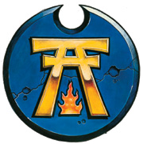
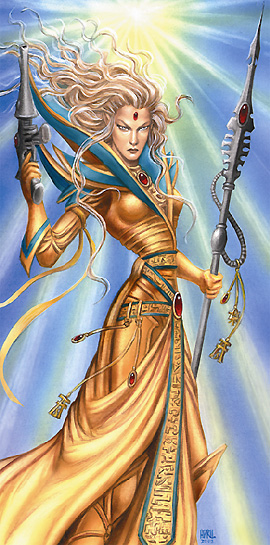
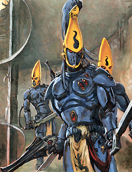
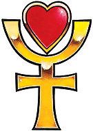
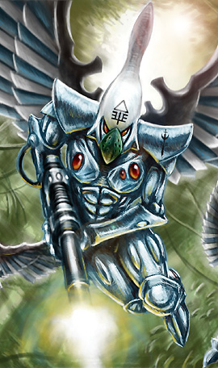
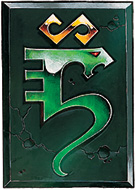
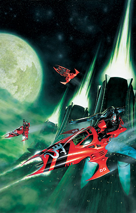
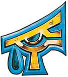
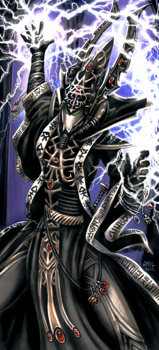

# 奇茨瓦克审判官关于异族的著作――《辨邪大典》

【原翻】奇茨瓦克审判官关于异族的著作――《辨邪大典》

eliphasfan

嗯，特别感谢大卫李和２２８团兄弟们的一些定名上的帮助 

幽灵战士 ________________________________________ 摘录自审判官奇茨瓦克关于异族的著作――《辨邪大典》 

调查方舟世界伊昂丹最近的历史可以得出这一个结论――伊昂丹的灵族人正濒临彻底灭绝。他们自“失落” 以来在漫长的数万年中已经失去了许多人口，正如同所有的灵族，新的一代代人间隔甚长而寥寥可数。然而，那是虫巢舰队海妖的泰伦虫潮攻击可能敲响了方舟世界伊昂丹的丧钟；太空城被全部摧毁了，千千万万的勇士在对抗吞噬者之时消亡。他们曾在彻底歼灭的边缘挣扎；不过尽管有这些可怕的损失，由于海盗亲王伊里尔和他的奥法掠袭者的干预方舟世界被免于灭绝。不过，伊言丁永远不可能恢复自己的损失，到方舟世界变得没有生命的仅仅是一个时间问题。 

我们可以从容地在一个事实的基础上作出这种推理：伊昂丹军队中占多数优势的是人工建造的战士。这些“幽魂守卫”和“幽魂领主”使用灵族的先进的灵能知识和灵魂嫁接技术，为一个其身体已被销毁的灵魂创建了一个新的人工制造的身体。对这种构造的依赖，简单地证实了方舟世界伊昂丹即将灭亡的想法：因为创作这些“幽灵战士”，鉴于其整个过程类似于在我们自己的文化中盗墓，它对灵族来说是一种令人憎恶的必要。它们不仅扰乱死者永恒的沉眠，灵族在本质上是创造祖先的僵尸，并强迫他们继续战斗。可想而知，这种丑恶的行为除非在最可怕的情况绝不会被允许。 

这对死者依赖已经引起了专精从他们被存储的至无限轮回唤起灵族灵魂的灵能者的人数的增加；这些亡灵术士，或有时也被同胞们称为灵魂先知，善于交流与死亡的灵魂和使用灵魂石先进的心能晶体技术。灵魂先知显示了强大术士所有的正常战斗法术能力，而且也为从他们的沉睡被激起了灵魂形成了一个节点或中心。在场的灵魂先知大大地提高了这些死灵部队的协调性和灵活性；应该指出的是，每当面对这样一个对手的情况下，军事指挥官应将设法消除这些灵魂先知作为重要紧迫事务处理。 

奇茨瓦克审判官――《辨邪大典》第五章：伊昂丹的亡灵巫师 －－－－－－－－－－－－－－－－－－－－－－－－－－－－－－－－－－－－－－－－－－－－－－－－ 

游侠力量 ________________________________________ 摘录自审判官奇茨瓦克关于异族的著作――《辨邪大典》 

有时全能帝皇的仆人拥有足够的运气或技能捕捉到活着的灵族。大多数落入我们的手中的人，是来自流浪者这个从我们的军队处得知的种姓的（原文用的ｃａｓｔｅ……）；这些游侠，在正确的引诱下可以为我们提供了很多他们的人民的资料。在过去两千年来，一个令人吃惊的比例的游侠俘虏是源自方舟世界阿莱托克。感受到这个事件的过程，我的前任就开始了对这方舟世界详细的分析；我曾尝试继续下去，这一直是一个很难的任务，因为漂流在宇宙非常边缘的阿莱托克是方舟世界中最隐秘的。自从他们与帝皇的正义之师的战争爆发后，继毕尔兹冲突以来他们都避开所有与其他种族的直接接触。 

为阿莱托克灵族跟随那些所谓“流浪之路”的倾向所吸引，我设法从他们的人中找出根源；我成功获取的资料很有意思，但可惜的是目标未能在揭示什么深度的细节之前死亡。 

似乎阿莱托克的灵族是最根深蒂固的被称为灵族之道的文化的纯净追随者――即一个灵族将致力于在一段时间中于一个生活领域内追求知识的生活方式。这个热心的态度导致了很多的阿莱托克灵族成为流浪者――无论是因由师傅对一些轻微违法违章行为不满，或不耐他们方舟世界苛刻的纪律而被离弃。对一些人来说，阿莱托克灵族非常孤立的价值观只提高了他们好奇心和对更大世界的探究精神。 

虽然不再对自己方舟世界抱有幻想，那些在流浪之路的灵族仍忠于阿莱托克并且他们中的许多人在适当的时候返回。因其地处偏僻，方舟世界使用它的诸多流浪者来收集资料，随时通报有关其他方舟世界和外来种族的行动；这样阿莱托克在有必要时可以作出回应。 

当阿莱托克打一场战争时，他们透过网络通道集中了很多游侠，派他们到主要力量之前，以在敌人的军队散布混乱和无组织状态。游侠高擅长摧毁供应点和弹药储藏，牵制试图攻击单位和一般上分裂敌军任何可能的协调和凝聚力。当阿莱托克进行主要攻击时，敌人已被打的半残――花费了数天甚至数周追逐阴影，他们将会拼命地试图将他们的部队的碎片凝聚成一支战斗部队。 

奇茨瓦克审判官――《辨邪大典》，第十一章：阿莱托克的暴政 －－－－－－－－－－－－－－－－－－－－－－－－－－－－－－－－－－－－－－－－－－－－－－－ 

剑风之军 ________________________________________ 摘录自审判官奇茨瓦克关于异族的著作――《辨邪大典》 

比尔-谭位于银河的南沿，据信是在古埃尔达帝国的边缘。在灵族当中，比尔-谭以好战闻名。他们的名称在灵族语中意味着“旧日的重生”；正是比尔-谭决定自己去争取重建灵族的荣耀。为了达到这个目的，比尔-谭的灵族比其他的方舟世界更加重视战士之道；因为他们知道，如果想要创造一个新的埃尔达帝国，它只将会在激烈的战斗与无数鲜血被完成。 

集结好的比尔-谭的战斗部队叫做“Bahzhakhain”，意为剑风，或剑刃风暴。剑风依赖于突袭攻击的运用和它的支派武士的强大的战斗技巧和火力在一个迅速的打击里歼灭敌人。为了达到这个目的，剑风使用了无数波蛇和猎鹰将单位带入位置，然后从那里支派武士发动毁灭性的全面攻击，粉碎敌人，让他们没有机会恢复。 

这种类型的攻击被证明是对剑风的最喜好类型的目标――敌人的殖民地特别毁灭性的打击。比尔-谭似乎其他种族的殖民视为对埃尔达帝国的未来成长的威胁；他们的哲学是最好在敌人变得相当完备之前尽早地铲除任何篡夺者。为达到这个目的，方舟世界比尔-谭与我们的军队有过无数次的冲突；往往机械教的探索者发现和殖民统治接近比尔-谭的世界的过程中，灵族就发起进攻，并消灭了移居者。因此，我们必须为南沿新安置的世界提供重型警备驻军，以从这些灵族的攻击中保护殖民者，为在其他地方的战争掏出宝贵的资源。如果比尔-谭能被根除，这样就可减轻了一个对我们的军力令人难以置信的压力。然而，尽管我多次为此请愿，一直也都没有军事实力，也没有政治意愿来做到这一点。 

剑风也落在其他的外来种族身上；兽人尤其地为比尔-谭人仇恨，因为他们可以迅速传遍整个新殖民世界[其产生新一代的速度连我们自己也觉得难以抵抗]。比尔-谭的星舰不断地在他们能够找到一个世界并以绿色战士的大潮吞没之前星际间猎杀兽人的太空船。千年里有许多报告关于比尔-谭灵族到达帮助受创的帝国驻军抗击兽人；一旦兽人已被全部消灭支派武士就开始攻击他们的昔日盟友。剑风的领导人也将从外星人入侵中保障殖民世界看作为自己的重要职责；以比尔-谭的灵族看来，在灵族走出阴影并追回应属于他们的东西的时机成熟时，殖民世界将会是为征服已散布到整个银河的其他种族的世界的首个中转站。许多不谨慎的远征军刚在不知道有（灵族）殖民居住的世界着陆，就发现自己被剑风来势凶猛的攻击冲走了。 

奇茨瓦克审判官――《辨邪大典》第三十章：好战的比尔-谭 －－－－－－－－－－－－－－－－－－－－－－－－－－－－－－－－－－－－－－－－－－－－－－－ 

御风之主 ________________________________________ 摘录自审判官奇茨瓦克关于异族的著作――《辨邪大典》 

萨姆－汗恩据说是第一个于“失落”将至时从灵族母星逃亡的方舟世界，它至今仍保留着许多与在其之前原始的殖民灵族的关系。我们发现其他方舟世界的灵族人态度十分有趣；他们认为萨姆－汗恩的灵族人在许多方面原始而野蛮，进一步地阐明了这理应单一种族的分歧。我们的军事指挥官的报告表明这于战地上极其真实。萨姆－汗恩的灵族是激烈而骄傲的战士；他们似乎将荣誉价值得比任何其更为世故的近亲高很多。他们的英勇行为确实具有传奇色彩，但其鲁莽常常导致他们进入对其他种族甚至其他方舟世界的战争；看起来，这个战士的骄傲带领他们进入了他们甚至负担不起的冲突。 

最有名的萨姆－汗恩是骑着喷气摩托和蝮蛇进入战斗，善于迅速扫荡的狂野骑士。我们已获悉这些战士亲族对整个方舟世界和几乎所有萨姆－汗恩灵族，包括属于狂野骑士家族中的先知有着很大的影响。似乎，只是在一个灵族作为支派武士时，他们与他们的家人的联系才被遗忘在一边，因为对神坛的奉献超越其他所有考虑。 

在社会结构中，狂野骑士家族与能在我们自己的世界发现的封建等级制度有着许多相似之处。每个家庭有一个单一的领袖，而地位通常是通过世袭传承， [虽然没有强调父系或母系后裔] 。最接近这个首席的家庭形成了“亲人”，他们包括了执政的精英家庭。正是“亲人”引导首席的行政，当方舟世界去战争时，是个人的狂野骑士家族去决定他们是否会参加，而不像大部分方舟世界一般的守卫的征兵和调动。 

这有时会导致狂野骑士家族在他们当中实际的战斗，虽然这些“战斗”普遍采取高度老一套的形式，并主要是冠军之间的单人搏斗。这些决斗可以与在较原始的帝国可见一些做法相比――骑士决斗和大肉搏来决定谁具有优势地位。这些“荣誉决斗”并不少见，虽然争斗到死是罕见的――第一滴血通常就足以决定胜负。这种行为，也就是经常自相残杀的战斗，当人们考虑还有多少灵族留在宇宙中时似乎令人感到难以置信。 

奇茨瓦克审判官――《辨邪大典》第八章：表面野蛮的萨姆－汗恩 

译者注：Saim-Hann发音为萨姆－汗恩，而非塞姆－罕。 审判官注：翻译应该对他们的主子放尊重些。 －－－－－－－－－－－－－－－－－－－－－－－－－－－－－－－－－－－－－－－－－－－－－－－ 

被诅咒的 ________________________________________ 摘录自审判官奇茨瓦克关于异族的著作――《辨邪大典》 

乌瑟维在方舟世界中以众多选择了先知与术士之道的灵族闻名，一般认为这是源于方舟世界附近被混沌笼罩的恐怖之眼；乌瑟维声称其需要大量的先知术士以监控混沌的诡计，不过其它方舟世界暗示混沌之力污染了乌瑟维人，增强了他们的灵能潜质。不管这趋势的原因如何，乌瑟维的战士总与他们众多的灵能者一起作战。 

在所有方舟世界中，我相信正是乌瑟维最常干预其他种族的事务。该方舟世界的许多灵能者可以预见较其他方舟世界更加精确和较长时间的未来事件。在臭名昭著的领导下，先知议会似乎是在不断转移的历史过程，以达到自己目的；因此，乌瑟维的战士经常被派往关乎他们家园的战场上，巧妙地改变命运的平衡。 

我猜测我们自己也过去多次遭受过这种麻木不仁的操控；正是这些神秘的，常常看似矛盾的冲突为灵族人赢得了他们随机而反复无常的声誉。 

我的一些前任广泛地（有些人可能会说，随便地）将我们的一些最灾难性的冲突归因于乌瑟维的干扰。其中足有第二次阿米吉多顿战役 、萨纳潘洗劫、莫提思湮没和欧利安第三次降临。 

但是目前仍有希望，这种对灵能者的持续依赖使方舟世界缺乏熟练的支派武士，先知之路是最为漫长和最危险的，仅为灵族人在战士之路上行走留下了一点时间。为了弥补这一点，乌瑟维保持着相当大的守卫常备军（通常守卫在需要时被征发，很像我们自己的行星民兵）。黑色守卫无论是作为救星和可怕的敌人都享誉整个恐怖之眼区域。 

奇茨瓦克审判官――《辨邪大典》第三十六章：被诅咒的乌瑟维 
