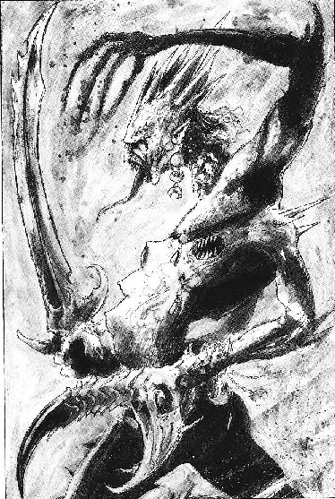
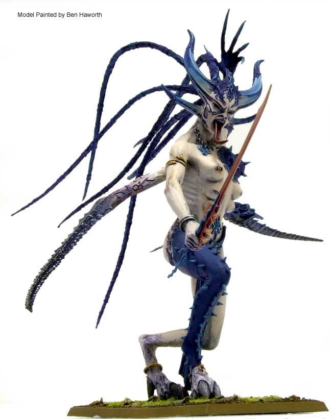

# 守密者 THE KEEPER OF SECRETS

[ACE翻译的尾行］守密者 THE KEEPER OF SECRETS

trivel

Keeper of secrets, Bringers of Slaanesh's temptations 守密者，沙历士的惑娱提供者 There is nothing so loathsome yet beguiling as a keeper of secrets. Wreathed in glamours and mindulling musks, this monstrous beast masks its true form with supernatural allure. More than any other Greater Daemon, the appearance of a Keeper of Secrets can vary wildly from its fellows. Created by the capricious whim of Slaanesh, each is a unique statement of the Dark prince’s particular mood and muse at the time of its creation. Some Keepers of Secrets have haunting, androgynous face pierced with rings, with fanged mouths from which forked tongues flicker. Diaphanous robes swirl around their bodies, floating in a scented witch-breeze that befuddles the senses. Others are more bestial, wide-eyed and fierce, decked in fine scale armour or plates of black-lacquered hid pierced with glittering studs and gems. All of them, however, are several times the height of a man, with jewel-like eyes and sinuous movements, and they all have a splendid crown of horns. 

没有比守密者更令人憎恶的欺诈者了，这些丑陋怪异的野兽周围包裹着一种极端令人迷醉致幻的香气用来形成一种超自然的假貌以掩盖原形。守密者之间的外貌区别能比其他所有大恶魔之间更为形式多样。创自沙历士多样的一时兴起，每个都独具形体，都是黑暗王子创造其时所感所思而化。一些守密者有着另人困惑，难辨雌雄，布满环饰的脸，叉状的舌头闪缩于布满尖牙毒齿的嘴中。透肉的布袍盘挂其身，不时飘散于含香的阵阵特意营造香艳美景的色风中。（恩，吐爽没，说明你不懂欣赏，哦…呃…喔）另一些更向野兽，瞳目中闪着野性凶残，穿着隐含杀气的黑漆漆精致盔甲，上面饰满闪亮的钉头及宝石。但是至少所有这些家伙都有几个人那么高，有着宝石般闪亮的双眼，用曲折诡异的方式前行，并且都有一个壮观多角的头冠 

All sensation is a blessing to a keeper of secrets, for the thrill of fear is as exquisite as the triumph of victory. To a Keeper of Secrets, pain is simply another sensation to be bestowed on others, or to be enjoyed when others inflict it. The great servants of the Lord of pleasure feed upon the rampaging hope and dread of their enemies, suckling life from terror and leeching energy from despair. They are despoilers of purity, liking nothing more than to take the noble ideals of others and twist them to selfish ambition and self-satisfaction. The Keepers of Secrets exist to dash dreams and fulfil nightmares, growing strong on the impulsive emotions of those that fight them. 

所有感受对守密者都像赐福其身,毛骨悚然的恐惧与胜利时的欢愉同感。施痛于人或受痛于他的感受在守密者看来不过是痛感的不同形式。欢娱之主的近仆们从敌人混乱的希望和恐惧中获得满足，舔食生命于恐惧，吸食能量于绝望。他们是掠夺纯洁者，专注于将他人高尚的思想转化为自私自利，自我满足。守密者以毁灭梦想代填以噩梦为生，在那些对抗他们的生灵的冲动感受中日益强壮。 

The Greater Daemons of Slaanesh consider battle as another form of creative expression, taking delight in the interplay of explosions, blood and horror, feeding upon the strong emotions triggered by mortals that are torn apart. The pleas for mercy of the wounded and the battle cries of the fighters are music to the Daemon’s ears, a delectable opera in honour of its Master. Lithe and deadly, a Keeper of Secrets has long claws that it uses to eviscerate opponents, spilling their blood in pleasing patterns, spreading limbs and organs in exotic, interweaving tapestries of death. 

沙历士的大恶魔们将战斗看作另一种创作展现，欣喜的舞动在那些参与其中的凡物所引发的血腥，恐惧情感的大爆发之中。被怜悯救赎的伤者发出的感悦和激战者们发出的战嚎在恶魔耳中化为天籁纶音，组成一出荣耀其主的甘美妙剧。守密者们用能开膛破肚的轻盈而又致命的长爪，泼血做画，切肢抛脏为图，用死尸织就着一副副锦绣挂毯。 

As well as being a vicious warrior, a Keeper of Secrets possesses knowledge of many mystical arts. Weaving spells of misdirection and mystification, it leads the weak to their doom and sends the strong on fools’ errands. It invades the thoughts and senses of its enemies, it penetrates their every defence, sending them visions of glory, titillating their egos, caressing their inner desires to lead them astray. There is nothing more satisfying for a Keeper of Secrets than to corrupt a warrior of pure heat and noble intent, turning his quest for glory into a sacrifice upon the altar of Slaanesh’s perverse will. 

作为堕落战士，守密者同样精通掌握各种神秘技艺。通过吟唱另人困惑，引人歧途的咒语，将弱者引向灭亡，愚者埋入蠢途。他们侵入敌人的思想感知，绕过他们所有的心防，带进绚烂的假象，鼓动满足他们的自负，爱抚鼓舞他们的小小私心，最终带领其进入迷途。没有比让一个纯洁热血，高贵善良的战士堕落，将其为伟大事业奉献的意志转而成为沙历士邪恶祭坛上的供品更能使守密者们得到满足。 

------- 

WS BS S  T  W  I  A  Ld  Sv 

Keeper of secrets  8  4  6  6  4  10  6  10  4+ 

Unit Type: 

Monstrous Creature. 

Daemonic Gifts: 

Aura of Acquiescence 

Special Rules: 

Daemon, Fleet. 

&quot;Pools of blood glisten so brightly. 

Death cries echo so harmoniously We drink deeply of fear and pain. 

Only thus we can soothe our fiery hearts.” ＂粼粼血珀光，幽鸣暗合殇 惧痛醉魄时，得隙抚魂创＂ 

Illaitanen, Handmaiden of Slaanesh 沙历士的侍女 Illaitanen
