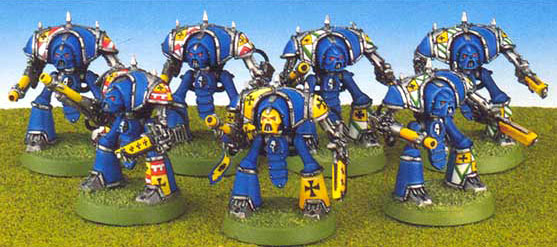

# 骑士级泰坦简述

[日常小翻译] 骑士级泰坦简述

vol.13

看到有人问到骑士级,我就把手头的资料整理了,翻了一下.. 服务大众吧..

骑士级泰坦的驾驶员全是来自各个封建世界的,货真价实的骑士们.. 过去机械神教向着银河系的边远地区派出了由许多机械牧师组成的搜索队伍,他们的主要任务是搜寻残余的STC技术. 话说这些牧师们没有找到STC,反而发现了数个文明退化回封建时代的人类世界.. 这些世界一般分裂成数个帝国,互相征战以夺取对方的土地.. 机械神教的牧师们对这些封建世界产生很大的兴趣,在搜寻STC之余,他们帮助那些对牧师们表现出善意的骑士,教授他们文明的力量以及武器的知识.. 作为交换,骑士们将保护牧师在搜索STC时不受那些不怀好意的兽人或者ELDAR打扰.. 

在相处的过程中,牧师们发现骑士们虽然英勇善战,不过古老的战法和骑士精神使得他们总是无法协调在一起.. (个人英雄主义=.=) 于是神教为这些骑士发明了&quot;适合他们作战风格&quot;的战斗装备 - Knight-Paladin微型泰坦

这种微型泰坦是按照泰坦的理念设计的 - 重火力,厚装甲. 然而却像一件巨大的骑士铠那样,只需一人就可以操作. 装备有一件泰坦级的武器作为主要火力(常见的有Vulcan Mega-bolters,或是Volcano Cannons),副手则通常是大件的动力武器. Knight-Paladin被证明在小队作战和单体作战时有巨大的优势. (废话,拿着火山炮扫人啥优势都出来了)

知识就是力量呀,有了机械神教的帮助,这些骑士们牛B了.. 邻国的骑士根本无法跟装备有先进武器的机械骑士们抗衡,更别说周围的土匪强盗了.. 很快,各个机械神教扶持的帝国均以压倒性的优势统一了各自的行星.. 这些领主为了报答机械神教的厚恩,都表示自己和后代将永世听从机械神教的指挥. 随着时间的流逝,这些封建世界被机械神教建设成了独特的骑士世界. 骑士世界一般服务于某个特定的铸造世界,为其提供矿产,食物和人力资源. 而他们最重要的供奉就是骑士世界要将他们最精锐的骑士送往铸造世界做Knight-Paladin的驾驶员. 现在,Knight-Paladin作为机械神教军队的重要组成部队而存在. 为重型泰坦和Skitarii军团提供火力支援和突击力量. 与那些高度发达世界的&quot;文明人&quot;相比,封建式的教育和生活反而让骑士们富有忠诚观念和高贵的骑士精神,在许多保卫铸造世界的战斗中,他们都战斗到最后一刻.. 不知道这算不算是一种讽刺呢?
