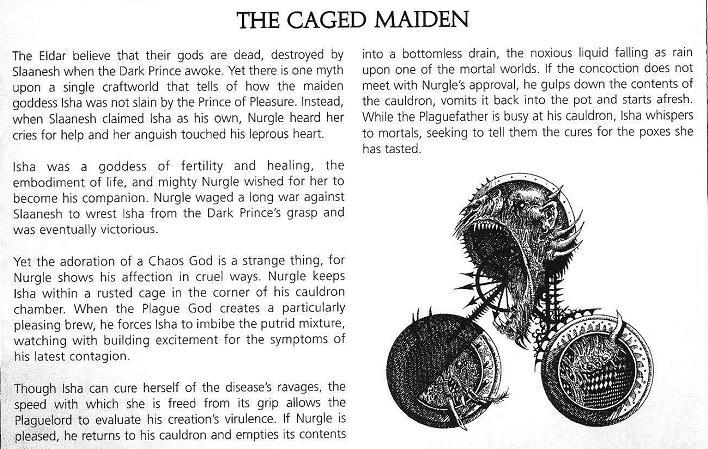
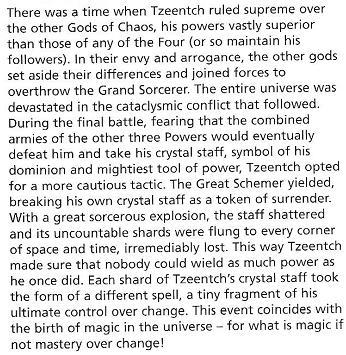

# 【恶魔书中大八卦】乐高虐恋？奸奇最强？

【原翻】【恶魔书中大八卦】乐高虐恋？奸奇最强？

eliphasfan

灵族人认为他们的神灵们已经死亡，在黑暗王子苏醒时被色孽摧毁了。但是在一个方舟世界上有着一个神话传说，少女之神爱莎并没有被欢愉王子杀死；当色孽宣称爱莎将为他所有时；纳垢听到了爱莎求救的哭喊，她的苦闷打动了他不洁的心灵。

爱莎曾是生育与医疗女神，生命力量的化身，纳垢希望她能与他在一起；他期望着能从黑暗王子手中夺得爱莎，所以纳垢开始了与色孽的长年斗争，并最终取得了胜利。

但是一位混沌之神的爱慕是一种极其扭曲诡异的事；纳垢用残忍的方式表达着他的热爱；他将爱莎关在了他坩埚室墙角处一个腐朽的笼子里。每当瘟疫之神创造出满意的“佳酿”时，他就强迫爱莎饮下那腐臭的混合物，带着逐渐升高的激动观察着他最新疾病的症状。

虽然爱莎可以在疫病的蹂躏下治愈她自己，但是她恢复的速度使得疫病之主能够评估他造物的毒性。如果纳垢满意的话，他回到他的坩埚边，将里面的东西倒进无底阴沟中，毒液像降雨一般落到凡间的某个世界上。如果混合物不能达到纳垢的要求，他就把坩埚里的东西一口吞下，再把它们吐会锅里，重新开始。当瘟疫之父在坩埚边上忙碌时，爱莎悄然向凡人私语，试图告诉他们她所尝受过疱疹的治疗方法。

来源是混沌恶魔ｃｏｄｅｘ第８２页下方框框里

爱莎姐姐真是惨命……以前ＥＤ还好时候被凯恩虐……现在被纳垢虐……

不过至少乐高是真心爱她的……多少比凯恩那种人渣来的强

以下为真相党配图

那啥啊……图撤了，要看的自己去俺相册——提示：这里的配图就是从俺相册接过来的

从前有一段时间，奸奇曾是混沌诸神的最高统治者，他的力量远超四大魔中他者（或者他的追随者坚持道；）。在嫉妒与狂傲之火中烧下，其它几位混沌之神抛弃偏见联合起来以颠覆大术士。整个宇宙被灾变性的冲突所毁灭。在最终一战时，奸奇恐怕自己最终会被他们三个联手打败而自己的水晶权杖——他统治的象征和最强的法器会被夺走，所以他采取了一个更为谨慎的战术。大阴谋家退让了，他破坏了水晶杖以作为投降的表示。在法术的大爆炸中水晶杖破碎成了无数个碎片，飞往空间与时间中的每一处角落，不可挽回地失落了。这样一来奸奇确保了没人能够得到他曾拥有的力量。奸奇水晶杖的每一个碎片都以一道法术的形式存在——他对变化之力的完全控制的一小部分。这个事件正符合宇宙中魔法的诞生——如果没有对变化之力的掌控，什么又是魔法呢？

