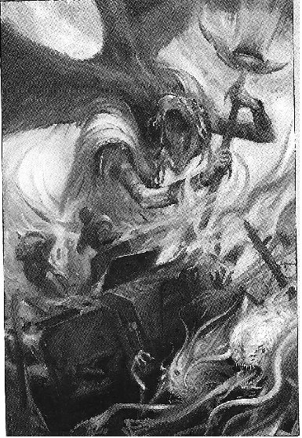
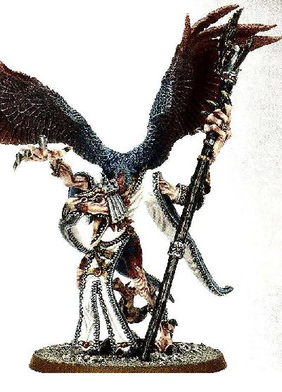

# 诡道之主 LORDS OF CHANGE

[ACE翻译的尾行]诡道之主 LORDS OF CHANGE

trivel

LORDS OF CHANGE, TZEENTCH’S SUPREME MUTATORS 诡道之主,辛烈治的最高万变者 

The lords of Change, Greater Daemons of Tzeentch, often appear as tall and slender humanoids, with a long neck and a bird-like head. They are attired in a high wizard’s robe and ornaments, and carry a sorcerer’s staff in their taloned hands. They have mighty wings with multi-coloured feathers, which allow them to soar high in the sky to carry out their god’s orders. Tzeentch’s areas of influence are magic, deception and knowledge. His Greater Daemons are the personification of all of these. 诡道之主，辛烈治的大恶魔，通常以长颈、鸟头, 瘦高的类人型面貌出现。他们穿戴的像大法师一样，鸟爪型的手里握着一根巫师之杖。他们有一双五彩羽毛组成的强力翅膀，让其有能力飞在高空中实现他们的神的意愿。辛烈治可影响的领域是魔法，诡计和知识。他的大恶魔是这些的具像化身。 

Magic. Lords of Change are the most powerful sorcerers in the galaxy, gifted with unparalleled psychic abilities and a near-infinite skill and expertise in the arcane sciences. They can turn scores of mortals to boneless spawn with a mere glance, destroy an armoured vehicle with the flick of a finger or wrench the soul out of the mouth of the mightiest of warriors with a simple word, only to devour it with the delight of a connoisseur. Magic is the power to change – to change matter into energy, unliving into living, lead into gold, and the opposite of all these. Magic is change and change is magic, and both are boons from their Master, the Changer of the Ways. 魔法。诡道之主是银河中最强大的法师，天生具有无比强大的灵能、近乎无尽技艺和在神秘科学上精深认知。可在一瞥间将众多凡人化为无骨的肉囊，一个弹指就可摧毁掉一辆装甲战车，只言片语，就能将最强大的战士的灵魂从其口中拽出，只为像美食家一样感受吞食时的欣喜。魔法是变换之力—能将物质转化为能量，起死回生，点石成金，或其相反。魔法就是变化，变化就是魔法，二者皆是其主，即万变之宗的恩惠所化。 

Deception. To cheat, scheme and manoeuvre in order to gain an advantage over one’s enemies, or peers, is one of the most practiced activities in the entire galaxy. From the corridors of the Administratum on Terra, to the high spires of the Eldar Craftworlds, from the bridges of battle barges in the Eye of Terror, to the palaces of planetary governors, mortals are always busy plotting against one another, striking deals with so-called allies only to then stab them in the back when their usefulness has come to an end. Lords of Change revel in these activities. They fuel them, nurture them, concoct them with all of their unmatched guile. They often assume the guise of mortals only to lead these ambitious, influential individuals to lose their soul, often together with the rest of their home world. 诡计。用欺骗，阴谋和策划来达到战胜敌人或竞争对手目的，是整个银河中对熟练和精通要求最高的活动之一。从地球总管庭的回廊到灵族方舟世界的高旋尖塔。从恐惧之眼中的战舰舰桥到行星政府的宫殿，凡人们总在忙于谋图他人，小心联络着所谓的盟友，直到有那么一天可以终因再无利用价值而背后捅他们一刀。诡道之主着迷于参与这些活动，刺激他们，滋养他们，用他们无法匹敌的狡诈谋划他们。诡道之主经常伪装成凡人的样貌去引导那些野心勃勃，影响巨大的个体迷失自我，并总是站在那个世界中残存者的身边。 

Knowledge. The mind of a lord of change is an inexhaustible well of information, so much so that to mortals these Daemons appear omniscient. The most unnerving of their abilities, however, is their prescience. Their Great Master, who knows all, has granted them the boon of seeing into the near future, a power that makes them almost impossible to defeat. How can one fight against an enemy that knows in advance every move and every trick you are going to attempt? A Lord of Change can be brought down by the weapons of mere mortals, but only when its demise is part of Tzeentch’s schemes, and the Ultimate Deceiver tricks his own Daemon by sending it false visions of the future. Because of this, the destruction of a Lord of Change should bring no joy to the enemy, as they are only helping the Changer of the Ways to move his pawns on the board of the Great Game. 知识。诡道之主的头脑是一口取之不竭的信息之井，多到对于凡人来说这些恶魔无所不知。他们最让人气馁的能力是他们会预见。他们众所周知的大导师给予了他们预见短期未来的恩惠，一种能让其近乎无敌的力量。你怎么去和一个会知道你每一步行动和计划的敌人交手？诡道之主的确能够被纯粹的凡间武器杀死，但这只可能发生于辛烈治的阴谋需要之下，只有这位终极欺诈者可以用一个假预言谋害他的恶魔。但由见于此，诡道之主的毁灭并不会给他的敌人带来欣喜，因为他们做的只是帮助万变之宗在其参与的大游戏的棋盘上移动了他的棋子而已。 

WS BS S T W I A Ld Sv Lord of Change 5 5 6 6 4 5 3 10 3+ 

Unit Type: Monstrous Creature. 

Daemonic Gifts: Daemonic Flight, Soul Devourer, Bolt of Tzeentch, Daemonic Gaze. 

Special Rules: Daemon. 

“Curiosity begets knowledge. Knowledge begets curiosity. Only great Tzeetch sates both.” “思久欲知，知繁渴思。唯（圣）奸奇毋为所困。” The Teachings of Tz’Kui’Anak
