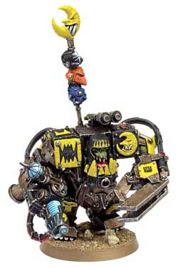

# 口古月！ 哥特语4级证满塞！兽人高材生军阀纳兹德雷格生平

口古月！ 哥特语4级证满塞！兽人高材生军阀纳兹德雷格生平

no.ace

Nazdreg Ug Urdgrub 纳兹德雷格·乌骨·乌德格拉布 

Nazdreg Ug Urdgrub is a large and cunning Ork Warlord from the game Warhammer 40,000. He was one of the star players in the recent Fall of Medusa V campaign, as his personal space hulk had crash-landed on the doomed planet. 

纳兹德雷格·乌骨·乌德格拉布是 战锤40K游戏中的一个又大块又狡猾的兽人军阀. 梅杜莎V战役模板中的明星单位(当然也包括他坠毁在那行星表面的御用古巨圾--触礁号)

Early history 早年历史 

Nazdreg's past is largely unknown. It is, however, known that he is a member of the super-wealthy Bad Moonz Klan. He is widely known as a pirate and general threat to shipping. He is also rather smarter than most Orks, as he speaks good Imperial Gothic and understands the &quot;carrot and stick&quot; approach of rewards and punishments to gain production from his hapless slaves. He also wears a suit of mega armour, painted in yellow flames and fitted with his Kustom Blasta-X, a large plasma weapon with long range (And unlike most orks he is also able to hit his target, having the same in game Ballistics skill as a Space Marine). 

纳兹德雷格的过去鲜为人知.只知道他是极-有-财的破月亮部落的一员.而且他也因为是一个对帝国航运有极大威胁的兽人海盗而广为人知.他比已知的所有兽人看起来都聪明那么一些, 因为他能说一口流利的哥特语(也就是帝国官方语言 ACE:纳叔 08年哥特语4级的答案有没有啊? Q上给我传一份啊)并且懂得使用&quot;萝卜与大棒&quot;的奖惩制度来督促他不幸的奴隶为他工作.他穿着一身黑底黄火焰的兽人超重盔甲并且内置了他的最爱武器&quot;御用离子枪-X&quot;--重型长程离子枪(不象其他兽人.纳叔总能击中他的目标.他的BS=4(或5).跟星际战士在一个档次 ACE:纳叔你硬是个人才..) 

Piscina 鱼塘星 

Prior to the Third War for Armageddon.Nazdreg has allied himself with the dreaded Goff Warlord, Ghazghkull Mag Uruk Thraka. The world of Piscina suffered a grievous strike from the two allied greenskins, though their alliance soon fractured due to their race's naturally aggressive nature. Nazdreg continued to operate throughout the war from his Space Hulk Scylla, until his forces were expelled and his hulk apparently destroyed. 

第3次阿米吉多顿战役中,纳兹德雷格与恐怖的高夫部落军阀碎骨者苟合在了一起(ACE:想来是碎叔主外纳叔主内..).鱼塘星险些被这两个恩爱中的绿皮的毁灭性的基情夷为平地,虽然他们的联盟因为他们种族天生的侵略倾向而显得不那么牢靠.但是纳兹德雷格依然坚持从他的私人古巨圾--触礁号上给予配合作战(ACE:基爱的胜利啊),这邪加精的蜜月一直坚持到了纳兹德雷格的部队被车的粉碎并且触礁号也被击毁----好吧,在帝国看来是这样---之后,纳叔与碎叔的基情才算告一段落 

Medusa V 梅杜莎V 

As it would turn out, the Scylla was not destroyed. It has come out of the Warp and crashed on the planet of Medusa V. Nazdreg has ordered his Boyz to go out and gather as much scrap as possible so the Meks can repair the Hulk, and with all speed, as his Weirdboyz have told him of the fate rapidly approaching the planet, and Nazdreg has no intention of being on the planet when that happens. Of course, they're still going to get in all the fighting they can while they're still there. 

无错!触礁号并没有被击毁.它从次元空间中直接飙出并且结结实实的砸在了梅杜莎V行星表面.纳兹德雷格命令他的小子们全速出击收集尽可能多的废铜烂铁回来以便技师们迅速修好他的古巨圾之后大家速度跑路... 原因? 原因是在听过灵能小子们对于这个星球未来命运的预言之后(ACE:灵能小子们大概是说些了什么&quot;异次元里有些东东可能会跟着你一起来到这里哟~~&quot;之类的).纳兹德雷格多一秒也不想继续待在这里了-----当然话虽是这样说,死性不改的绿皮们依然会加入发生在星球上的所有有必要或者没必要的冲突..

Surviving Medusa V 逃离梅杜莎V 

Even though the battle on Medusa V didn't work out for the best for the Orks, Nazdreg and many of his Orks managed to get off the planet alive. After finding out that the Imperial forces had damaged his Spacehulk beyond repair, Nazdreg had a (for an Ork) brilliant escape plan. The Orks took over a slightly damaged Imperial transport, the Minnow, and managed to get into orbit. Nazdreg also left several humans alive to fly the Minnow and create a false distress call. The Imperial battleship Terra’s Defiance received the call and came to the transport's assistance but was boarded and taken over by the Orks. Although the disappearance of the Terra's Defiance was noticed by the Imperial Navy, Nazdreg Ug Urdgrub proved why he was a Warboss and managed to escape with many of his boyz against many odds. 

虽然在梅杜莎V的战役还没有让兽人们战到HIGH(消息指出混沌果然跟来了).纳兹德雷格跟他的很多部下们还是决定先活着离开这个星球再说.当他们发现帝国军队已经将他的古巨圾彻底打成了一堆不可修复的垃圾以后.纳兹德雷格有了个惊天地泣搞毛(ACE:相对兽人来说..恩)的逃跑计划.兽人们控制了一艘略有残损的帝国运输舰--米诺号.他们的计划是先用这个驶出行星轨道.然后由纳兹德雷格留下的一部分人类活口操作米诺号并且发出虚假的呼救信号.一艘帝国战舰--地球的鄙视(Terra’s Defiance)愚蠢的中了兽人的伎俩(ACE:战舰上的所有人类确实都值得被地球所鄙视..) 他们接到这个呼救信号后迅速赶来试图援助这艘运输舰,很快 绿皮们以迅捷的身法登舱并占领了地球的鄙视号战舰...虽然地球的鄙视离奇失踪已经引起了帝国海军的注意,并且追捕行动已经开始.但是纳兹德雷格依然会在不久的将来证明为什么他才是总能带领自己的小子们摆脱困境的酋长...
