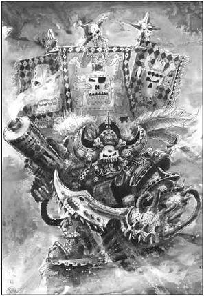
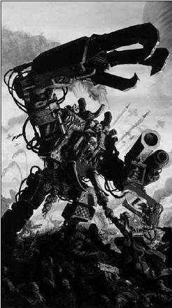
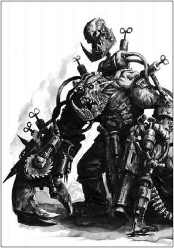
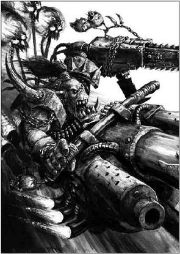
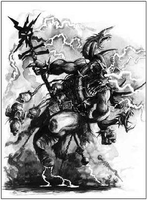
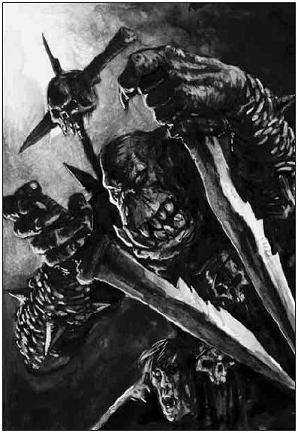
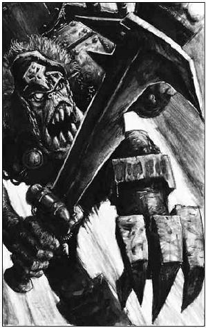

# ORK小子们！进来拜！这里有你们最崇拜的BOSS！

[ACE翻译]ORK小子们！进来拜！这里有你们最崇拜的BOSS！

no.ace 

我们称第二，谁敢说第一？

|  |  |  |  |  |  |  |  |  |
| --- | --- | --- | --- | --- | --- | --- | --- | --- |
|  Kaptain Badrukk 烂赌鬼船长 Ws | Bs | S | T | W | I | A | Ld | Sv |
| 5 | 2 | 4 | 4 | 2 | 3 | 4 | 9 | 3+ |

135分，替代持枪混混小队老大出场 

武装：金牙甲，撕裂者，3个炮灰屁精，老大旗帜，手喷，砍刀，废柴搜索器（能随意测距后再声明射击）， 棒棒手雷（破片手雷） 

屁精随从：船长的海量弹药和宝藏需要许多人力来携带。烂赌鬼有三个弹药屁精。这些不算在允许配备在他所在单位内的屁精的份额内。 

金牙铠：烂赌鬼的装甲是用上百颗从其他海盗船长嘴巴里踹出来的金牙熔掉后镀起来的。它提供3+装甲保护，还内建了一个保护力场产生器提供船长5+ 特殊保护。 

撕裂者：烂赌鬼爱用他最爱的喷子-撕裂者来屠人了。有一天烂赌鬼自己也迟早会成为其枪下亡魂之一，但是现在它仍然还是一件暴强的武器。它有以下属性： 

|  |  |  |  |
| --- | --- | --- | --- |
| 射程 | 力量 | 穿甲 | 特殊效果 |
| 24 | 7 | 2 | 突击武器3，过热 |

特殊规则：暴徒规则，狂怒冲锋，Waaagh!    

烂赌鬼船长是绿皮海盗里最出名的一个，作为割喉派的传奇人物，烂赌鬼驾驶着他装饰大铁嘴的杀手级寻羊舰--黑跳板号，在行星间上演过数十起血腥屠杀以及劫掠。他率领着一群被称为“烂赌鬼的大枪混混”的绿皮恶棍，同每一个历史上有记载的知名军阀并肩战斗。他坚持认为如果不是他那些混混的强劲火力支持，那些军阀早都死了不知道多长时间了--- 任何看过他们战斗的人也都会赞成这个说法  

烂赌鬼船长具有任何一个典型的海盗酋长所应该具备的全部特征---极端爱现，虚荣浮夸。他的长相的比格鲁牛还丑，全是疤痕的秃头上挂满了做装饰用的奖章---- 都是从被他屠船的帝国海军部队上将的尸体上拣来的。因为他嘴里的牙实在是太多了，所以他的脸上的表情总是一种骇人的咧着嘴的狞笑，并且他牙上还镀了一层金属，那是他从不灭之光神殿里偷来的无价的钨金与精金的合金 

船长穿着一身镀金的装甲，尽管上面的金色已经被他的刀下鬼血洗的快没颜色了。而他的旗帜则昭示着他无比的战力与征服力。他穿着一件大号的铅制内衬衣，以保护他不受他最爱的武器“撕裂者”发出的辐射伤害，这把武器是如此的危险以至于“站在它旁边”就是“找死”的同义词。撕裂者曾经是一名帝国地方官员的奥林猿人保镖使用过的武器，船长得到它以后，把这把武器改装成了符合自己美学观念的东西，现在撕裂者发射的不再是原来的超大口径子弹，而是不稳定的大号等离子爆罐，所以撕裂者每一枪打出去，子弹都会象小太阳一样爆炸开来。 

烂赌鬼船长当年被坏月亮部落驱逐了出去，因为他给自己敛了太多的牙齿（#注1），从他被放逐的那一天开始，他就比他的那些兄弟船长显得能耐大的多。与军阀嘎拉克一起对抗虫族的战斗中，他通过虫族蜂巢舰的卷须跳进了它的心脏部分而直袭虫舰内的母皇（#注2）。在哒卡之战里他跟他的小队曾消灭了一整个tau的猎手小队。甚至有人作证说船长曾经亲手搏杀过一只虚空抹香鲸 

作为一个兽人，烂赌鬼是个出色的战略家，也只有最富有的军阀才能出的起大把的牙齿请他作为战术顾问。每次战斗结束后，船长的混混们总是会“劝说”他们的雇主把最好的战利品留给他们，也只有等他们对战利品感到满意以后，才会卷起破烂爬上黑跳板号，离开并寻找下一单生意。许多军阀也心甘情愿的将这作为给他们的额外奖励，因为他们确实很满意烂赌鬼和他的手下们的表现----在战斗里用自己致命的武器将死亡之雨降临在他们可怜的敌人头上。 

|  |  |  |  |  |  |  |  |  |  |
| --- | --- | --- | --- | --- | --- | --- | --- | --- | --- |
| 碎骨者·萨拉卡被称为waaagh!的大传道者，他有能力鼓动整个星球的兽人进入征服与血腥的狂热。他或许是整个星系最有影响力的兽人，数以亿记的兽人愿意跟随着他，以他的名义去战！！并且看来他的能力还不止如此。   碎骨者一开始只是高夫部落的一只普通的小兽人,在尤克世界，星际战士们发起的的一次对兽人的打击行动中,碎骨者的头被一颗爆破子弹击中,他的大脑严重损坏了.之后它被交到了一个兽人军医小子----死亡颅骨部落的&quot;疯医&quot;格鲁特斯尼克----手上,后者使用了一种精金制成的生物装置取代了碎骨者的小脑...虽然不确定到底是因为植入物引发了它的什么潜在的精神能力或者只是碎骨者自己的妄想...反正就在这一次手术后.碎骨者开始相信它在手术过程中真实的看见了兽人之神--搞毛2哥    正是因为这件事,碎骨者在兽人权力结构中的地位如&quot;流星般&quot;的扶摇直上,它的力量与勇气赢得了身边所有兽人的尊重.不止是这样,最关键的是碎骨者具有一项大多数兽人都缺乏的能力--远见,它的话语经常会提到兽人要如何征服宇宙等等.某种意义上说,是它第一次授予了兽人一些从未有过的念头,比如团结,比如目的    当碎骨者的影响力在乌克世界达到顶峰以后,这颗行星的太阳也逐渐显示了一些即将熄灭与死亡的迹象.碎骨者坚定的相信这就是搞哥赐予它的一个启示,并且它进一步相信,拉起一票绿皮找个地方开始waaagh!!!的时候到了.所以乌克世界的所有兽人面临一个没什么选择的选择,跟着碎骨者去waaagh!!!或者留在这个星球上等死.    所以这个星球的全部兽人自然而然的选择跟随着碎骨者，这个有史以来第一个拥有征服宇宙的念头并且愿意为这个冒险而死的兽人军阀，坚定的走上了waaaagh!!!的道路  |  Ghazghkull Tharak 碎骨者·撒拉卡 Ws | Bs | S | T | W | I | A | Ld | Sv |
| 6 | 2 | 5 | 5 | 4 | 4 | 5 | 9 | 2+ |  |

225分，占用一个HQ名额 

武装：碎骨者有个超合金颅骨，老大旗帜，义体化蛮子身，巨无霸甲，棒棒手雷 还有一只大喷子（这把枪替换了巨无霸甲内建的双联喷子） 

超合金 头骨：挨碎骨者一记头锤和被一台磁浮列车撞到差不多。 当碎骨者冲锋时，他得到额外两次攻击次数，而不是常规的一次。另外，碎骨者无法被秒杀。 

特殊规则：独立人物，暴徒规则，狂怒冲锋，Waaagh之道弘法者 

Waaagh之道弘法者： 碎骨者的战吼能释放一个惊天动地的Waaagh! 盖世骨的Waaagh可以随时唤出，但限于一场游戏只有一次，并且不能是第一回合.它替换掉军队原有的Waaagh! – 因为碎骨者的版本更赞！ 碎骨者的Waaagh! 持续整个回合，包括这轮剩余其他玩家的回合。这段时间内，盖世骨的保护变为特保。 同样的，在该Waaagh！！生效时间内全体兽人步兵的Waaagh!!移动的掷骰结果自动算是得到6. 所有非扯呼中的友军单位在该Waaagh!生效期间变为无所畏惧。 

|  |  |  |  |  |  |  |  |  |
| --- | --- | --- | --- | --- | --- | --- | --- | --- |
|  Mad Dok Grotsnik 疯医格鲁斯尼克 Ws | Bs | S | T | W | I | A | Ld | Sv |
| 5 | 2 | 4 | 5 | 3 | 3 | 4 | 9 | 4+ |

160分，占用一个HQ名额 

武装：疯医格鲁斯尼克拥有一只动力爪，一只手喷，一只痛痛针筒，义体化蛮子身还有怪医工具。 

特殊规则：独立人物， 狂怒冲锋，Waaagh!  

脑袋少根筋：疯医是个完完全全的疯子， 公认比个满月时发春的疯小子还疯。 他以及任何他加入的单位都变为无所畏惧。附带，格鲁斯尼克特别嗜血，他总会朝最靠近的敌人以最快的速度移动，尽可能的对其发起突袭。这嗜血如命的特性也被附带到他加入的单位内。这也意味着一旦疯医格鲁斯尼克加入一个单位， 他无法离开该单位除非他是该单位的唯一幸存者。 

手术！ 手术！ 还有更多时间手术！

-疯医 格鲁斯尼克。

疯医格鲁斯尼克对别人的脑袋总有种病态的研究欲。有天一个头被打破的高夫部落的兽人--名字叫做碎骨者--送进了他医疗帐篷。当他出神的望着捧在手里的碎骨者的大脑的时候……他看到了什么？他看到了一个 大·好·机·会·呀 ！！……几个小时以后，做完手术的碎骨者从床上蹦起来，顶着他亮闪闪的新精金脑壳，生龙活虎的走了出去。  

这之后不到一个礼拜的时间里，碎骨者就被晋升成为了大军阀。格鲁斯尼克瞬间就成了名人，当他出神的望着排在他医疗帐篷外长长的绿皮队伍的时候……他看到了什么？他看到了一个 更·大·的·好·机·会·呀！！！！……他开始耐心劝说那些最富有的头目们换上“碎骨者40.000特别纪念版精金头盖骨”，当然他不会告诉他们每个头盖骨下都有个小巧的爆炸装置，并且他还刚好保存有每个爆炸装置的遥控器……他的计划进展的很顺利。从这时候开始，部落里出现了个神秘现象，如果有任何一个头目胆敢对格鲁斯尼克吐槽，那么不久之后，这个头目一定会死于一场“不明不白”的头部爆炸“事故”…… 

终于，那些头目开始意识到发生了怎么一回事了，他们清楚的知道他们不能正面跟疯医对抗，所以他们打算让疯医也出点“事故”。之后某天，疯医忽然被人叫去检查一个线路装错的兽人无畏机甲，但是很快他也得到了一个“不明不白”的惊喜。那无畏忽然用钳子抓住了他，并且把他按在地，用它巨大的圆锯锯开了疯医的脑袋，并且把它剩下的部分一脚踢开…… 

当疯医的私人屁精护士小队出神的望着他们濒死的主人时候……它们看到了什么？无错！那就是一个 天·大·的·好·机·会·口牙！！！……屁精们手忙脚乱的把疯医拖进了医疗帐篷，在那个寂静的晚上，所有绿皮都安然的睡在自己营地里的时候，帐篷里骨锯，锤子，钻头的声音响了整整一晚上 

在那个漫长的夜里，一个屁精弄丢了他的午饭，他只记得最后一次见到它的时候，好象自己正把手伸进格鲁斯尼克的脑袋……而另一个屁精找不到自己的宠物蜘蛛了，那只蜘蛛应该钻到了它能找到的，最柔软，最温暖的地方，也就是疯医被切开的脑袋里……格鲁斯尼克在那一晚无数次的接受了死神的拥抱又把死神推开，但他最后到底是被屁精们“创造性”的手术救活了。所以，几个小时以后，做完手术的格鲁斯尼克从床上蹦了起来，带着他新装的金属外壳脑袋，生龙活虎的走出了出去----他活了！……并且彻底，彻底，彻底的疯了……疯医在月光下癫狂的连唱带跳，手术给他带来的“爆炸性”改变之一，就是他一个一个按下了那些头目们脑袋里爆炸装置的遥控器…… 

从那天起，格鲁斯尼克对手术的爱好越来越怪异了，他经常切下自己的肢体，换上那些“情愿”为他“慷慨”捐赠的，死在手术台上的兽人的肢体。甚至相当数量的，非常勇敢/非常愚蠢的来找他做手术的兽人，都被精神分裂的疯医用活的跳跳替换了他们的大脑。有传言说他已经依靠那些“捐献”给他的器官，把自己的全套肢体都替换了，而成为了一个“超级”兽人。总之比较一致的看法是如果不是有碎骨者罩着格鲁斯尼克，他已经被杀了很多，很多，很多次了。但是就现在的情况来看，疯医格鲁尼克已经着实成为了一个极恐怖，极变态，极强壮，极难缠的对手…… 

|  |  |  |  |  |  |  |  |  |  |
| --- | --- | --- | --- | --- | --- | --- | --- | --- | --- |
| 袜子哒卡·古斯墨克是兽人历史上最伟大的飚车小子，他总是驾着他的涡轮动力·畸形可怕·好象大概可能曾经是摩托的东西..   在沙漠星球卡萨卡上，当袜子哒卡还是个兽人小鬼头的时候，他就已经开始痴迷于鼓捣摩托了。只有一件事，对他来说比每天拆车装车更有意思---- 那当然就是自己飙车了！   那天早上，袜子哒卡带着自己新装好的摩托，参加并且获得了爆胎杯摩托赛第一名，从那个时候起，他的命运就已经注定了。他被人指责说在比赛里做了弊，盛怒之下的他，开始了一场大暴走！！……最终，他用他摩托上新安装的哒卡加农炮，用兽人的方式解决了这场“争执”。   之后的几年里，袜子哒卡成为了一个传奇形象。他对记时的精确掌握已经到了他咳嗽一声说我只是第二，没有兽人敢站出来称第一的地步。并且他也很少参与兽人们最爱的肉搏战。只是专心致志的追杀那些被部落通缉的“坏医”(#注3)。袜子哒卡很少离开他的座车，除了他打算为车子进行升级改造的时候   袜子哒卡孤身漫游的日子很快结束了，他联合了一些志同道合的飙车部落开始了属于他们的，永不停止的waaagh!!!,每当他们waaagh!!!完一个地方，紧接着就去waaagh!!!下一个地方，就这样他们几乎waaagh!!!过了整个星系……无论他走到哪里，他都能得到当地急速飙车族(#注4)的支援   不论袜子哒卡的疯狂计划究竟会给他带来什么好处，其实他只是在尽情享受极速飙车给他带来的快感而已。 斯卡拉VI围攻战   袜子哒卡的waaagh!!!差点在帝国的铸造世界斯卡拉VI停下脚步。在那里，这个急速飙车族的军阀与他的摩托部落遭遇了一支机械神教的军团----对手甚至拥有一只军阀级泰坦。飙车族部落的实体武器根本无法穿透那神一样机械的装甲，泰坦用它的超重型喷射炮残忍的收割着面前的兽人部队，甚至它核心部分的连接齿轮，都被兽人的血与飞溅的机油清洗的异常光滑。   飙车族部落似乎已经面临毁灭了，但是袜子哒卡不这么觉得，他驾驶摩托行驶到了战场背后的悬崖上，静静的观察着战局……终于他发动了自己座驾的引擎，从断崖边直接飞向那泰坦，轻松的穿过了泰坦的护盾。袜子哒卡如火流星一般的砸在了泰坦指挥仓的顶上，也就在那一瞬间，袜子哒卡轻松的屠掉了所有驾驶员---在不到一秒的时间里   这成为了战场的重要转折点，袜子哒卡的部落最终获得胜利并且将这个星球纳入了他帝国的一部分，从那里工厂劫来的所有型号所有大小的载具都被袜子哒卡的waaagh!!笑纳了。从那天起，袜子哒卡把泰坦主驾驶员那仍在燃烧的头骨作为自己的标志，而他的手下会永远记得这是他们老大生涯做掉的最大块的敌人！ |  wazdakka Gutsmek 袜子哒卡·古斯墨克 Ws | Bs | S | T | W | I | A | Ld | Sv |
| 5 | 2 | 4 | 5(6) | 3 | 3 | 4 | 9 | 4+ |  |

180分，占用一个HQ名额 

武装： 袜子哒卡骑着一台启弑辘摩托，并且有技师工具，一把手喷，一只动力爪，一只老大旗帜， 一只手工巨喷还有棒棒手雷。 

启弑辘摩托： 袜子哒卡遵循第46页的战争摩托规则。 而且袜子哒卡的战争摩托经过大量改造后比常规战争摩托更加强大（当然外形也更赞！！） 当袜子哒卡使用涡轮加速器的时候他仍然在该轮能够发射他的武器。 

哒卡加农炮： 架设在袜子哒卡的战争摩托上的哒卡加农炮是个能坦克却步的高射速大杀器。 它拥有下述属性：

|  |  |  |  |
| --- | --- | --- | --- |
| 射程 | 力量 | 穿甲 | 特殊效果 |
| 24 | 8 | 4 | 突击武器4 |

特殊规则：独立人物， 暴徒规则， 狂暴冲锋， Waaagh!  

|  |  |  |  |  |  |  |  |  |
| --- | --- | --- | --- | --- | --- | --- | --- | --- |
|  old zogwart 老祖格沃特 Ws | Bs | S | T | W | I | A | Ld | Sv |
| 4 | 0 | 3 | 5 | 3 | 2 | 2 | 8 | 6+ |

145分，占用一个HQ名额 

武装： 

蝮蛇之巢：老祖格沃特可以进行D6次攻击 I=4。所有这些攻击都带有剧毒所以无视+2以下保护 

特殊规则：独立人物， 暴徒规则， 狂暴冲锋， Waaagh!，次元头头 

灵能者：老祖格沃特算做一个灵能者 

祖格沃特的诅咒：老祖格沃特的特殊能力是可以把一个强力敌军变成跳跳，这个特殊能力可以取代需要投骰确定的灵能。在老祖格沃特视线里，18'距离内选择一个独立人物，双方玩家一起投骰，如果兽人玩家胜出那么对手的人物移出桌面，换成一只由对手控制的狂暴跳跳，你必须提供这个跳跳模型，跳跳不能携带任何装备也没有特殊规则。属性如下

|  |  |  |  |  |  |  |  |  |
| --- | --- | --- | --- | --- | --- | --- | --- | --- |
| Ws | Bs | S | T | W | I | A | Ld | Sv |
| 4 | 0 | 3 | 2 | 1 | 3 | 1 | 5 | - |

兽人历史上最伟大的灵能小子，祖格沃特出生于卡塔昌世界的一次日全食中。祖格沃特从他的茧中挣扎出来时，他的蘑菇正长在一个血蛇巢穴中央，甚至在他爬出地面之前，还是婴儿形态的时候，他就已经神秘的长出了一对充满毒液的蛇牙。所以这幼兽不但从蛇巢里活了下来，并且他还凶悍的进行了反击。当太阳落下，月光照耀在那里时，他的出生成了一幅可怕的剪影。他混身裹满毒液从地下挣扎而出，一手一条翼蛇，而他的嘴里还紧紧咬着一只大蝮蛇。 

不难想象他让他的部落有多吃惊，而兽人之神对他的眷顾还不仅仅如此。从他出生那一天起，再没有蛇敢咬他，并且那些蛇好象很喜欢爬过他的毛发，感受他温暖的，瘦骨嶙峋的，满是蛇咬伤疤的身体。 

祖格沃特从小就表现的比他的兽人兄弟们更稳重，更狡猾。任何想把他打倒的人很快就会发现这样一个事实，就是他咬人的毒性远大于一般的毒蛇。所以部落成员认为他是毛哥眷顾的孩子，是他们部落里最不同寻常的成员，实际他加入部落连一年都还不到 

而直到他的青年期，他的能力才被彻底的展现出来，狂暴的灵能现象开始围绕着祖格沃特出现，很多老兽人打赌这个幼兽将来一定会成为一个灵能小子。他被指定给一些兽人看守者严加看管，也是从这个时候开始，兽人部落里有了这样的传闻，某些不幸的家伙，在漆黑的夜晚莫名其妙被变成了跳跳。 

当他的部落与卡塔昌的人类正式开战的时候，祖格沃特陷入了一种极度惊恐的情绪，当他彻底被脚步践踏声与喘息声包围的时候，他发出了一声惊天动地的waaaagh!他的血亲部落遗传给他的力量彻底爆发。而祖格沃特完全不能控制这能量的激发，直到这能量变成了一股眩目的绿光，完全包围了他的人类敌人们…… 这能量结束以后，战场上剩下的只有空荡荡的衣服，无人使用的武器，以及一大堆睡眼忪醒，完全不知道发生了什么事的跳跳。 

祖格沃特在这突然的能量爆发中失去了自己双眼，但是他激发的能量摧毁了整个帝国卫队集团军。从这一天起，他坚持的认为这是自己毕生的事业，而毛哥会指引他的道路。他的年纪渐渐变老，他的脾气也变的越来越乖张，当然他的能力也越来越强大。他的志向很快就超过了他的酋长，斯卡伯古兹，所以祖格沃特决定离开了这个星球，带着他的跳跳-蛇宠物一起，去寻找更伟大的冒险以及更强大的兽人帝国。 

老祖格沃特现在以兽人海盗的身份漂流在宇宙里，加入四处发生的waaagh!!他现在拥有最纯净的能量，只是最轻微的释放也可以瞬间唤醒友军的精神力量。他曾站在许多兽人军阀的王座背后，证明自己的能力。所有他经历过的战斗无一不证明了他的传奇，还有什么能比在友军面前将强大的对手变成跳跳更能激励士气的呢？ 

以狩猎兽人出名的阿米吉多顿帝国卫队，只害怕一个兽人，一个从来独自行动的兽人。在第一区与第二区漆黑的夜里，疑神疑鬼的帝国老兵们，耳语着鬼祟鼠酋长的传说。他是个潜伏者，一个神不知鬼不觉的游荡在丛林里的幽灵杀手，他能穿过茂密的树林而甚至不会碰掉一片叶子。他们说他是个不知疲倦的复仇猎手，他的眼中总会闪现出火一样的憎恨的光芒，最后，他们说到他的受害者，每一个都是睁着眼睛死的，而头皮被扒去，只剩下头骨露在外面。 

鬼祟鼠酋长是碎骨者第一次入侵中最受重视的兽人特种兵，他率领的部落使得阿米吉多顿第一第二区成为了绿色地狱。那里有海洋一样无穷无尽的丛林，鬼祟鼠的特种兵们在那里跟主力部队分开行动，游荡在瑟伯鲁斯基地附近。他部落里的主力丛林作战老手都埋伏在了帝国卫队绿色的心脏里。鬼祟鼠命令他的小子不要轻举妄动，首先让自己溶入丛林环境中，不要被人类基地注意到 

鬼祟鼠详细掌握了附近丛林的特点，他打算在丛林中心进行一场游击战，他将他所有的行装都丢弃了，只带了最少的装备，这样他的绿皮能完美的溶入丛林的背景中。他跟他的特种兵小子们埋伏在纠缠的植被里，他们坚硬的皮肤以及他们强大的代谢能力帮助他们抵抗了致死的，噩梦般的生态环境。鬼祟鼠跟他的伙计们尽量把本身就已经很精熟的潜行和暗杀技巧发挥到极致，直到他们可以做到偷偷溜进帝国的的兵营，杀掉那里熟睡的驻防士兵而不引起任何人注意之后。他们才开始了针对帝国卫队的散播恐惧的心理战，战争的瘟疫渐渐在这个星球上传播开来。 

鬼祟鼠的红色头骨特种兵-- 被人这样称呼是因为他们有将被害者头皮扒下贴自己脑门上的习惯-- 在碎骨者离去以后依然是一股强大的势力，他们一直坚持游击直到57年后碎骨归来.在这段时间里鬼祟鼠的传奇故事传遍了附近大大小小的蜂巢城市，有人说那里有幽灵夜间出没吸食人血。有人说那个野兽杀手将所有受害者的狗牌都缠在了自己的护臂上，每当月亮出来的时候他都在叨念着受害者的名字。也有人向别人描述他可怕的双刀，是如何饮下上校们，贵族们，以及他们的情妇们的鲜血。 

在整个阿米吉多顿行星上，每当夜幕降临，人类的母亲们会用鬼祟鼠的名字与故事来止小儿夜啼。每一个残酷的故事都包含着一些真事，直到今天，鬼祟鼠依然是所有兽人里最让人类害怕的一个。甚至那些最忠诚的兽人猎手也会天天向皇帝祈祷，下一个鬼祟鼠刀下的牺牲品，最好不是他 

Boss Snikrot 鬼祟鼠酋长

|  |  |  |  |  |  |  |  |  |
| --- | --- | --- | --- | --- | --- | --- | --- | --- |
| Ws | Bs | S | T | W | I | A | Ld | Sv |
| 5 | 2 | 5 | 4 | 2 | 3 | 4 | 8 | 6+ |

85分，替代兽人特种兵头头出场

武装：棒棒手雷 

毛哥之牙：鬼祟鼠有一对长牙一样的匕首，叫做毛哥之牙。这漆黑的武器约有人类手臂那么长，在战斗中他被认为携带了额外武器。毛哥因他百人斩的功绩而赐福了这把匕首，所以鬼祟鼠可以在突袭中重掷任何未命中攻击

特殊规则：暴徒规则，暴怒冲锋，waaagh，渗透规则，穿越地形 

伏击：鬼祟鼠拥有传奇般的游击战术，当鬼祟鼠的部队结束预备可以进入战场的时候，他们可以选择桌台的任意一边进入战场

杀手恶名：鬼祟鼠常年暗杀的恶名使得他或他的小队在肉搏中只要获得胜利，对手就要遭受LD-1的惩罚

boss zugstruk

酋长祖格斯图卡

|  |  |  |  |  |  |  |  |  |
| --- | --- | --- | --- | --- | --- | --- | --- | --- |
| Ws | Bs | S | T | W | I | A | Ld | Sv |
| 5 | 2 | 4 | 4 | 2 | 3 | 4 | 9 | 4+ |

85分，替代风暴小子老大出场

武装：火箭小子背包，爆破手雷，义肢身体，砍刀，短枪 

秃鹫之爪：祖格斯图卡的义肢腿非常适合一脚就将敌人踩烂，所以在冲锋回合祖格斯图卡视做有动力爪 I=4

特殊规则：暴徒规则， 狂暴冲锋， Waaagh！ 

飞扑打击：祖格斯图卡跟他的小子们必须使用深入打击规则进入战场，在那一回合他们不能射击，但是可以突袭（只要离的够近），如果决定在深入打击的那一回合突袭，那么在战斗前，从桌面上移去D3个小子，视作降落事故。

暴力情绪：如同帝国政委一样，如果祖格斯图卡所在的小队士气检测失败，那么祖格斯图卡会立刻处决一个小子以正军威，他所在的单位视做通过检测，但是必须移去一个风暴小子。如果祖格斯图卡单独行动，那么这条规则不适用。

无情的杀手与盲目纪律化的长官，酋长祖格斯图卡作为一个令风暴小子们畏惧的头头，领导着赫赫有名的秃鹫中队。他蔑视所有弱者，而最喜欢做的事就是强迫块头没有他大的小子精确的按照他的命令做每一件事。祖格斯图卡的心情总是在情绪恶劣和杀人狂怒之间摇摆，从来没有过什么激情。

秃鹫中队的成员们都极尊重他们的领导，并且对他们领导的恐惧远胜过他们的敌人。这个被小鬼们称呼为“老大”的人，说话的声音从来不低于一声大吼。最糟的是，他通常都会现场处决任何他认为不顺从或者胆小的人。这让他能一直保持自己亲自带领的小队最好战！最凶残！

谣言说祖格斯图卡出生在人类的营地之中，而他出生不久后，就独自穿过人类的腹地偷偷回到了他的血亲部落。他的战士们说他从出生起就保持每天杀掉一个的记录，并且他会找任何借口开战。任何敢于直视祖格斯图卡双眼的小子都等于是在给自己写遗书。许多秃鹫小队的人赌咒发誓他们的“老大”只用眼神就可以压倒别的军阀，嚎狼，甚至史古革巨兽什么之类的。

秃鹫小队的名字来自于他们老大的私人座驾，秃鹫号，一架不同于流行兽人飞机样式的古老战斗轰炸机。然而这老飞机一样拥有恐怖的弹载量---那就是整个秃鹫小队！

每当战斗进行到高潮的时候，祖格斯图卡跟他的小子们会低空掠过前线，坐在雷鸣秃鹫号机腹的小子，在听到祖格斯图卡叫骂一样的命令后，就会打开秃鹫号的主弹仓，让秃鹫中队的风暴小子们如同炸弹一样垂直砸进战场，直到最后一秒祖格斯图卡才会命令他的小子们打开火箭，用他们兽人特制的铁底靴来迎接敌人的脸。

这种标志性的攻击方式，因祖格斯图卡自己的战斗装备而显得格外有破坏力，那就是他的义肢，被叫做秃鹫之爪的东西。祖格斯图卡曾被星际战士的无畏机甲切断双腿，但是那机甲的啮合系统也失灵并且倒在了战场上，于是祖格斯图卡就用这个可以神经控制的，如动力爪一般的无畏机甲的腿部，做了自己的义肢。这东西极大的增强了祖格斯图卡的战力，以至于所有跟他进入肉搏战的敌人听到的最后一声响，都是不变的肉体被碾碎的声音

#1：兽人的通用货币是牙齿，无论是死兽人活兽人的，自然脱落还是从嘴里踢出的，自己的还是别人的…… 都是货币 

#2:母皇是虫族蜂巢舰的核心，担任属于这一蜂巢所有虫子的精神联络中心。母皇的死亡将直接导致蜂巢舰的坠落，以及虫子不分敌我的相互厮杀 

#3：坏医，当一个军医小子做出了偷换兽人肢体，用跳跳替换兽人大脑，乱拼兽人肢体等等行为，他将会被部落冠以“坏医”（BAD DOK）的名声而追杀（如果他活着跑掉了的话）……当然疯医格鲁斯尼克是个例外……

#4：急速飙车族，兽人部落里一些技术小子以及技无霸的非正式组织，爱好改装车，飙车，比赛，打劫等等…… 

资料来自07版 ork codex 翻译过程中参考/借鉴/ctrl+V了 战锤世纪论坛vape111的&lt;07兽人codex翻译&gt;, ---部队名称与规则 zpeng21的&lt;绿皮特殊人物翻译&gt; ---烂赌鬼船长以及碎骨者属性，人物名称 以及TEOS40K的回帖 ---疯医属性，袜子哒卡人物名称 属性 

对以上3位前辈致谢，冒犯原翻 还望见谅 

感谢KV85共产我英文版本的绿皮核心书 感谢elifaus拖我下了228群 感谢228群众人的吐槽以及呓语以及萌腐宅讨论以及美图流传以及战术YY以及军备绘图.... 最重要的，感谢大家帮助校对 以及支持 ^_^ ----ACE 
