# [翻译]凤凰领主传奇

[翻译]凤凰领主传奇

vol.13

(资料采集自WIKI和Lexicanum)

凤凰领主们是Eldar战士中仅次于战神凯恩化身的最强者。同时他们也是各个支派的创立者和该支派最古老的Exarch。某个意义上来说，凤凰领主们全是永生不灭的存在。因为尽管他们的肉身可以被毁灭，但是当另一位Eldar战士穿上凤凰领主所遗下的盔甲时，他的意识将逐渐丧失，身体也为另外一股力量所操纵。最终，盔甲主人的灵魂将取代这位战士自己的灵魂…… 于是，凤凰领主重生了。

惟有被诅咒的阴冥诗人们才知晓Asuryata，凤凰领主的传说。这首古老的史诗不仅详细的记载了凤凰领主们的过去，也预示了他们的未来。在史诗的结尾，预言了被称为Rhana Dandra的最终之战。在这场善与恶的最终之战中，所有的Eldar和凤凰领主都将被动员起来，与Eldar一族的大敌——混沌展开一场决定宇宙命运的决战。然而，史诗中并没有任何有关这场战斗结局的信息。未来，仍然掌握在每个人自己的手中。

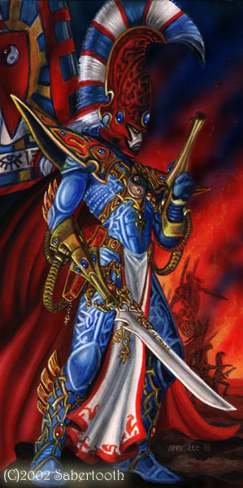

凶暴复仇者之主：Asurmen，Asuryan之手

Asurmen被称之为Eldar战士之道的元祖，他同时也是第一位凤凰领主以及Shrine of Asur的缔造人（阿苏尔神坛）。是他传授了战斗的技巧给其他的几位凤凰领主，也是他带领了幸存的Eldar族人从被沙历士的初啼所毁灭的家园中逃离出来。这也就是“Asuryan之手”这个名字的由来。

Asurmen到访过许多的方舟世界，比其他任何一位凤凰领主都要多。他将自己的战技传授给每一位想要成为战士的Eldar，而这些年轻战士中最伟大的几人将Asurmen的教导于自己的技巧和风格混合，创造了自己的支派并成为一名凤凰领主。Asurmen的盔甲中嵌合着一把特制的星镖射枪，而他的恐剑中宿有他亲生兄弟，Tethesis的灵魂。这位勇敢的战士在一场战斗中为一只恶魔所杀。

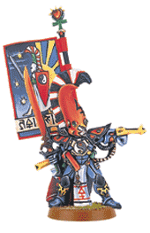

狂嚎女妖之主：Jain Zar，沉默风暴 (MM长得比较暴力..没大图.. =.=)

Jain Zar是狂嚎女妖支派的凤凰领主。传说她由Asurmen亲手带大并且是他最喜欢的学生之一。Jain Zar也是第一批成为主教的Eldar战士。

与其他凤凰领主不同，尽管Jain Zar视她的神坛为生命般重要并将不惜一切守护它，但她经常造访各个方舟世界传授其致命的战斗技巧。所以几乎每一个方舟世界都有狂嚎女妖的神坛。Jain Zar是个神出鬼没的女子，她经常突然在某地出现，然后又长时间消失。惟有通过神坛才可以了解她的行踪。

Jain Zar最著名的武器是一把称为Jainas Mor（沉默死神）的三刃镖，据说这把武器在虚无中由黑火铸成，要比一般的武器锋利数倍。Jain Zar可以精确的投掷Jainas Mor去攻击敌人身体的任何部位，而每当对手倒下时，Jainas Mor又会自动回到Jain Zar手中。（类似回旋镖吧）

Jain Zar还拥有一把成为Zhai Morenn（或称为毁灭之刃）的侩子手之剑，这把武器数千年前就被铸造出来，其历史甚至早于Eldar的堕落。Zhai Morenn是一把非常轻盈的武器，可以以惊人的速度挥舞。

Jain Zar的女妖面具也是所有女妖面具的原形，比起其复制品，正版的效果自然要强上许多。

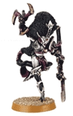

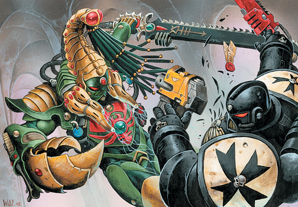

突击蝎之主，Karandras，猎影人

（这段嘉拉迪雅的Path of Warrior:Aspects已经有详细介绍）

Karandras是突击蝎支派的凤凰领主。没人知道他的身世，但是传说他并不是第一位突击蝎的主教。Arhra，毒蝎之父，才是突击蝎的首位主教。然而他却弃明投暗，在摧毁了他第一个支派神坛后逃入了隧道网路。没人知道他是否还活着。此人因为其被诅咒的行为获得了“堕落凤凰”的称号。有传言说他投奔了黑暗灵族并创建了男魅魔（Incubi）这个战斗团体。

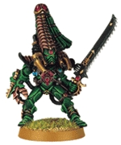

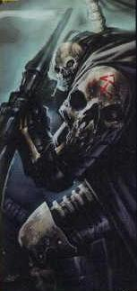

暗黑死神之主，Maugan Ra，灵魂收割者

Maugan Ra来自被毁灭的方舟世界Altansar。Altansar是一个悲剧性的方舟世界。在the Fall of the Eldar之后，尽管Altansar并未被毁灭，但它却与已被毁灭无异：这个方舟世界就在恐惧之眼血喷大口的边缘，而它已然没有逃离的希望，因为恐惧之眼巨大的重力会将它慢慢拖入其中。在长达五百年的岁月里，Altansar的Eldar与混沌奋勇作战，但这并不能改变他们的命运。最后，只有Maugan Ra逃出了Altansar。整个方舟世界被恐惧之眼吞噬。

一万年后，当掠夺者阿巴顿决定发动第十三次黑暗远征时，Maugan Ra在策划反击混沌的同时对混沌之眼进行了搜索，试图找到Altansar。他惊奇的发现Altansar上的族人并未被全部消灭，他们在恐惧之眼里独自与混沌战斗了１万年的岁月。在与阿巴顿周旋的同时，Maugan Ra带领幸存下来的族人成功的逃出了恐惧之眼。然而其他的方舟世界却对这件壮举反应冷淡甚至表示出敌意。原因很简单：在长达万年的岁月里，又有哪个Eldar人可以宣称自己完全未被混沌污染呢？

Maugan Ra的武器被称为the Maugetar（收割者），他身上的盔甲来自Altansar上一座被毁灭的神殿，以白骨作为装饰。

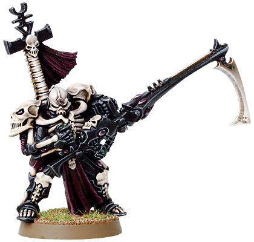

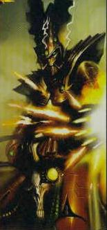

火龙战士之主：Fuegan，燃烧之矛

Fuegan对Arhra有着深刻的仇恨，当Arhra摧毁Shrine of Asur时，Fuegan并不像其他人一样逃离了那里，而是在选择战斗到底（？）。数世纪后，当大多数人都觉得他已经死去时，Fuegan却在Haranshemash（翻译做“血与泪的世界”）出现并帮助Eldar一方战斗。

Asuryata中记载当最终之战Rhana Dandra即将开始时，Fuegan将会召集其他的凤凰领主一同参加战斗。而他也将成为Rhana Dandra最后一个死去的人。

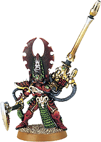

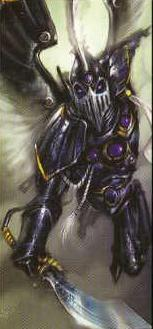

翔鹰之主：Baharroth，疾风之泣

Baharroth被认为是Asurmen膝下高徒中能力最强的一位。他被称为“翼之凰”，同时也是翔鹰部队的首位主教和创立者。无论其飞行速度还是其反应能力，Baharroth都毫无争议的被认为是历史上速度最快的Eldar。

Baharroth对混沌有着刻骨般的仇恨，因为他所出生的方舟世界和他的全家都是在一次由Trarkh，一名恐恩狂战士领导的攻击中毁灭的。所以Baharroth经常组织麾下战士突袭混沌的基地，并给混沌众带来深深的恐惧。

Asuryata中记载在最终之战Rhana Dandra中，Baharroth将面对自己的结局，至于这个结局具体如何，无人知晓。

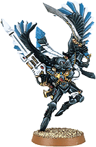
