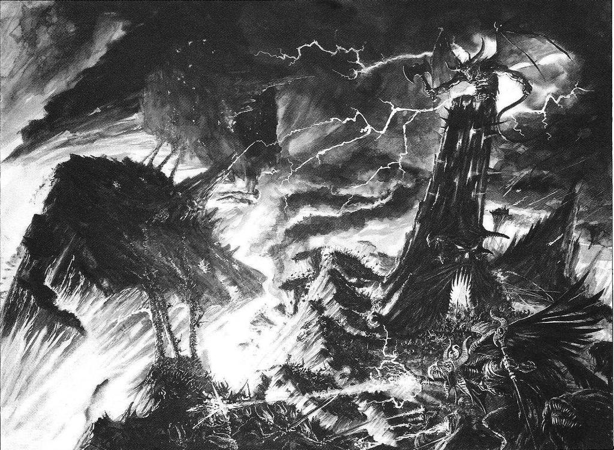
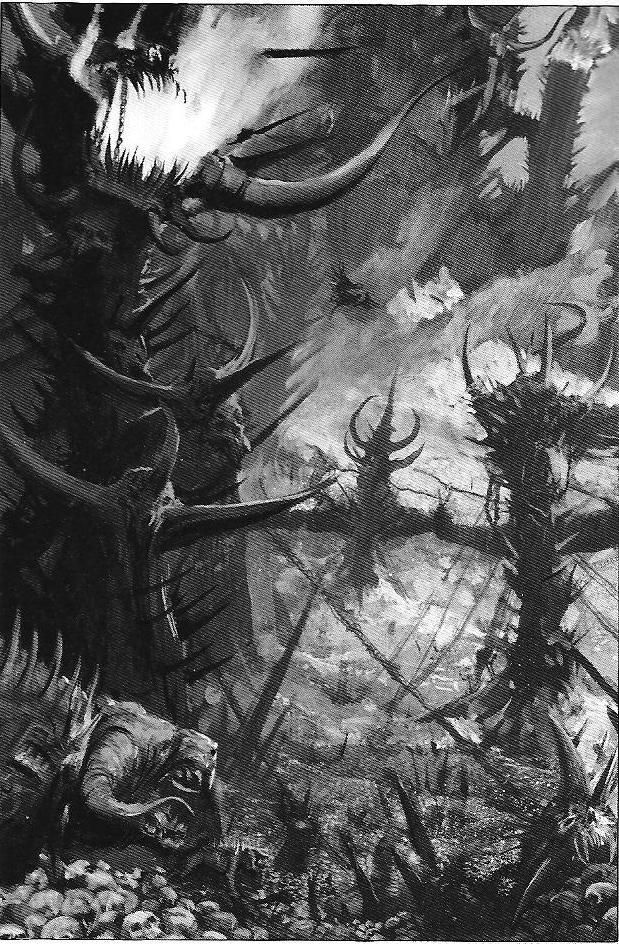
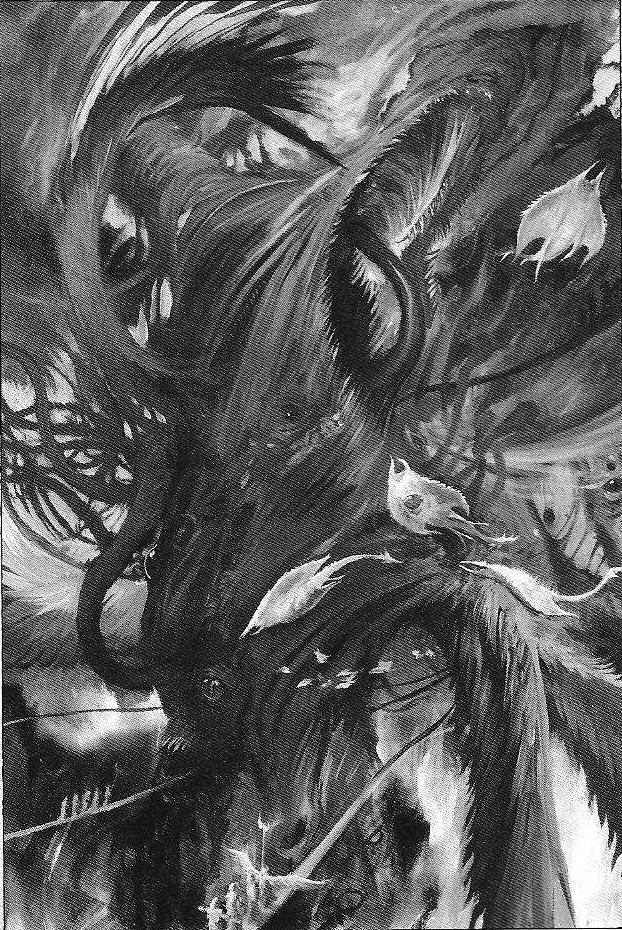
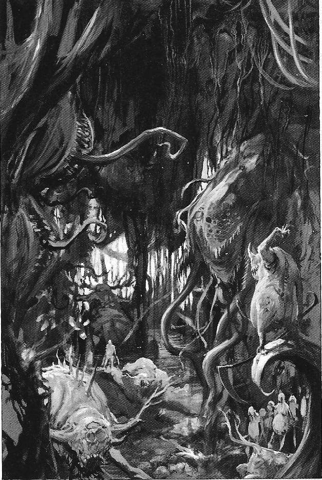

# 混沌界 THE REALM OF CHAOS

[盲目的翻书者，规则背景]混沌界 THE REALM OF CHAOS

trivel

混沌界 

受凡人的美梦和噩梦影响，潮汐般变换中的亚空间被塑造成古怪奇异的地貌和居住着传奇般的各种存在。这个永恒又时刻变换着的灵境幻景就是众所周知的混沌界。 

混沌界又被称做瓦普，亚空间或瓦普空间，是我们世界的平行空间，一个不存在物质和生命、时间和空间规则的世界。它是由随意、无组织结构的纯能量和无目的意识形成的空间。混沌被从物理的诸多限制中解放出来，并摆脱了智能引导的目的性。亚空间就是混沌，混沌就是亚空间，二者密不可分。 

混沌诸神和其众多领域是一体的，两者皆成型于同一种亚空间能量。作为一个混沌神，他靠收集相同能量得到壮大，在亚空间中其边界的周围扩展影响，他混沌界的领域也就随之壮大。没有两个领域的景象是完全相同的，但他们都建筑在相同的基本主题和感受之上。作为诸神的延伸，这些领域的外貌会依其创造之主产生同一种感觉：恐虐的领域建筑于愤怒和嗜血；色孽的领域是充满受诅咒的诱惑的天堂；奸奇的领地是纯魔法化成的千变万化的建筑群；纳垢的领地是死亡和再生的乐土。虽然领域和神是一体的，混沌神依然将他们的个性化为一具形体，居住于他的众多领土的中心。簇拥于众多的恶魔之中，混沌诸神照看着他们的领土的同时，寻找着亚空间众多其他形式领域中的骚乱，以便得到侵占其的机会。

混沌恶魔们

混沌诸神在亚空间中并不孤单，他们有着创造出来的仆从 – 恶魔 – 这些恶魔与亚空间的关系并不象邪神那样紧密。他们分离于其所在世界的潮流之中，像是一个个自身能量的小包裹并不跟随混沌界变换。恶魔们是与其主人完全不同特性的存在，并且在亚空间中最为数量众多。当邪神分离一部分自身能量决定创造一个分割的存在时，一个恶魔便‘诞生’了。这部分能量将感觉，思想和目标结合于一起，化做一个灵性和意识，最终独立的在亚空间中行动。混沌邪神能随时收回或分离给予恶魔的这种能量，以确保他们的忠心。只有通过摧毁这种能量核心才能真正杀死一个恶魔，他的意识会渐渐分散于亚空间的旋涡幻流之中。 

恶魔们在亚空间中并没有物理的外型。混沌界对任何驶入其深处的物质或舰船都有一种诅咒，会在其进入后慢慢剥离他们的外型或幻化他们的实体存在。恶魔们用亚空间的原始能量以魔法幻化为一个投影外型，以替代真实的物理外型。恶魔们用投射而成的奇异的、非人型的外表，具形和表明其拥戴的邪神。这些幻化的形体同恶魔在现实宇宙采用的外型互相影响，并且同创造他们的邪恶能量会显现出相似的外型。 

由于同混沌诸神和其领域做伴，这些外型反射出恶魔所属的感觉，并且被上百年的理念灌输塑造成型。在现实宇宙中恶魔的外型同他们在亚空间中时完全一致，虽然可能看起来像是由魔法而化成其内外。当恶魔在现实宇宙中显现时，恶魔特别的刀枪不入和虚弱无力，同许多其他来自亚空间的奇异能量具有着相同性质。杀死恶魔的物质投影并不会毁掉恶魔，只是毁坏了他的物质显现，他原本的亚空间能量并未受损。 

当恶魔在物质世界被‘毁掉’，他并未被真正毁灭，只不过是被放逐回虚空之中。他必须待在那里恢复元气，直到被其创造者补充完整或最终自己完成显形。传说恶魔被这种方法放逐后回归需要1千年外加1天，显然这种说法通过研究无法被证实，不过在亚空间中时间是毫无意义的。较弱的‘杀死’一个恶魔的赞扬倒是可以被接受，被击败的恶魔必须忍受同类的嘲笑直到可以重返肉身为自己复仇为止。最强大的恶魔们可以召唤附庸于他们的仆从们来帮助他们一雪前仇。如果他有盟友，也可能被唤前来帮忙，虽然所有的恶魔都很小心不欠这份必有所还的人情，并且没有恶魔欢迎其他形式的生物、凡人或恶魔。 

大竞赛 

混沌界不仅仅是邪神们的家园而已。它还是他们的战场，是混沌诸神争夺至高权利的大竞赛的场地。混沌诸神经常互相开战，在永恒之地间为权能争斗。尽管他们有着无数的不同点，但伟大的混沌诸神都有相同的目的：掌控全部。这种绝对的权能肯定不能被分享 – 特别是在众神之间。 

伴随着亚空间内能量的潮起潮落，混沌诸神的能量也壮大和缩减，他的领域也相应变化。在一段长久的时间内，一个邪神可能会凌驾于其他的邪神，受他的成功所益，吸食他的敌人的能量壮大自身。最终，其他的邪神会联合起来反对他的统治，通过合作以减弱他的力量，直到反对者之中有人取而代之。这种事在永恒世界里一次次重复着。没有一位邪神会最终胜利，因为如果所有其他形式的亚空间能量被抹杀了，亚空间就会稳定下来成为不变动的物质，混沌也就不存在了。 

当邪神们开战时，亚空间就会随之颤动，亚空间风暴的巨浪会席卷整个银河。在混沌界内部，成群的恶魔应其主人的要求被送到前方，邪神的领地随着激烈的攻防彼此间扭曲伸展着。被赋予个性和灵智，混沌之神的恶魔们渴望从其主人那里获得鼓励 – 亚空间能量，所以经常对敌对恶魔自发发动进攻。 

恐虐的恶魔们前进时就如同一只巨大的军团，伴随着呜呜的号角，在黄铜色的众多旗帜之下，一排排邪恶的血魔被嗜血者挥舞的皮鞭驱赶，含着原始粗野的愤怒和暴力，恐虐的军团割过敌人的领土，他们进攻中喷出的鲜血布满敌人的领域，将其转变成恐虐的荒原。 

当纳垢的宠儿们被放出来撒欢时，他们涌上前方撒播着疾病和腐烂。响亮的吵闹声和锈蚀金属的碰撞声就好象千万轰鸣的钟声宣示着他们的进攻，他们前进军队的上空覆盖着无以记数的苍蝇群。大不净者的有害脓包和瘟疫一路上杀死所有东西，将其转变成一层含有邪恶真菌和广植疹牙的覆盖物。 

色孽总是一贯发动阴险邪恶的进攻。第一波攻击总是难以琢磨，发动于其他神的未注意处。位于其他神领域的结构之内，色孽的神力触手通过诱骗深向根茎、骨架和水晶体，从内部腐蚀他们。当领土本身被色孽的能量歪曲后，会弱化迟钝敌人恶魔们的意识，以便色孽的快速部队发动快速果断的攻击。 

奸奇恐怕是所有邪神中最危险的，因他总能在进攻前创造出来一个弱点来加以利用。这就是通过阴谋，讽刺和魔法，奸奇经常挑拨起其他邪神间的互斗。他在一旁耐心的观看着这些冲突的进行，当时机成熟时，他的粉红惧妖们和诡道之主们迅速上前，如铺开魔法地毯般的，突击最弱的一方。伴随着魔法的爆炸和扭曲的能量，奸奇的军队迅速压制了所有的竞争者，新的占领地迅速成为奸奇的水晶世界的一角。 

最重要的是，一个邪神总是受制于其他邪神，这种占领总是引起各方关注，将邪神们的目光从凡人世界上引开。尽人皆知的是有时四位邪神也会达成共识，虽然他们各自都把这看作为了获取一些利益而达成的休战。在我们计数的几千年间，总会在物质宇宙中出现某个存在、地点或东西吸引所有混沌诸神的关注。这个新元素太重要、太迷人或太危险，会引起争斗者暂时抛开分歧取得这个利益或消灭这个威胁。这时四个邪神会合作为一，但当目标达成后，永恒的争斗又会得以延续。 

对于人类，最重大的情况就是帝皇的崛起。在这期间邪神们将其所有的力量都用于摧毁人类之主，高潮就是污染了基因原体并导致何路斯之乱。其他一些导致混沌界冲突短时中断的事件有：应恶魔亲王和混沌星际战士领主要求的黑暗十字军远征；一个种族的新生或灭绝；一个新存在的崛起；这些事件在凡人中最好的影响是大逃亡，这些协议在邪神间不会维持太久。一个或几个，或干脆四个，最终会打破协议的束缚，试图篡夺其他的邪神们。混沌界又会再一次充满军队互相进攻的巨响和邪神间冲突的吼叫。

无定型的荒原 

亚空间没有物理的特点，并且混沌界没有界限或真正的地貌。区域的影响受控于混沌诸神对他们各自的领域塑造，其他滚动着的地方通常被叫做无定型的荒原，迷失灵魂之地或混沌深渊。 

大多数无定型的荒原是随机的混沌，不断翻腾着，重组于凡人的幻想和亚空间中的流动。在这里绯红色的天空下，暗黑污浊的河流穿过石化的林地；巨大台阶群引入云霄又汇合于底部连成一个永无止境的圆环；骨制的城堡和脓液的堡垒耸立于残躯断肢间，天边燃烧着发亮的柱子群。每个美梦和噩梦，每个疯狂的幻景和错乱的怪念头都能在无定型的荒原上找到。 

无定型的荒原是狂野恶魔们的家园，这些恶魔创自犹豫不决和随机之下，培养于无本原的恐惧。他们聚集成巨大的一群往返于光化的天空，寻找着弱小的猎物 – 那些还未被亚空间吸收的凡人吵闹的灵魂。这些软弱的幽灵们看上去是闪烁着的精神和脱离了肉体的声音，只含有最基本的意识和直觉。恶魔们扫食着这些无助的生命，抢在其消散于更强力恶魔搜寻灵魂群的接近途中之前。 

无定型的荒原还是其他一些强力生物的居所 – 像是大恶魔和足够强大的恶魔亲王的领地，这些生物强大到足以稳定控制其周围的一些环境。就像一些萌芽建筑杂乱堆成的小岛，其中的一些只能维持一瞬间，也有的同邪神一样古老。每个这种世界相对于广大的邪神领域都是很渺小的一块，不过每个都是其创造者奇异的具型体，一个小信仰的小神坛或小庙。这些可能在他们自创的短命恶魔中颇受崇拜，虽然这些短命的恶魔大多数被狂暴恶魔们最终吞食。 

恐虐的要塞 

恐虐的领地是一座愤怒和杀戮的纪念堂。它以谋杀和冲突为基本要素，就好象战场之上和征战路上方方面面的反映的家园。这个浸满鲜血的领域不停回荡着恐虐的吼叫、武器的碰撞之音、鞭子的啪啪爆音和无以记数的战斗号角发出的呼号。 

恐虐是血神、战争之王和采头骨者。他是愤怒的聚形体，去征服和杀戮。血神粗犷又健壮，有着一张野人般的不停犬嚎着的狗脸。恐虐穿戴着厚重的黄铜和黑铁时期式样的重重甲片。他用无尽怒火的咆哮喊出每个词语，这些愤怒的吼叫在其整个领土上不断回荡。恐虐坐在一个黄铜的王座上，下面的基座是一个由其冠军勇士们击败的敌人们的头骨堆成的山峰。在其身边停放着一把巨大的双手剑，一挥之间就能在世界中划出荒原。这把堕落之刃有着众多的名称，包括灾难递送者，战争缔造者，万物之终和饮血者。 

一个巨大的火堆照亮着恐虐的黑暗厅堂，邪恶之火在那里吞食着从战场上逃离的懦夫们的灵魂。这座浓烟密布的王室坐落于恐虐黄铜的大城堡中央。这座邪恶的大堡垒的金属外墙装饰着好象从墙内挤出的矿脉一般的酒红色大理石，排成齿状的大理石上面满布血壳和黄铜色沾满血迹的尖刺。恐怖怪异的滴水兽头遍布胸墙向下睨视着，随时准备向围攻者们喷出燃烧着的烫人金属溪流。黄铜大堡垒的护城河中流动的并不是水，而是沸腾翻滚着的丧命于战场之中的人的鲜血。 

在护城河之外是一块块开裂的土地，其上散乱的分布着战斗中失败者的碎骨残片。一伙伙猎肉犬在这些荒原上徘徊寻找着入侵者，边巡于血海的边界，游荡于碎骨堆成的迷宫之间，追捕着闯入者。这些猎肉犬可以在无所不在的血腥气味中，分辨出最细微的恐虐敌人的气味，并进行无情的追逐。 

这片荒原被一个大裂缝分割，一道无底的长达许多里的峡谷。据说恐虐有次被巨大的愤怒吞噬，这使他挥剑砍向地面，将其永久分成数块。偶尔这些死亡峡谷会被血浪填满，掀起的海啸般的深红巨浪将平原上的无头尸堆和山峰般的碎骨一扫而空，就好象宇宙有个可怕的伤口大出血一样。 

一连串无数持续闷烧着的火山就好象恐虐领地的腰带。这些形成了末日之环。恐虐的愤怒吼叫会引起火山群的喷发和大地的颤抖。火山群伴随者血神的愤怒爆发着，喷出的岩浆河流同血神的愤怒一样炙热。在这些吐着火的突起的环内侧的斜坡上散布着恐虐的铸造厂群，据说工作于其中的可悲灵魂是死于睡梦之中的战士，被永久注定为恐虐的奴隶。混合火山喷出的浓烟形成的巨大成排的向上升起的战争工业烟云堵塞了血红的天空。这些狰狞的建筑群保证了恐虐的军备充足；通过这种不停歇的苦干，他的无数战士得以被装备和武装。 

这里也可以发现重型坐骑的围栏，在加固后裂纹满布的厚过任何凡人工事的围墙之内，恐虐的重型坐骑被围控其中。这种神级的围栏是很有必要的，因为除此之外的障碍物无法拦挡这些恶魔怪物的愤怒。有着泰坦般破坏力的重型坐骑之间经常发生战斗，互相碰头或用犄角互挑来决定统治权。恶魔中的传奇存在，凡人中被恐虐带入领域的冠军勇士，还有那些敢于挑战囚禁物的愤怒的家伙都必须靠自己来获取一个坐骑。几乎所有这些战士都以把自身最终抹在墙上而失败了，只有极少数最勇敢和最强大的家伙可以骑在这些凶残的野兽身上走出巨大的黄铜大门。 

在这些火山环的外侧是无尽的围墙和棱堡。以黑花岗岩雕刻而成，高达几里的塔楼直插天空，一道让人气馁的防线阻挡着那些胆敢攻击血神王国的不智者。巨大的地狱火炮等待着恐虐攻击其他邪神领域的发射命令。强大的要塞群被末日之环的黄铜炮眼和伙同其中的恐虐的嗜血军团守卫着。只等恐虐一声吼叫，这些军队就会冲向前去穿过其他邪神的领地带来屠杀和战斗。在恐虐的鼓励下，他无尽潮涌般的战士会被扫进一片血的狂热，并且在找不到敌人时会互相砍杀以满足喷溅鲜血的愿望。 

因为不断的战争，疯狂的嗜血和毁灭才是恐虐唯一关心的。他不在意谁是胜利者和谁被屠杀，只关心有人战斗到直到无法再战。恐虐存在的原因，和他全部的存在都致力于让鲜血从新伤口流出和不断收集头骨。 

奸奇的迷宫 

奸奇是变化之神和巫术大师。他的领域被纯粹的魔法原料织就，编进了奸诈和阴谋。在混沌界奇异的地貌之中，奸奇的领地是最奇异和难以理解的。 

奸奇的水晶迷宫坐落于无尽的彩虹高原之上；它看起来好象穿过了所有恶魔界。交替变换着每种颜色的水晶通道在奸奇的领域里转折、交叉着。通过阴谋和谎言渗透进其他邪神领地的密道将多变的混沌界连为一体。 

水晶迷宫里没有恶魔战士。他自身的幻觉通道足以拦阻未受最强大的思维想象所控制的闯入者。他闪闪发光的回廊不仅仅反射光，还反射希望、痛苦、美梦和噩梦。水晶迷宫不单单反射，它还歪曲，分化闯入者的目标和抱负，将其转变为疯狂和绝望。受奸奇无意识的谋划的控制，水晶迷宫不断的移动和重组；每个曲径、转弯和死胡同都是命运之主一瞬间的奇想。那些迷失于迷宫之内的会永远迷路下去，他们的思想动摇于其自身失败的重复之中，梦想随之破灭。 

在迷宫的中央，隐瞒过那些没有疯狂的洞察力去找出来的家伙们，矗立着雄伟的不可能要塞。来自要塞核心的粉色和蓝色火焰在孪接的尖塔和塔楼中扭曲喷出。这些仅仅存在了一个心悸的时间，然后闪烁消失，被一个更疯狂的建筑所取代。大门，窗户和引人入内的门洞打呵欠般的开着，像是饥饿的大嘴，下一刻又都突然关闭，挡住了所有的入口。 

混沌界的特性浓缩于不可能要塞之中。物质的空间和时间概念在这里并不存在。一个人可能会在顶针般大小的房间里迷逛几个星期，又或通过一步就能穿过几个小时才能走完的路程。重力交替和变化着，有时甚至完全消失。光谱中的每种光线，合着宇宙间的未知暗影，在墙壁上交替跳跃前进着。 

对凡人来说，这个变化着的堡垒是完全无法接受的存在。因为执着于他们的物理解答，人们被驱向疯狂，同时在奸奇曲折的思想放出的力量下，他们的身体也可能会内爆或分割成块。即便恶魔们也不能随意忍受不可能要塞的扭曲和恐怖，只有诡道之主可以安全的行走在其中的走廊里。这些奸奇的大恶魔们能走上一条密道通向不可能要塞内部的密室，也就是奸奇谋划他永久阴谋的秘密图书馆。 

秘密图书馆自身保存着每个知识的片段，每个生物每时每地的每个思想。书籍、羊皮书和卷轴被魔法火焰标记整理成串，一卷卷，一架架各种知识铺展进奸奇巢穴中无穷的隐秘空间。受困于不可能要塞的交替变换着的迷宫，无数粉红和蓝色的惧妖在图书馆里爬上爬下，像一个个疯狂照看不规则疯长的杂草树枝的园丁一样照看着图书。黑魔法通过喋喋不休向他们的守护者唠叨着，用他们的声音将惧妖们陷入阴谋和流言的陷阱，以便使这些恶魔最终漫漫凋谢于其中，然后秘密图书馆好能吸收掉他们的能量。 

奸奇是混沌诸神中最奇异的。他的皮肤上爬满了不断变换着的脸孔，这些面孔斜睨和嘲笑着那些胆敢看向他们的家伙。当奸奇说话时，这些面孔用有着细微差别的语调重复他的言语，并提供一个让人对原话产生怀疑的注释来愚弄听者。奸奇皱缩的面孔来自于他未定型的躯干，因此他的头和身体是一体的。在奸奇燃烧的双眼上方跳动着两只扫动的角，旋转的末端爆发出神秘的火焰。 

奸奇是万变之宗，大阴谋家 – 宇宙命运的缔造者。他对于阴谋和其他政治活动怀着巨大的欣喜，并且喜欢狡诈胜过力量，操控多于暴力。没有一个奸奇的计划是简单的，并且确实经常自相矛盾，因其只渴望永久的欺诈和阴谋。 

在奸奇看来，凡人的生命是无比沉迷于阴谋之中，并充满了变数；以某种方式过着他们的日常生活却完全没意识到在他们的灵魂中有着多少缺点和自相矛盾。奸奇禁不住会涉足凡间，有时作为大竞赛中打击他兄弟邪神们的一部分，更多时候是满足他自己的需要去偷偷掌控、篡改和控制。奸奇不会不屑于损伤他的双手于吵闹的战争之中，虽然他更喜欢通过狡诈和毁灭性的巫术来赢得战斗多过使用蛮力。 

受困于他自己的难以形容的想法，奸奇总在编织一个复杂阴谋而别无其他目的或目标。当有人说谎，当嫉妒和野心残存下来，奸奇就会像宇宙的傀儡大师一般操控起他的魔法。

纳垢的花园 

当凡人世界中有祸害和瘟疫导致荒芜时，纳垢的领土就会随疾病和腐化兴旺扩展。受腐败之王的精心照管，这个不利于身心健康的领域是每个脓泡和可想到的折磨的家园，并充满了腐败的恶臭。 

有死就有生。在生命的腐败里无数细菌，病菌、昆虫和食腐生物得到兴旺发展，所有的生命都靠其他生命滋养存活，并从一次次瘟疫中诞生出比上一代更强、更有繁殖力的新一代。因再生来自腐败，所以希望涌出自绝望之中。最振奋人心的灵感来自最黑暗的时刻；在危机关头，凡人们被最终考验并驱向脱颖而出。这就是纳垢（腐败之王、疫病大师）的信条。虽然看上去十分肮脏，而且是扫荡宇宙的传染病和流行病的创造者。纳垢却是一位充满活力的生命和欢笑之神，而不是满脸阴沉的失望和忧郁的提供者。他的永恒领域就同其神一样，纳垢的领地不是贫瘠的荒原，而是一个死亡和疫病的死亡天堂。 

生于纳垢花园中的毛茸茸的苍蝇嗡嗡着在天空之下形成又黑又厚的的一群又一群。在被昆虫啃食的一塌糊涂的树叶天棚之下，腐朽的大树叉和紧缠其上的藤蔓好似并生而出一般的覆盖着正在腐败的大地。真菌植物从覆盖树林的覆盖物中叶散般的四处丛生，并不断喷出呛人的孢子。半恶魔的植物依自己频率摇动树茎，但这并不是受到好似凝固了的刺激空气的刺激所致。明亮的红色、兰色、黄色和紫色小花刺破阴郁之气；欢乐的天堂布于忧郁的林景之中。挖掘着的和奔跑着的各种昆虫身上都有着明亮的图案甲壳和闪亮的翅膀。昆虫们沿着缓慢浑浊的河流长堤轻快的飞行着。芦苇发出的哗哗声中，细语诉说着凡人世界中由伟大纳垢散播的流行脓毒的名字；或为那些注定死于他们创造者的家伙们悲鸣。 

冲破这片最原始的泥沼中突现出来的是纳垢的牧师住宅，残破而又古老，但其根基永远牢固，这座大厦是腐败木料和残破墙壁的折中结合，上面附满了蠕动的毒藤和厚厚的苔藓。裂开的窗口和碎裂开的石头与锈迹斑斑的青铜制品争夺着空间，锈蚀的铁器边框与布满苔衣的边楣用它们的腐败魅力互相竞争着要超过对方。 

纳垢在这些摇摇欲坠的墙壁之下埋头苦干着，他巨大的身体因腐败而肿胀，并且放出让人难以忍受的臭气。他有着绿色的、坏死的皮革肌肤，表面充满了流脓的溃疡，膨胀的疮和众多的寄生物。纳垢啵啵脉动的器官中充满了腐败的排泄物，通过他表面皮肤的裂口喷出来挂在身上，就好象他身上布满了另人作呕的果实。从这些器官中爆发出成群的微缩纳垢，他们在像爷爷一样的纳垢的腐败肠道上觅食和吸吮着另人作呕的丰富汁液。 

在四散密布、下陷着的桁梁下，大邪神永久的工作在一口大锅前，一个足够装下宇宙中所有世界里的海洋的大容器。自言自语的咕哝之中，纳垢致力于创造感染病和疫病 – 一种最完美的、自由的生命形式。在纳垢爬满蛆虫的长勺的每一下搅动中，一打新的疾病舞动消散于宇宙，在世界中消减文明程度和毁灭众多人口。一次又一次纳垢会止歇他的激动，用他爪子般的手捞起一部分恐怖的混合剂放入他山洞般的大嘴，品尝他的劳动成果。 

一大群低矮于他们强大主人的瘟疫携带者，围在纳垢身边。每个都大声的吵闹计算着，有多少创造出来的疾病；或有多少的微缩纳垢；或腐败之主们散拨的腐败赐福带来了多少的灵魂。这些嗡嗡的声音压过了腐烂地板的咯吱声和勺子刮擦大锅发出的声音，长久待在这千篇一律的声响之中，听着它最终会将人逼疯。 

当纳垢的力量增强，他的花园会伴随着死人头和污物越发茂盛，并侵入其他邪神的领地。战争随着敌人的反击而爆发，疾病携带者们会拿起武器保卫疾病的森林。大量的生和死，以及建立在灾祸之上的胜利喜悦从这种战争中喷涌而出。尽管纳垢的领域会最终退回，但它已被无数死于其中的尸体深深滋养，并再一次回归平静、孕育生命的和平之中，直到它准备再一次肿胀开来。

Ｓ伪姐的宫殿和诞生史，超有爱的迷宫守卫前人已经翻过，这里就不赘述了。欢迎指正。

大家都想知道的事……

沙历士的香闺（囧 崮 莔 冏 圙）

泰拉的子孙 

没有几个神欢迎外人闯入他们的国度，但是有一个特别衷爱于引诱旅者来到他那非自然的王国。这就是沙历士——黑暗王子——欢愉之主——那些胆敢进来的人都陷入了永恒的扭曲快感。黑暗王子的领域被划分成了六个王国，按照同心圆环饶着欢愉之殿。沙历士的王国也许会被误认为是天堂，但……这里所有一切都是虚假的。每一环都不仅仅是沙历士的盛宴，更是他的防线。一个入侵者想要到达沙历士的中心——欢愉之殿——就必须穿越这六个环，这可是绝大多数生灵都无法办到的，不论凡人或是恶魔。

贪欲之环构成了沙历士王国的最外环。它诱惑着闯入者内心的贪婪。这里黄金俯拾即是，闪闪发光的钱币无可记数。任何试图窃取这些财富的人都得到了永世清点及打磨这些财产的命运。贪欲之环被点缀着五颜六色的宝石的高大大理石墙壁所分割开，这些珠宝是一些恶魔的巢穴——随时准备着吞噬任何碰触他们的生物——包括他们的灵魂和肉体。在每个角落或路口耸立着镀金的雕像，有些是美丽的莎莎，其他的则是被引诱捕获的恶魔或凡人。任何一个不经意的碰触都会让你成为其中一员——你的灵魂仍留在凡躯里，但身体已经成了金身罗汉。

如果贪婪没有让你上当，那么下面便是饕餮之环。这里遍地肉林酒池，纵横的桥梁连接着酒海中星罗棋布的小岛。每个岛都是一张盛满了盛宴的大桌，并且每一桌都比上桌更丰盛。任何试图尝试的举动，哪怕是沾上一小口，都会让你的灵魂就此沉沦，你的饥渴将无法被任何美食填满。最终因为无止境的进食，身体将越胀越大，伴随着一阵血雨以及尚未消化的食物的残渣——你暴体而亡了。

下一环则为放荡之环，一个充满了肉欲快感的邪淫之地。柔软的女体及美丽的少年充斥着翠绿的原野，他们的面容和丰满的躯体全部是内心的最完美形态。但是与这些生物接触绝对是个大错特错的选择，这些外表美丽的漂亮可人儿其实是沙历士的女妖——她们会把任何伸出咸猪手的家伙大卸八块。

再下一环，迎接旅行者的是一片赞誉的声音。这便是主宰之环，他们会被那种高于一切的权利所诱惑。对于有着征服野心的人来说，会有一支延伸到地平线的大军满足他指挥与征服的愿望。而对于有着政治野心的人，这一环将会给他一个庞大的议会让他统治（翻成议会觉得不妥，但实在没有别的好点子）在这里他可以享受对整个世界君临天下并被万民膜拜的快感，个人权利被无限地夸大，任何一时兴致都可以被满足，任何命令都将被服从。留恋于这个环最终会屈从于永恒，变成喋喋不休的失心狂：笑脸逢迎的马屁背后隐藏着轻蔑与嘲讽。弄臣们整天围绕左右，旅行者自身的怀疑将成为自身的禁锢，永远没有逃出这个囚牢的机会。

虚荣之环是个能催眠人的花园，它的曲折小径覆盖着美丽的鲜花和荆棘。温和、芳香的微风向你低语着逝去的荣誉，暗示着你的大小功绩。镜湖反射出旅者的倒影，照出他最完美的形象，此乃本环之陷阱——傲慢，在这环踏出每一步的同时自满的骄傲会将人带离正确的道路。当他越来越膨胀时，他将不可自拔地陷入荒原中令人窒息的低矮树丛并很快成为等待在那里的荆棘刺上的猎物。恶魔树精也将轻蔑地嘲笑羞辱他，他所有的荣誉都成了讽刺的颂词。

最后一环是最为危险的，在面对了所有严酷的考验后，这平静的一环为颓惰之环。天籁般的歌声萦绕在一望无垠的沙滩上，歌声宽慰且轻柔，海水芳香且使人困顿。和煦的夏日阳光平息着灵魂，海浪的温柔冲刷抚慰着心灵。脚下的白沙是先来者晒干的躯壳，仅仅是片刻的休息也将使你昏迷，然后你就死定了，在懒惰与颓废中日渐干瘪。假使旅行者能够穿越这最后也是最阴险的一环，他将面见大能的沙女王。

在所有的混沌之神中，沙历士庄严且富有魅力：四肢修长，优雅，还有那种亦雌亦雄的让人无法忘怀的美丽。有人说沙历士能够随意转变成男人、女人或是雌雄同体的样子。他通常以一个年轻男子的形象出现——干净的外表，充满青春活力。的确，沙历士拥有不属于凡物的美丽，能让人在他面前放下警惕，被他的翩翩风度彻底欺骗。有人说没有任何凡人能够活着看见他的真实面目，因为所有看到的人都心甘情愿地成了黑暗王子的奴隶，衷心地拥抱他的道路——被唾弃者之道。
