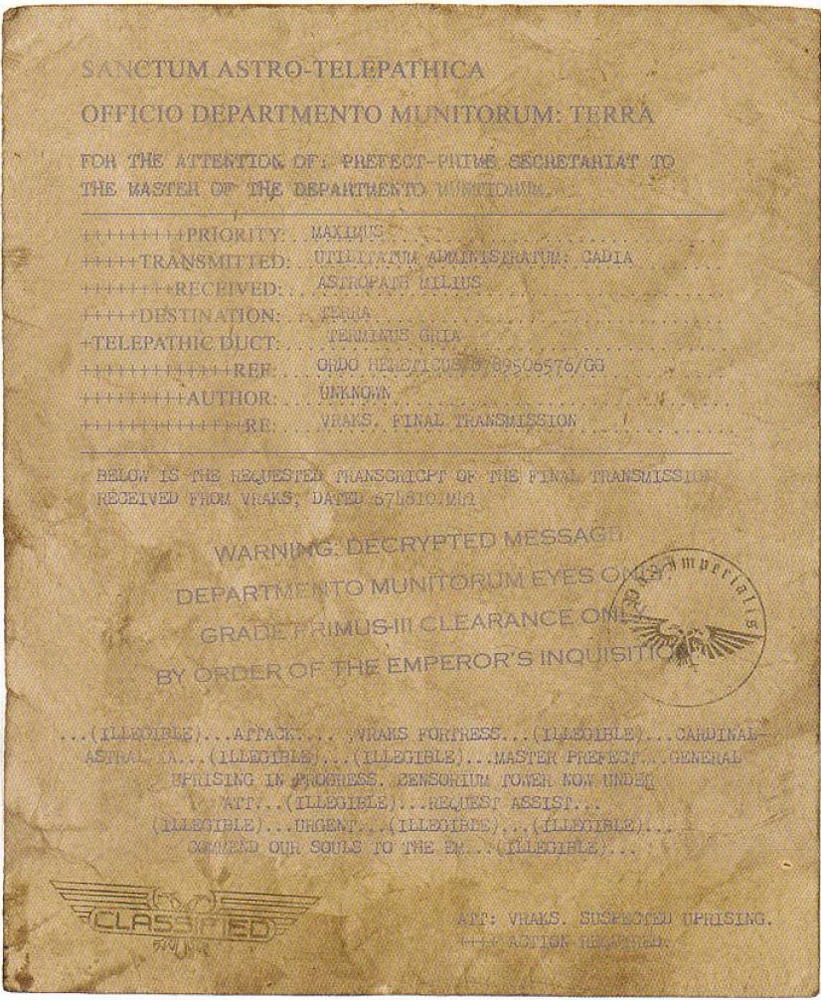
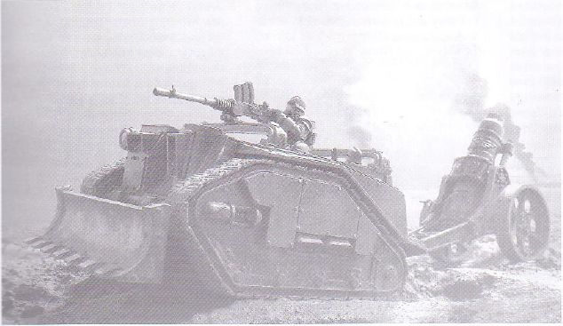
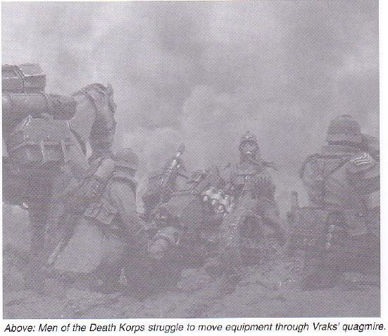
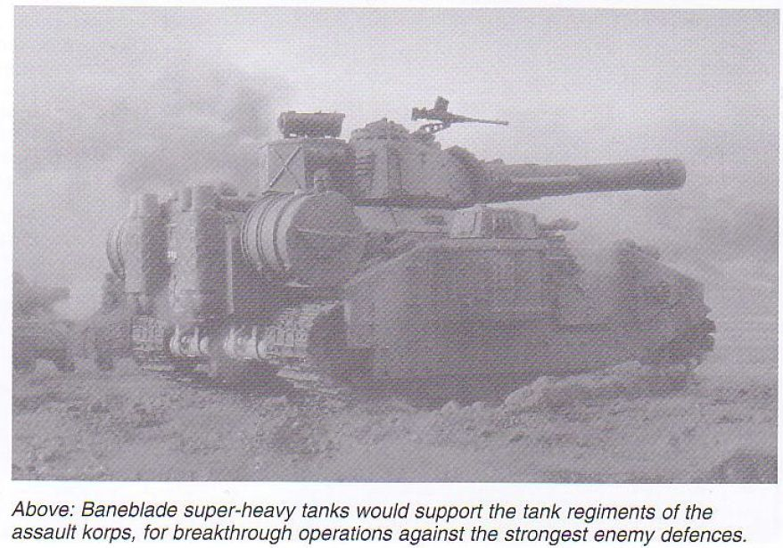
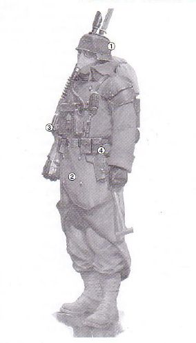
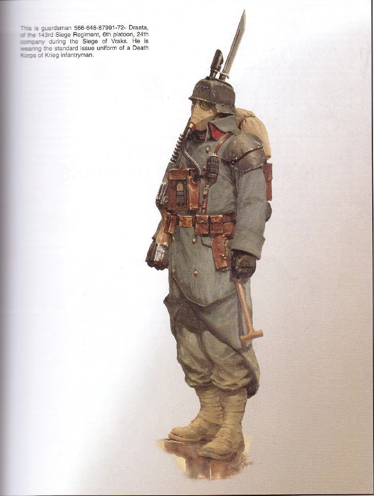

# 第二章 运筹帷幄

《帝国装甲第五卷-弗拉克斯攻城战（上）》剧情篇

CZ75

第二章

运筹帷幄

“在弗拉克斯不会有什么辉煌的胜利，不会有光荣与荣耀，只有冷酷无情的战斗。在敌人放干我们的血之前，我们将先放干敌人的血。”

——第88攻城集团军司令屈尔克阁下

军务部的反应

军务部对弗拉克斯的陷落未有及时反应。失陷一事经久方得确认，并呈送至朦胧星域的军务部部长办公室。后又必须与地球上的内政部联系之后，方能采取行动。数月间，文牍层层，印章重重，官官相诿，辗转反复，待此事获高层关注，已过数月之久。此后内政部的齿轮才缓缓运转起来。

不可放任叛军在弗拉克斯恣意妄为。其人口虽仅八百万，其重要性与各大远征及迫在眉睫的远东虫族战争相比，简直不值一提，然其地位险要，斯卡卢斯行省之军需品，多需经其转运，一旦失陷，后果不堪设想。如果斯卡卢斯行省及近之帝国防卫军团队供给不济，则后果堪忧。皇帝塔罗为弗拉克斯占卜的结果亦尽触目惊心。弗拉克斯一旦陷落，则恐怖之眼周围之帝国防线将遭重创，黑暗力量（指混沌）定会趁虚而入，倘不能胜之，则更多世界势必相继沦陷，更多异端军队将如飞蛾扑火一般，与之合流，烧杀抢掠！谁能断言弗拉克斯之陷，不会在十年之后引发新一次黑色圣战？军务部部长绝不能容忍此预测成真，势必不计代价夺回弗拉克斯，然而何以为之？

设于卡迪亚的朦胧星域帝国防卫军总司令部受命夺回弗拉克斯。防区司令与朦胧星域总司令均出席会议商讨良策。来自地球的命令令人十分为难。自古以来，弗拉克斯就是易守难攻，它的城防历经万年苦心经营，固若金汤，坚固无比，可挡千军万马。如强攻之，必遭重创。此前万年，从未失陷。

统帅们考虑了各种方案。一些将领反对出兵弗拉克斯，他们争辩说，这完全是浪费大量人力物力的愚蠢之举。把已经十分紧张的资源用于攻占弗拉克斯，则势必意味着其他星系会落入敌手。 弗拉克斯既已失陷，军务部更应防微杜渐，未雨绸缪，防止此类事故再次发生，而非为掩饰自己的迟钝与短视发动一场无望获胜的战役。弗拉克斯上的军需品既已丧失，何不索性一笔勾销，专心提高朦胧星域内的产量以代替它们？

些微怀疑的声浪，无法动摇朦胧星域总司令的决心。克复弗拉克斯的命令直接来自地球，上有内政部部长办公厅厅长（他身居高位，效命于帝国元老会议）的大印，任何人皆不敢轻慢之。若有怠惰者，必遭审判庭严惩，军事委员会内，无人敢冒被异端审判庭问罪之险。

胜算虽小，弗拉克斯之战却势必进行。军事委员会之职，便是运筹帷幄，指挥作战。有人献上一计，刚猛无比:先以帝国海军进行轨道轰炸，星际陆战队随即强攻抢滩。为行此策，派出了一位信使与阿斯塔尔特修会联系，请求星际陆战队助战。朦胧星域最高统帅部也开始评估进行强攻所需的资源。人们在档案库里翻箱倒柜，寻找有关弗拉克斯行星布防的内容，资料汗牛充栋，浩如烟海，令人望而生畏。

始建之初，弗拉克斯堡垒及宇宙港便可抵挡轨道袭击，此事人人皆知。其周围布有一圈行星防御激光炮台，内设激光炮逾百座，地表之火力，足可与低轨道上的整支舰队匹敌。帝国海军的战列舰与巡洋舰虽船坚炮利，终不可与行星战而胜之。炮台深埋于地表之下，可抗轨道轰炸，宇宙舰艇若与之战，实乃以卵击石。舰艇欲空降地面部队者，必先机动至低轨道，当其发射登陆舰艇时，空门大开，移动不便，极其脆弱。登陆艇自身亦易遭攻击，一发激光，便可将其粉碎。行星防御激光炮台下面，又有高低混合之防空火力网，足可抵御任何航空器。经统筹分析，可知强攻之风险甚大，极有可能兴师动众，损失惊人而又劳而无功。空降至地面之部队将无力夺取堡垒，即使大能如星际陆战队，亦无力进行此作战。任何战团长，皆不会鲁莽至此，甘冒牺牲其宝贵的战列旗舰与无价的战斗修士之生命的危险，参加此一获胜希望极其渺茫的战斗。若星际陆战队不来助战，帝国防卫军孤军冒险，必将损兵折将，伤亡惨重，解脱之法，唯有尽速脱身一途。弗拉克斯势当夺回，但切不可图快而草率行事。

又有人提出一替代方案：以帝国海军长期围困弗拉克斯星系，断其援助，数百年内，反复对其发动小规模攻击，将小股精兵空降于弗拉克斯，逐步削弱其防御（特别是行星防御炮台）。 待百年封锁与攻击之后，其防御能力必将大跌，彼时便可发动。分析之后，其结果仍不乐观：该方案即使能生效，少说也要进行五百年左右。如此怯阵而又拖沓的方案，军务部定将其驳回，它不可能等上半个千年去收复一个世界。

第三项方案便是空降一支大军，进行规模宏大、历时长久的攻城战，有条不紊地、无情地磨碎叛军防线。若以将收复弗拉克斯之战以消耗战的形式进行，则帝国可以其无穷无尽之资源供应此军，待叛军耗干之后，弗拉克斯便可收复。若军务部将叛军与帝国军之伤亡比以二比一计算，则需多久、多少人才可夺回弗拉克斯？

堪称人体计算机的分析专家开始了评估，在考虑了供应率、后勤需求、异空间航行延迟时间、已知的储存在弗拉克斯上的军火数量、叛军所能动员的人力等一切因素之后，他们估计：从准备行动开始，到弗拉克斯回归皇帝的统治为止，需要十二个标准地球年。

统帅们制定的可行性报告迅速呈送到地球上的军务部部长办公厅。该方案切实可行，但军务部能否提供足够的人力及所需的巨量后勤物资？军务部的回答是：人是会有的，物资也是会有的，为了夺回弗拉克斯，已经组建了一个新的集团军：它就是帝国防卫军第88攻城集团军（88th Imperial Guard Siege Army）。

帝国防卫军第88攻城集团军

新组建的攻城集团军的所有士兵都来自行星克里格（Krieg）。克里格一带必须向帝国防卫军提供的人力资源份额是最高的。整个帝国里能像它那样，可以提供如此之多的士兵为皇帝效力的行星寥寥无几。长达五百年的克里格内战，塑造了坚韧顽强的克里格战士，也塑造了具有独特作战原则的克里格死亡军团（Death Korps of Krieg）。

在克里格内战中，忠于皇帝的军队曾试图用核武器来净化叛军。当禁忌的上古武器在克里格开出一朵朵蘑菇云时，克里格变成了一片荒原。而在这片饱经辐射的人间地狱上，幸存下来的人类仍在地下继续进行战争。内战持续了五百年，整个行星上布满了错综复杂的战壕，僵持不下的局面持续了很久很久，就在这种环境中，十五代克里格人成长、受训，并形成了堑壕僵持战的传统。当克里格死亡军团投入到持久、血腥的战斗中，就能体现出他们擅长持久的阵地战的优点。与帝国防卫军的其他团队不同，克里格士兵的最显著品质是无私的牺牲。漫长的阵地战会给士兵的心灵造成严重创伤，其他团队在这种情况下会发生崩溃或兵变，但克里格死亡军团却能坚持下来。无论损失多么惨重，死亡军团都会坚持战斗，绝不溃退。他们只知战斗一途。

第88攻城集团军的最高指挥官是战区司令屈尔克，他出身军人世家，其家族在帝国海军与帝国防卫军中很有势力，其曾祖父曾任太阳星域统帅的随员。除了显赫的出身、高度的军事素养和对《帝国战术教典》的精细研究之外，他本来没有多少可以胜任这一职位的条件，但政治压力和响亮的姓氏最终还是使他获得了这一职位。组建部队、策划战争是一件很耗时间的工作，为了完成这些工作，屈尔克司令组建了一个庞大的参谋部。

弗拉克斯战役的准备工作耗时甚长，但其本质却很简单。为了夺回弗拉克斯，必须牺牲多少人？在制订作战计划时，攻克敌军防线、破坏行星防御炮台、最后强攻并夺取堡垒和宇宙港，每一个步骤都要用数学公式来计算其损失如何。第88攻城集团军的一切都是可消耗的资源。要用多少士兵和多少铲子去挖战壕？推进一百米，或强攻一个支撑点，需要多少人？压制一道敌军战壕，需要多少枪？要补充多少乘员、炮弹、替换炮管、口粮包和水？这些清单长得没个头。一张又一张清单在预先计算好之后打印了出来。在士兵编入团队，或武器生产出来之前，第88攻城集团军仅仅存在于几千张数据表上。

这是最无人性的战争。死亡军团里的士兵没有名字，只有编号，这样可以很方便地计算他们的数量，团队开赴战场时，就已经知道了有多少士兵将会死亡。有了精确的分析，第88工程集团军就可以准确地预测每场战斗的结果：每场战斗中能赢得什么战果？为了赢得这些战果，又付出了多少代价？克里格士兵们的生命并不比日油料消耗量或日炮弹消耗量更重要。在何处、以多少力量进行战斗，都由公式决定。最终胜利一定会在十二个标准地球年之后到来，精确的分析和准确的预测让他们确信这一点。

第88攻城集团军序列表：

第1防线军（1st line korps）：

克里格第3攻城团

克里格第5攻城团

克里格第15攻城团

克里格第19攻城团

第12防线军：

克里格第143攻城团

克里格第149攻城团

克里格第150攻城团

克里格第158攻城团

第30防线军：

克里格第261攻城团

克里格第262攻城团

克里格第263攻城团

克里格第269攻城团

第34防线军：

克里格第291攻城团

克里格第308攻城团

克里格第309攻城团

克里格第310攻城团

第8突击军（8th assault korps）：

克里格第7坦克团

克里格第11坦克团

克里格第14坦克团

克里格第179攻城团

克里格第231攻城炮兵团

第11突击军：

克里格第61坦克团

克里格第66坦克团

克里格第101攻城团

克里格第497攻城炮兵团

第19炮击军（19st bombardment korps）：

克里格第3攻城炮兵团

克里格第4攻城炮兵团

克里格第8攻城炮兵团

第21炮击军：

克里格第19攻城炮兵团

克里格第22攻城炮兵团

克里格第23攻城炮兵团

独立炮兵连：

第4炮兵连

第6炮兵连

第8炮兵连

第27炮兵连

第31炮兵连

第33炮兵连

第224炮兵连

第226炮兵连

第227炮兵连

第230炮兵连

第61重型迫击炮连

第67重型迫击炮连

第70重型迫击炮连

第71重型迫击炮连

弗拉克斯的守军

弗拉克斯上，突如其来的暴动和主教的胜利引发了暴乱的狂潮，几个月里，叛军之间为了建立以萨凡主教为核心的新秩序，彼此你争我夺，大打出手。最终新的领导人从驻军和工人中间脱颖而出，能证明自己忠于主教的新秩序的人都得到了一份美差，最优秀的人则被介绍加入“萨凡的门徒”，或得以担任监军（enforcer），监军是萨凡主教的干部，都是些蛮横的强者，其职责就是迫使他人服从主教的统治，接受主教的新秩序。

当暴乱与流血结束之后，萨凡主教麾下的指挥官制定了第一个任务——防御任何报复性攻击。他们必须让士兵们枕戈待旦，同时培养出一支军队。他们有大量掠夺来的帝国防卫军供应品，可以为他们的军队提供良好的装备；他们的军队还占据着非常强大的防线，但是他们还是必须准备好应付帝国发动的一切进攻。萨凡主教下令：将弗拉克斯变成一座屠宰场。他强调说，任何防守者都休想期待入侵者的怜悯，所有人都必须战斗，否则就会被敌人处决；只有击败敌人才有活路；重赏有功者；无法履行其职责者，将被监军就地处决。

暴动之后，反叛者只享受了一段短暂的自由时光。工人们很快就又被赶回去做工。他们要加固防线、移动雷场或布置新的雷场、铺设连绵的铁丝网。炮兵们要练习测距修正射击和装定射击诸元。 叛军的民兵无论是否情愿，都要练习使用他们新抢来的武器。主教的军队已做好充分准备，当敌军进攻时必会碰个头破血流。萨凡主教对这支大军十分满意，深信它将会在他的率领下取得最终的胜利。

两军对阵

即将迎战帝国军队的弗拉克斯叛军是一支强大的力量，它的强大主要在于其巨大的规模。关于弗拉克斯的人口并没有确切的数字，估计有八百万人，现在这八百万人都得当成叛国者看待，他们都可能成为叛教的主教军队的兵员。叛军的质量参差不齐，训练有素者有之，装备精良者有之，狂热者有之，无纪律之暴民有之。

弗拉克斯叛军中最好的部队是“萨凡的门徒”，他们构成了叛军精锐部队的中坚，是由主教的代表亲手提拔上来的，个个对主教忠心不二，是主教信得过的人，其中许多人是因为有从军经历而得以提拔。他们所有人都曾宣誓，要为主教本人赴汤蹈火，作为回报，他们可以从劫掠来的东西中获得分量可观的一份。帝国还不清楚萨凡究竟有多少门徒，但他们构成了弗拉克斯叛军的核心。

质量排在“萨凡的门徒”之后的，是当地辅助卫队（garrison auxilia）。弗拉克斯位置险要，战略意义重大，当地组建了庞大的辅助卫队以自卫。这支部队大致相当于其他行星的行星自卫队（PDF,planetary defence force，人类帝国次于帝国防卫军的二线军事力量）。辅助卫队的训练和装备都无法与帝国防卫军正规团队相比，但它能从弗拉克斯的库存物资中调用任何短缺的装备，所以能补充大量的重型装备，比如莱曼·拉斯坦克（Leman Russ），奇美拉步兵战车（Chimera）和毒蜥自行火炮（Basilisk）等。尽管这些装备在他们手中能发挥多大效力不得而知，但是在辅助卫队里，有大量的富有经验的老兵和军官，他们都是从因无法重建而解散的帝国防卫军团队中调来的，他们构成了辅助卫队的战斗力的主心骨。尽管辅助卫队在装备精良的情况下，也未必能执行精心策划的协同作战，但在一场静态的防御战中，他们却很能适应据守碉堡或防线的任务。

叛军的另一类兵源是弗拉克斯上的工人。军务部派驻弗拉克斯的劳工团人数众多，其中还有不少奥格林人（Ogryn）。这些工人都是被罚做苦役的人，每天都要从事筑路、修路、建造碉堡、爆破地下以建造仓库、在港口与城堡之间运输货物之类单调的工作。终日劳累不堪，生活极其贫乏困苦。自然，他们中很多参加了萨凡主教的叛乱，认为为主教而战是逃离苦难生活的机会。军务部驻弗拉克斯的长官给工人提供的待遇极差，工人都很恨他，这也促使工人参加了叛乱。许多工人已经接受过基础军事训练，他们不但要工作，还要为弗拉克斯民兵提供兵员。当弗拉克斯遭到攻击时，行星卫队没有足够的人力部署在防线上，此时就要靠民兵来补充了。参加民兵的工人在训练时，可以在口粮和住房方面享受一点微小的特权。虽然弗拉克斯的民兵都接受了基础军事训练，但它仍然是一支以数量取胜的部队。每四个弗拉克斯工人中就有一人或志愿或被强征加入了民兵。民兵的兵力虽多，但缺少重武器、火炮和车辆，因此他们只能作为第三线力量。不过，他们所缺少的装备，可以很迅速地用库存物资补充，接受了一些附加训练之后，他们一样可以承担固守静态防线的任务。

萨凡主教的军队的第四类兵源是巡回朝圣者和军务部的官员。这些人虽然没有从军经历，可一旦武装起来之后，他们就能像工人一样防守阵地。虽然有许多朝圣者视主教为救世主，大部分朝圣者还是不明白他们将跟谁战斗，他们为什么要战斗。许多志愿参加护教军的人是因为相信自己在保护圣列奥尼斯神殿免受异教军队破坏，并将其视为自己的神圣职责才参军的。有人告诉他们，敌人其实是异教叛军，他们必须参加护教军，否则就只能看着圣地被玷污。他们同样会从库存物资中得到装备，但他们应该只能捡别人不要的东西。

支撑叛军的，是萨凡主教的亲信、他的代理人和布道师，他们在叛军中传播主教的话语，并激励士兵效忠主教。原行星卫队里的许多人——往往是前军士——被提升为监军（Enforcer）。他们就像帝国防卫军的政委，负责监督部队的忠诚度，维持部队的纪律。战斗中，监军将呆在战线之后，处决任何擅离职守的士兵。更令人担心的是那些刚从弗拉克斯的地牢里放出来的犯人，他们神志混乱，行为疯狂，异常危险。同样危险的还有那些已经显出具有灵能潜力的人，没有保护的灵能者是非常危险的，他们会很容易被异空间生物附身。在弗拉克斯的地牢里，原本关押着几百个这样的灵能者，本来是准备当审判庭的黑船一到，就把他们运往地球的。现在主教将这些非法灵能者视为自己的亲生孩子，并宣称他们从神那里获得了给自己的消息！

弗拉克斯的防守者良莠不齐，尤其是在士气这一方面，但他们装备精良，他们最大的优势在于，他们已经占领了一个戒备森严的星系。

被用来突破这固若金汤的防御的部队，正是令人闻风丧胆的克里格死亡军团。他们是帝国防卫军中最优秀的团队，克里格士兵忠心不二，尽职尽责，纪律严明。他们在战斗中奋不顾身，几乎到了毫无人性的地步。他们视为皇帝在战斗中捐躯为终极目标。

没有人能怀疑第88攻城集团军的士气，这正是它被选中执行这一任务的最主要的原因。他们将从克里格自己的军械库中获得良好的装备，各团具体如何装备要看他们的任务如何。在这场战役中，大多数的团将是攻城团，配备适于长期静态战争的装备，而且还高度依赖炮兵。在围攻弗拉克斯的作战计划是围绕炮兵进行的，在战争之初，这将是一场炮手之间的战争。火炮是胜利的关键，人们期待大量集中起来使用的火炮将把防线中的敌军消灭，使步兵能在敌人反应过来之前推进并清扫敌人。每个团都有自己的炮兵连，其武器包括用于前线的轻型迫击炮，及重型迫击炮和四管火箭炮（quad-launcher）等中型火炮。还有重型火炮，包括美杜莎（Medusa）攻城炮和撼地炮（Earthshaker），以及第88攻城集团军的战马、最重型的火炮、威力强大的“轰击”（Bombard）重型攻坚迫击炮。这些巨型攻城炮将用于摧毁敌军最牢固的防御。为了增强各团的炮兵力量，第88攻城集团军司令还保留了一些炮兵团和独立炮兵连，当发动进攻时，将它们加强到各团去，以增加炮兵火力。

其他的团将是装甲团，装备更具机动性。在攻城战中，它们将用于突破防线和扩大战果，而不是用于在长期据守防线。坦克将用于支援步兵进攻，在弗拉克斯上将不会有大规模坦克会战，作战计划将力图阻止敌军发动机动战。在攻击敌军时，莱曼·拉斯坦克、毒刃（Baneblade）坦克和戈尔贡（Gorgon，希腊神话中的蛇发女妖）突击运输车都会有自己的任务要执行。

战场环境

弗拉克斯对于克里格士兵来说，是一个完全不同的环境。克里格士兵都是在克里格的地下聚居都市里成长的，那里人口众多，拥挤不堪，呼吸的都是循环利用的空气。他们是在克里格行星表面上、在内战留下的核冬天的酷寒中、在断壁残垣中、在一道道交织连绵的战壕和铁丝网中接受训练的。他们在辐射区中行军、挖掘战壕、与其他受训的团进行模拟战。训练非常艰苦，有些新兵无法活过训练期，但不管怎么艰难，这都仅仅是训练。现在他们要接受战斗的考验了，多数团还是头一次——尽管他们的番号所代表的部队历史悠久，战功卓著，但他们毕竟还是用大量新兵重建的团队。

弗拉克斯是一个贫瘠、单调的行星，表面覆盖着一层含硫化物的古老火山灰，地表赤裸而多山。它的气候比克里格暖，但每天都会发生剧烈的电磁风暴，它伴着倾盘大雨突如其来，把所有人浇成落汤鸡，然后又突如其去。风暴刮过地面后，水渗入多孔的地表，形成了一片片粘稠的灰色沼泽地。

战场包括几乎整个范·梅尔斯兰德荒原，这个荒原是一片方圆五千平方公里的贫瘠的荒地，上面有很长的、起伏不大的褶曲地形，偶尔有一些小山头，它们是由没被雨水冲走的坚硬火成岩形成的。整个荒原上都没有可当作地标的显著特征，但叛军对它的地形了如指掌。军务部向克里格军官提供了地图，但许多地图上缺乏明显的地貌特征。敌人很清楚，哪里是高地，在哪里部署火炮能最好地发挥火力。而所有这些有关战场的信息，进攻者将不得不在战役进程中掌握它们。

从弗拉克斯传来的最后一份电文（第11页）：

夺回弗拉克斯的重任落在了克里格死亡军团身上。下图展示的是一辆半人马运输车正把一门野战炮拖入阵地（第13页）：

死亡军团的士兵们正在把装备拖过弗拉克斯的沼泽（第14页）：

在突破最坚固的敌军阵地时，毒刃超重型坦克将派去加强突击军的坦克团（第15页）：

克里格死亡军团的步兵

（第16页）：

1、盔甲

头盔是标准IX型，由塑钢（plasteel）制成，形状经过调 整，适合人的头型，其下沿可以与防毒面具紧密配合，顶部有 一通气管可以通气。通气管内含过滤器，可以抵挡生化战剂。 标准IX型头盔有多种用于特种兵和军官的派生型号，比如军官 戴的头盔上就有特别的装饰，以显示其地位。

肩甲由塑钢制成，扣在大衣上。军士（克里格死亡军团的 军士叫watchmaster）和军官的肩甲上刻有军衔标志。

2、制服

克里格死亡军团最独特的特点是他们沉重的大衣。这种大 衣是在克里格生产的，由又厚又耐磨的布料制成，颜色有深绿 色、棕色、灰色和黑色等。大衣只能提供有限的防护能力，但 里面充有许多化学药物，可以抵御生化攻击，但它有个令人不 快的副作用：它会发出刺鼻的难闻味道。这种大衣防水彻底， 穿戴暖和，当部队部署于比较寒冷的环境中时非常有用。大衣 采用双排扣设计，扣子由黄铜制成，一对扣子可以让大衣的翻 领折成闭领（如图所示），在战斗中更便于士兵行动。

大衣领子上缝有团的识别标签。在战役开始时，司令部为 每个团都规定了标签的颜色和形状，本图中为红三角。其他团 的标签是红方块或黄圆圈等。这些标签有助于军需官 （quartermaster）进行战场识别。士兵的裤子是用跟大衣一样 的耐磨布料缝制的。裤子的包边能让裤子紧贴腿，尽量减少泥 泞地形的影响。靴子是标准的行军低帮靴，鞋底装有增强抓地 力的鞋钉。装具里还有一种防芥子气的油，士兵将这种油涂在 靴子里面，以彻底隔绝化学战剂。

当装备齐全时，克里格士兵的制服夹层和呼吸器能使他们 与被污染的环境完全隔绝开来。

3、武器

士兵的主要是卢休斯（Lucius）型98号激光步枪。这种武 器是克里格死亡军团的标准装备，克里格军械库存有大量这种 步枪。它使用标准的能量块，能发射威力为21megathule （megathule是40K里的一种能量单位）的激光。它发射的激光 威力比通常的激光步枪要强，所以能量块会比普通的更快用完 。能量块可以发射25发。这种激光步枪是一种单发武器，如果 使用能量更多的能量块，则步枪内置的快速放电装置工作时会 处于超压状态，这样会减小充电速率并减慢射速，作为补偿， 步枪的单发杀伤力得到了增强，火力持续时间也得以增加。

步枪的枪管内有散热线圈，以散发枪管的热量，持续射击 时，枪管会烫得令人难以忍受。激光步枪上还有一个刺刀座和 简易瞄准镜。枪托是用合成木料制作的，但有许多派生型的枪 托是用金属制作的。

这位士兵还配有手榴弹。这种手榴弹是标准型38号破片杀 伤手榴弹。所有的克里格士兵都会配一枚手榴弹，但各班在进 攻之前都会得到额外的补充。

所有克里格士兵都配有一把长45厘米的刺刀。这种锋利、 沉重的刺刀是士兵唯一的格斗武器。克里格士兵精通刺刀格斗 ，他们很小就开始接受刺刀训练了。有些指挥官评论道，刺刀几乎成了团队的主要武器，在将敌人赶出阵地时，刺刀要比炮 兵和重武器排更有效。刺刀冲锋仍然是备受克里格军官推崇的 一种战术。

4、装备

所有克里格士兵都配有独特的呼吸器，这种呼吸器由三个 部分组成：防毒面具、蛇形管和空气净化器组成，空气净化器 位于胸前。

空气净化器无疑是克里格士兵的装备中最复杂的。它包括 一个微粒过滤器，一个用电池供电的风扇，这个电扇可以将空 气抽如过滤器中，空气被过滤之后再被压入呼吸管里。这种空 气处理过程的一个好处是，呼吸器官可以在“正压力”下工作 ，将干净的空气压入防毒面具中。如果系统遭到损伤，气体会 在气压的作用下从任何空洞喷出，而不是让外面的空气涌进去 ，这样可以避免有毒的颗粒进入系统中。

空气净化器和微粒过滤器都能检测空气中的有毒物质，并 且会自动将解毒剂送入士兵呼吸的空气里。过滤器的盒子里还 有一个保温瓶为防毒面具供水。饮用水中还含有可溶性兴奋剂 和营养药剂，让士兵可以在超乎人类承受极限的环境中作战。

呼吸器不提供氧气，所以士兵只能在有氧环境中作战。军官可以从外部显示屏上观察呼吸器工作状况，士兵则可以观察到空气的毒性状况。

图中的士兵，是弗拉克斯攻城战期间，第143攻城团第24连 6排的士兵566-648-87991-72-Draeta，他穿着克里格死亡军团 步兵标准制服。

整个净化器装在一个皮革盒子里，盒子由背带的肩带部分挂在胸前。

沉重的外露蛇形管里包着两根细小的导管，蛇形管可以保护导管。两根导管一根通气，一根供水。蛇形管连接在防毒面具的呼吸阀上。呼吸阀的外壳是黄铜做的，里面有一个附加的过滤器和一个单向阀，所以空气只能朝一个方向流动。呼吸阀可以让呼出的废气从黄铜外壳上的一个小洞里排出。

防毒面具由一个面罩和用来固定呼吸阀和护目镜的螺钉组成。护目镜的镜片由双层强化玻璃制成，制作时用防起雾化合物进行了处理。

背带：背带是皮革做的，由挂背包、空气过滤器、呼吸器的挂带组成，有四个子弹袋用来装激光步枪的能量块，其他的袋子用来装其他工具，比如武器和空气过滤器的维护工具，备用过滤器和解毒药瓶之类的小玩意儿。

背包：皮革制的背包挂在背带中的肩带上。背包上还有一条袋子用来挂睡袋，两条睡袋还可以拼成一个防水的小帐篷；以及一个用来储存易腐败的东西的锡罐。

小型掘壕工具：所有的克里格士兵都要学会挖掘战壕。堑壕战是克里格人推崇的作战方式，他们必须不断地挖新战壕，或是修复、改善战线上已有的阵地。每个士兵都携带掘壕工具——一把小型锹。装锹的袋子通常挂在腰带上，袋子上通常还要一个环，当刺刀不装在枪上时，就挂在这个环上面。铲子和鹤嘴锄之类比较大的工具则在干重活的时候发放。

这是弗拉克斯战役期间，第143攻城团24连6排的士兵566-648-87991-72-Draeta。他穿着标准的克里格死亡军团步兵制服。（第17页）：

