# 第三章 弗拉克斯杀场

《帝国装甲第五卷-弗拉克斯攻城战（上）》剧情篇

CZ75

第三章

弗拉克斯杀场

“时刻准备着，为胜利献身。这就是我们的信念。”

——谢克上校，克里格第15攻城团

790812.M41，克里格第143攻城团的二十万（译者注：原文如此）将士开始登船。一队又一队批着灰色大衣的士兵登上了甲板，住进了船舱。他们是第88攻城集团军第一批开赴弗拉克斯的部队。在他们身后，有一支庞大的舰队正在克里格轨道上装运部队，并准备在弗拉克斯会合。

战区司令屈尔克将司令部设在色雷斯一号，斯卡卢斯行省的一个主要行星上。他的战争机器正马不停蹄地运转着，他不必亲自去弗拉克斯，只需要舒服地坐在遥远的色雷斯一号上遥控战争就可以了。既然已经胜券在握，他所要做的也就只是监督好补给工作，让替换的兵员和供给物资能按时抵达了。

199812.M41，21艘大小各异的运输舰，搭载着第88攻城集团军先头部队的人员、装备和物资，在帝国海军的护卫舰舰队保护下，抵达弗拉克斯。这支护航舰队的司令是拉西亚克提督（Admiral Rasiak），旗舰是巡洋舰“柏勒洛丰王”号（Lord Bellerophon）。为了安全，舰队是从远端航向弗拉克斯的，以避开行星上的防御激光炮。与这支舰队相比，叛军的的舰队可谓微不足道，这样登陆行动就可以相对安全地开展。

一块地方被选为登陆区，以为第88攻城集团军提供一个可靠的行星表面上的滩头阵地，在战斗打响之前，第88攻城集团军要在这里建立补给线，组织好各团的集结工作。敌人肯定会对登陆点发动攻击，因此必须保护好登陆点。所以第一个登陆的团——第143团——一着陆，就马上开始挖掘战壕。首批战壕已经选好了位置，正在挖掘。阿特拉斯挖掘者（Atlas Excavators），阿特拉斯修理坦克的一种装备了挖壕铲的派生型号，开始挖掘战壕，随后布置雷场和铁丝网以加固防线。第143团的死亡骑兵（Death Rider）连被派去在附近巡逻，找出敌军攻击的任何迹象，但他们报告说除了荒凉与空旷的荒原之外什么也没有。叛军没有采取任何行动来阻止帝国军的登陆或集结，而是占据了自己的防线，并把战壕挖得更深。

一连几个月，登陆区就像蚂蚁窝一样热闹，大型登陆船在登陆区上空喘鸣，把越来越多的士兵和枪炮从轨道上的运输船上运下来。飞船上上下下，运来大量的物资，这些物资都储存了起来，其中包括食品、弹药、水和军队在一场将持续十二年的战争中可能用到的一切东西。这是一项浩大的工程，它将持续到第88攻城集团军的所有团抵达为止。

用了差不多一年的时间，整个集团军才全部到位。同时，军务部还运来一支庞大的工程队，它是由来自阿尔菲斯塔（Arphista）惩戒殖民地的五十万人组成的，这些人的任务就是协助战争。当作战人员和装备抵达弗拉克斯之后，他们还要在荒凉的野地里走上一千多里路，才能到达第一个目标。无论如何，士兵和车辆都不可能靠自己走完这段路之后再和敌人战斗，所以就需要建设一个运输网。

工程队负责挖掘地基、铺设铁路线。工人日夜施工，铁路线迅速地向北延伸。当铁路完成之后，它能把各团运抵前进补给站，此后，各团就得靠自己去走完到敌军防线的路了。最大的运输船中，有一艘搭载了机械教（Adeptus Mechanicus）的

一个代表团，科技教士（Enginseer）带来了火车头，这些大嗓门的、长满了轮子的大型钢铁机器，每一个都能拖动几百节沉重的车皮。科技教士们完成了工作，很快火车头们都安装完了，它们将第88攻城集团军运进了敌人的攻击范围内。铁路的铺设工作与作战物资的准备工作同时进行，在965812.M41，第一列火车载着第3攻城团的士兵和枪炮出发了。它日夜兼程，穿过了萨利塔马（Saritama）平原。抵达目的地之后，第3攻城团建立了前进补给站，现在他们距离敌军防线只有不到一百英里路了。士兵得从这里向前线进发。火车日夜不停地把士兵运往前线，工程队则不停地维护铁路，铺设支线，把储存着弹药、油料和其他重要物资的次要供给站与铁路干线连接起来。至此，支持克里格各团队作战的大规模后勤支援工作已经就绪了。

战役计划

第88攻城集团军计划通过在两条战线上发动一系列攻势，来削弱弗拉克斯的防御，以最终夺回城堡。各防线军要将弗拉克斯围个水泄不通，对叛军防线全面施加压力，而不是集中大量兵力在一处发动攻势，因为如果这么做的话，叛军就能迅速集结兵力阻挡攻击。由于地形因素，进攻城堡的路线十分有限。在城堡的南方和东方，弗拉克斯特有的沟壑和峡谷纵横交错，构成了一道无法通过的天堑，所有步行的军队都无法通过，更不用说发动进攻了。当年建造城堡的先人在选址时就是因为这一点才选择了这里的。要进攻城堡，就只能从西边和北边进攻，而叛军早已在这些地方布置了重重防线。

第1、第30防线军将从城堡西北方向发动进攻，而第12、第34防线军将从西南方向进攻。占领了从萨利塔马峡谷到45-45区一带的这两个军的任务是突破叛军的西侧外围防线。

给第1防线军规定的任务是：绕过外围防线西侧，从北面进攻外围防线。它甚至还可能进一步向东推进，避开从未完成的北方防线，从57-53区直接南下，进攻第二道防线。当然，各军要做好进攻的协同，以免团队因推进过深而遭到敌军强有力的反击。每一点进展，都要谨慎地夺取，切实地巩固。克里格死亡军团的条令中，绝没有不顾侧翼，孤军深入这么一条。

攻占外围防线之后，包围圈就能真正地建立起来。当各团抵达第二道防线后，集团军的正面宽度将收窄，使各团能更好地抵御叛军的反击。为此，必须不惜一切代价尽快攻克第一道防线。在对第二道防线发动总攻之前，各团团长应该利用好时间，更加谨慎地组织侦察工作，找出敌军防线上的薄弱之处。第二道防线一瓦解，包围圈就能进一步收紧，紧贴着叛军的内层防线，彻底围住城堡，并能首次将城堡纳入远程火炮射程内。然后叛军就会知道他们的事业已经失败了。只要第88攻城集团军准备就绪，他们就能把敌人围困起来，静待敌人的灭亡。克里格的大炮将把毁灭与死亡带给敌人，任何敌人都休想躲藏起来或乞求宽恕。

开局

帝国官方记录显示，这是记录下来的弗拉克斯攻城战开始的官方时间。

当黎明出现在灰蒙蒙的天边，它的第一道曙光扫过范·梅尔斯兰德荒原时，弗拉克斯叛军外围防线上的前哨站里，哨兵瞪着发酸的眼皮，凝视着寒冷的、覆盖着尘埃的大地。在西边几里地外，在测距仪和扫描器后面，无数双眼睛正回头望着后方，等待着开火的命令。炮手们在火炮旁站立待命。沉重的撼地炮的炮管高高地指向天空，向黎明致以一个不详的敬礼。火炮后面，堆着如山的炮弹，以供炮击之用。炮兵排长们检查了炮弹的引信，等待着通信兵传来的口令。突然，电台噼啪一声恢复了生气，传出了嗞嗞作响的静电干扰声和一串尖利的哔哔声。电台操作员迅速按下开关，对一闪而过的信号进行解扰处理。操作员转向连长，说道：“长官，信号正确。开火。”排长转过身，抬起了胳膊。炮组成员们从头盔中的通信器里接到了命令，精神为之一振。排长放下了胳膊。“开火！！！”

一个没有留下名字的内政部档案文书记下了这一时刻：166813.M41，弗拉克斯攻城战开始了。

炮弹冲出炮口，飞行了约十五千米后一头扎在地上，它携带的高爆炸药炸出一朵火花，将巨石化为齑粉抛向空中，形成了一股灰色的喷泉。榴霰弹的破片向四周飞舞，空气中迅速充满了飞扬的灰色尘土和赤红色金属碎片。克里格炮手们越干越起劲，炮击的力度也随之不断加强，节奏不断加快。在撼地炮的轰鸣声中，更沉重的轰击炮也用它的怒吼声加入了合唱。炮弹在柔软的地面上砸出一个个大弹坑，铺路石大小的岩石被炸飞上天，又像雨一样落下，然后再被下一发炮弹炸起来。一整个上午炮击都在持续着，一阵阵爆炸像锤子一样打击着外层防线，直到第88攻城集团军的炮管都因过热而发红为止。

与此同时，在外围防线后面的前进阵地上，防御者的炮手们以牙还牙，进行反炮火准备。毒蜥（Basilisk）自行火炮驶入预先准备好的炮位，这些炮位能保护火炮免遭敌方火力伤害。毒蜥火炮的炮口抬向天空，压得液压传动装置的活塞吱吱抱怨。炮尾一下子打开了，只听“砰”的一声，炮弹被装进了炮膛，接着，炮尾哐当一声关上了，炮栓闭锁就位。最后是检查距离、射角、横向偏移量……毒蜥开火了，炮弹释放出的能量压得减震器痛苦地变了型，后坐力使得这辆四十吨的装甲车猛地一退。炮兵之间的较量开始了。

在远处的克里格的炮兵阵地上，火炮正齐声合唱，根本听不见来袭的炮弹的呼啸声。当克里格炮手们专注于搬运炮弹和药包时，几声爆炸声突然在他们周围响起。敌军的首批炮弹落在距离克里格炮兵阵地很近的地方，接下来弹幕开始变宽，再接下来，弹幕就越来越近了，这可不是个好兆头。一发敌军炮弹直接命中了第413炮兵排，把一门撼地炮炸成了儿童玩具般的零件状态，引爆了堆在它旁边的弹药，它的整个炮组——一共八人——一齐葬身火海。这虽然是敌军火炮在极限射程上的一次侥幸命中，但它预示着这场炮兵对决不会是一边倒的战斗。

当炮兵之间的战斗开始时，第158团的士兵们正坚定地前进，他们披着战壕大衣，戴着防毒面具，每人之间距离五码，形成了一队队长长的、深色的队伍，以一致的步伐行军。炮弹就在他们头顶上飞过，尖叫着冲向叛军或帝国军的目标。当炮兵之间打得难解难分时，步兵仍在坚决地前进，几乎全忘了这场正在他们头上如火如荼地进行的炮兵对决。

命令中规定：今天的步兵作战行动限制在稳健地向敌军前进，然后停止前进，着手挖掘第一批战壕，停止前进的时间应足够完成挖掘战壕。步兵暂且不必进攻敌军阵地，因为炮兵不可能在一个早上就能削弱敌军防线，但重型火炮将进行远程压制射击，阻止敌军与前进中的步兵接触，并干扰、疲惫敌军的炮兵。

当夜幕降临时，首批单兵掩体就能挖好，这些掩体深六英尺，每个掩体可容纳两名士兵。到第二天，各个单兵掩体都要扩大，通过一条狭窄的堑壕与下一个单兵掩体连接起来。通过这种方法，每个班都能建立起一道基本战壕。然后各班的战壕还要与排的战壕连接起来，再然后，排的战壕又要跟连的战壕相连，接着连的战壕又要与其他连的战壕相连。在这一过程中，战壕就是这样不断扩展，彼此相连，最后形成战线的。

用手挖掘的首批掩体深六英尺，宽两英尺，它们将成为更持久的前线阵地的基础。为了更安全一些，战壕可能还会加宽，在周围堆上沙包。借着夜幕的掩护，铁丝网安装队将把一卷卷铁丝网设在战壕前，不给来巡逻或偷袭的敌军留下捷径。重武器的阵地也要选好，然后就开始挖掘。地下掩蔽部的入口是可以看见的，它挖在战壕胸墙上的。各排要实行轮换值班，两个班负责警戒，两个班负责挖掘，两个班则趁机休息。所有这一切都是精心策划好的，当死亡军团各团队在克里格上训练时，他们学的就是这些东西。靠着掘壕工具、铁锹和鹤嘴锄，克里格士兵们为自己建造了一个新家。各排、各连之间互相竞争，看谁能最快完成自己的工作，克里格上的学员排在训练时也是这么做的。

弗拉克斯上的岩石很像浮石，挖起来很省力，所以战壕延伸得很快。挖战壕是件脏活，士兵们个个都像覆盖着灰色尘土的鬼魂，暴雨一下，战壕又变成了一片灰色的泥潭，但一周之内，前进阵地就完成了。在这基地里，他们可以向后挖交通壕，与后方单位保持联系，也可以向前方挖地道，建立前方观察点，在前方观察点，他们可以袭扰敌军阵地；敌军一有动静，前进观察点就能迅速通报基地。

当死亡军团正有条不紊地挖战壕时，敌军并没有发动攻击。敌军龟缩在坚固的碉堡和防线里，例行公事般地进行着炮击，偶尔放一两枪冷枪，打几发迫击炮袭扰一下。两条平行的战线里，人们越过战线之间的无人地带望向对方，彼此谁都不敢贸然进入无人区。

当死亡军团正在挖掘、加固战壕时，萨凡主教的叛军已经占据了对面的预备阵地。在地图上，这些阵地也许可以被叫做防线，但它们并不是一条固定的线。它们每一个都是复杂的防区，里面布置了战壕、防线（用速硬水泥和塑钢进行了简陋的加固），战壕和防线还往往与碉堡相连。这里有重型地堡，它们设有供重武器使用的多重射孔，武器阵地用沙包加固过，在需要的地方，还会特别布置用装满碎石的油罐、皱形钢板及防弹板组成的路障。在地下挖有个人掩体，以保护防御者免遭敌军炮火杀伤。所有这些阵地前，都设有绵延数里的坦克陷阱、铁丝网、反坦克壕和雷区。

叛乱之后，敌军重新布了几百万枚地雷，因此，帝国原先掌握的雷区部署情况全都失效了。在一些地方，防御阵地组成了支撑点，抵抗巢足以抵挡最重的炮弹。这些抵抗巢通常用于为防御者提供紧密连结的火力射界，彼此之间可以互相支援。每条防线都有约五英里的纵深，可以为防御者提供良好的掩护，可让防御者组织纵深防御。突破每道防线都是一次大冒险，每往前突破一步都要付出高昂的代价。更糟糕的是，环绕城堡的三道主要防线越往里就越密，敌人突破得越深，他们所遭到的抵抗也就更猛烈。

对外层防线的首次进攻

克里格死亡军团必须依次攻克三道防线，而要完成这一任务，势必付出大量牺牲，但时间不等人，要按照计划好的时间表行事，克里格军团就得尽快发动首次攻势。

执行46-39区内的首次攻击任务的重担落在了第149团身上。根据叛乱发生前的情报，克里格军团可能从这里攻破防线。这里的工事尚未完成，因此克里格军团有可能从这里进行一次他们渴望已久的快速突破。在第149团左翼的第143团、右翼的第150团将提供强有力的支援性攻击，以压制敌军，并将敌军的预备队牵制在其阵地上，不让敌预备队投入到主要进攻方向上。第11突击军已经调到了第149团后面，并做好了准备，只要初次攻击能在防线上打开突破口，第11突击军的坦克部队就将投入突破口，长驱直入，直捣敌防区。

第一次步兵进攻将在212813.M41开始。在这次攻势中，五十万士兵将在两天内，分波次投入进攻。人们并不期望第一波攻击能取得多大进展，只希望能通过强有力的步兵进攻找出敌军防线上的弱点，由掷弹兵部队打头的第二波攻击将打在防线上的弱点上，进攻部队要在防线上打入“楔子”，并坚守到第二天，随后，第三波攻击将通过这些“楔子”，扩大突破口。当这些过程完成后，第61坦克团将调出预备队，投入突破口，撕碎防线。当然，得对46-39区及其临近区域进行数日的重炮轰击之后，这一切才能进行。

首次攻势的准备工作进行得很顺利。大量从炮击军调来的火炮、以及加强步兵连的士兵已经进入了阵地——这一过程都是在敌军火炮和迫击炮的干扰射击下完成的。为首次进攻准备的炮击方案非常复杂：在前沿战壕里部署有步兵自己的迫击炮，当步兵跃出战壕进行冲击时，这些迫击炮就用来提供俯射火力，将炮弹射入敌方战壕里；在前沿战壕后面的二线战壕里，部署有重型迫击炮和四管火箭炮，用于对付已被识别出来的敌军重武器阵地；再后面部署有美杜莎攻城炮，用于对付敌军地堡和永备火力点；再再后面则是撼地炮，当步兵进攻时，撼地炮将以密集的徐进弹幕射击支援他们，将敌军步兵压制在战壕里。随后，撼地炮将转为反炮兵火力，以对付可能的敌军或已确认的敌军炮兵阵地。在最后面是“轰击”型重型攻坚迫击炮，这些庞然大物将在徐进弹幕射击中提供可观的火力，随后将炮击防区深处的敌军支撑点。为了支援这次攻势，已经储备了四百多万发炮弹。这次炮击将是这场战争发动以来规模最大的一次，它将把几百万发炮弹倾泻到三个区中。

第21炮击军的火炮齐声怒吼，加入了攻城团自己的炮兵连的合唱，掀开了为期五天的炮击的序幕。这次炮击的目的是：为即将开始的进攻削弱敌军。大炮无情地轰击着目标，将无人地带和敌军前沿阵地炸得有如月球表面一般。从战壕中看去，似乎没有任何东西能从这场漫长、猛烈的炮击中幸存。火炮命中了一切被看见的东西：坦克陷阱、铁丝网、地堡、便道（用于快速机动援军和供应品）。这是一场毁灭性火力的展览，它以击鼓的节奏进行着，伴随着单调而可怕的炮弹呼啸声，它持续了一天又一天。看起来，似乎当攻击发起后，将不会有任何人阻挡他们。

212813.M41,首批进攻连队已经就位，各个班肩并肩地挤满了前沿战壕。在他们前面只有战壕的墙壁和梯子，往上几步就能到无人地带。就在攻击发起前一夜，铁丝网组借着夜色掩护爬出战壕，在己方的铁丝网上开了口子，以便参加进攻的士兵通过。连长们等着前进的命令，排长们等着连长发话，而军士们也在等着排长的话。在他们头顶上，炮击密度逐渐增强，爆炸一声接着一声，间隔之短，让人听起来就像是阵阵闷雷炸响，又像一堵炸音形成的墙。然后，炮击结束了。所有的火炮都不作声了，战场上顿时寂静得吓人。时候到了。

前进的命令传遍了整个通信网，然后，首批步兵班像一个人一样，一齐涌出战壕。士兵一个接一个地从胸墙上出现，然后向前迈进，绕开己方布设的铁丝网，组成了一队队暗色的队列，穿过无人地带里的弹坑，向前冲锋。

当炮击停止时，敌军步兵班也立刻进入阵地。他们的阵地已经被炮击粉碎，被炸碎的护墙瘫在地上，战壕被炸平了，地堡被直接射击摧毁，地堡里的步兵班都被消灭了。但是，尽管炮击异常猛烈，仍然有不少躲在深深的个人掩体里的敌人幸存，现在，当监军和军官们咆哮着命令时，他们迅速跑向阵地。死亡军团已经来了，他们不得不战斗。

克里格步兵在前进着，没有任何人来阻碍他们，十码、二十码……突然枪炮开始作响，重型爆矢枪的子弹扫过无人地带，扫倒了前进中的士兵。死亡军团坚定不移地前进着，最前面的队伍就像在阅兵场上一样行进，一头撞进了无情的弹雨中，一个个地像镰刀割麦子般被扫倒了。

接着，敌军的炮弹开始落下。由于敌军火炮都已经事先装定好坐标，因此炮火既准又狠。无人地带顿时为爆炸所覆盖，进攻者队形中火花朵朵，尘土飞扬，烟雾腾腾，充塞空气。弹片落处，血肉横飞，其状甚惨。然而进攻者丝毫不乱，稳步向前，直入火海。经过无人地带的路途很短，然而就在几分钟之内，就有数千人阵亡。他们是在前进中被扫倒的。随着敌军火力逐渐增强，一些班不得不卧倒，爬到弹坑中寻求掩护，但这样做只会招来更多的炮弹。

军官们喝斥各排前进，却一一被扫倒。在后面的战壕里，下一批步兵班正在集合，头上弹雨横飞，他们上了刺刀，等着投身战火的时刻。他们并没有等太久，当敌人进入阵地之后，他们爬上梯子，然后立刻被打中了，许多人掉回战壕，落在战友身上。只有很少的人能在爬出战壕后前进十码。

在密集的敌军火力下，一个又一个排接二连三地被冷酷无情地屠杀。无人地带里尸横遍野，伤者到处都是。幸存者在泥泞中爬行，有些人想爬回去，其他则仍旧试图前进。少数几个班抵达了敌军防线，投出了手榴弹，端起了刺刀。但即使是在这里，他们也遭到了敌人的顽强抵抗。敌军坚守阵地直至最后一人。在469-391区，没有一个排抵达敌军防线。第32连的9个排原先有600多人，在第一波攻击中就有542人伤亡，所有的军官都阵亡了。在晚点名时，幸存的58人甚至凑不齐一个排。

不顾前面的惨重伤亡，在二线战壕和交通壕里，第二波士兵正在准备进攻。在拥挤的士兵中，掷弹兵班披着沉重的盔甲，笨重地前行。这些掷弹兵们即将踏入死地，对于他们来说，头顶上飞过的炮弹根本不算什么。这就是克里格士兵。第二波士兵将走过同一片地方，就在这里，第一波士兵几乎都被消灭了。

参加第二波进攻的士兵们按照计划规定的那样，排好队列爬出战壕。弹雨立刻覆盖了他们，给第一波攻击之后留下的尸堆又增加了一层。在（剪开来供进攻部队出去的）铁丝网的口子上，死伤累累，血肉横飞，哀嚎连天，惨不忍睹。屠杀持续了一整天，直到夜幕降临时才停止。整个晚上，伤员爬回战壕里，头上偶尔炸起照明弹，照出一片地狱般的惨状。无人地带里，到处是挣扎、扭曲的人。有些幸存者整晚都在坚守其在无人地带里的阵地，夜色中，偶然有几次交火，那是少数几个勇敢者仍在试图向目的地前进。

损失惨重得可怕，而进展却小得几乎可以忽略不计。当黎明来临时，这一切又重新开始了。无尽的炮兵对射继续着，弹雨再次纷纷落下，把尸体炸成一堆堆紧密的肉块。第三波攻击依旧照样进行，结果也是一样的伤亡惨重而又徒劳无功。人们渴求的突破不会来临。防线的工事已经构筑完毕，甚至可能进一步加固了。敌军依然维持着防线。

218813.M41，当幸存的克里格部队撤回战壕里坚守阵地时，敌军发动了反击。敌军知道克里格部队已经遭受了惨重的损失，他们希望借此机会进一步扩大战果。为了避免打草惊蛇，叛军没有进行炮火准备，就蜂拥而出，越过无人地带，直冲克里格部队。敌军的步兵班（其中许多搭乘奇美拉运兵车）向克里格部队进攻。饱受折磨的克里格士兵迅速进入重武器阵地，其中大半一直守在重武器旁边，没有参加悲惨的越过无人地带的进攻。整条防线上，坚定的炮火阻止了叛军的进攻，部署在二线的四管火箭炮和重型迫击炮迅速调整火力，将敌人死死压制住。

在R462-3892战壕里，马洛特（Marot）中尉和他挑选出来的士兵（来自第143团第15连的三个被打散的排）发现，无人地带里出现了大批叛军步兵，就是从马洛特的指挥哨里都能清楚地看见。马洛特中尉立刻向后方请求炮火支援，但不知为什么没有进行炮击。叛军不顾马洛特及其部下的激光步枪和重机枪火力，步步逼近他们。马洛特与其侧翼的部队失去了联系。敌军步兵逼近了，向战壕里投出了手榴弹。马洛特的士兵也以牙还牙。在激烈的战斗中，马洛特的排要面对数量占据压倒性优势的敌人。他手下只剩下了三十个人，然后又剩下了二十个。他用刺刀和枪托（这是他最后的武器），顽强地进行肉搏。有个敌人趁中尉不注意，用链锯剑锯断了他的左臂。当中尉不支倒地时，战壕被占领了。叛军试图攻向防线的下一区域，但遭到了顽强的抵抗。敌军停止进攻后，一次炮火呼叫终于唤来撼地炮，摧毁了克里格自己的前沿战壕，将敌军插入克里格防线的楔子粉碎了。

夜晚来临时，叛军已经精疲力尽，克里格士兵的尸体上面又堆满了叛军的尸体。战斗再次陷入僵局。炮兵仍在对射，但熊熊燃烧了三天的战火已经退去。

战壕里的生活

整条战线上，双方都在进一步加固防线。克里格的战壕向后延伸，增加了第三和第四战壕，炮兵阵地被改善了，前沿阵地得到了极大加强。密如蛛网的堑壕系统地向整个范·梅尔斯兰德荒原延伸。看起来，在很长一段时间内，双方都不打算采取行动。第149团失败的进攻仅仅是无数次类似的进攻中的第一次。各团依次向无人地带发动了勇敢的进攻，每个团都被击退了。只有第34防线军第308团在进攻萨利塔马丘陵时在204高地上打进了一个楔子。他们坚守高地数周，但在敌军的反复反击之下，最后还是不得不撤退。

一连几周，双方都在各自阵地上僵持着，哨兵们望着对面的敌军阵地，两边阵地中间是惨不忍睹的无人地带。尽管战局陷入僵持，各部队仍然轮流巡逻、偷袭敌军防线。无人地带里的夜间作战行动包括巡逻、布置雷区、标记铁丝网上的缺口以供随后的偷袭行动利用。偷袭战壕抓“舌头”的行动非常普遍。被抓来的“舌头”要接受审讯，以获得有关兵力和阵地位置的情报。炮兵仍在进行永无休止的战斗，双方的整天互相朝对方后方进行干扰射击。在火炮射程之内，死亡随时会降临。即使是在这段平静的时期里，即使双方都没有发动进攻，损失依然迅速增加。第88攻城集团军没有一个团正在进攻，即便如此，平均每天仍要损失2000人。当然，这些损失是意料之中的，克里格各团能持续得到补充兵，填补兵员的损失。

生活在战壕里的士兵们就像老鼠一样，挤在阴暗、湿寒的地下掩蔽部里。执勤的人站在战壕里的哨位上，观察着敌军的一举一动。弗拉克斯的气候多变，每天都会有狂风暴雨，大雨把战壕变成了水渠，把无人地带变成了沼泽。流入战壕的雨水很快会退去，留下一堆堆粘稠的灰泥浆，把战壕变成了沼地。向前沿开拔的士兵可能会觉得他进入了一口日夜不停的大锅。火炮的吼叫声、炮弹的呼啸声和爆炸声终日响彻范·梅尔斯兰德荒原。在夜间，天空被爆炸的火光和照明弹的光芒照得通明。越靠近前线，弹坑就越密集，被遗弃在泥浆里的尸体和被打坏的装备就越多。军需官和他们的助手们穿行于尸体之间，收集任何可用的装备，从尸体身上扒下制服、武器和供给品，这些东西都要回到后勤仓库里，重新发给新来的人。对于冷酷的军需官来说，一具尸体意味着什么呢？意味着一个能给补给品清单上增加更重要的物资的机会，除此之外，一具尸体只不过是一堆能很快补充上来的肉而已。

弗拉克斯是一片阴沉的荒原，大地是单调的灰黑色，阳光终日被烟雾遮挡，天空中愁云惨淡。空气中弥漫着尸体腐烂的臭味，在进攻失败的地方，未掩埋的尸体横七竖八地倒在地上，由于炮击一刻不停，掩埋尸体的尝试往往以增加更多的尸体而告终。发臭的尸体只能留在那里腐烂。重炮日复一日地把尸体捣碎，直到所有的尸体都碎得不能再碎为止。腐烂的尸身布满了整个无人地带，这些碎块都曾经是人的一部分。被炸碎的士兵尸体就摆在弹坑里。双方不久就把遗骨移到自己阵地上，作为纪念牺牲者的死亡祭坛。死亡环绕着他们。在僵持的几个月中，空气和地面都受到了污染，变得剧毒无比。

弗拉克斯攻城战的第一年就这么过去了。敌军的外层防线顶住了第一次攻击，双方都自我安慰说消耗了对方的力量。某一天，在某处，某些事情一定会发生，但在那之前，双方都只能在这僵局之中继续耗下去。

A-453要塞之战

897814.M41，第30防线军第261攻城团接到命令，对45-49区进行一次火力侦察。在战线相对寂静了六个月之后，第30防线军准备发动新的攻势，为此，它在自己的整个前沿都进行了侦察。上级给了第30防线军一段时间以恢复元气，为了支援这次新攻势，第19炮击军也已开始重新部署。上级将进攻敌军防线上的支撑点——A-453要塞——的重任交给了第9连。

A-453要塞是一个坚固的阵地，由多个相连的碉堡和永备火力点组成，但它的主要武器——一门装在炮台上的撼地炮——已经被一枚轰击炮的炮弹直接摧毁。可是，它的永备火力点尽管已饱受炮火摧残，里面却仍旧布满了重型爆矢枪，其交叉射界可以覆盖整个无人地带。A-453要塞周围环绕有反坦克壕、雷区和厚厚的铁丝网，在地堡地下还有强化了的个人掩体和储备物资，以供驻军之用，驻军可以从半英里之外，通过一条安全的地道进入地堡里。此前曾对A-453要塞发动过一次攻击，结果被轻易击退了。

在夜色中，第9连连长迪波克（Tyborc）上尉看着自己的士兵，他们正在进行最后的准备。天一亮，他就要带头进攻，在后面，高级军官们将在安全距离上估测要塞的强度。当上尉带着部下进攻越过无人地带时，一个四管火箭炮排将被牵上前，对要塞进行直接射击。为了使进攻更容易，士兵们在前几周就挖了一条新战壕。迪波克上尉的部下只需要越过三百码，就能到达相当安全的反坦克壕。

炮火准备开始时，天还没亮。炮弹从头上呼啸而过，扑向夜幕中的要塞。在炮击的断奏中，迪波克的先头排拥入前进战壕，准备出击。当第一道曙光出现在地平线上，炮击停止了，迪波克下令攻击。他第一个爬上梯子。

无人地带里弥漫着炮击产生的烟雾，因此，进攻者一开始能很快通过开阔地。在头一百码，敌人没有对进攻作出任何反应。当接近敌军铁丝网时，迪波克上尉喝斥全连保持步调前进。突然，一挺重型爆矢枪吼叫起来，第9连遭到敌军火力袭击，全连卧倒在地，以躲避致命的火力。迪波克的班匍匐前进，到了铁丝网前，他们冒着密集的爆矢弹，拼命地用剪线钳剪铁丝网。在他们后面，其他班一样被压制在地上，正在遭受伤亡。但在前方，上尉及其指挥班终于从铁丝网下面滚过，跳进了反坦克壕。

第9连不顾伤亡，跟着上尉向前冲。更多的人抵达铁丝网，剪开口子，跳入壕沟。顺着壕沟的斜坡往上爬时，士兵们又踩上了地雷。这些地雷是防御者为了对付敌军步兵而布设的。迪波克的人现在进退两难，他们现在要么向后退，冒着敌军火力穿过无人地带，要么向前，可前面又是雷区。迪波克命令士兵不顾伤亡地前进，并身先士卒，第一个冲上斜坡。地雷在他左右纷纷爆炸，但他还是到了坡顶，其余的人紧随其后。在迪波克前面，一个火力点继续射击，爆矢弹纷纷射向士兵们。上尉身边的一个士兵被一发爆矢弹击中，弹头在他体内炸开，将他炸成了一团模糊的血肉，他的一块骨头碎片刺伤了上尉的腿。迪波克蹒跚而行，命令部下拿下这个火力点。

现在，防御者已经回过神来对付这次奇袭了。防御者从他们的临时掩体里爬出来，发现克里格士兵已经冲过了铁丝网，一些人冲上前迎击进攻者，要塞里突然爆发了肉搏战，而其他人看见进攻者已经近在眼前，以为阵地已失守，吓得拔腿就跑。

要塞突然陷入一片混乱。四管火箭炮发射的炮弹落下，不分青红皂白地杀死双方士兵。迪波克的部下攻入第一个火力点，朝射孔里丢手榴弹，炸死了里面的射手，但迪波克被一块弹片击中，再次负伤。他已经在支撑点里打进了一个小小的楔子，他必须守住它。上尉失血严重，他借着一个已经倾覆的、用装满石头的油桶和沙袋组成路障掩护自己，在他身边，他的士兵们正在与四面八方涌来的敌军交火。在冲锋中，他的电台操作员不知到哪儿去了，电台操作员现在肯定是死在哪里了。第9连急需援军来守住他们夺取的阵地。迪波克叫来一个士兵，叫他带回口信：“第9连已过铁丝网。敌军力量在增强。如有增援定能守住。”信使立刻上路了。

迪波克的第9连在孤军奋战。在烟雾中，第二个火力点被火焰喷射器烧成了废墟。现在第9连已经占领了一些敌军战壕，并向中央地堡前进。他们夺取了一个通往个人掩体的通道，用热熔枪射穿了钢制的大门，迪波克率领部下，沿着速硬水泥造的楼梯，直扑地下的地堡。他前面是一条长廊，里面匆匆设了几个路障。前面激光直闪，跳弹横飞，仍然在一瘸一拐地前进的迪波克下令部下随他冲锋。他们冲向人数少于他们的防御者，用刺刀解决了敌人，夺取了长廊。迪波克挂了第三道彩，这次是打在头上，幸亏他的头盔——现在已经被打碎了——救了他一命。

第9连及时夺取了走廊。在外面，已经能听见重型炮弹的呼啸声不断增强，敌军开始呼叫炮兵向自己的阵地射击。经过预先瞄准的齐射直接命中，将地面炸得翻腾起来。这是一场屠杀，呼叫炮火的人也葬身火海。在地下，迪波克和四十来个士兵还算安全。

大规模炮击结束了地面上的战斗，持续不断的炮击将每个人都赶到了地下。迪波克的士兵仍守着走廊，但是到了夜晚，援军还是没有来。显然，信使没能回到阵地上。第9连的幸存者们必须坚持下去，巩固他们得来不易的进展和希望。

英勇的上尉和他的战士们并不知道，他的信使已经回到了己方战线。信使花了几个小时，爬过一个又一个弹坑，才穿过了无人地带，回到了自己人那里。他在路上负了伤，血从头一直流到脚，然后又流进泥里，但他坚持着立正姿势，将口信带给了杜里安（Durjan）将军，当时将军正站在自己的指挥所里，观察着战场形势。

终于来了。在叛军防线上打入楔子的消息终于来了，随着而来的还有攻破防线的可能。将军立刻向电台操作员口授新命令。掷弹兵部队一准备好，就跟着第9连进攻。迪波克需要一阵弹幕以阻挡敌人向堡垒增援，全团要立刻全线进行牵制攻击，拖住敌人。最重要的是，他需要一支突破部队尽快进攻。

第二天清晨，迪波克的士兵们在A-453要塞的地下走廊里进行着激烈的肉搏战，与此同时，在猛烈的炮火掩护下，掷弹兵部队开始向要塞进军。在漆黑中，只有手榴弹的爆炸在闪光，第9连坚守着阵地。敌军从地道调来了援军，但他们无法攻入第9连把守的走廊。空气中尘土飞扬，爆炸产生的浓烟几乎让人窒息，要不是有呼吸器，士兵们肯定都会死。第9连的士兵们打完了子弹和手榴弹，就从敌军尸体上偷来武器。他们在走廊里设置路障，并据障坚守，每倒下一个人，就会有另一个人来顶替他。第9连甚至还用自己人的尸体来加强路障。迪波克手下只剩下了十六个人。整整一天，炮弹不断在地上爆炸，掀起阵阵灰尘，迪波克依然英勇地战斗着。到了晚上，掷弹兵已经消灭了其他地面建筑里的敌人，并向地下掩体进攻。

战役的第三天是它的转折点。A-453要塞已经差不多完全落入克里格人之手，他们已经在敌军防线上撕开了一个口子。为了堵上这个口子，敌人一定会疯狂地进行反击。不过，杜里安将军已经实现从预备队里的第61坦克团里调出了三个装备毒刃（Baneblade）超重型坦克的坦克连，现在他将这三个坦克连投入了要塞区的战斗。毒刃超重型坦克和莱曼·拉斯主战坦克冒着弹雨隆隆前进，伴随着它们的还有一队阿特拉斯挖掘者，他们都装备了推土铲，用来填平反坦克壕，好让坦克通过。等到填完壕沟，让所有坦克过去之后，大半个早上已经过去了，损失了四辆阿特拉斯挖掘者。毒刃和莱曼·拉斯咆哮前行，将道道铁丝网碾碎在履带下，加入了坚守着废墟中的阵地的步兵和掷弹兵的行列，然后与他们一起向前推进。防线被攻破了，杜里安将军向突破口中投入了更多的兵力。第30防线军正在全线进攻。

在地下的第三天，对于迪波克来说，是最漫长、最艰苦的一天。敌军使用了火焰喷射器，想把他熏出来。而他没有这种武器，不能回击敌人。走廊里充满了窒息性的黑色烟雾。迪波克只剩下最后一个空气过滤器了，一旦这最后一个不能用了，他也就完了。他的饮用水早已用完，激光手枪已经没有了能量，腿上和腹部又多了两处伤。他倒在走廊上，随时可能死亡。敌人用火焰喷射器扫射一番之后，再次冲入走廊，他们在门口就被激光和手榴弹干掉了，克里格士兵迅速上前，从尸体下取下武器装备，一个死人身上还背着火焰喷射器，燃料罐还是半满的。在敌人再次进攻之前，他们跳回了路障后面。火焰喷射器将以火海封锁住入口，阻止任何敌人攻进来，直到燃料用完为止。

第三天夜晚，地面上的战斗仍在继续。迪波克不知道，掷弹兵已经攻进了地道，在付出了沉重代价之后，已经占领了主要地道。他们很快安装了炸药包，以防敌人夺回走廊。但是，掷弹兵们已经一条走廊接一条走廊地夺取了整个地道。黎明前，一位掷弹兵军士发出信号，说他已经找到了幸存者。该掷弹兵在证明自己是友军之前，差点遭到攻击。

迪波克上尉蹒跚着走出避弹所，与他一同走出来的还有八个遍体鳞伤的士兵。上尉手里拿着一具没有燃料的火焰喷射器，身上衣衫褴褛，头盔也碎了，他的双腿、右臂、腹部、头部都受了伤，但他依然活着，而A-453要塞已被拿下了。

首次突破

第30防线军坚定地给敌军施加强大压力，越来越多的步兵和坦克通过A-453要塞进行突破，扩大突破口。敌军不得不从其他区抽调部队，试图阻挡突破，由于缺乏兵员，其他区的形势也是岌岌可危。 克里格死亡军团正在向前推进，越过那些不久前双方似乎要永远僵持下去的地方。在接下来的十天里，战火不断往前烧。短时间里，战争由绞肉机般的堑壕战变成了在开阔地上进行的运动战。死亡军团的坦克向东方推进，敌军不断地向克里格坦克反攻。范·梅尔斯兰德荒原变成了一片被战争机器碾碎的废墟，在死亡军团推进的道路上，到处都是烧尽的残骸、被遗弃的火炮和武器。第8突击军进入突破口后，转向南、北两个方向，席卷整个外围防线。各防御阵地原本都是用于防备正面攻击的，现在它们突然遭到来自侧翼和背面的进攻，没过多久就失守了。

敌军开始撤出防线，向后撤退。他们知道在后面还有第二道防线，恨不得能立刻撤到那里，寻找新的掩体。第30防线军走到哪里，友邻的第12防线军就跟到哪里。第12防线军的士兵冲过无人地带，这些无人地带不久之前还是地狱，现在只有一些倒霉的敌军后卫部队守在这里。没过多久，第34防线军也攻克其正面的敌军防线，越过了萨利塔马丘陵地带。当敌军撤退时，死亡骑兵连跟在后面紧追不舍，骑兵后面则跟着步兵连，他们的队形前面没有敌人阻挡。在进行了两年艰苦的消耗战之后，第一道防线终于像用卡片搭成的房子一样崩溃了。虽然扫尾工作还没完成，第一道防线上还有敌军的后卫部队在进行孤立无援的抵抗，以拖延克里格死亡军团的进军，但这些部队将会很快被消灭。伤亡尚未统计出来，但弗拉克斯攻城战的第一个目标已经达成了。

战役计划图，从中可以看出由四个防线军组成的包围圈（第19页）：

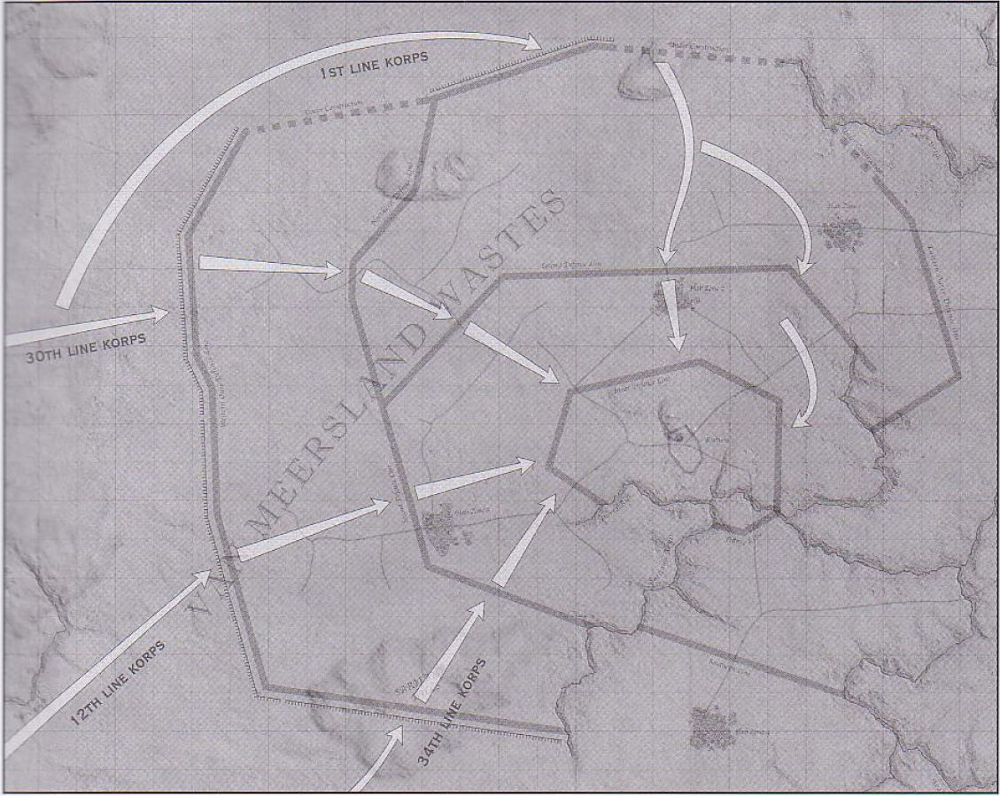

弗拉克斯攻城战将是一场炮手的战争。下图展现的是一个炮兵阵地上，在两次射击任务之间，炮手们正在卸下额外的弹药（第21页）：

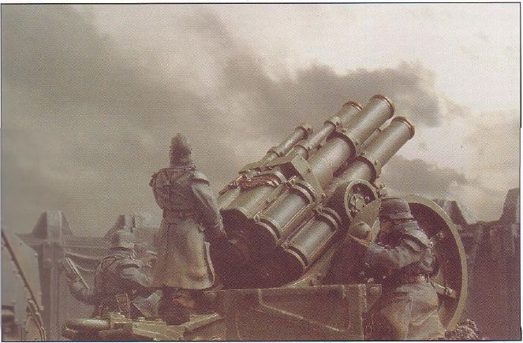

这是一队走在行军纵队前头的死亡骑兵，他们要侦察敌军阵地，并掩护行进中的部队（第21页）：

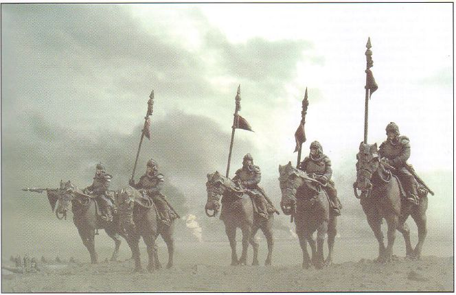

一位死亡骑兵（第23页）：

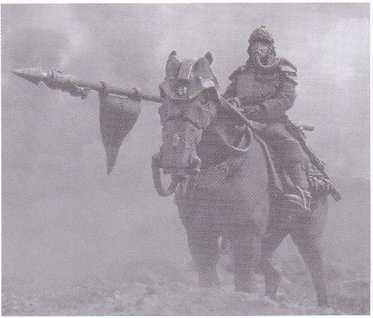

重型火炮是攻城团的中坚火力，它们一旦布置好了之后，就可能要呆在阵地上长达数月，有时是数年之久（第24页）：

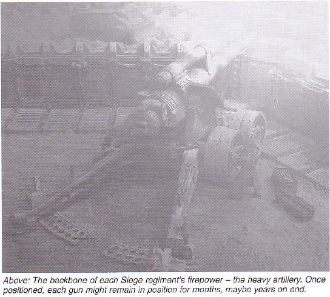

在地狱犬（Hellhound）喷火坦克的支援下，一个克里格步兵班正向敌军战壕投掷手榴弹，要把敌人炸出来（第25页）：

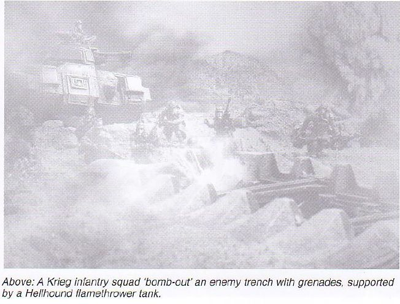

这张图展示的是突破外层防线的战斗中，莱曼·拉斯主战坦克向A-453要塞进攻的场景（第26页）：

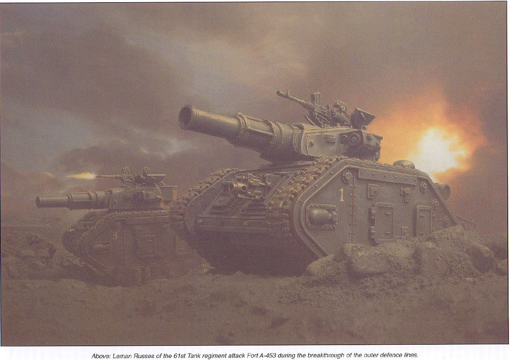

毒雾笼罩在第261团第29野战炮连的重型迫击炮上空（第27页）：

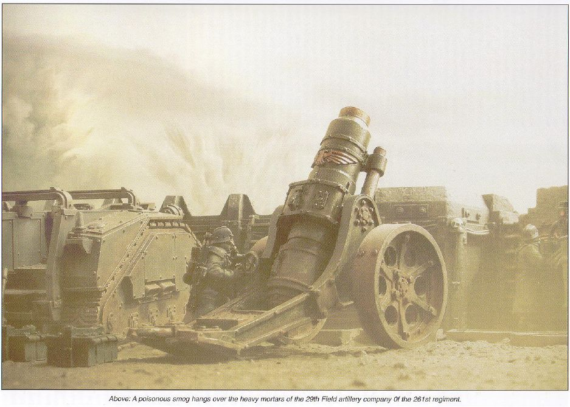

前沿堑壕里的一个自动炮组正监视着无人地带（第28页）：

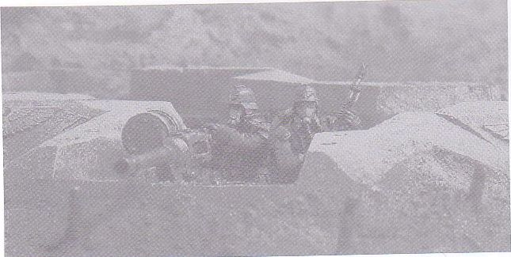

突破期间，一辆半人马运输车载着一个步兵指挥班前进（第28页）：

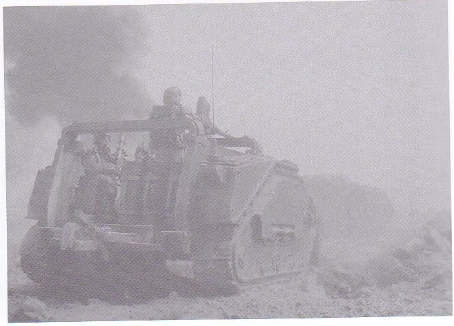

第261团在A-453要塞达成突破之后，第8突击军从突破口进入，扩大突破口。敌人除了留下少量后卫部队断后之外，全都撤向第二道防线（第29页）：

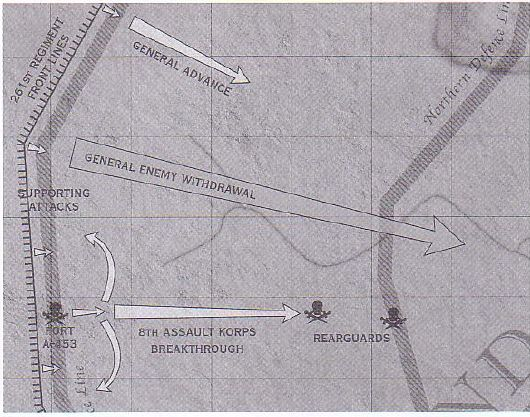

一辆戈尔贡突击运输车轰隆隆地向前开进，后面有一个激光炮组正以它为掩护（第29页）：

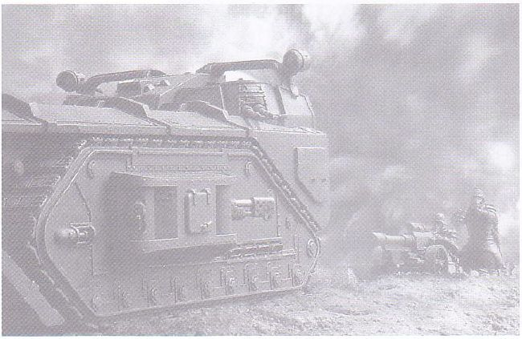

第8突击军第179团的一辆戈尔贡重型突击运输车（第30页）：

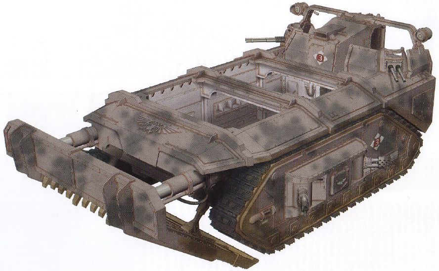

第7坦克团的一辆戈尔贡重型突击运输车，配属于第143团（第31页）：

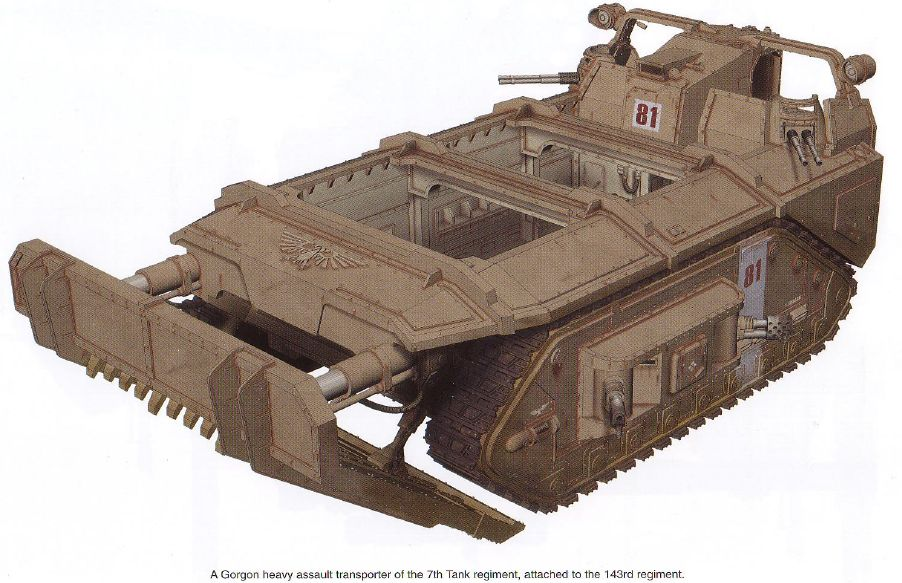

第143团第45炮兵连的一门撼地炮（第32页）：

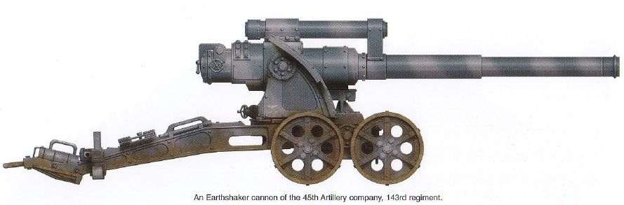

第4独立炮兵连的一门撼地炮，战役期间曾配属于多个团（第32页）：

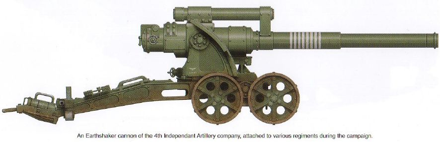

第61坦克团的一辆莱曼·拉斯主战坦克，它是第1连1排的3号车。请注意它的战斗炮炮管是更换过的（第33页）：

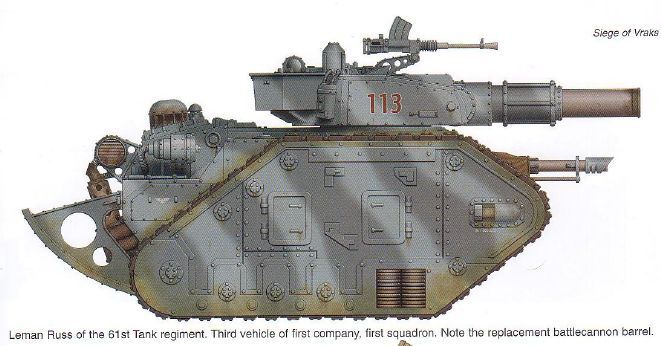

第7坦克团1连的莱曼·拉斯粉碎者（Demolisher）坦克，它是9号车（第33页）：

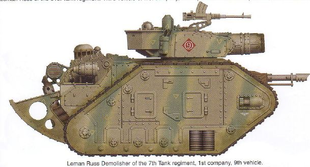

第7坦克团的莱曼·拉斯胜利者（Vanquisher）坦克，它是第17连的指挥坦克（第33页）：

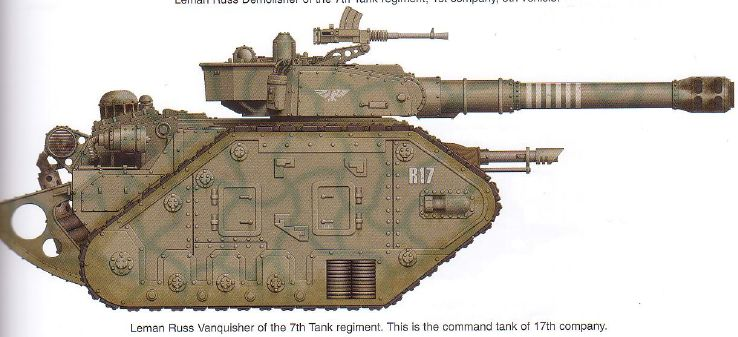

第143团第1野战炮连C排的重型迫击炮与半人马运输车（第34页）：

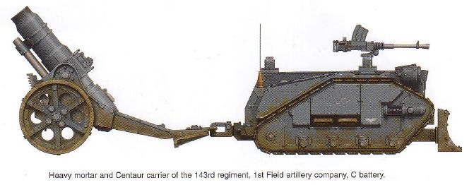

第19团第38野战炮连的重型迫击炮（第34页）：

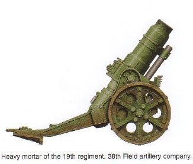

第261团第8野战炮连的重型迫击炮（第34页）：

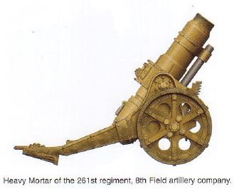

第19团的半人马运输车（第34页）：

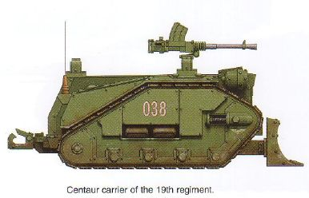

第143团第1野战炮连B排的重型四管迫击炮和半人马运输车（第35页）：

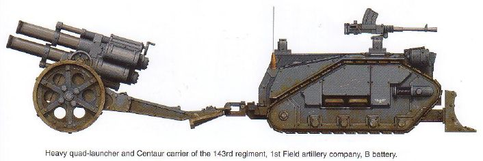

第19团第2野战炮连的重型四管迫击炮（第35页）：

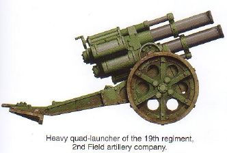

第33独立炮兵连的重型四管迫击炮和它发射的标准高爆炮弹（第35页）：

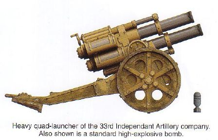

第143团207炮兵连的半人马运输车，这是该连连长的运输车（第35页）：

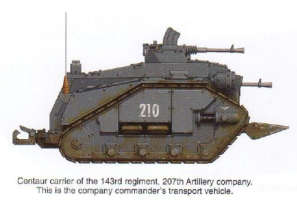

被叛军缴获使用的莱曼·拉斯主战坦克，炮塔上的“44”被混沌符号盖住了（第36页）：

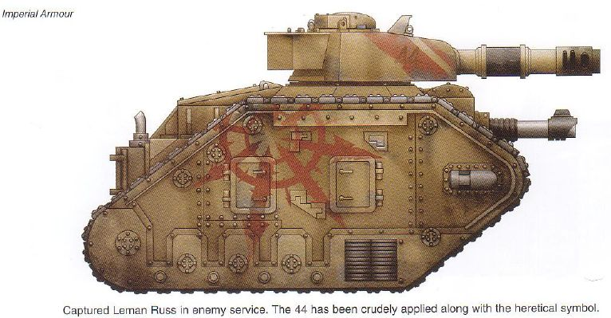

被叛军缴获使用的毒蜥自行火炮，叛军保留了它原来的涂装（第36页）：

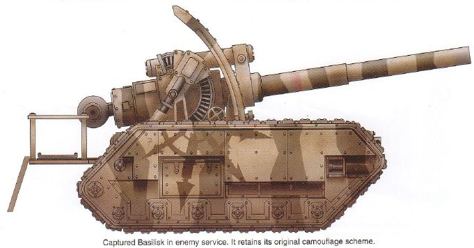

装备一门自动炮的奇美拉装甲运兵车，它在46-38区的一次反冲击中被击毁（第36页）：

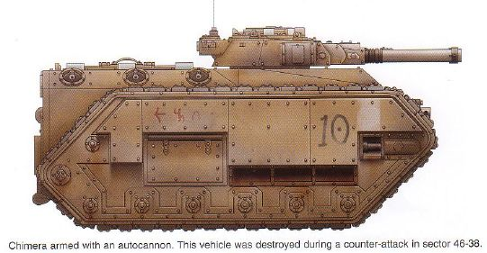

被缴获的狮鹫自行迫击炮，它原来的涂装上被加画了识别标志，它安装了内置式瞄准器（第37页）：

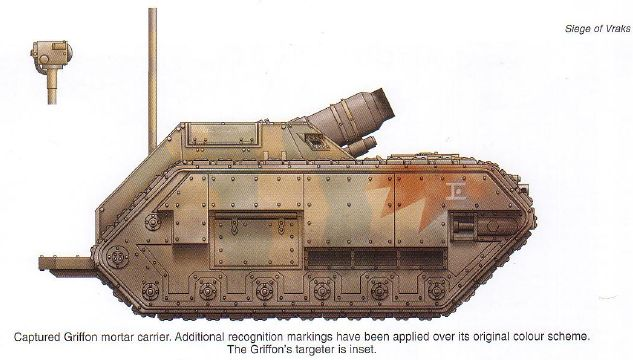

地狱犬喷火坦克，攻城战期间，双方都很喜欢这种坦克（第37页）：

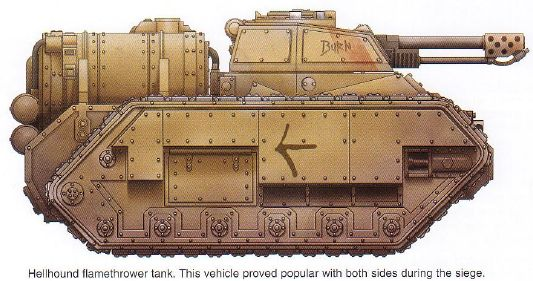

撼地炮平台，叛军把许多这种火炮提供给了了毒蜥自行火炮连（第37页）：

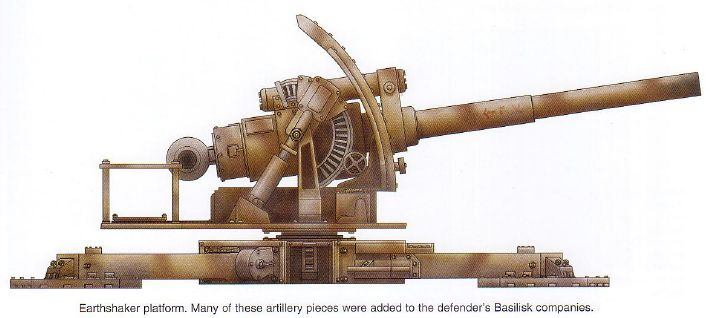
