# 第四章 消耗战

《帝国装甲第五卷-弗拉克斯攻城战（上）》剧情篇

CZ75

第四章 消耗战

“克里格人的战斗方式是无情的纪律和无私的牺牲.这赢得了所有人的敬重,无分敌我。”

——朦胧星域统帅

第1军的危机

克里格部队节节推进，叛军不得不撤退。叛军不但抛弃了外层防线，连北方防线也抛弃了。北方防线是第二道防线上的一个突出部，根据目前的形势，叛军认为已经无法守住它，就只好撤了出来。克里格第1、第30防线军经过一段时间修整之后，已经准备好再次进攻，现在它们正从北方防线的南翼向它包抄。而第12防线军将压制住它正面的所有敌人，然后将其分割。如果叛军继续坚守阵地，他们被包围和消灭只是个时间问题。因此，叛军不愿冒着覆没的危险守在无法守住的阵地上，向后撤退了。

第1、第30防线军发现敌军已遗弃了北方防线，便立刻推进。一路上仅仅遭到了敌军后卫部队、狙击手和无法避免的干扰炮火的轻微抵抗。第1军扫向东方，直奔第1居住区（hab-zone 1）而去。第1居住区正好位于城堡和宇宙港之间的一条主要道路上。当第1防线军向南方和东方行进时，它就可以形成对第二道防线的环形包围圈。

自从开战以来，两年多时间里，第88攻城集团军都是进攻的一方——弗拉克斯叛军更愿意坚守阵地，进行防御性作战，除了在必要的时候发动反击夺回失地，或对第88攻城集团军的战线进行奇袭之外，叛军没有采取过进攻性行动。但就在255815.M41，战略形势改变了。当第1防线军从北边逼近第二道防线时，它将遭遇到敌军自开战以来进行的首次攻势。

叛军虽然不放一枪就放弃了北方防线，但在北方防线和第二道防线之间的地段上组织了多次强有力的反击。叛军在第1居住区集结了可观的装甲预备队。莱曼·拉斯主战坦克、奇美拉装甲运兵车、毒蜥自行火炮和狮鹫（Griffon）自行重型迫击炮和它们的乘员都被特地保存下来，集中在这里，准备对克里格第1防线军进行反击。叛军打定主意，趁第1防线军离开了坚固的战壕，在开阔地上行军的时机，要狠狠地打击一下第1防线军。

第19攻城团在60-53区占领了临时阵地。它的前方观察哨报告说听见敌军的车辆整晚都在活动，而且，在试探敌军意图时，敌军的干扰炮击也随之增加，很显然是在阻止侦察行动。上级认为叛军可能会在局部地段发动反击，便补充了前方联队，在黎明时分下令全体待命准备战斗。士兵挖了一道新战壕（这道战壕大半段只是浅浅的壕沟），准备好了激光步枪。

最先抵达的是叛军的炮弹。先是试射弹四处落下，随后是集火射击倾泻在第19团的阵地上，弹幕就像惊涛骇浪一样袭来。重型炮弹中混杂着烟幕弹，它们喷出浓浓的白烟，遮蔽了整个战场。敌军接着烟幕掩护发动了第一波攻击。驾驶员踩下油门，坦克与装甲运兵车碾过崎岖不平的荒原前进。在他们后面，太阳刚刚升起，在进攻者掀起的尘埃后面投射出一个苍白的圆。当叛军的攻击队形到达防御阵地时，炮击停止了。

车辆不断接近，它们发动机的声音穿过烟尘，听起来就像地狱的铁匠铺开张了。坦克发炮轰击前沿战壕，炮弹接连在拥挤的战壕里爆炸，炸出一个一个血口子。第19团全线告急，到处都报告说发现了坦克和奇美拉装甲运兵车。敌军步步进逼，他们的步兵从奇美拉和坦克上跳下来，呼着渎神的口号，手里拿着刺刀、斧头和砍刀，不顾一切地冲向克里格士兵。克里格部队则以激光步枪、重机枪和重型爆矢枪回击。可是，叛军的坦克向战壕射击，战壕被炸毁了，成吨的泥土倒塌了，把整个班的士兵活埋在里面。叛军像狼一样成群结队地狩猎，子弹和坦克炮弹纷纷扫过荒地。

克里格部队接二连三地被击退，他们遭到了敌方强大的坦克部队。第22野战炮兵连B排的四门四管火箭炮一直在向通过开阔地逼近的敌军射击，直到上级下令撤退为止。当半人马（Centaur）运输车来牵引火炮时，他们突然遭到了一阵猛烈的炮击，两门火箭炮和三辆运输车瞬间被摧毁。第三门火箭炮也不得不，炮手朝火箭炮的四根炮管里各丢一枚反坦克手榴弹，彻底摧毁了它。B排最后一门火箭炮刚刚连上运输车，就又被落在它旁边的坦克炮弹的爆炸震得脱开了。此时，敌军步兵已经占领了他们丢弃的发射阵地。

第19团团长阿达尔（Adal）上校在指挥所里透过双筒望远镜观察战斗，即使炮击炸起了漫天烟雾，他还是能明白战况。阵地失守的消息不断传来，他能看见敌军坦克正在逼近并摧毁前沿阵地。阿达尔将预备队中的连队调上前线，试图阻挡敌军攻势。他还向军长求援。敌军装甲部队正在给他的防线施加强大压力，而敌军的后援部队还在不断赶来。如果无法从军预备队得到步兵、炮兵和坦克，他是守不住阵地的。得不到增援，他就只能后撤，建立一条新防线。

上级答复说：没有增援，他必须以手上的兵力守住阵地，不许撤退。但第19团防线面临的压力越来越大，阿达尔上校很清楚，一旦第二战壕被攻破，他就只能撤退，或者直接面对迎上敌军的矛头。他把尚未接敌的几个连队小心地保存下来，迅速建立了一道围绕着他的指挥所的新防线。

整个白天，战斗都在持续。下午十分，双方都开始毁灭性的炮击。攻防双方绞在了一起，一条壕沟里的人往往会发现敌人就在紧挨着他们的另一条壕沟里。在这一片混乱之中，敌人凭借着坦克部队的强劲火力，牢牢控制着阵地。即使在Adal的猛烈炮击下，叛军也没有后退一步，反倒是借着地形掩护，匍匐前进，发起了反冲击。一天之内就有十九个四管火箭炮和重型迫击炮阵地落入敌手。敌人往往一占领这些阵地就立刻利用缴获的火炮射击，直到弹药耗尽为止。日落之后，战斗开始停息，但整晚双方都在互相试探，不过每次试探都被对方击退了。战局一片混乱，战场上没有一条清晰的展现，双方部队犬牙交错，乱成一团。

黎明时分，敌军再次进攻。头一炮仍是炮兵打响的，敌军炮兵的炮弹再次弹如雨下，第19团的炮兵则还以颜色.叛军步兵冒着炮火前进，士兵们在每条战壕中浴血奋战。老天似乎被感动了，下起了雷阵雨，大雨倾盘而下，战场马上变成了一片泥塘，但敌军坦克仍顶着暴雨前进。阿达尔上校在指挥所看见了正在接近的敌军，沉着地指挥部队应战。敌军炮弹不断在他周围炸开，一发炮弹打穿了他的避弹所顶棚，幸亏当时他不在里面。他就在自己的士兵中间，观察着他们战斗。敌军很快就到了指挥所不远处，顿时弹雨横飞，他们临时设置的路障也被坦克击毁了。敌人的首次进攻被击退了，上校自己也手持激光步枪在沙包后射击。敌军的第二次进攻也被击退了，但敌人占领了上校左右的壕沟，把上校和他的士兵包围了起来。上校唯一一条退路已经暴露于敌军火力之下，他的指挥避弹所再次被坦克击中，而他的副手迪内（Dyneh）上校也阵亡了。上校手下只剩下了八十人，而他与后方的联系也被切断了。上校下令：所有伤员立刻尽力撤离，并把幸存者分为两批，第一批人要尽力突围，将敌军突破的消息通知后方，而他自己将指挥后卫部队尽力坚守，为撤退争取时间，他们将坚持到援军抵达或他自己阵亡为止。他知道自己获救的希望非常渺茫，但只有一息尚存，他就会继续战斗下去。

撤退部队拼命翻过胸墙，借着弹坑，躲避着敌军火力，尽力奔逃。逃回去的人把上校的报告交给了上级。而留下来和上校一起断后的人则英勇地战斗到最后一刻。关于上校最后的命运的，人们只知道：敌人调来了一辆地狱犬（Hellhound）喷火坦克烧毁了他的指挥所，他当场就被火焰烧死了。

失去了指挥所，第二防线也守不住了。第19团的形势已无法挽救，他们失去了团长，也没有任何人能协调全团的行动。被分割包围的各部队仍在战斗，但是，作为一个整体的第19团已经筋疲力尽。成百上千的掉队士兵拼命向后跑，一路上炮兵阵地上的火炮都已经连上拖车，拉到安全的地方，以防敌军夺取它们。在混乱的撤退中，大批装备和物资不得不遗弃。现在第1防线军必须竭尽全力来抵挡敌人凶猛的突袭。

敌军猛攻两日之后终于获得了突破，第1防线军面临着一场危机。在第1防线军左翼的第19团被击溃后，第1防线军的整个战线都有被敌人从侧翼包围的危险。现在死亡军团不得不撤退，就像敌军在不久之前做的那样。为了迅速撤退到第一道防线的可防御阵地上，不得不放弃大片以惨重伤亡为代价换来的土地。在第一道防线上是可以顶住敌军的进攻，但这意味着要尽快行动。目前的第一要务是延迟敌军的攻势，要尽可能地争取时间让其他团重新部署。第1军集结了第7坦克团和幸存的第19团的死亡骑兵连队，将他们部署在敌军的前进方向上，希望能尽量拖延敌军。要阻止敌军进攻，这些部队是不够的，但他们争取到的每一分每一秒对第1军来说都是至关重要的。第261团（译注：原文如此，但这很奇怪，因为第261团隶属于第30防线军而不是第1防线军）接到命令，转向侧翼并掘壕据守，而其他团则奉命撤退。这次撤退是一个大退步，它延迟了屈尔克司令战役计划的实施。

敌军勇猛的反击和突破影响了整个第88攻城集团军的态势。第88攻城集团军全线停止进攻，因为物资要优先供应第1防线军。第8突击军集合起来，出发救援第1军。第8突击军将成为抵挡敌军下一次突破的最后屏障，如果再来这么一次突破的话，敌军也许占领不了多少有价值的地方，但却能赢得整个战争。主动权已经落到了敌人手里。

第三天，敌军坦克仍在不断推进，但第1军总算重新部署了一些部队来阻击敌人。这些部队是无法阻止敌军推进的，但他们将尽量争取时间，好让士兵、装备、武器和物资能往北撤退。第7坦克团已占领阵地准备迎击敌人，它共有莱曼·拉斯主战坦克和马卡里乌斯（Macharius）重型坦克五十二辆，而它面前的敌人至少有一百辆坦克，如果情报属实，还会继续增加。第15坦克连连长是格尔森（Gersvanqzon）上尉，他乘一辆胜利者（Vanquisher）坦克（莱曼·拉斯主战坦克的一种派生型号）指挥全连。第19团的溃兵向后跑，格尔森上尉指挥各排向前，没过多久，他远远一炮，击中了一辆敌军坦克，一团黑烟在目标头上升起。车长从潜望镜中看到，敌军坦克炮塔迸裂开来，然后里头炸开一团火花。敌军步步逼近，穿甲弹你来我往。一发炮塔擦伤了格尔森的炮塔，另一发打坏了装在车体正面的激光炮，炮手重伤。格尔森又打中了两辆坦克，随后他的坦克第三次中弹，这次打坏了一个油罐，燃料开始泄漏，他下令乘员弃车。剩余的三名乘员刚跳出舱门，燃料就被点燃了，胜利者坦克消失在一团火光中，橙红色的火球直冲云霄。格尔森上尉指挥的十二辆坦克里只剩四辆还能战斗，但他数了一下，敌人至少有十六辆坦克正在起火。他命令剩下的坦克撤退，此时他看见一队死亡骑兵放平了长矛，绝望而又勇猛地向前冲锋。克里格人且战且退，一天之后就只剩下了两辆马卡里乌斯重型坦克和九辆莱曼·拉斯主战坦克，但敌人的损失不比他们小。敌军的装甲矛头已经被磨钝了。

阻滞行动继续了好几天，每一天，敌人占领的地盘都比前一天少。三天后，敌军的反击终于停止了，但是这次反击给第1军造成了重创，并迫使第1军放弃了此前夺取的大片土地。第19攻城团在反击的头两天中被打散，伤亡、被俘八万多人（包括团长在内）。敌军的损失同样惨重，尤其是装甲车辆损失甚多。第1军在这场苦战中付出的代价不光是兵员、物资和土地的损失。这场好不容易才扭转的灾难意味着一件事，此前的攻势并未像人们期待的那样削弱敌人，敌人反而越战越勇，他们有了时间去重组防线、获取武器、组织预备队并将其调入阵地，第二道防线现在更难啃了。

第二道防线之战

当突破中的各军遭到敌军突然反扑、第1军陷入危机之后，其他三个军的正在前进的团接到命令，立刻停止进军。对第二道防线的进攻将不再采用莽撞的打法，而将以稳妥、谨慎的方式进行。第二道防线比第一道更密、更坚固，敌军反击成功之后，已经稳稳地占据了它。要想逐层、逐段地攻占第二道防线，只会招致失败。第二道防线必将被攻克，就像第一段防线那样，但却要通过缓慢的消耗来拖垮它。

先头的各步兵连又拿起了掘壕工具。阿特拉斯挖掘者再次被召唤上前。士兵们在前不久退守的战壕里再次开始了挖掘工作，把战壕进一步扩展。在炮兵火力掩护下，克里格军团将缓慢地把他们的战壕向前延伸，一码一码地接近敌军防线。

烦人的工作又得重新开始。战壕不断延伸，交通壕从前线伸向后方，将不久前刚刚成为前线的战壕连接在一起。范·梅尔斯兰德荒原布满了密如蛛网的战壕，日复一日，战壕网变成了迷宫。冒险跑到自己所属的地域之外的人很容易就会迷路。而无论何时都会有的炮火袭扰又开始了——火炮和迫击炮炮弹会毫无预兆地炸响，使得突然、毫无规律、无法预测的死亡成了家常便饭。双方都竭力使对方无法接近自己的前沿阵地。

120816.M41，第88攻城集团军再次发动了攻势。至少六个团全力投入了这次全面进攻。各团不顾骇人的伤亡，日复一日地进行着攻击，战场上布满了倒塌的地堡、扭曲的战壕、生锈的铁丝网和堆在士兵死亡处的累累白骨……整条战线上，攻击以一种单调、枯燥而又可怕的方式进行了几个月：几小时的饱和炮击之后，克里格士兵们就涌出战壕，冲向敌阵，扑向敌人的战壕、防线或地堡。大多数情况下，进攻都被打退了，只给无人地带里的尸堆又增加了一层尸体。在一些地方，克里格兵团的突袭是的手了，进攻者占据了防御者的阵地，但敌军的火炮早已装定好了坐标，对进攻者发射出准确的反击炮火，将进攻者孤立在新阵地上。当敌军炮兵猛烈地持续射击时，敌军的步兵将在进攻者的援军抵达之前发动反突击。用手榴弹、刺刀和铁锹进行肉搏战，将克里格士兵打回去克里格兵团的步兵就像潮起潮落一般，进攻，然后被击退。

尽管几乎每一次攻击都会失败，进攻仍然不屈不挠地、周而复始地进行着。今天，进攻在一个区受阻，那么明天，进攻就会在更广的范围里进行，目标区邻近的区域也要遭到攻击，摧毁其侧翼火力。不把一个关键区域的邻近区域都拿下来，是攻不下这个关键区域的。要攻占每个区域的关键就是先攻占它的侧翼，依次类推，攻破一条防线的关键就是占据防线的侧翼，最后，整个团都得进攻，因为单靠一个连无法达成目标。结果每一点进展都是微不足道的，而且永远有新的侧翼要去攻占。几个月里，克里格兵团发动了数百次进攻，但却没能成功突破，僵持中，一年又这么过去了。

在北方，第1军在得到了来自克里格的新部队补充之后，开始了新的进攻。在布满了坦克和装甲运兵车残骸的荒原上，战壕不断延伸向前，第1军不久前夺取了这片土地，然后很快又失去了它。敌军仍然在继续进行遭遇战和袭扰战，但仍然不忘加固防线，否则据点就会被克里格兵团的火炮摧毁了。在开阔地和比较浅的壕沟里的敌军遭到了此前从未遇到过的猛烈炮火袭击。克里格炮兵反复地轰击敌人，迫使敌军撤退，不撤退的敌人就只能等着被消灭。在敌军反击中丢失的土地慢慢地被夺回来了，丧失这片土地只用了一个星期，却花了克里格兵团六个月的时间来夺回它。这年年底，一号居住区被克里格炮兵系统地摧毁了，然后步兵几乎没经过战斗就占领了它。这次攻击之后，该居住区的预制房屋就被从地图上抹掉了。第1军终于打到了第二道防线，在从62-47区到54-38区之间约长250千米的阵地上包围了城堡。

在第88集团军推进的过程中，它攻占了弗拉克斯的许多外层仓库。这些仓库都是设在地下的大型暗堡，可用大型升降机降到地下洞穴里的仓库里，但仓库里储备的各种军需物资早已被敌人运到了堡垒里，以更好地保护它们，使其不落入帝国之手。这些供给品是叛军的生命线，全靠它们，叛军才能与拥有充足后勤保障的克里格兵团战斗。每天，列车都为克里格兵团运来几百吨炮弹，一起运来的还有新的炮管和炮闩，用来替换因过度使用而磨损的旧炮管和旧炮闩。但是，很明显地，敌人目前仍未显出物资匮乏的样子，这场消耗战还得继续下去。

无情的循环周而复始，弗拉克斯攻城战就像一头贪得无厌的野兽，每天都要吞下无数的士兵和装备。无止境的炮火对轰在前沿地带炸出了一个又一个弹坑，有些地方，弹坑一个叠着一个，居然深达几十英尺。无人地带再次成了杀场，散落着累累尸体，阴森的毒雾、密集的尘埃、无烟火药、烟雾与刺激性气体始终笼罩着这里。又一年过去了。再一年过去了。情况再次恶化了。无论克里格团队在哪里取得了进展，敌军很快都会发动反突击，夺回失地。

大多数时候，各团只能勉强守住战线，在整个前线保持进攻态势是既不可能也不必要的。当然，这并不是说，前线是一片安宁或“西线无战事”。即使是双方都不准备进攻的时候，双方都以攻击性行动向对方施加压力，让对方不得安宁，自然，这些行动会不可避免地引起对方的回应。前线上的小规模战斗频繁发生，造成了伤亡，特别是晚上的“轰炸”奇袭，在这种行动中，一小队士兵趁夜色悄悄穿过无人地带，渗入对方展现，往敌人阵地上丢出一堆手榴弹，然后撤回己方防线。奇袭小队还会趁敌方哨兵不备，打昏哨兵，拖回己方审问。双方都使用了持续袭扰战术，不让对方轻易穿过无人地带。这类小规模行动的目的并不是夺取土地，双方也不鼓励进行连、排级的小规模进攻，即使是在对敌方的行动进行还击时也不允许，因为在整个战争的大背景下，夺取一小片土地是没有什么意义的。其结果就是，在很长一段时间（有几年之久）里，战线总体上是静止的。克里格指挥官们要的是一次大规模突破，而要达成这一点，首先必须削弱敌人，随后在一次大规模攻势中，在各兵种的协助下粉碎敌人。

649818.M41，第158团在50-45区发动了一次大规模袭击，其目标是夺取并破坏一个地下激光发射井，它是弗拉克斯轨道防御网的一部分。这个发射井建在地下很深的地方，可以抵挡轨道轰炸，所以任何炮击都不会对它产生多少伤害。因此，里面的守军也会很安全。为了保持攻击的突然性，克里格兵团将不进行炮火准备就发动进攻。首先由掷弹兵班趁夜幕掩护穿过无人地带，渗透进地面上的守军阵地，消灭守军，夺取地表阵地，随后步兵在黎明时夺取发射井。该发射井大部分都在地下，地表防线由铁丝网、密集的雷区和几个加强的炮兵阵地组成。

在一个漆黑的夜晚，掷弹兵出发了，他们悄悄地潜入无人地带，爬过烂泥地里的一个又一个弹坑。 每当照明弹在头上炸响，照得周围一片亮堂堂时，他们就停止不动，或干脆装死。照明弹一熄，他们又开始往前爬。在伸手不见五指的黑暗里很难找对路，有几个班走散了，其中一个班撞上了一支敌军巡逻队，这支巡逻队可能是过来侦察或是伺机朝战壕里丢几捆手榴弹的。一场短暂的交火爆发了，但在敌军哨兵看来，这不过是又一次发生在无人地带的夜间冲突而已。

其他各班抵达目的地之后，发现四下一片寂静，便立刻剪起第一道铁丝网来。正当他们顺着剪开的口子匍匐前进时，一枚照明弹突然在他们头上爆炸，四周马上笼罩在一片亮堂堂的黄光里。掷弹兵们立刻停止了一切动作，但还是有一个视力惊人的哨兵发现周界（译注：：筑有防御工事的地带或边界，常用以保护一军事地点）内出现了几个奇怪的影子。警觉的哨兵立刻大叫起来，向夜幕中射出了激光。顿时枪声大作，一挺重型爆矢枪吼叫起来，向仍困在铁丝网上的掷弹兵扫射。在防线后面的营房里，军官咆哮着，把士兵们从被窝里叫醒。

奇袭已经被识破了。掷弹兵们现在只能前进或撤退，如果继续呆在铁丝网地带，就等于听任敌人宰杀。先头各班爬过铁丝网，不顾雷区向前冲锋。夜幕被阵阵爆炸照亮，发射井中传出了枪炮声，一个掷弹兵军士正在对部下下令，要他们跟他去冲击最近的一个地堡，却被一发重型爆矢弹炸飞了脑袋。铁丝网后面火焰熊熊燃烧，手榴弹到处爆炸，处处都能听见伤员的嚎叫。一个地堡被火焰喷射器的射流吞没了，火光照出了到处寻找掩护的掷弹兵的影子。在后面，敌军首批步兵班已经赶到，纷纷进入战壕操作武器。到处都爆发了战斗。

当一股淡绿色的霞光宣告黎明来临时，发射井已被烟雾和灰尘覆盖了。克里格军官在己方战壕里，透过扫描装置观察着战争，但他们能得到的消息非常少。完成任务的消息仍没有传来，但也没有一个幸存的进攻者回来报告失败。战斗仍在继续。继续进攻的命令按计划下达了，各步兵连准时冲出战壕，冲向无人地带。但是，新的进攻者并不知道，掷弹兵的进攻已经失败了。在夜间混战中，掷弹兵没能清除敌军地表防线，后续的步兵便不得不在开阔地上向敌军重武器进攻。很快，老一套又重新上演了。守军的强大火力把进攻者压在地上，随后守军炮兵开始齐射，把无人地带变成了关满了被烧死、被震死、被炸碎的士兵的停尸房。幸存者很快稀稀拉拉地撤回己方战壕中。作为回应，“轰击”炮兵连瞄准发射井射击，将守军轰得一塌糊涂，爆炸的巨响不断在无人地带回响。第二天，当浓密的尘埃云散去后，发射井露出了表面的伤痕，但它仍然完好，功能并未受损。这是一场艰苦的交战，但这种类型的战斗每天都在前线进行着。在这次无望的进攻中，有数百人阵亡，毫无疑问，进攻者要比守军死得多。参加进攻的掷弹兵只有几个人回到了己方战线。绝大多数都阵亡了，被被俘的人则遭到严刑拷打以获取情报，然后被处决了。他们的尸体被挂在铁丝网上，以向进攻者警示他们的命运。

新的威胁

自从第一次排炮（那是官方认定的这次攻城战的开始）之后，艰苦卓绝的七年过去了，在这七年里，克里格军团付出了几百万人死亡的代价，却仅仅推进了几十里。双方均有得有失，损失惨重，但双方都没有显出崩溃的迹象。

820.M41，一份新报告报告传到了屈尔克设在色雷斯一号上的司令部，这份报告引起了一阵惊慌，它不但报告说，进度仍然落后于计划，而且守军得到了援军。第261团进攻52-49区时，几辆戈尔贡突击运输车已经突破了敌军防线，形成了在第二道防线上打开突破口的威胁时，敌军一如既往地发动了反击，但这次，反击者竟然是装备了动力盔甲的星际陆战队员。穿着深蓝色盔甲的星际陆战队员发动了一次短促的反突击，很快就堵住了缺口，所有的戈尔贡都在战斗中被击毁了。

星际陆战队怎么可能站在弗拉克斯叛军一边作战呢？不论他们是谁，这都意味着战局将朝不利的一面发展。由于弗拉克斯的特殊环境，没有星际陆战队的部队被派到这里来，也没有哪个战团长愿意让自己的战斗修士在一场进展缓慢的消耗战中牺牲。战争本来已经陷入了僵局，但这些援军将让胜利的天平朝守军一方倾泻。

屈尔克司令派出信使去向朦胧星域统帅求助，请他帮忙识别出现在弗拉克斯的星际陆战队来自哪个战团，同时屈尔克还请求增调一个新的防线军，屈尔克认为这样就能让战役赶上进度，并打破第二道防线上的僵局。申请更多士兵的报告进入了军务部系统，官员们开始征集克里格上的多余士兵。至于那些神秘的星际陆战队员的真实身份依然不得而知，分布在朦胧星域内穿深蓝色盔甲的战团的各连都有案可查。结论是：这些陆战队员隶属于叛国军团（Traitor Legionnaires），他们是被这场激烈的战斗引来的，他们的目的是要通过增加杀戮来获得他们崇拜的邪神的青睐。屈尔克的司令部采取了一系列行动来对付新威胁。

第88攻城集团军的指挥官并不知道，弗拉克斯确实吸引了叛国军团。一个叛国者听说了叛乱及之后发生的战斗的消息，然后选择了加入这场战争，他就是阿尔科斯领主（Lord Arkos），前阿尔法军团（Alpha Legiion）连长。他的战斗旗舰“混乱之心”号（Anarchy's Heart）潜入了弗拉克斯星系，在宇宙港着陆之后，他的战斗修士们登上了弗拉克斯。他们伪装出新部署到这里的忠于皇帝的星际陆战队员，越过了克里格军团的战线，然后假装要发动一次进攻，穿过无人地带，抵达了城堡。阿尔科斯及其部下在城堡中出现后，宣布以所有混沌邪神的名义提供支援。阿尔科斯不但带来了强大的、擅长奇袭和在敌后制造混乱的老兵，还负责训练民兵。他可以把自己的作战经验传授给民兵，教他们怎么打这场防御战。而对他以及邪神忠心不二的兄弟们，则会好好珍惜这次参战的机会。阿尔科斯建议说，弗拉克斯应该成为打碎斯卡卢斯行省的一块铁砧，如果叛乱能在这里胜利，那就能在未来带来更大的胜利。一次成功的造反将在别处点燃另一场叛乱，他有很多盟友已经准备好煽风点火了。他还保证说，更多的盟友将会追随他而来，其他的战队知道弗拉克斯之后也会赶来助战的。萨凡主教认为阿尔科斯领主是一个非常有用的强大盟友，感激地接受了他的支援。阿尔科斯富有经验的兄弟们立刻投入了工作。

这份图表描绘出了突破后的进军、叛军的反攻和第1防线军各团的撤退（第38页）：

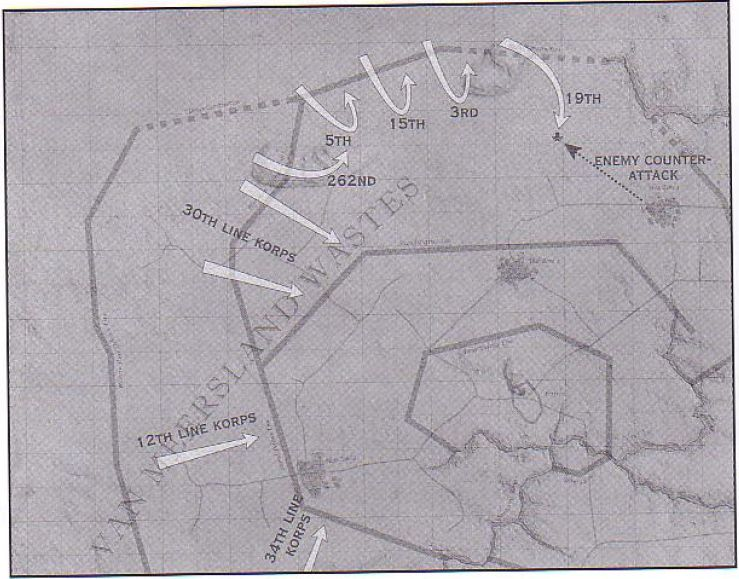

克里格士兵冒着炮火强攻敌军阵地（第39页）：

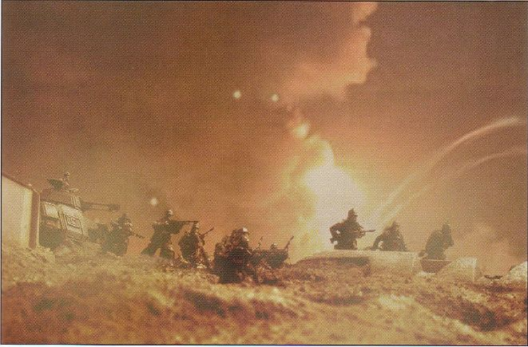

第7坦克团的坦克在无人地带行动（第39页）：

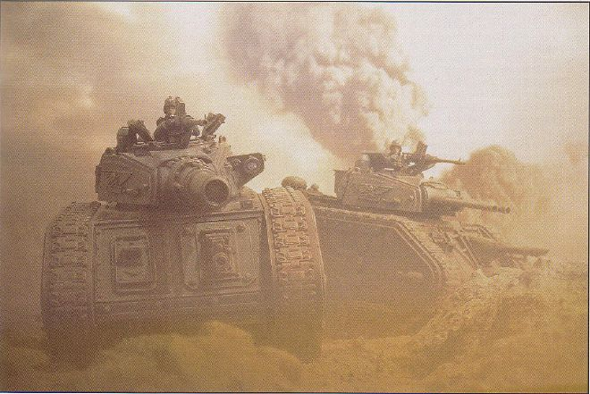

一个四管迫击炮阵地（第41页）：

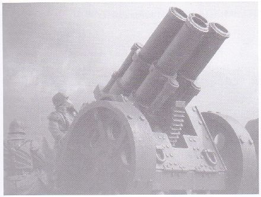

在46-62区，士兵乘着戈尔贡突击运输车，冒着敌军炮火穿过无人地带（第44页）：

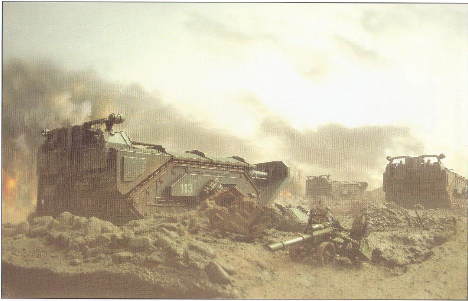

第7坦克团的坦克支援第310团进攻第二道防线，背景是萨利塔马丘陵的群峰（第45页）：

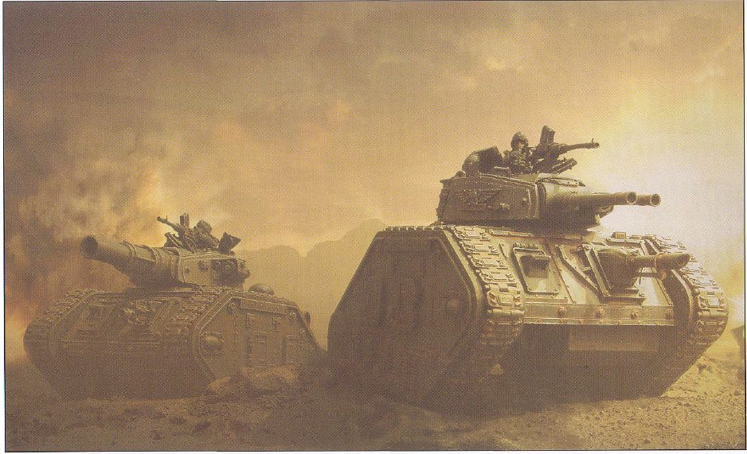

第66坦克团的毒刃超重型坦克，它是第9连第3排的指挥车，注意发动机盖上加装的空气过滤器（第48页）：

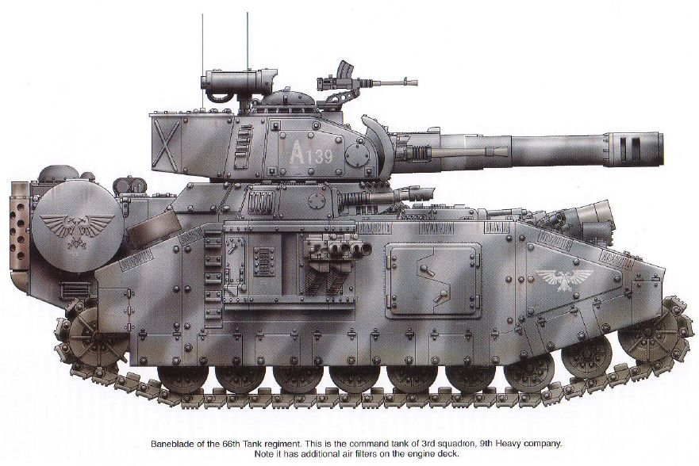

第47掷弹兵班的半人马运输车，该班配属于第179团第13连（第49页）：

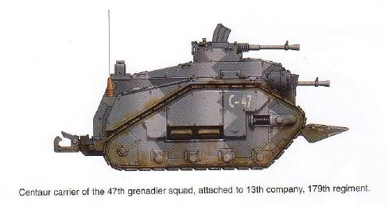

第4掷弹兵班的半人马运输车，该班配属于第19团A连1排（第49页）：

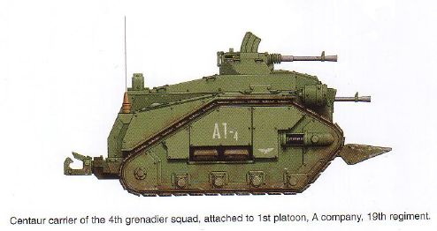

第3掷弹兵班的半人马运输车，该班配属于第143团第10连（第49页）：

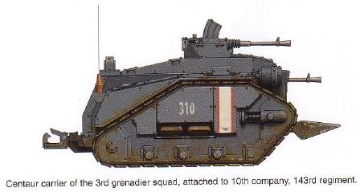

第143团第14炮兵连C排的美杜莎攻城炮（第50页）：

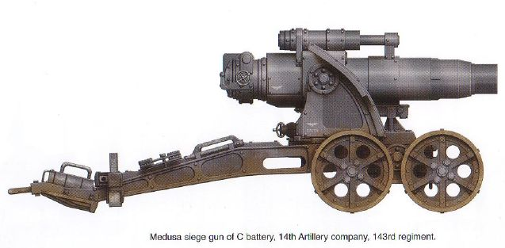

第19炮击军第73攻城炮连的美杜莎攻城炮（第50页）：

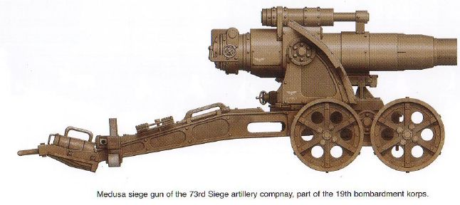

第179团的地狱犬喷火坦克，它在59-49区支援掷弹兵进攻时被击毁（第51页）：

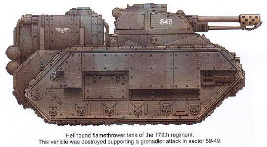

第179团的咆哮者（Thunderer）攻城坦克，请注意这辆车发动机盖上的附加过滤器（第51页）：

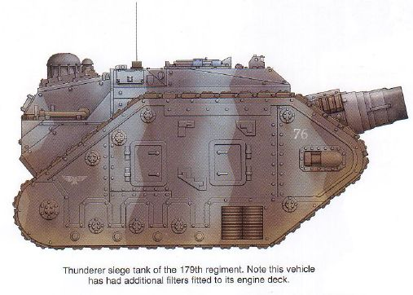

独眼巨人（Cyclops）遥控爆破车，它被广泛用于摧毁敌人地堡和碉堡的行动，尽管它们中有许多还没通过无人地带就被击毁了（第51页）：

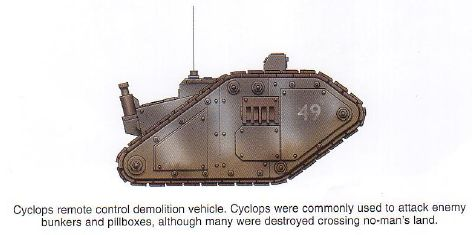

第61坦克团第7连的暴风之刃（Stormblade）超重型坦克，攻城战开始时第7连有3辆车，后来在战斗中都被击毁了，这辆车是后来补充的（第52页）：

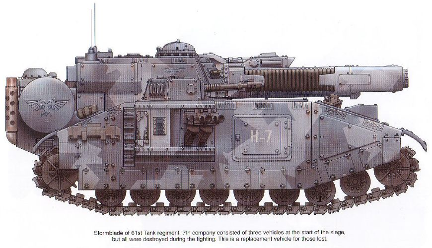

第11坦克团第18重型坦克连的毒刃坦克，该车在53-50区触雷后不能动弹，乘员为了不让它落入敌军之手，自己破坏了它（第53页）：

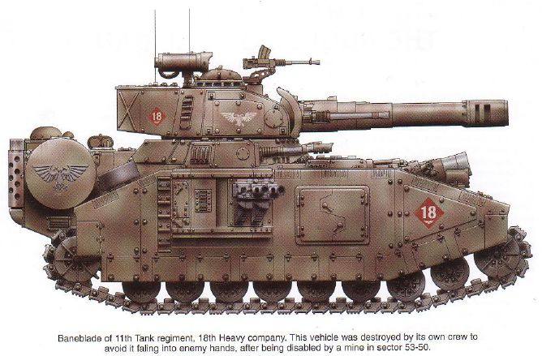

第19团第13攻城炮连的轰击（Bombard）型重型攻城迫击炮，它是第13连的8号车（第53页）：

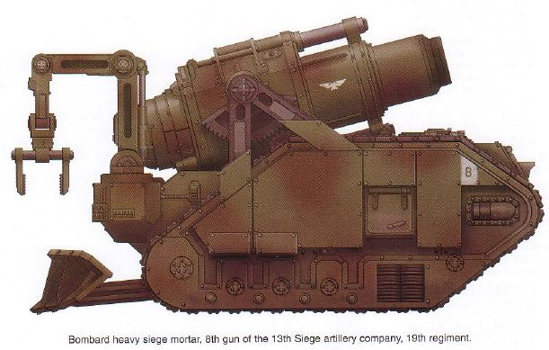

弗拉克斯叛军民兵

这是弗拉克斯民兵的一个无名士兵。弗拉克斯守军的制服标准化程度很低，由于缺少标志，使得人们无法识别连、排、班（第42页）：

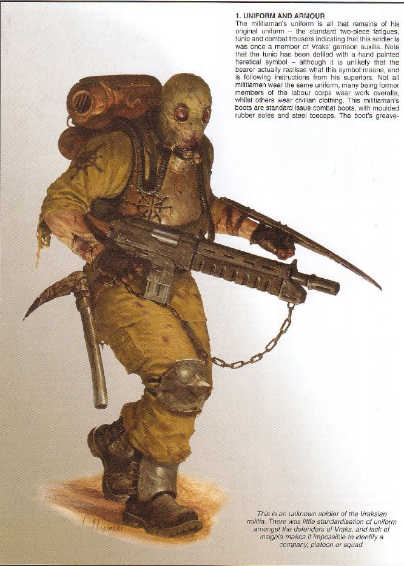

（第43页）：

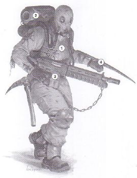

1、制服与盔甲

这个民兵的制服有一部分来自他原来穿的那套，从标准的两件套杂役服、上衣和作战裤可以看出他曾是弗拉克斯辅助卫队的一员。注意他的上衣，他在上面涂了一个亵渎的异端标志——尽管他自己可能并不清楚其含义，仅仅是上级吩咐他这么涂他就涂了。并非所有的民兵都穿同样的制服，许多曾参加劳工队的民兵穿着工作用罩衫，其他人则穿着平民服装。这个民兵的靴子是标准型作战靴，有模制橡胶鞋底和钢制鞋头。靴子的护胫板与配发给帝国防卫军的标准式样相同，显然是从弗拉克斯军火库里弄来的。

辅助卫队并不承担一线作战任务，故它并不广泛装备任何式样的身体护甲，这个士兵装备了手制塑钢护甲来弥补这一点。增加了这些护甲，能在战斗中提供一点基本的防护（特别是在徒手格斗中），但它们对激光也有一定的防护能力。这些护甲都比真正的身体护甲要笨重臃肿。

2、呼吸装置

这个民兵最独特的装备是他的呼吸装置。这种大型装置的核心是氧气筒（氧气筒也是从弗拉克斯上的储备物资里弄来的），还有一个手工缝制的气罩。据说，所有守军都要制作这种装备，很可能是因为他们的指挥官打算使用化学武器（这是他们防御战略的一部分，克里格军团在占领的地下仓库内发现了数量可观的化学武器）。呼吸器本身既是一个过滤系统，也是一个气密呼吸系统。

背包顶上的圆筒就是氧气筒，它使得携带者能在无氧环境中工作一段时间（约两到三小时）。氧气筒下面的圆筒是过滤系统，当吸入大气层中的空气后，它能过滤掉空气中的有害成分，再把过滤后的空气通过呼吸管送入气罩内。如果空气是可呼吸的，就可以关掉这两种系统，打开气罩前方的呼吸栅，战斗中的使用者不必通过漫长的过程摘下面罩和氧气筒就可以直接呼吸空气了。

气罩上有两个通气管接口和两个目镜，请注意：为了获得更大的世界，目镜之间的距离要比通常的宽一些。许多民兵给气罩加装了塑钢面板，以增加防护能力。

3、自动枪(autogun）

这个民兵的主武器是他的自动枪。这种武器是从弗拉克斯军火库中储存的大量轻武器中偷来的。“自动枪”这个名字泛指传统的发射弹丸的武器，它在帝国国防军中装备的范围虽然没有激光步枪那么广，但在一些团队中装备得很多。帝国内生产的自动枪有多种型号。生产自动枪所需要的技术并不复杂，所以在许多与帝国接触不频繁的前沿世界上，和聚居世界上的黑帮手中，自动枪非常常见。

作为一种武器，自动枪的效能可与激光步枪媲美，但它的多功能性及可靠性不如激光步枪。自动枪容易卡弹，在多灰尘或泥泞环境中尤其如此，因为在这种环境中，自动枪复杂的运动部件很容易淤塞。装备自动枪的部队必须有完善的保养程序。通常情况下，自动枪及其弹药也比激光步枪及其能量块要重。

图中的自动枪为阿格里皮纳式丙型（Agripinaa pattern,type III）。发射8.25口径（译注：原文如此，不知其口径具体多大）长弹，有单发、半自动（译注：原文如此）、全自动三种发射方式，射速650发/分，初速820米/秒。配有20发和30发弹匣（图中为30发弹匣）。

该枪有一个消焰器（译注：减小枪口火焰的装置），但这种武器的缺点之一就是射击时枪口焰亮得过分。其缺点还包括全自动射击时会有极大的后坐力（这是由于它所发射的大口径子弹造成的），在标准交战距离上进行全自动射击时射击精度会很差。设计丙型时，设计人员试图通过增加重量来弥补这一缺点，他们在前护木前段增加了一个沉重的金属块，减轻了全自动射击时枪口上跳的幅度，可让射击者在射击时能一直瞄准目标，试验证明增加重量确实有助于提高射击精度，不过这一措施也让这种枪本来就已经很显著的重量进一步增加。该枪只有一个铁制准星。

这支自动枪被它的使用者进行了一些小调整。它的挂带是一根捡来的铁链，枪托被换成了自制的木制枪托，很可能是原先的枪托损坏后换上去的。

4、格斗武器

这个民兵除了自动枪之外还装备了件格斗武器。第一件是装在他左腕外侧的大型战斗刀（可让他空出左手来握枪），这是一种粗陋的手工武器，是用废管子上切下的一片金属磨利了两边做成的。它用带子绑在胳膊和手上，战斗时可用来进行野蛮的挥砍、刺杀动作。在遭遇叛军多次进攻之后证实：这种武器在强攻敌方战壕的民兵中普遍装备。

他的第二件格斗武器确切地说应该是一把镐，这是一种工人常用来砸石头的工具。这把镐唯一的改动是它被磨利了，只有一个尖角，以增强穿甲能力。在短兵相接的堑壕战中，肉搏是很常见的，进行肉搏时自动枪常被丢在一边，或是背在背后，好让士兵活动更自由。尽管从这张图片上看不见，但这个士兵很可能还带着一把战斗刀或刺刀。
