# 第五章 卡利班的天使

《帝国装甲第五卷-弗拉克斯攻城战（上）》剧情篇

CZ75

第五章

卡利班的天使

“吾等之复仇之念势如破竹。”

——黑暗天使战团最高导师阿兹瑞尔

援军

821.M41，屈尔克司令的请求终于被批准了。一队运输舰载着由三个团组成的第46防线军进入了弗拉克斯星系，他们将有助于打破第二道防线上的僵局。这些部队本该用于其他战区，但屈尔克的政界人脉发挥了作用，使他能获得所需的额外部队。

朦胧星域统帅办公室还提供了一些屈尔克并未要求的部队来帮助他。弗拉克斯守军得到了来自行星以外的援军，这个动向令人担忧，而如果更多的叛军也追随他们抵达弗拉克斯，为邪神寻求战斗、战利品或光荣的话，事态将不可收拾，打破弗拉克斯战争僵局的机会可能就会这么溜走。朦胧星域指挥官绕过下属，直接向星际陆战队求助。第一个给他答复的，是首批战团中第一个组建的黑暗天使（Dark Angels）战团，由于该战团基地设在卡利班（Caliban）星系，所以他们很快就发出了回复（译注：卡利班也在朦胧星域内）。黑暗天使战团派出了一支庞大的部队——该战团近一半的战斗修士，由最高导师（译注：黑暗天使战团的最高领导不叫团长，而叫最高导师Supreme Grand Master）阿兹瑞尔亲自率领，已经登船出发，驶向弗拉克斯。开入弗拉克斯星系的，有该战团的战列旗舰“惩罪天使”号（Angel of Retribution）和攻击巡洋舰“卡利班之剑”号（Sword of Caliban）和“救赎”号（Salvation），以及一支由护卫舰组成的小舰队。

阿兹瑞尔没有与第88攻城集团军司令联系，他只是给自己布置了任务，然后就去执行——任务是摧毁弗拉克斯宇宙港，随后切断弗拉克斯与外界援军的联系。他不需要其他人帮助，并认为没有任何理由让弗拉克斯上的帝国国防军团队卷入这一行动。

正当屈尔克司令的参谋为把新获得的防线军调入战线调整计划时，阿兹瑞尔与他手下的连导师们（译注：黑暗天使战团各连连长叫连导师Company Master）已经移动到了低轨道上，用空降舱和雷鹰（Thunderhawk）把他们的攻击部队部署到了弗拉克斯表面。

阿兹瑞尔的计划

阿兹瑞尔为他的部队选择的登陆区是阿巴洛斯丘陵（Abaros Hills）山脚下的斯尔纳平地（Srna Flats），这里正好位于宇宙港的正南方。他的舰队抵达了行星防御激光射程外的轨道上，然后放出雷鹰，雷鹰进入大气层后环绕行星飞行，寻找登陆区。在这里，帝国国防军要花好几天才能空降一个团，而黑暗天使却只花了几小时就完成了空降。弹射甲板上不断回响着雷鹰发动机的吼声，一架架满载着车辆和物资的雷鹰运输机飞来飞去，将各连队及其支援装备运往地面。

阿兹瑞尔之所以选择宇宙港为目标，有三个原因。第一，很明显，来自弗拉克斯之外的援军要到守军那里的话，经过宇宙港是最快捷的办法；第二，一次新的攻击将迫使守军抽调部队来对付新的威胁。目前，由于克里格军团未能直接威胁宇宙港，守军只需部署一支小部队来防守这里，空出来的部队则被调往前线。如果黑暗天使攻击宇宙港，就能迫使敌军从前线抽调部队回防，削弱敌防线的力量，从而帮助第88攻城集团军的攻势，让他们获得期待已久的突破；第三个原因只有黑暗天使自己知道，这很可能是黑暗天使为什么这么快就作出答复的原因：现在出现在弗拉克斯上的叛国军团可能知道“堕天使”（the Fallen）的所在，阿兹瑞尔并没有确凿的证据证明堕天使就在守军的新盟军中，但黑暗天使的“内圈”对阿尔科斯这个名字非常熟悉。阿尔科斯被斥为古老的何露斯叛乱时期的一位黑色叛国者。如果屈尔克司令无法识别出正与他作对的穿动力盔甲的部队究竟是何方神圣，那么黑暗天使的“内圈”则非常了解这些部队到底是谁。与阿兹瑞尔一起来到弗拉克斯的还有审讯牧师（Interrogator-Chaplain）贝尔菲戈（Belphegor），抓到叛徒之后，从叛徒口中榨出情报的工作将由他来负责。

阿兹瑞尔决定派战团前往弗拉克斯参战之后，就仔细考虑了攻击计划。他不打算加入消耗战，而是让装甲纵队快速通过斯尔纳平原，直达宇宙港，然后攻击他认为敌人防御最薄弱的地方。时机的选择对这次攻击来说至关重要，他需要等待足够长的时间，让敌人的援军抵达，但又不能等得过久，等得过久的话，就会有过多的敌人聚集在宇宙港，那样的话，他的任务就有可能无法完成。阿兹瑞尔将在没有他最强大的火力——战斗旗舰和攻击巡洋舰的轨道轰炸——的帮助下将他的战斗修士们投入巷战中，因为他不能冒让他的船暴露在弗拉克斯防御激光前的险。冒险是无法避免的，但他要冒的险是经过深思熟虑的。

对宇宙港的进攻一开始，阿兹瑞尔就要夺取并摧毁经过斯尔纳平原和巴兰（Balan）峡谷的主要公路，阻止敌人派遣援军抵达战区。在这一带，有许多建在峡谷上的大型高架桥，摧毁了它们，敌人就无法从城堡或防线上派遣援军支援宇宙港了。这个任务交给了奥里亚斯（Orias）导师指挥的第三连。第三连将一次攻击每一座高架桥，他们将乘雷鹰炮艇空降，消灭任何抵抗，在高架桥上安装炸药，摧毁公路，随后前往下一个目标。完成任务之后，他们就去宇宙港，支援已经在进攻宇宙港的其他攻击部队。

对守军来说，具有高度机动性的星际陆战队攻击部队的到来，给守军造成了很大的战略问题。星际陆战队可以在任何时间攻击任何地点，他们可以轻易地飞过防线上空，直接打击城堡。这就证明了阿尔科斯的智慧的价值和准确了。在城堡的防线和驻军仍然完好无损时，黑暗天使不会冒险进攻城堡的。他们将用别的方法来影响战局。无论星际陆战队进攻哪里，主教都得调部队去回击，所以叛军的部队从第二道防线抽调回来，调入其他地方（包括宇宙港）的驻军内。区区五百名星际陆战队员的存在就已经对整个弗拉克斯战争产生了影响。

弗拉克斯宇宙港之战

944821.M41，黑暗天使开始了攻击。首先，他们得先在斯尔纳平地上进军200千米。由兰德掠袭者装甲运兵车、猎食者坦克、犀牛装甲运兵车、复仇者（Vindicator）自行火炮和旋风自行火炮组成的装甲纵队，在兰德突击艇（译注：Land Speeder，一种双人驾驶的告诉悬浮飞艇）的掩护下，浩浩荡荡地前进。鸦翼（译注：Ravenwing是黑暗天使的第二连，装备兰德飞艇）连的兰德突击艇贴着地面漂浮在空中，他们搜索着任何可能出现选定的进军路线上的敌人。所有的兰德突击艇都与雷鹰炮艇队保持着联络，雷鹰炮艇为装甲纵队提供空中掩护，当敌军向装甲纵队进攻时，雷鹰炮艇还能从远距离上抢先攻击敌人。

唯一一支没有向宇宙港出发的部队是奥里亚斯率领的第三连。他们负责防御基地，直到他们自己的任务开始为止。

正当黑暗天使的装甲纵队在平原上疾驰时，敌人也派出了侦察部队。叛军的哨兵机甲和火蛇（Salamander）装甲侦察车在斯尔纳平原上穿行，试图找出敌人的位置。突然，一架黑色的兰德突击艇掠过天空，打响了突击炮（译注：突击炮assault cannon是一种六管机关炮），火光一闪，一架哨兵机甲应声爆炸。叛军指挥官当即明白了：黑暗天使已经向北奔袭了200千米，他们的目的一定是宇宙港。援军立刻受命加强宇宙港的驻军。而此时，最高导师阿兹瑞尔正率领着黑暗天使的先头部队快速逼近，他站在自己那辆普罗米修斯型兰德掠袭者运兵车“皇帝天使”号（Angelis Imperator）上，已经能看见宇宙港了。

高架桥之战

当阿兹瑞尔开始进攻时，奥里亚斯导师的部队正乘着雷鹰炮艇，杀向巴兰峡谷上的高架桥。三架雷鹰中的第一架飞过长达一英里的高架桥上空，将突击班部署在高架桥东边。两个突击班在低空空降，直接降落在高架桥的东端。防守高架桥的叛军大部不战而逃，少数负隅顽抗，很快就被消灭了。守高架桥的叛军并不强，只有一支小部队驻守在这里，管理着桥上的检查站。所以当黑暗天使抵达之后没费什么力气就消灭了他们。另外两架雷鹰炮艇用导弹和脉冲激光向高架桥开火，炸得古老、富有纪念意义的高架桥上碎石横飞，把检查站炸成了一堆冒着烟的石块。在降落点，黑暗天使的战术班冲出炮艇，迅速奔向公路，用爆矢枪向守军扫射，吓得叛军士兵抱头鼠窜，已经占领了东边的突击班很快就把叛军砍翻了。无处可逃的守军马上就被歼灭了。

奥里亚斯闪电般的突袭仅仅进行了几分钟，目标就落入了黑暗天使之手。奥里亚斯命令部下安装炸药包，同时让毁灭者班在高架桥东端占据阵地，准备阻击从西边来的敌人。敌军车辆很快出现在公路上，他们是来增援宇宙港的。一门激光炮准确地瞄准了排头的坦克，激光一闪，撕裂了坦克的前装甲，把坦克变成了一团火球，乘员在火海中挣扎。后面的奇美拉运兵车来了个急转弯，想避开挡在路上的正在燃烧的坦克残骸，却正中奥里亚斯下怀，短短几分钟里，反坦克导弹和激光炮就把车辆纵队打成了一堆堆闷燃的废铁，公路上堆满了一辆辆莱曼·拉斯主战坦克、奇美拉装甲运兵车、哨兵机甲和毒蜥自行火炮着火的车体。

当毁灭者班防守桥梁时，突击班已经完成了安装炸药的工作，在高架桥的每一根主支柱上都装好了炸药。奥里亚斯命令所有部下立刻撤过高架桥，雷鹰炮艇再次降落下来，接走了奥里亚斯的所有修士。在第一次攻击中，仅有三人受伤，由于他们的身体经过改造，所以这三人仍能继续作战。当最后一架雷鹰离开地面，飞向北方后，奥里亚斯按下了起爆器的开关，高架桥的支柱一根接一根地被炸毁，古老的高架桥呻吟着断裂开来，然后被自身的重量压垮了，碎块落入了深深的巴兰峡谷里，只留下一团尘土。援军通往宇宙港的主要道路被切断了。当天晚上，斯尔纳峡谷上的两座高架桥都已经被奥里亚斯的部队夺取并摧毁。

在皇帝的怒火下

阿兹瑞尔站在他那辆兰德掠袭者装甲运兵车的炮塔上，正当他把目光越过平原，投向地平线上露出的宇宙港里的楼顶和塔顶时，通信器里传来一条解码信息。鸦翼连队的前导车汇报说，在74-46区发现敌军有一队坦克开出宇宙港，正向南方行进。敌人来了！阿兹瑞尔命令负责掩护的雷鹰炮艇前去截击，并命令自己的车队前进接敌。在他那辆指挥型兰德掠袭者装甲运兵车上，他观察着正向敌军车队俯冲攻击的雷鹰。敌军的九头蛇（Hydra）自行高炮向雷鹰吐出火舌，但是雷鹰炮艇用导弹、激光炮和脉冲激光给开阔地上的敌军车队造成了沉重的损失。由于没有空中掩护，敌人只能享受雷鹰的仁慈的净化。当负责侦察的兰德突击艇引导先头的兰德掠袭者装甲运兵车投入战斗时，平原上已经到处都是被击毁的、正在燃烧冒烟的残骸了。兰德掠袭者拖着装甲厚重的车体冲入残余的敌军坦克中，吓得敌军的莱曼·拉斯主战坦克和奇美拉装甲运兵车纷纷逃窜，想躲入宇宙港里相对安全的地方，却被兰德掠袭者用激光炮消灭了。阿兹瑞尔的攻击干净利落地消灭了他们，然后继续东进，包围宇宙港。最高导师已经接到了奥里亚斯导师的来电，得知第三连已经摧毁了第一座高架桥。现在阿兹瑞尔正准备从东边进攻宇宙港，将宇宙港的守军大部分吸引到他那边，随后让第三连从西边进攻，东西夹击，消灭守军。

最先冲进宇宙港的街道探查虚实的是飘在地面上的鸦翼连的兰德突击艇，他们要向后方报告攻入市区的最佳路径。现在阿兹瑞尔把复仇者攻城坦克派上前，并让搭载犀牛装甲运兵车和长须鲸（Razorback）步兵战车的战斗修士们掩护复仇者。复仇者将敌军步兵占据的建筑轰垮，随后战斗修士们下车清除废墟中的任何幸存者。星际陆战队员们无情地、高效地按照计划进行着战斗，目前一切进展顺利。

阿兹瑞尔的攻击部队沿着宇宙港的街道前进，一路上所向披靡。雷鹰炮艇重装了弹药之后，无情地在敌人头顶上轰炸。鸦翼连队识别出敌军集结的地点，汇报给旋风自行火炮，随后迅速撤到安全处，旋风就根据他们的回报，对目标进行一波又一波的齐射。阿兹瑞尔的装甲拳头谨慎地向前推进，消灭路上的所有敌人，持续不断地进攻了一整天，到夜幕降临时都没有停止进攻，阿兹瑞尔命令部队在黑暗中继续推进。黎明的第一道曙光照下来时，黑暗天使已经控制了从城市东段到宇宙港北方着陆区一带，迫使敌人在混乱中撤退。黎明前，第三连也已经就位，他们在主要着陆区西边登陆，堵住了敌军的退路。

黎明时，敌人占据了登陆场周围的大型建筑，冒着旋风自行火炮的齐射把机库、仓库和维修站都改成了支撑点。敌人竭尽全力强化阵地，使用任何能弄到手的又大又硬的东西制作路障，连登陆场里的勤务车辆都用上了，许多勤务车辆被推翻后堵在黑暗天使可能经过的公路上。雷鹰炮艇的发动机再次在敌人上空咆哮起来，一架架雷鹰将炸弹丢在敌人头上。在进攻的第二天里，阿兹瑞尔很好地削弱了敌人，他派出了战斗侦察队去侦察敌人的阵地。他给了敌人时间，让更多的守军进入防御圈内。他的目标并不只限于迅速破坏登陆场，还包括消灭驻守宇宙港的敌军。第二天里只发生了零星的战斗，但宇宙港里仍然回响着旋风自行火炮发射的导弹的爆炸声和敌军火炮还击的声音，但是旋风的机动性很强，使得敌军很难进行反击，因为在敌人进行反击之前，旋风早就转移阵地了。

第三天黎明时分，登陆场已现出一片战场景象。这里的街道被飞机和导弹反复攻击之后，到处堆满了碎石和瓦砾。前一天派出的侦察队给阿兹瑞尔发回的消息使他能准确地掌握该在何处进攻。他召集了第六连（该连大部分班为战术班）的战斗修士们，让审讯牧师贝尔菲戈亲自指挥第六连，并让他们享受伴随着黑暗天使战团的毁灭圣旗（Sacred Standard of Devastation）战斗的荣誉，旗手由他亲自挑选的资深修士安麦尔（Anmael）担任。得到这两项荣誉之后，第六连狂热地向南进军，向宇宙港南方的守军进攻。在复仇者攻城坦克、旋风自行火炮和猎食者坦克的伴随下，第六连开始了攻击，投入了逐房逐屋的巷战中。星际陆战队很擅长这种艰苦的肉搏战，当复仇者用近距火力摧毁楼房之后，街道变成了一堆堆碎石和尘土。废墟中，一个个深绿色的身影在前进，他们是战术班的战斗修士们，手里的火焰喷射器吐出橙黄色的火焰，将守军从掩体中赶了出去。经过一天激战后，街道上堆满了尸体。贝尔菲戈汇报说，十五名战斗修士已魂归皇帝，但宇宙港的南区已被攻克，已无敌人反抗。

战斗的第四天以黑暗天使对敌军的轰炸和强化自己的阵地开始，阿兹瑞尔再次对这些工作表示满意。黑暗天使的侦察队仍然在废墟中穿行，但今天不会发动大规模进攻了。阿兹瑞尔知道，仍然占据着宇宙港的叛军已经孤立无援，时机对他是有利的。雷鹰运输机给车辆运来充足的弹药和油料，士兵们虽然已经持续战斗了三天，但他们的动力盔甲使他们仍能继续坚持相当长的一段时间。在巩固阵地之后，阿兹瑞尔召集各连导师，开了个短会。经验丰富的指挥官们在“皇帝天使”号里讨论了怎样才是歼灭包围圈里的敌军的最好计划，最后制定了一个向心攻击计划。首先由阿兹瑞尔率领的部队从东边进攻，然后由贝尔菲戈指挥的连队从南边进攻，接着由奥里亚斯的人马从西边进攻。三天之后，他们就能把敌人压进一个越来越小的“口袋”里，然后阿兹瑞尔将亲自参战，带着到目前为止还未参战的“死翼”（译注：死翼Deathwing是黑暗天使战团的第一连）连队的终结者进行最后的攻击，消灭所有残敌。

命令下达了，一切按部就班的进行。三天里，三支部队轮流压迫敌人，每天都能看见，雷鹰毫无阻挡地空中俯冲扫射，在坦克和无畏（Dreadnaught）机甲的支援下，在已经被系统地摧毁的建筑物废墟中，星际陆战队员们在艰苦地战斗敌人的胜算已经越来越小了，他们发动的每一次局部反冲击都被打退了。在奥里亚斯的第三连的进攻中，有人报告说：他们攻克了几个着陆区，与一支叛军遭遇，并识别出了这支叛军是叛国军团的一支部队——阿尔科斯狡猾的追随者。阿尔法军团已经派出了部队来防守弗拉克斯宇宙港。阿兹瑞尔要求尽可能多地抓获

叛国军团的成员。最后的战斗来临时，抓获叛徒将是死翼连队的任务之一。

自从夺取宇宙港的战斗打响以来，黑暗天使已经战斗了八天。现在阿兹瑞尔下达了最后攻击的命令。他再次坐上他的兰德掠袭者装甲运兵车，率领第一、第二、第五、第八和第九连，前去消灭最后的残敌，彻底占领宇宙港。炮弹和导弹在黑暗天使们周围纷纷爆炸，但他们不屑一顾，径直向前。他们绝不会对敌人仁慈，背弃皇帝之光的人都得死。在熊熊燃烧了一万年之后，他们胸中正义的怒火依然在炽烈地燃烧，那些古老的背信弃义者，他们差点毁灭了战团和人类帝国，现在黑暗天使们要向他们复仇了！

尽管敌人负隅顽抗，却还是无法阻挡死翼连队的钢铁洪流之威。五个终结者班在楼房之间穿行，用暴风爆矢枪、重型火焰喷射器和突击炮清扫躲在房子里的叛军。当战斗进行到高潮时，阿兹瑞尔的兰德掠袭者装甲运兵车被激光炮打穿了武器站，里面的重型爆矢枪子弹被引爆，炸坏了履带，使得“皇帝天使”号一时动弹不得。在“皇帝天使”号里，阿兹瑞尔戴上了狮盔，打开前门，指挥班和披着长袍的老兵一声不吭地跟着他投入战斗。阿兹瑞尔高呼着“复仇！复仇！复仇！”，冲向敌阵，他挥舞着神秘之剑（Sword of Secrets），在狮盔的保护下，用黑色的剑刃杀出一条血路。他怒火冲天地冲杀，敌人的血染红了他平常穿的那件白色长袍，许多敌军士兵一见他就吓得抱头鼠窜。其他参加进攻的战斗修士们纷纷靠拢过来帮助他们的指挥官，胜利似乎将在这天到来——直到阿尔法军团的反击打破了他们的期待。这些阴险狡诈的老兵们一直在等待，使用民兵作诱饵，等待黑暗天使上钩。现在阿尔法军团的混沌星际陆战队员们跳出藏身处，用暴风雨般的爆矢弹迎接阿兹瑞尔的战斗修士们。在弹雨中，阿兹瑞尔看见被打得浑身是洞的安麦尔修士倒下了，安麦尔手中的圣旗眼看就要掉到地上，阿兹瑞尔知道他必须保护旗帜，绝不能让圣旗落地。他穿过敌人的火网，与敌人同时冲到了圣旗前。黑暗天使与阿尔法军团在安麦尔修士的遗体身边展开了激战，双方都不肯后退半步。当黑暗天使战团的其他战士打退了阿尔法军团的伏击时，阿兹瑞尔也砍倒了最后一个敌人，拔起了圣旗。他刚拔出旗子，烟雾中就出现了一个披着沉重盔甲的身影，这个人穿着一套古老的动力盔甲，盔甲上装饰有渎神的文字和大逆不道的混沌邪神的八角星。阿尔科斯亲自来跟阿兹瑞尔决斗了。一个突击陆战队员挡在阿尔科斯面前，却被这位邪神宠儿的经过异空间能量加持的利刃一刀两断。这是两位大能英雄的巅峰对决。阿兹瑞尔一手拿着毁灭圣旗，一手拿着神秘之剑。两人你来我往，刀光剑影之中，阿兹瑞尔的血从精工盔甲的连接处渗了出来。阿尔科斯力大无比，他的重击打伤了阿兹瑞尔。两人都使出了吃奶的劲战斗，但这一天中，阿尔科斯得到了四大邪神的力量。阿尔科斯唱着献给邪神的祷文，手中长间虎虎生风，逼得阿兹瑞尔步步后退，突然，阿尔科斯给阿兹瑞尔来了个肩撞，又顺势朝阿兹瑞尔下盘一斩，将阿兹瑞尔打翻在地。阿兹瑞尔的神秘之剑脱手落到地上，但阿兹瑞尔还是紧紧地握着圣旗。死亡正向阿兹瑞尔逼近，阿尔科斯俯视着阿兹瑞尔，脸上带着胜利的狞笑，举起了暗剑（Darkblade），准备一刀了结阿兹瑞尔。

阿兹瑞尔眼看就要命丧刀下，突然，一阵突击炮打来，将阿尔科斯连连逼退数步。街道中出现了死翼连队的终结者们，打头的是穿着黑色终结者盔甲的审讯牧师贝尔菲戈，他高举着克洛休斯手杖（译注：克洛休斯手杖Crozius Arcanum是星际陆战队牧师使用的一种武器），直奔阿尔科斯而去。阿尔科斯被他打得失去了平衡，不支倒地，阿尔科斯的盔甲也被贝尔菲戈打坏了。现在轮到阿尔科斯目瞪口呆、鲜血横流地倒在地上了。此时阿兹瑞尔仍然倒在地上，神志不清。贝尔菲戈注意到了阿兹瑞尔的伤势，急忙上去对他的最高导师进行急救。当贝尔菲戈回去找阿尔科斯算账时，阿尔科斯已经跑了，消失在弥漫的尘埃中。

阿兹瑞尔在决斗中身负重伤，但医官（Apothecary）对他施行了治疗之后，他很快就能重新站起来了。随后他乘雷鹰炮艇回到战列旗舰上治疗。地面部队的指挥权交给了奥里亚斯导师。与此同时，敌人仍在进行最后的顽抗。阿尔科斯召回了他的部下，他们很快就悄悄地溜走了。阿尔法军团的伏击虽然给黑暗天使造成了惨重损失，但光靠阿尔法军团自己是无法赢得这场战斗的。在接下来的两天里，幸存的民兵试图逃出宇宙港，却被黑暗天使一一发现并消灭。战斗进行十天之后，黑暗天使终于攻克了宇宙港。他们开始炸毁各种设施。又过了两天，宇宙港已经被炸毁，修复它已经是不可能的了。黑暗天使在着陆场布满了地雷，随后撤退到了正在轨道上等待着他们的战列旗舰和攻击巡洋舰上。

历时十天的夺取宇宙港的战斗胜利了。但黑暗天使为此付出了高昂的代价。黑暗天使最高导师阿兹瑞尔即将康复，而圣旗旗手安麦尔以及两百多名战斗修士则牺牲了，他们留下的空缺只有回到卡利班之后才能填补。黑暗天使没能抓获一个活的叛国陆战队员，尽管战列旗舰的牢房里关了不少民兵，等回到卡利班之后，这些民兵将面临审讯牧师的拷问。阿兹瑞尔通过心灵感应通信，向色雷斯一号上的第88集团军司令部发了一条独具特色的简短消息，里面只写道：“在皇帝的怒火涤荡下，弗拉克斯宇宙港已被摧毁。任务完成。”发完之后，他的攻击部队就走了。

黑暗天使战团对弗拉克斯宇宙港的进攻计划图（第55页）：

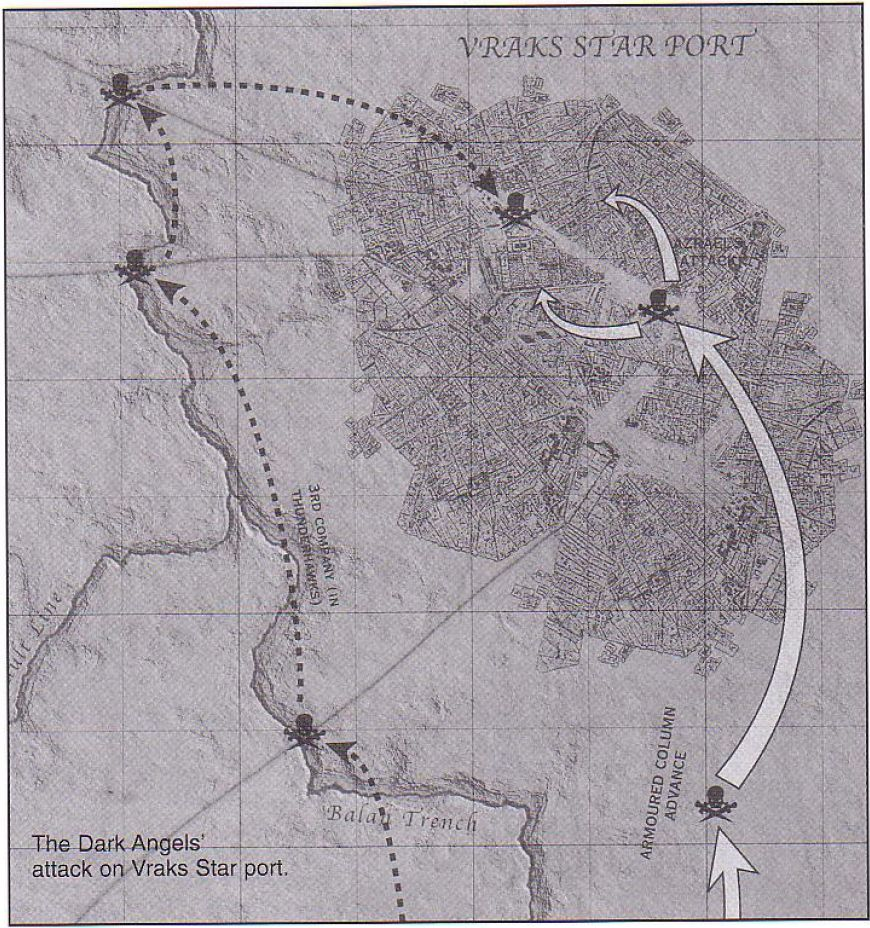

黑暗天使战团第5连队的无畏机甲在战斗中（第56页）：

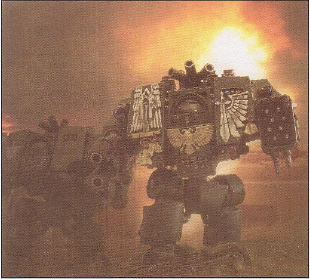

黑暗天使战团的装甲车辆驶向弗拉克斯宇宙港（第57页）：

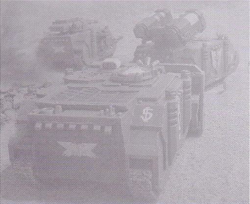

黑暗天使战团设在弗拉克斯宇宙港郊区的指挥所。请注意背景中攻击部队的达摩克利斯型犀牛装甲运兵车。达摩克利斯型犀牛装甲运兵车并不是战斗车辆，但它在协调弗拉克斯上的下级单位的行动上发挥了很重要的作用，使得阿兹瑞尔能放手在前线率领部队作战（第58页）：

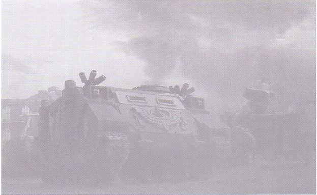

进攻的矛头，这辆兰德掠袭者步兵战车正带头冲向弗拉克斯宇宙港（第59页）：

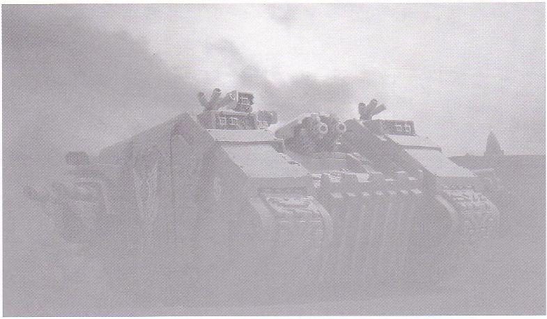

一架暴风雨（Tempest）型兰德突击艇在弗拉克斯宇宙港迫降时坠毁，叛军随后前来调查残骸，这伙叛军之中有奥格林狂战士随行（第59页）：

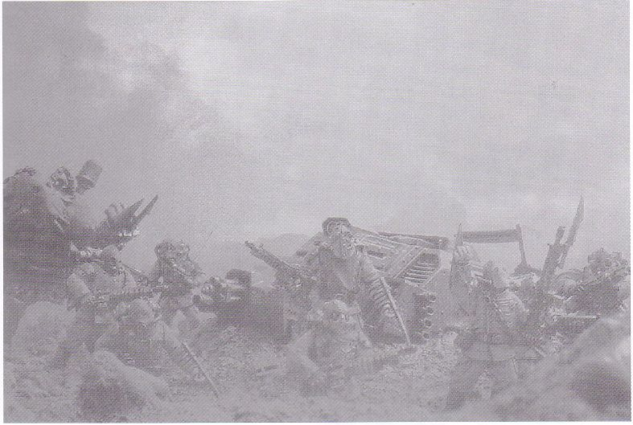

普罗米修斯型兰德掠袭者步兵战车“皇帝天使”号， 它是黑暗天使战团最高导师阿兹瑞尔的专用车辆，在弗拉克斯战役期间是他的指挥车。该车在战斗中严重受损，但随后修复（第60页）：

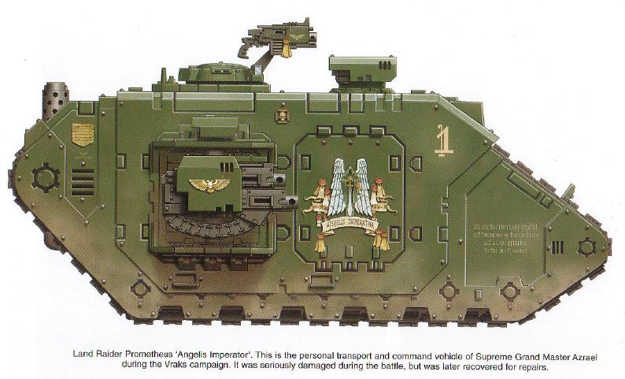

黑暗天使战团第1“死翼”连队的兰德掠袭者步兵战车，在进攻弗拉克斯宇宙港的最后环节里，它搭载了终结者参加战斗（第61页）：

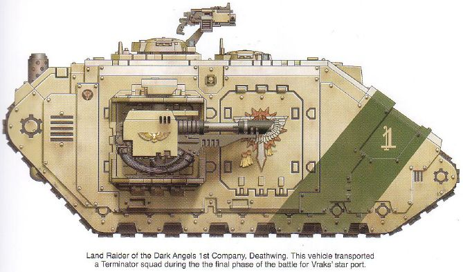

弗拉克斯战役期间配属给黑暗天使战团第5连的MkIIb型兰德掠袭者步兵战车（第61页）：

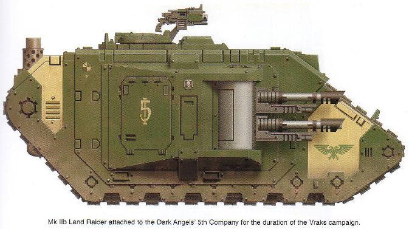

配属给第3连的雷鹰炮艇，这架炮艇曾将第3连各班运到高架桥上，随后各班夺取了高架桥（第62页）：

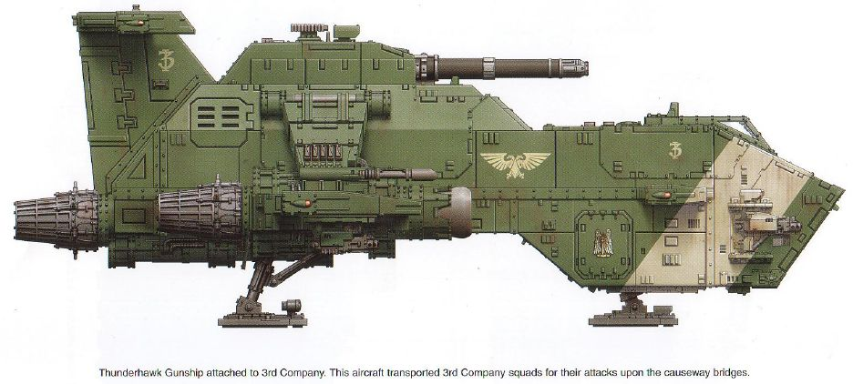

3号雷鹰运输机，整个战役期间，它在黑暗天使战团的补给工作中发挥了至关重要的作用（第63页）：

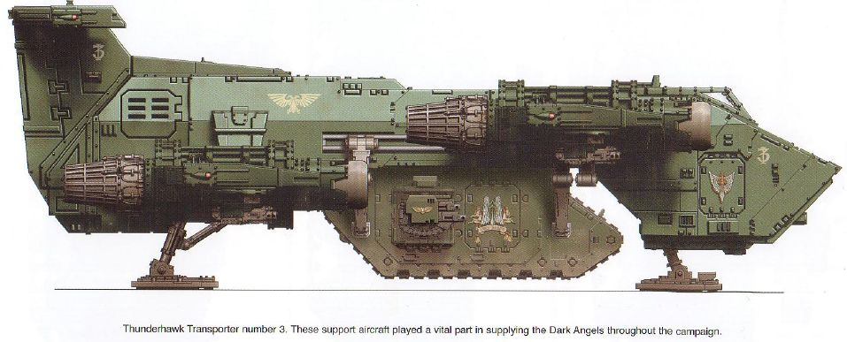

配属于第5连的破坏者（Destructor）型猎食者坦克，安装了附加装甲（第64页）：

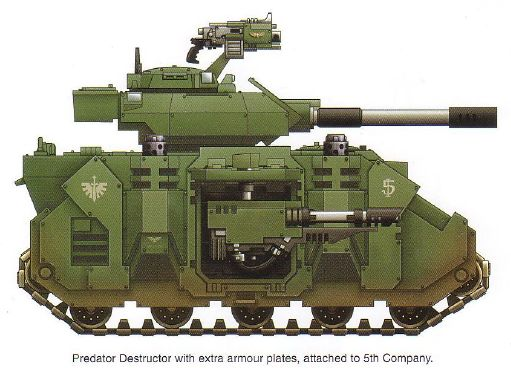

安装了附加装甲的复仇者攻城坦克，它是攻击部队的8号车（第64页）：

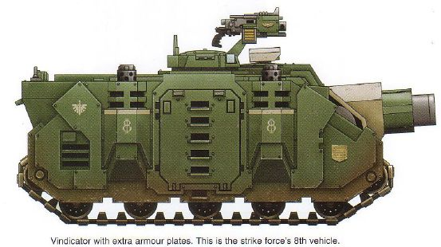

第5连的犀牛装甲运兵车，安装了附加装甲（第64页）：

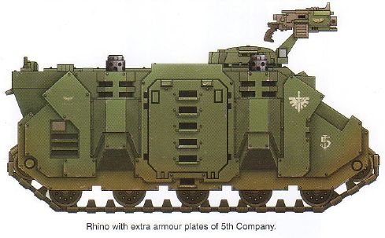

第5连的Mk4型无畏，由拉齐尔（Raziel）修士驾驶，装备了双联重型爆矢枪（第65页）：

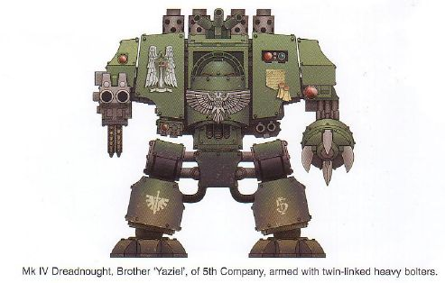

黑暗天使第2“鸦翼”连队的龙卷风型兰德突击艇，这是该连8号机（第65页）：

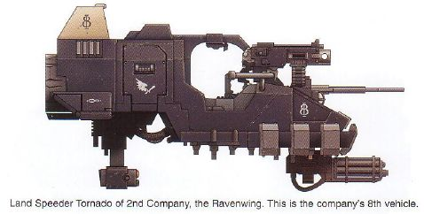

配属于第5连的旋风自行火炮（第65页）：

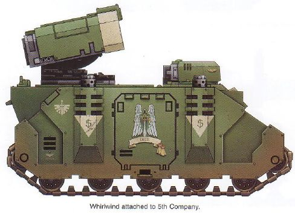

在53-48区被炮兵火力摧毁的一辆特洛伊人（Trojan）拖车（第66页）：

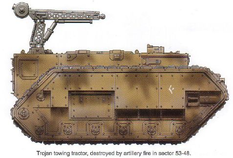

装备重型火焰喷射器的奇美拉装甲运兵车，它原来的号码被擦去了，涂上了新的号码“18”（第66页）：

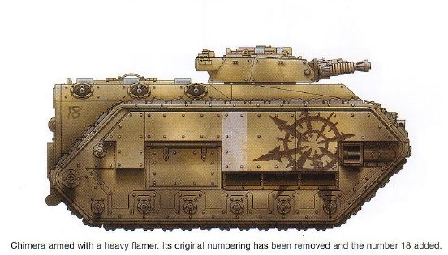

一架装备了多管激光枪的哨兵侦察型机甲，弗拉克斯叛军大量使用哨兵机甲，用于侦察和支援（第66页）：

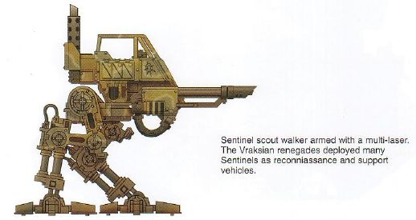

一辆被缴获的“轰击”型重型攻城炮，车身上涂上了混沌的八角星符号，在重炮方面，叛军也是装备精良的（第67页）：

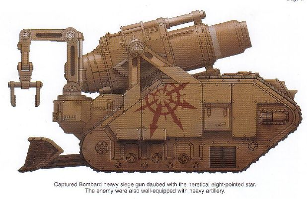

装备了重型爆矢枪的狼蛛哨戒炮（Tarantula Sentry Gun），这种武器被部署于前线，用于掩护前沿无人地带的接近地（第67页）：

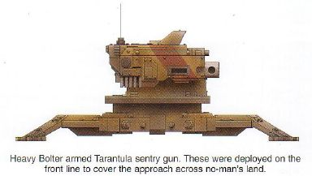

毁灭者坦克歼击车，尽管这种车很少见，但在弗拉克斯的储存物资里还是有一些的。这辆车在第11突击军进攻52-41区时被击毁（第67页）：

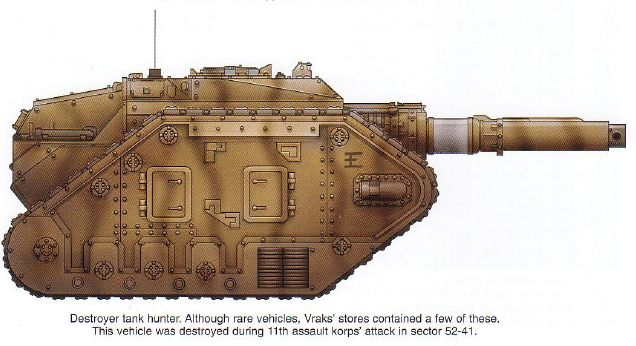
