# 第六章 突破

《帝国装甲第五卷-弗拉克斯攻城战（上）》剧情篇

CZ75

第六章

突破

“撤退就是失败。前进！前进！用牺牲铺就胜利之路！”

——戴诺斯上尉，第468团第19连

大进军

自从弗拉克斯攻城战打响以来，九年过去了。现在第88攻城集团军已经攻克了两道环形防线，打到了内层环形防线下，将城堡纳入重型火炮的射程之内。但这九年里，战争并没能按照计划进行，第88集团军不得不请求更多的兵员。黑暗天使战团对宇宙港进行的成功攻击给克里格军团带来了新的希望，屈尔克司令认为这是一个好机会，可以让他用一场决定性的突破来挽回先前的延误。

新抵达的防线军由三个新团组成，弗拉克斯地面部队指挥官得到了这支生力军之后，就能发动一场不间断的攻势。原先在弗拉克斯上作战的各攻城团由于遭受了巨大的损失，力量严重削弱了，各团团长渐渐变得只想守住防线、骚扰敌人，满足于组织一系列协调不周、收效不大的小规模进攻，期望这些进攻有朝一日能成为摧垮防线的第一道裂缝。但是屈尔克司令已经没有那么多时间来慢慢削弱敌人防线了。他只有十二年时间来完成这次任务，而弗拉克斯战争又极大地消耗了克里格的资源。他向新抵达的三个团和已经部署在防线上的其他团下令：要他们策划并进行一次大进军，一次在第二道防线上全线进行的攻势，这次攻势要对第二道防线施加持久的、不间断的压力。这次进攻将引来敌军的预备队，随后再用炮兵火力和强大的步兵进攻将敌军预备队消灭。在不间断的压力下，敌军防线早晚会在某处被突破，随后一个突击军就进入突破口，直捣内层防线。如果突破足够快的话，也许还能敌人站稳脚跟之前，在内层防线上打进一个楔子。

组织一场大进军需要时间；还要策划进攻计划，部署并储备火炮，用新的士兵和供应品来补充被打残了的连队，清除雷区等等，最重要的是：储备足够的炮弹，用来供应这场战争开始以来规模最大的炮火准备。组织这场进攻的重任落在了第88集团军司令部的参谋人员身上，当组织工作完成后，第88集团军就做好进行一场大战的准备，这次进攻也许将成为战争的转折点。新的攻势的开始时间定为101822.M41。

守军对这场进攻的准备工作并不是一无所知。侦察队和观察哨纷纷报告说，发现前线的克里格军团人数增加了，武器装备的储存量也增加了。对此，叛军对克里格的战壕进行了暴雨般的炮轰，试图阻止战役的准备工作。克里格炮兵再次承担了反炮兵的任务。此时每摧毁一门叛军的火炮，当步兵发动进攻时，就能少挨一些炮弹。

与此同时，为这次进攻所设计的炮兵使用方案也已制定完毕，与先前的进攻中一样，这次的方案也非常复杂，涵盖了释放烟幕、摧毁敌军铁丝网或坦克障碍物、压制敌军步兵或摧毁敌军火炮、掩体和防区内的公路等任务，对各炮兵排的射击精度和协同能力提出了很高的要求。当炮兵在进行准备时，步兵军官们也接到了详细的进攻命令。每个连都被分派了任务，各排也得到了如何完成任务的详细指示。随着进攻发起的时刻的逼近，准备工作进行得热火朝天。089822.M41，炮火准备庄重地开始了。第88攻城集团军的每一门火炮都咆哮起来，炮口向守军吐出高爆炸药，火焰照得天空亮堂堂的。火炮没日没夜地射击着，试图摧毁守军的一切抵抗。

当大地在爆炸声中颤抖、天空被冲击波震动时，守军躲在深深的、与地面隔着好几层土壤和速凝水泥的地下掩蔽部里，冷冷地等待着克里格军团的进攻。他们的战线上已被火焰、烟雾和灰尘覆盖，就连轨道上都看得见。

黑暗中，士兵们渐渐挤满了交通壕，第一波士兵已经就位。第二波士兵也已整装待发，肩并肩地挤在一起，他们身上背满了沉重的装备、手榴弹、弹药和口粮，这些都是为了即将进行的战斗而额外发放的。当时正下着暴风雨，头上传来一阵阵雷鸣声，范·梅尔斯兰德荒原上，永不停息的火炮炸出一朵朵橙黄色的火花，两百多万名克里格步兵已经做好了进攻的准备，就等一声令下了。

很快，黑暗中，天边出现了第一道微弱的曙光。前线上弥漫着浓密的烟雾，越过无人地带看过去，大多数目标都看不见。火炮们做了最后一次努力，提高了它们的调子，把最后的炮弹倾泻在防线上，爆炸产生的弹片和火焰形成了一堵墙，随后炮击就结束了。炮火的怒涛停息了，短短几秒之后，只剩一片沉寂。

第一天

进攻命令从前沿战壕里的每一台电台里传出来，然后又传达给士兵们。伴随着一阵阵脚步声，士兵们爬上楼梯，翻过胸墙，蜂拥着冲过无人地带。指挥官们在后方观察着，不过他们只能看见士兵们消失在烟雾和灰尘里。各团团长目前无事可作，庞大的战争机器正滚滚向前，现在要由各连、排、班来开辟前进的道路。团长们在指挥所里，听着电台传来的报告，试着拼出一幅前线的图景——进攻在哪里成功了，或是在哪里失败了？哪里需要援军？哪里的敌军防线将被突破？

在无人地带的另一边，敌军开始用火炮还击，他们很清楚接下来将发生什么，便匆忙进入战位操作武器。许多地方的敌军阵地已被持续了四天的火炮准备摧毁，敌人只能躲进弹坑里并布置武器。 尽管叛军的视野内还没有出现目标，但稀薄的烟雾是挡不住子弹和激光的，叛军仍然射出了致命的火力。在烟尘遮蔽中的克里格士兵虽然看不见敌人，但通过突如其来的重机枪扫射声、重型爆矢枪的吼叫声和自动枪点射声告诉了他们：敌人就在这里。士兵们开始卧倒，但仍然向前进攻。

尚未被消灭的叛军各炮兵排马上开始了反击。叛军事先已经瞄准好了无人地带的各处，所以炮火反击打得又快又准。炮弹开始在克里格士兵中间爆炸，守军的火力逐渐增强，构成了毁灭性的火力网。在无人地带里，炮弹爆炸后产生的弹片，将步兵班整个整个地消灭。在50-45区，叛军的炮火彻底瓦解了第158团的进攻。在猛烈的火力前，第一攻击波开始后退。突击班里的政委们要求士兵们顶住并继续进攻，就地枪决了第一批后退的士兵。有几个连的政委被己方士兵打死，这几个连的残部撤回了安全的己方防线里。在胸墙上，他们遇到了正要上前开始进攻的第二波士兵。要前进的与要撤退的部队撞在一起，堵塞了战壕，造成了一片混乱。战壕里挤进了超过容量的士兵，参加第二波进攻的军官们想强行让部下向前进攻，结果引发了殴斗。仅仅几小时内，第158团的进攻就彻底失败了。由于这次惨重的失败，第158团的上校和参谋人员都被逮捕，最后都被处决了。该团随后由第88集团军的政委们解散，所有的幸存者都被编入惩戒营服役。

在其他区，进攻取得了较大的进展。克里格士兵不管惨重的伤亡，继续向前推进。在一些地方，克里格士兵攻到了敌人防线并用刺刀消灭了敌人。不断进行的血腥战斗，使得前线成了混乱的杀场。进展良好的消息与进攻受挫、损失惨重的消息夹杂在一起，汇报给团长们。上级不顾失败和损失，向第二波士兵下达了前进的命令，士兵们再次涌入无人地带，地平线上出现了长长的灰色队伍。

随着战斗的进行，有一点越来越清楚：那就是大部分敌军都守住了阵地，敌人即使后退了，也只是撤到防线深处，占据新的阵地。第34防线军的进攻似乎取得了最大的进展。在第291团的地带上，他们达成了彻底的炮兵优势，摧毁了几乎所有的敌军火炮。他们的步兵已经攻克了敌军的一线战地，并在黑暗中继续向前推进。第88集团军抓住这个机会，准备在第二天以此为基础取得更大的进展。一直留在预备队里的第11突击军寿命从第291团的地带上发动一次攻击。第11突击军的士兵们迅速登上坦克，进入戈尔贡突击运输车里。第11突击军要用一天时间来准备进攻，所以第291团在第二天里必须巩固战果，到第三天才能得到援军。

与往常一样，进攻第一天里所遭受的伤亡高得惊人，许多连队已人手不足，在敌军战线中打入了楔子的连队必须守住阵地，直到援军抵达。第二天里，敌军肯定会反扑，各部队必须要巩固战果，要坚持到第三天，到了第三天，将会发动另一次大规模进攻。其实各部队取得的进展并不大，敌人战斗得非常顽强，在一些地方，敌人疯狂地守着阵地，但进攻仍将继续。

第二天

第二天是巩固阵地、打退敌人进攻的一天。克里格军团各连都竭力守住阵地，或继续向第一天未能攻克的目标进攻。炮弹继续在天空飞来飞去，士兵们在各自占领的临时阵地上，进行着孤立的战斗。防线上到处是满目疮痍的地堡，等着敌人反攻夺回它们。地下掩体里幸存的敌人被手榴弹和刺刀消灭了。

进攻中每夺取一段敌军战壕，都要从两头把它封堵起来，不让敌人沿着战壕进攻。为了打退敌人的反扑，重武器被拉上前方，部署在阵地里。在56-60区，第158团14连8排的卡达（Kada）中尉率领的士兵就正好取得了这样的战果。在第二波攻击中，他率领的一个满员（60人）的步兵排，在火网中穿过无人地带之后，只剩下了33人，中尉在堆满了先前进攻中伤亡者的弹坑里匍匐前进，亲自进攻一个重型爆矢枪阵地，他跳入阵地里，在很近的距离上用激光手枪里的最后两发激光打死了射手，接着他跳入战壕，把重型爆矢枪调转过来朝踏台（译注：即战壕里供士兵站上去射击的台）上的敌军士兵射击，随后命令仍然躲在无人地带的士兵前进，夺取了战壕。现在他必须守住这段战壕，不知从哪边打来的炮弹仍在附近爆炸。那天晚上，卡达的部下夺取了一个地下掩体，并在占领的战壕上构筑路障。

黎明时分，敌人开始反扑，试图夺回战壕。手榴弹飞过路障掉了下来。卡达中尉缴获的重型爆矢枪再次开火，迫使敌军后撤。敌人一露头，就会被重型爆矢枪的近距离平射逼退。中午时，卡达的部下已经精疲力尽，弹药也快用完了，敌军的迫击炮炮弹落点也越来越近，他们现在急需援助。为了请求援军，中尉和副官回到无人地带寻找电台。他们从一个弹坑跳到另一个弹坑，最后发现了电台操作员的尸体，操作员死时身上还背着电台。中尉将电台取下，蹲在弹坑里，向连长汇报情况，但却没有得到回音。他试图与友邻的连队联系，也没有成功。最后他总算联系上了一个四管迫击炮排排长，对方同意将他的情况和阵地位置通过指挥链传达上去。正当卡达中尉进行汇报时，一个敌军狙击手发现了蹲在弹坑里的中尉及副官。狙击手的第一枪打中了中尉的脖子，使中尉受了致命伤。卡达中尉倒在泥地里，鲜血浸透了大衣。副官冒着狙击手的射击，一路跑回战壕，向大家报告排长的死讯和援军即将抵达的消息。此时迫击炮炮弹在胸墙上爆炸，大部分人躲进了占领的掩体里，只有几个不幸的哨兵勇敢地冒着火力留在战壕里，当敌军发动进攻时，他们得给大家报警。情况令人绝望，第8排只剩下了19人，这勇敢的19人又顶住了两次进攻，然后他们中尉的牺牲终于得到了回报。

一队半人马运输车穿过无人地带，摇摇晃晃地开了过来，每一辆车上都搭载着一个重装掷弹兵班（译注：原文如此，可一辆半人马运输车其实只能搭载半个步兵班）。靠着重机枪射出的压制火力掩护，掷弹兵们从车上跳入战壕里，并马上开始扩展楔子，用手榴弹和火焰喷射器向临近的其他战壕进攻。敌人很快就被打退了，如果不把仍在飞过来迫击炮弹算在内的话，那么这道战壕已经安全了。夜里，一个新调来的排换下了卡达中尉的第8排的14名幸存者。当返回自己的战壕时，精疲力尽的战士们找回了卡达中尉的遗体。

第二天里，第88集团军试图巩固用第一天的牺牲换来的成果，像卡达中尉指挥的第8排所进行的小规模战斗，在整个前线上到处都在进行。第二天结束时，几个团长请求取消进攻，至少也得减小进攻的规模。如果按照现在的消耗率打下去的话，他们的团很快就会被打光。第88集团军司令部，特别是屈尔克司令本人既不会，也不可能考虑这种请求。这次进攻实在太重要了，不能因为高昂的损失就取消。这是屈尔克的最后一搏，这场大规模进攻不能为了琐碎的情况分析而拖延下去。在各种因素中，行动的速度是最重要的，后续的攻击拖得越久，敌人就能有越多的时间来强化阵地，最终进攻时损失也就会越大。所以，尽管目前进展缓慢,但绝不能错失这次进攻的契机。更多的进攻将在第三天发起。第88集团军虽然已受了伤，但敌人的损失也绝不比它小。

第三天

根据命令，战斗依然在整条战线上进行，但这一天里，第88集团军的进攻焦点将放在51-41区和52-41区南方，第11突击军受命从这里进攻。很快，伴随着履带和发动机的声音，坦克向前进攻了。各坦克连慢慢地开过凹凸不平的无人地带，以散开队形杀向战场。跟在坦克后面的是大批戈尔贡运输车，这些陆地上巨兽们每辆搭载了一个50人的步兵排，步兵们已经做好了下车冲击敌军阵地的准备。

敌军在反攻中，占据了一条由被破坏的地堡、围墙和弹坑组成的松散防线，当戈尔贡运输车抵达这些阵地，放下跳板，克里格士兵们蜂拥而出，阵地一下子就被攻克了。薄薄的一线阵地无法承受第11突击军的打击，进攻持续了很久，到了早上时，坦克和步兵仍在前进。看来，能动摇整个第二道防线的突破就快达成了。

可是，敌军指挥官并没有忽视地面战况，他们也看出了第291团的突破形成了很大的威胁，并用了整整一天的时间来向这里增援。敌军从深藏在地下的仓库里调出新装备，提供给部队，向第11突击军发动了反击。莱曼·拉斯主战坦克、奇美拉装甲运兵车、崭新的毒蜥自行火炮、美杜莎攻城炮、还有由十二辆毁灭者（Destroyer）坦克歼击车组成的装甲连都接到命令，前去进攻第11突击军。第11突击军一马当先，稳步推进，敌军的反抗也越来越强。毁灭者坦克歼击车守株待兔，与克里格的坦克在远距离上交战，很快，克里格车辆的残骸就布满了战场，冒出了苦涩的黑烟。敌军的反击取得了他们期待的效果，到下午十分，克里格士兵已经停止了前进，被敌军的装甲突击逼得后退。坦克不断损失，部队匆忙请求防御性炮击。突破被中止了，希望再次化为泡影。

其他地带上传来的消息比较好一些。在最东边的进攻中，1防线军第3攻城团已经在62-48区达成了第1天的目标。第3团正在积蓄力量，准备在第四天里进行第二次进军。第14团的坦克连已被调去增援。

第四天及第四天之后……

第88集团军不能放弃进攻头三天所取得的些微的成果，而突破仍有可能达成，所以也不能放弃它。第88集团军似乎要将自己撞碎在第二道防线上。一个团长评论道，第88集团军司令部好像以为打碎一堵墙的最好方法是用头去撞它。许多地段上，战斗仍在激烈地进行，第88集团军似乎将比敌人先倒下。第46防线军的新调来的团在战斗中损失惨重，第469团虽然进展显著，但它也差不多打光了。第88集团军已经把全部的力量都投入了进攻，它的预备队里只有一些重建的连队，这些连队是由进攻的第一天里的幸存者和掉队者组成的。在新的战场上，战斗的烈度丝毫不减，战斗还将持续三天。尘土和苦涩的烟雾久久地停留在地面上，许多地方的战场能见度减少到了100米以内。在这种状况下，是无法组织好进攻的，也无法获得弹着点的准确报告，但进攻仍在进行，可是进攻方仍未取得全面的突破，战线的各个角落都在发生你死我活的争夺，也许直到有一方终于坚持不住的时候，这场战斗才会分出胜负。

当连长们仍在为了夺取并确保目标而奋战时，这次攻势的攻势能量已经开始枯竭了。供应这次进攻的血流已经快耗干了，弹药储备，尤其是重武器的弹药，已经所剩无几，各连剩下的人数只够凑满一个排，而各排剩下的人数也只够凑够一个班。

这次攻势进行了七天，却仍未能达成突破，直到第468团发起进攻时，才有了突破的转机。第468团是一个新调来的团，它受命于122822.M41向57-50区发动进攻，这是它的第一次战斗。第468团指挥官阿塔斯（Attas）上校为了攻克面前的敌军战壕，设计了一套夜袭方案。最终，在混战中，他设法使下级指挥官们协调进攻，而没有让他们陷入各自为战的混乱局面，在过去几天里，正是因为协调不周，才导致了付出大量人员和装备的代价，却只换来一些微不足道的土地的局面。

阿塔斯上校调集了他所有的炮兵连来支援他的作战计划，并设法从第46防线军的储备物资里弄来了额外的弹药。按照计划，他将亲自率领突击连打头阵，在持续的炮火掩护下，趁夜色潜入无人地带，尽可能地接近敌军。压制炮火将压得敌人抬不起头来，不让敌人看见他们接近。各连队进入无人地带之后，就卧倒隐蔽，直到天亮为止。天亮后，炮兵将集中攻击敌军前沿阵地。接下来的部分是整个计划中最关键的一步，弹幕将向前移动50米，突击连趁机尽量缩短与敌人的距离，不给敌人时间作出反应。夺取敌人战壕后，后续连队将穿过第一波士兵，继续向前进攻。

军司令部起初拒绝批准进攻计划，因为他们认为，在夜间组织大批士兵进入无人地带埋伏起来的方案，会给协同工作带来很大的困难，而且埋伏在无人地带的士兵也很容易被发现，这一方案太过冒险。但阿塔斯上校回答说，只要集中足够强大的炮兵，就能压制住敌军炮兵，万一进攻失败，部队不得不撤退的话，损失也不会太大。最后，他说服了上级，计划得到了批准。

124822.M41，在一个漆黑的夜里，阿塔斯的突击连出发了，在上校的率领下，他们悄悄地爬入无人地带，一路上都要保持安静，小心前进，不让敌人发现。当他们匍匐前进时，团里所有的火炮，与阿塔斯为了支援这次进攻调来的独立炮兵连一起，向敌军阵地射出了雷霆般的炮火。炮弹纷纷从头顶上飞过砸在敌军阵地上。在炮火掩护下，步兵继续匍匐逼近敌人。天空被上千朵炮口火焰点亮，但敌人靠地下掩体和地堡的掩护躲过了炮击。

规定的时间一到，炮兵便集中轰击敌军前沿阵地。克里格士兵们卧倒在地等待着，就在他们前面100米的地方已经被炮火粉碎。接着，弹幕向前推进了，阿塔斯上校站起身来，手里拿着激光手枪和剑，向部下挥手示意，命令部下进攻。士兵们整齐地站起来，开始向前冲锋。这次进攻达成了彻底的突然性，敌人几乎没有时间作出反应，在他们冲出掩体之前，掩体里就落入了一捆捆手榴弹。许多敌人开始逃窜，却发现克里格士兵已经到了他们头顶上。阿塔斯上校跳过一道堑壕，挥手召唤部下跟着他追击，突然与一个庞然大物打了个照面，这是一个高达十英尺（译注：约合3.048米）、浑身长满了肌肉的奥格林人（Ogryn），他爬出战壕，用手里的大锤朝震惊不已的上校狠狠地砸了一下，上校残破的遗体在空中飞出了六米，他的胸腔完全被打烂了。这个疯狂的奥格林人冒着激光枪射束，咆哮着用大锤杀出一条血路，最后还是被一个眼疾手快的榴弹发射器操作手用一枚反坦克榴弹炸成了碎块。

在一个被摧毁的地堡里，敌人一个被炮击吓傻了的排未放一枪就全体投降了。尽管阿塔斯上校牺牲了，黎明时，第二攻击波仍然继续前进，他们穿过已经获得成功的第一波士兵，突然发现，他们已经打穿了防线。在第468团面前，不再有地堡、堑壕、围墙、路障或铁丝网了。第二道防线已经被攻破了。

第468团成功突破的消息迅速传到了第88集团军司令部，司令部迅速派出援军，前去扩大突破口。最先抵达的是一个四管迫击炮排，他们用自己的半人马运输车把火炮拖上前线，很快就卸下火炮，投入了战斗，把炮弹射向绝望地发起反击的最后一波敌人。更多的部队——坦克、戈尔贡运输车、重炮、死亡骑兵连——纷纷涌入突破口，随后分别向东、西方前进，进攻第二道防线后面的敌人。

就跟差不多八年前的第一次突破一样，第二道防线被突破后没几天，它就像多米诺骨牌一样倒塌了。克里格士兵们像无穷无尽的潮水一般冲过了倒塌的大堤。情况与上次一样，敌人知道阵地已经守不住了，必须尽量把装备撤退到下一道防线去。叛军留下一些部队担任自杀性的断后任务，让他们阻击克里格军团，随后撤退了。攻城团一个接一个地前进，在一些地方甚至没有遭到抵抗。第468团继续前进，要夺取二号居民区（hab-zone two），很快就陷入了巷战中，但第468团左邻和友邻的团也向南前进，很快就包围了二号居民区。没有来得及逃出包围圈的敌人都被消灭了。

但就跟第一次突破一样，第88集团军没有轻率地直接冲向内层防线，它在这次进攻中遭遇了比第一次突破时更强大的敌军阵地，遭受了非常惨重的损失，它需要时间来重建部队、准备下一次进攻，它需要新的士兵、火炮和坦克。这次的突破的代价实在太高昂了。第88集团军要再次铺设道路、挖掘新的战壕、建造新的地下掩体和储备仓库。

自从开战以来，克里格军团经过了九年的消耗战，才打到了现在的阵地。这些年付出的鲜血和生命与帝国最艰险的战区一样多。有四百多万士兵已经在弗拉克斯上牺牲，不过最终胜利看来已近在眼前。敌人已经被包围起来，战线则再次被缩短了，这意味着在未来的进攻中，火炮和士兵能够更集中。而且，弗拉克斯城堡现在已经处于撼地炮的射程之内，这个最终目标第一次进入了攻击距离之内。

随着克里格军团逐渐逼近城堡，城堡里的弗拉克斯叛军头目们距离失败越来越近了。但是萨凡主教看起来并不在乎。这就是上天的启示，杀戮必须继续下去——他不在乎胜利与否，只在乎死亡与破坏。现在，阿尔科斯成了萨凡主教最亲密、最有价值的顾问，他劝叛教的主教说，这场战争还没有输掉，伪帝的军队是拉紧了绞索，但在宇宙里，还有比这些拿着枪炮的脆弱小兵强大得多的力量。只要萨凡主教能坚定不移地战斗下去，那么邪神一定会青睐他的。阿尔科斯告诉萨凡主教，许多盟军已经做好了帮助他的准备，如果主教知道如何请求援助的话，邪神一定会带给他胜利的。

阿尔科斯找来自己的巫术顾问，这些人就是能把援军带来弗拉克斯的人。这些巫师秘密开始了一场血祭仪式，准备把邪神的援军直接带到弗拉克斯来。

很快地，克里格军团的哨兵们就报告说发现了一些不寻常的景象。天空中的雷雨云聚成了奇怪的形状，地平线上被天空中的光芒照出一片血红，就像是有人用血在天空中涂了一笔似的。日子一天天过去，雷雨云变得越来越密集。不断炸响的闪电看起来已经不像这个世界上的自然大气活动了 。在城堡顶上，巨大的黑色雷雨云聚集在一起。在上层大气层里，大片黑色和红色的云伴随着噼啪作响的闪电，逐渐聚集在一起，形成了一个旋转的大漩涡。

当战争进行了九年之后，克里格士兵眼看就要取得胜利了，但这来自异空间的风暴预示着更可怕的恐怖即将来临……

一次夜袭中，一个步兵班穿过残破的防线，照明弹在他们头顶上照亮了天空（第69页）：

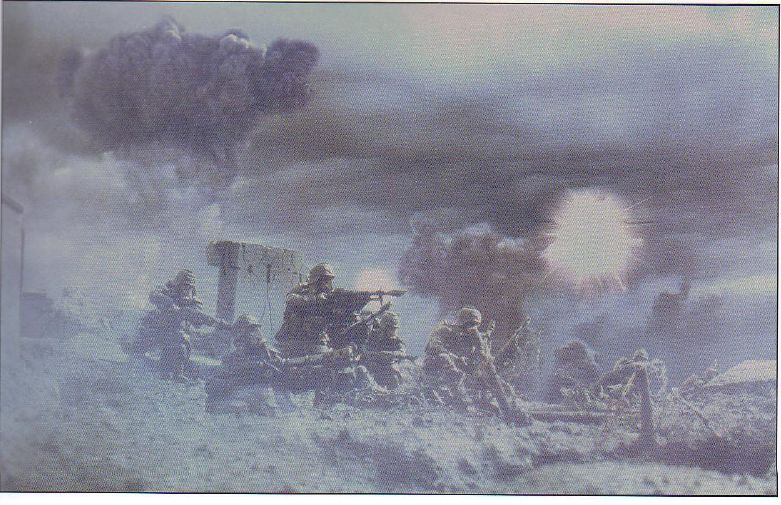

第105坦克连的一辆莱曼·拉斯主战坦克在突破外层防线时，一发炮弹在它旁边很近的地方爆炸，炸出一团火花（第69页）：

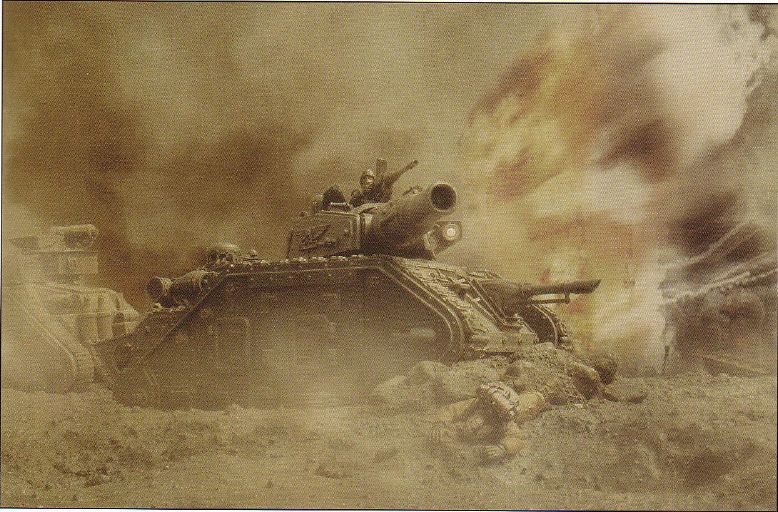

第14坦克团的莱曼·拉斯主战坦克冒着炮火，穿过烟雾和尘土前进（第70页）：

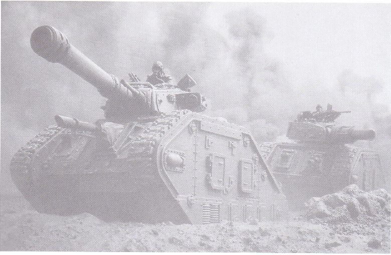

在向第二道防线进军的过程中，一门重型迫击炮被拖向新的阵地（第70页）：

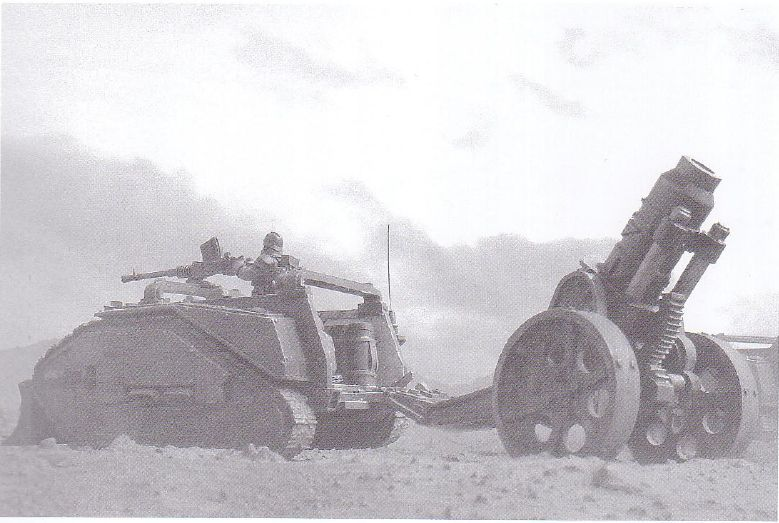

重金属，克里格的坦克在无人地带行动（第71页）：

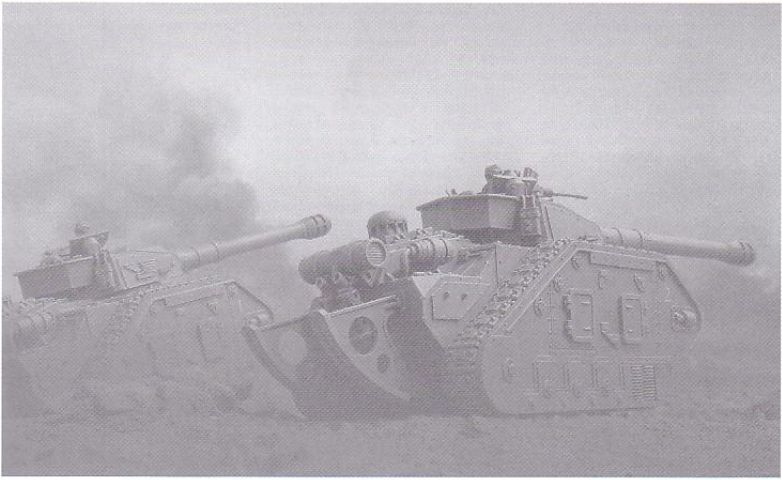

更劲的重金属！超重型坦克将大大提高坦克团的攻击力（第71页）：

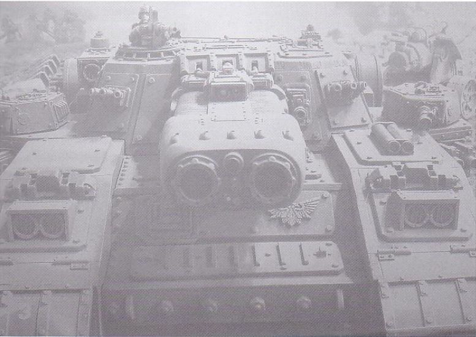

大进军。在进攻的第三天，第11突击军的戈尔贡突击运输车队正整装待发（第72页）：

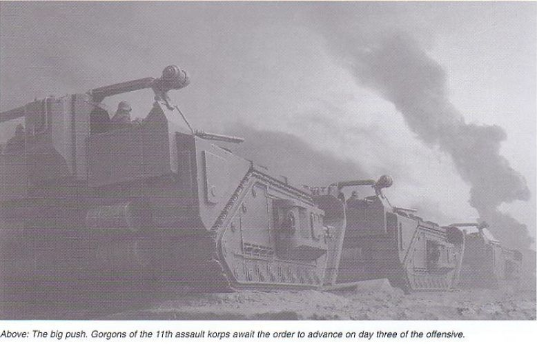

第88集团军围绕内层防线建立的阵地（第75页）：

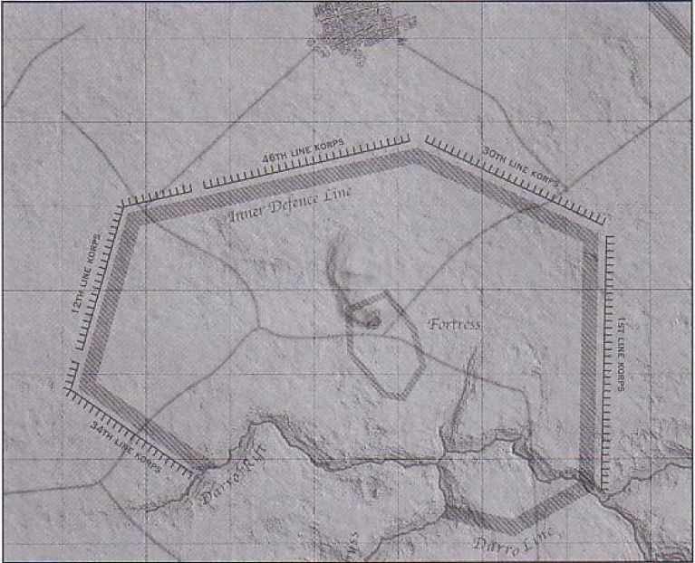

暴风之刃的等离子冲击炮被证明是一种能很有效地对付坚固碉堡的武器。第61坦克团第12重型坦克连的战斗序列中只有3辆暴风之刃坦克（第76页）：

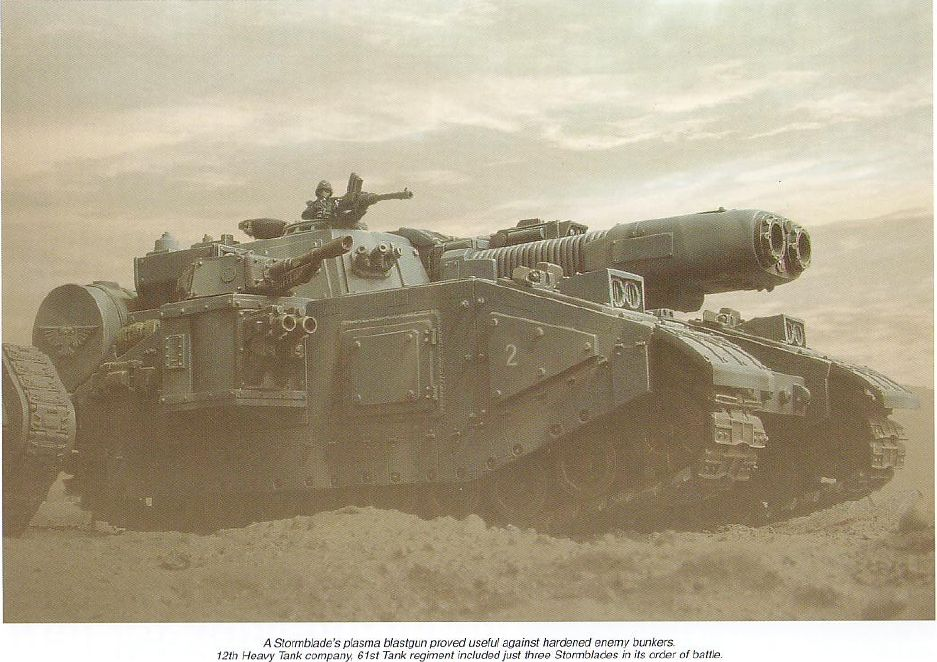

第7坦克团第8重型坦克连的毒刃坦克在向内层防线推进（第77页）：

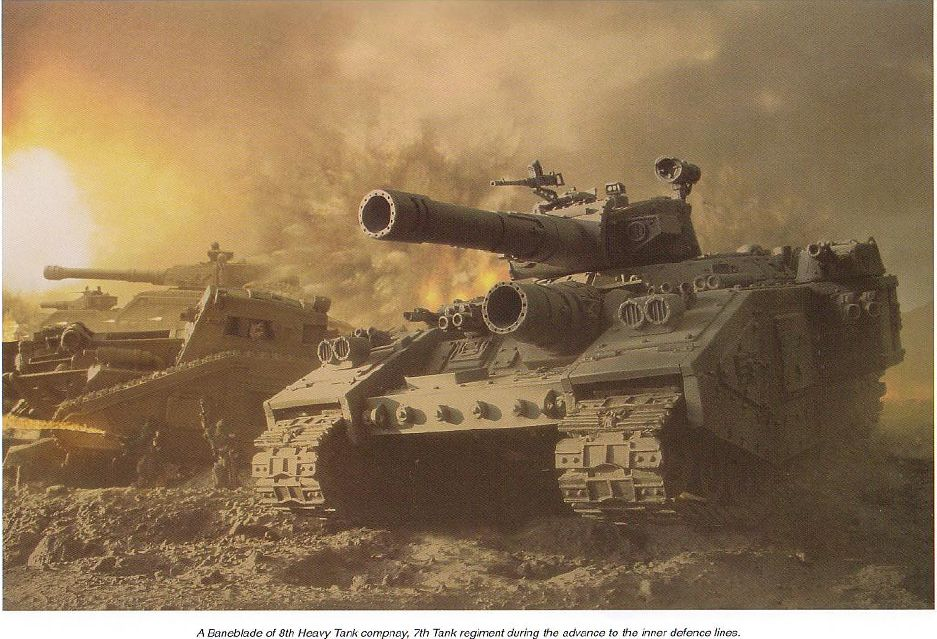

第101团的戈尔贡重型突击运输车（第78页）：

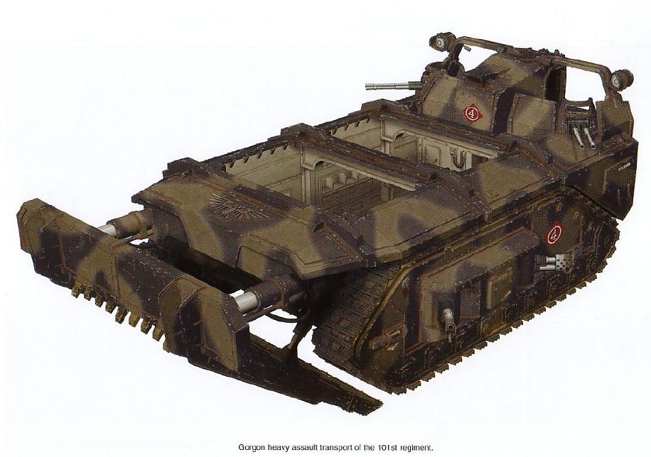

配属于第261团的戈尔贡重型突击运输车，该车在进攻52-50区时被炮火击毁（第79页）：

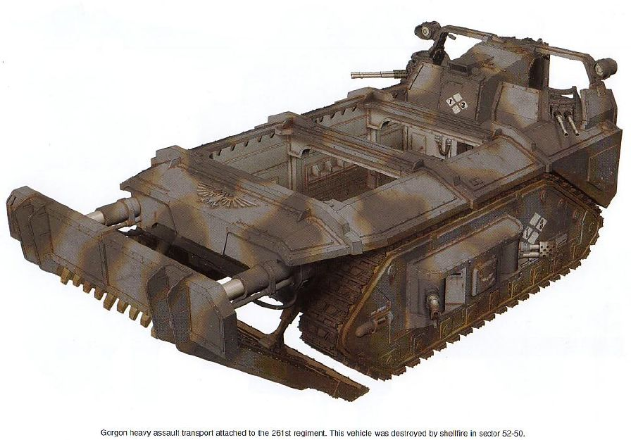

第31独立炮兵连的撼地炮（第80页）：

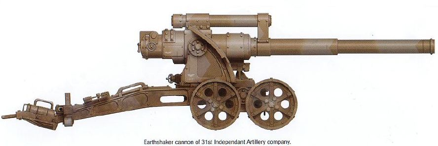

第23攻城炮团的美杜莎攻城炮（第80页）：

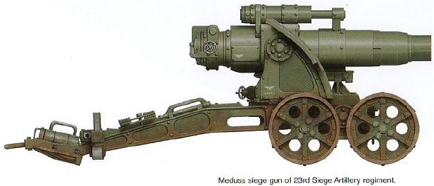

第7坦克团第3连的灭绝者（Exterminator）型莱曼·拉斯主战坦克（第81页）：

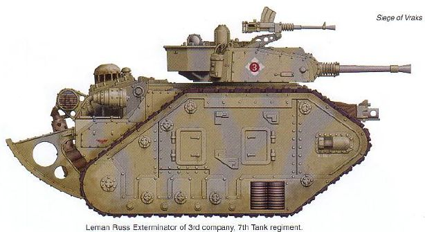

第7坦克团第8连第1排的莱曼·拉斯主战坦克（第81页）：

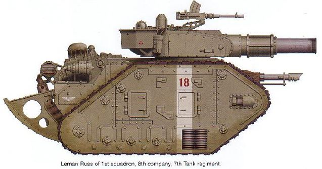

第11坦克团第3连的行刑者（Executioner）型莱曼·拉斯主战坦克（第81页）：

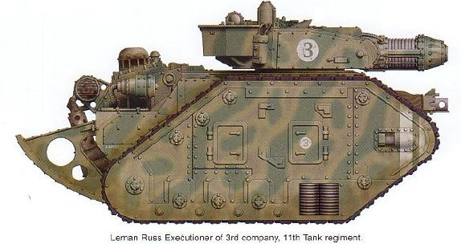

第61坦克团第3重型坦克连第1排的马卡里乌斯型重型坦克（第82页）：

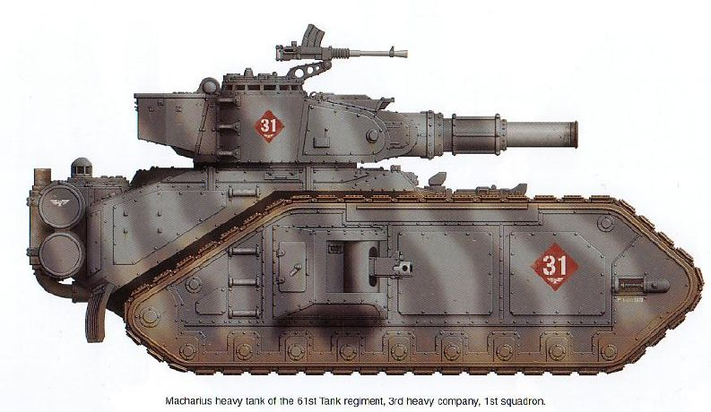

第14坦克团第8连第2排的马卡里乌斯重型坦克，它是第2排的指挥车，在47-45区被敌军炮火摧毁（第83页）：

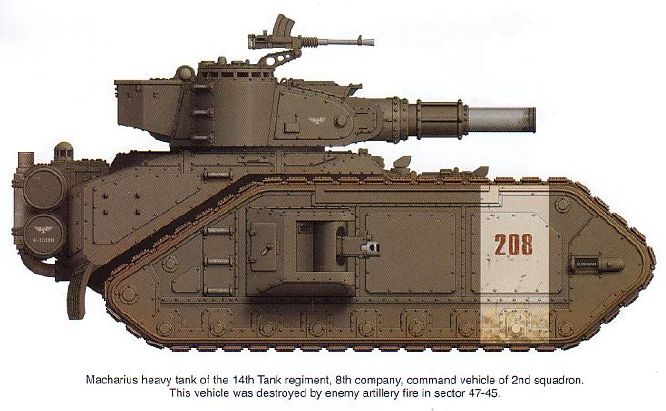

第11坦克团第1连的马卡里乌斯重型坦克，它是第1连的8号车（第83页）：

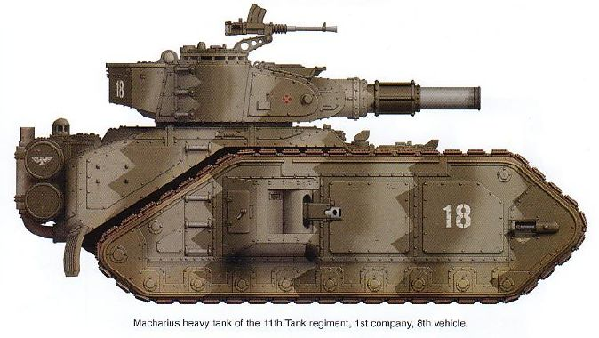

第61坦克团的特洛伊人弹药运输车（第84页）：

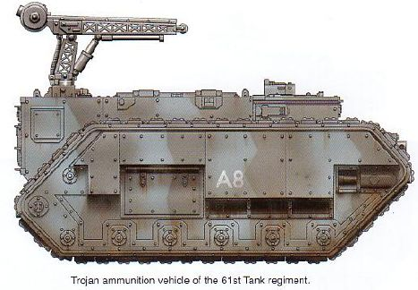

第156团的独眼巨人遥控爆破车（第84页）：

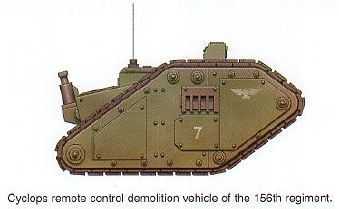

第3攻城炮团的“轰击”型重型攻城迫击炮（第84页）：

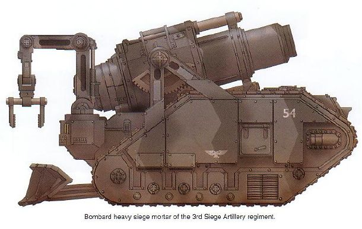
