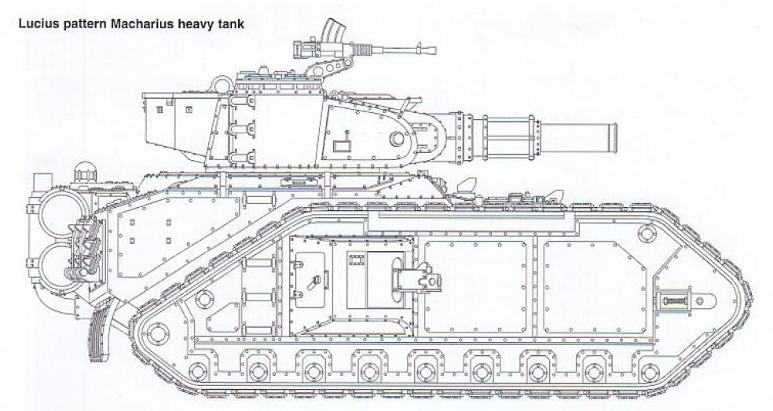
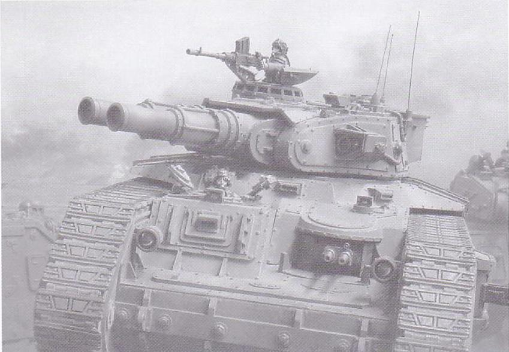
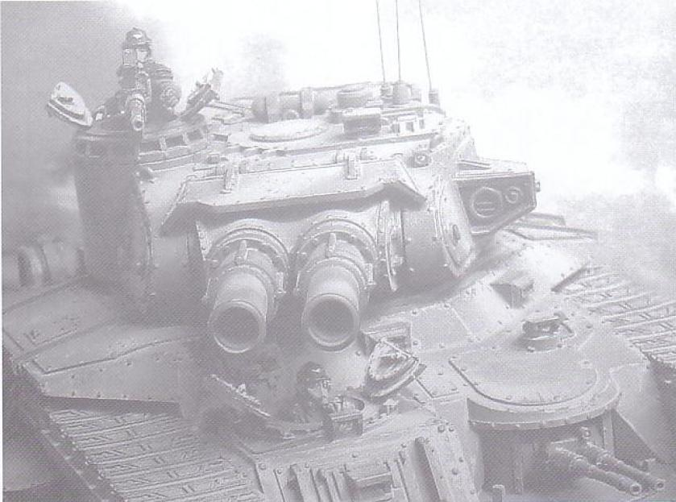
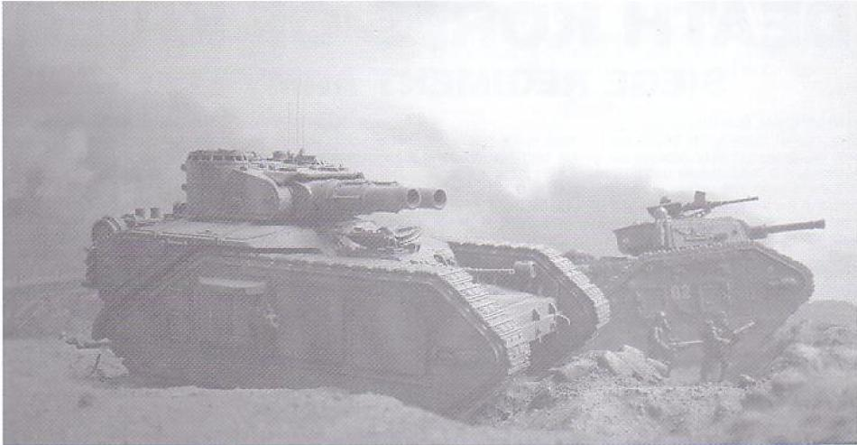

# 马卡里乌斯重型坦克

向猛犸坦克致敬！小翻译，马卡里乌斯重型坦克。

redkane

马卡里乌斯超重型坦克

马卡里乌斯坦克是被称为“赝品”的“第二代毒刃”坦克，很多铸造世界就靠这种巨型坦克来获取生产订单，因为他们没有能支持建造帝王毒刃的STC技术。只有火星的机械教总部和极少数铸造世界保存着自远大圣战时期遗留下来的帝王毒刃及其变体的设计图纸。他们严密保卫着这些只让极少数精英技术人员接触的知识。

从档案材料里得知，在遥远的年代里，各类超重型坦克广泛地配给帝国的军队。在伟大圣战的年代里，有多种设计的巨型坦克方案被提出来为帝王服务。多年以来，机械教和军务部不懈地对一种消失了的坦克数据进行搜寻。在干涉纪元（译注1）中，他们凭着对知识的和渴求人类复兴的满腔热情，在克服了无数瓶颈和错误后，机械教大师尼列克斯终于让掩埋在卢休斯铸造世界资料最深处的制造蓝图碎片重现天日。在他余下的生命当中，他将帝王毒刃和其他已知的装甲车辆的技术蓝图同自己发现的制造蓝图碎片整合以组成一个完整的可供生产的战车图纸。

马格斯的修补工作在呈送到火星保存前得到了高阶铸造将军（机械教的头面人物）的支持。但这个过程经历了2个世纪的冗长岁月，尼列克斯没能在有生之年看到自己的心血结晶被官方认可。在经历了漫长的测试和同其他铸造世界的磋商后，这种坦克的生产许可最后还是众望所归的落到了他的发现地身上，卢休斯铸造世界得到了生产资格的确认。同时，在人皇的伟名之下。伟大的“太阳领主”马卡里乌斯在第41个千年初发动圣战并解放了1千个世界的英名被用来为这个新生的坦克赐名。但不幸的是，卢休斯不久也得到了生产帝王毒刃的STC技术许可。如此，似乎尼立克斯穷尽一生的心血白费了。

卢休斯开始生产帝王毒刃，为满足军务部的的血盆大口。卢休斯铸造世界加班加点跟上军务部的需求。当货物被打包送到克力格世界时，突然被告知有新的团需要装备上这种巨型坦克。为此军务部的官员迫切的希望能在卢休斯找到新的装备来顶替之。

突然增加的需求量让已经超负荷的卢休斯统治者們不得不将目光转到了“替代品”马卡里乌斯身上，852.m41第一批坦克下线分配给克力格师团。如此开始了克力格团同马卡里乌斯坦克的蜜月。此后，其他帝国卫军也慢慢地装备他们，而且火星方面现在也正式认可了马卡里乌斯并容许其制造蓝图在其他铸造世界使用。

174吨的马卡里乌斯不及毒刃那么笨重但却有同样众多的武器，因此他可以担任同样的战场角色。他是辆大能的战争机器，每一辆马卡里乌斯都有能比拟帝王毒刃的敦实火力，他在重型护甲保护下的引擎及后备引擎提供其前进的动力。无论马卡里乌斯是多么大能的重型坦克，即使他装备有着非常厚实的前装甲，以及双联战斗加农炮提供的急具破坏性的强大火力。马格斯依然为马卡里乌斯的最脆弱的车尾部分提供了两种可以选择的装备来保护它

这个坦克需要8位组员，由车长统一指挥，炮手以及两名处于主炮塔处的装填手，通行员（同时负责操作两门双联装重机枪）同两名侧翼炮手在坦克的外装甲板位置。

坦克性能表

名称：玛卡里乌斯

出产世界：卢休斯

成员：车长，驾驶员，炮手，装填手X2，侧翼炮手X2，通行员，

发动机:LC400 V18 P2 MUKTI-FUEL

重量：175吨

身长：10.9米

身宽：7米

高：4.8米

最小转弯半径：0.45m

最大公路行使速度：26公里

最达越野行使速度：18公里

主要武装:双主战加农炮(备弹40发) 副武器重机枪X2，Bolter机枪X2。备弹分别为1000发和600发 

主炮射角:-2°到28°

炮塔360度旋转 

部分区域装甲厚度: 炮塔正面 220mm 车体上部 200mm 车体侧面 190mm 火炮防盾 150mm 

战场照片描述

上图：玛卡里乌斯在前往58-43无人区的路上时同反方向来的敌人交火

中图：马卡里乌斯坦克强大的武器在面对敌人的装甲和步兵单位是占有压倒性优势

下图：第7坦克团的坦克准备从静止状态启动，向敌人的坦克发起进攻

译注1：原文似乎是指的帝国的某个纪元

＝＝＝＝＝＝＝＝＝＝＝＝＝＝＝＝＝＝＝＝＝＝＝＝＝＝＝＝＝＝＝＝＝＝＝＝＝＝＝＝＝＝＝＝

依靠金山词霸的我，跌跌撞撞的将来自帝国装甲书5里关于马卡里乌斯的背景资料及其设定翻译完了。目的只是想早点知道这辆“猛犸”到底是个什么来头。更多具体的背景参考请详见CZ75翻译的帝国装甲书5－围攻佛拉克斯。

感谢CZ75、Tokugawa和Ｄａｖｉｄ的指导，并向所有提出建议的锤众一并致谢。
