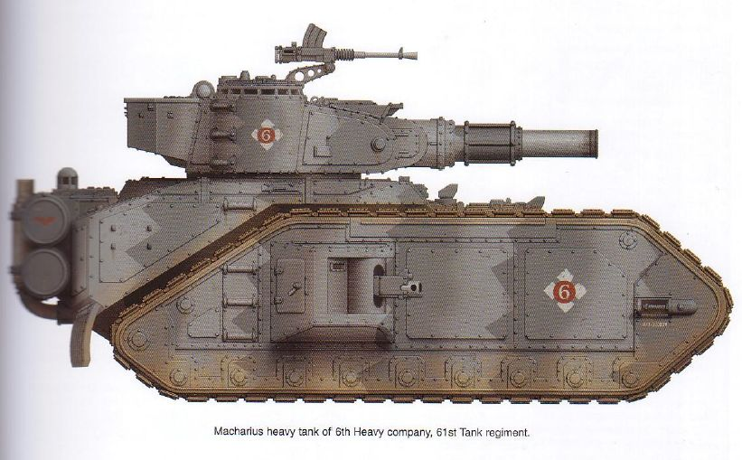

# 前言

《帝国装甲第五卷-弗拉克斯攻城战（上）》剧情篇

CZ75

译者前言：本书从去年12月1日开始翻译，直到2月28日下午2点翻译完剧情部分，即第1页-第75页的部分。在此先发表剧情部分翻译，部队、武器装备、规则的翻译将随后进行。我是第一次翻译这么长的文章，肯定会有不少错漏之处，欢迎大家对文中的词不达意、缺乏文采、不够通顺、流畅或是翻译错误的地方提出批评意见。

本文翻译过程中，得到了228群、战锤囧宅会群、C群、战棋世界群的多位同好相助，在此向他们表示我由衷的感谢！

帝国装甲 第五卷

弗拉克斯攻城战（上）

沃里克·金莱德

本书是一份有关惨烈至极的弗拉克斯（弗拉克斯是神圣的皇帝陛下的一个要塞兼军火库世界）攻城战的考察报告，它记载了最奸诈无耻、最背信弃义、最大逆不道的叛乱分子的阴谋，它记载了叛军的阴谋如何导致了他们的灭亡，它记载了皇帝陛下的帝国防卫军在挫败叛军阴谋、抵抗黑暗力量的战斗中付出的光荣牺牲。它进一步研究了冷酷无情、坚韧顽强的克里格死亡军团，以及那些误入歧途的凡人们。这些犯人无意中崇奉了混沌力量，为此他们付出了尸山血海为代价，但最可怕的代价还是——他们的灵魂将要遭到永恒的诅咒……

“我们将死亡军团之名押于弗拉克斯。他人视如至宝者，我们视之如粪土。为吾皇献身，死得其所！”

——哈莫尔上校，克里格第261攻城团

恐怖之眼位于朦胧星域。它是银河里一块被诅咒的区域，在那里，现实中的任何科学法则都不起作用，混沌力量从那里渗透进来，污染了那片地方，把那里变成了一片无可言状的恐怖之地。恐怖之眼里的星系被最猛烈、最难以预料的异空间风暴所包围，恶魔世界就在那些星系里面，这些世界被混沌邪神玩弄于股掌之上，充满了疯癫与狂乱，没人胆敢妄想心智健全地逃出恐怖之眼。

恐怖之眼是银河之癌，它是一个现实宇宙中的一个裂缝，异空间可以通过它渗入进来。它缓慢而又无法阻挡地扩大，对人类帝国和银河里所有种族形成了持续增长的威胁。混沌邪神的崇拜者不断寻找机会，伺机入侵帝国，削弱帝国。他们就是帝国最古老、最难对付的敌人——叛变的星际陆战队军团，在何露斯叛乱中，他们背叛了皇帝，并因此被赶出帝国。在那场叛乱中，首批星际陆战队军团中的九个站在大司战何露斯一边作战，并被击败了。失败之后，他们逃入恐怖之眼中避难，并在那里继续着反对帝国及其伪帝的战争。更糟的是，他们并不孤单。

在帝国内，有许多人信奉混沌邪神。其中有些人是自愿的，其他的则是被迫成为了邪神的奴仆。为什么？因为人心总是脆弱的。追求力量、财富和名望的心很容易遭到侵蚀。对于那些自愿出卖灵魂给混沌、彻底屈服于混沌的人来说，黑暗力量给他们提供了一条获得真正力量的捷径。对于那些穷苦无依的弱者，或那些追求正义、自由之类虚无缥缈的理想的人来说，混沌邪神提供了一条反抗这个残酷、冷漠的银河——在这个银河中，个人都不过是亿万人之一——的道路。当然，这条路本身不过是个诱惑，有些人想把帝国对神皇的崇拜转为对他们自己的神的崇拜，正是这些人散布着这些谣言，并（希望）由此带来混沌的最终胜利。

没多少人知道混沌的威力有多大，它的终极野心是什么。只有恶魔审判庭的审判长们或灵族的先知们知道真相。他们不单是为了自己种族的存续而战，更是为了现实宇宙的存在而战。

“当异空间风暴退去，弗拉克斯将陷入尸山血海中，就连死者也无法获得安宁。几百万人将成为祭品，以取悦真神……我曾经见过这一切，因为大乱即将来临，而我就是救世主。”

——萨凡阁下，叛教主教、大异端及弗拉克斯君主

前言

欢迎阅读《帝国装甲》第五卷。弗拉克斯攻城战是一场史诗般的战争的第一部分，我们将用几卷的篇幅来描写这场战争，而且这场战争的规模还会继续扩大。

自从编撰了《帝国装甲》第三卷之后，我们一直希望能描写第41千年中的攻城战，我曾经为《帝国装甲》第四卷编写了一份关于攻城战的摘要。在《帝国装甲》第四卷中，我们描写了一次小规模的作战行动，因此我们决定，在第五卷中将描写一场规模迥异的战争，这场战争将耗时数十年，有数以百万记的人死亡。这才是我想像中帝国所进行的战争，要把它的场面画出来，那就是：千军万马，伴着无数战车巨炮，奔赴战场。在帝国官僚机构漫不经心的操作下，战争不停地进行着。

本书中帝国的敌人是混沌军队，但是大部分40K的混沌玩家会发现，这支混沌军队与他们的规则书上所描写的很不一样。我们打算展示一种完全不同以往的混沌军队。我们在本书中描写的战争，是一场漫长而又相对“静止”的战争，而混沌规则书中描写的以混沌星际陆战队为主的部队并不适合这种形式。我们需要这么一支混沌军队：它必须拥有庞大的人力资源，足以跟帝国相比——因此我们制定了叛军与异端部队表。他们都是人类，却由于种种原因，（在他们失控的统治者的诱导下）不再信仰皇帝，不自觉地成了混沌邪神的仆人。人是怎么变成混沌信徒效忠邪神的，是一个很有意思的话题，但是背景设定中却很少提到，不过我们可以从已有的设定中得知，帝国与无数的混沌军队（比如黑色圣战）进行着永无休止的战争，可这些部队却从未在游戏中出现过。

设计这么一支军队的一大问题是：它是一支由大量低水平的单位组成的“乌合之众”，尽管这种部队在故事中很有特色，却不会有多少玩家愿意建立这么一支部队并将其用于游戏。理由很简单：一支“乌合之众”需要很多很多棋子，这意味着组建这支军队将消耗大量的时间和金钱来购买和涂装；可是在玩游戏时，要用这支军队获胜，就得利用它唯一的一个优势（数量），这么一来，对手一攻击，你就得大把大把地把棋子扫下桌子，没玩几局你就会觉得这样一点不好玩。所以这种“乌合之众”型的部队会导致一些我本来试图避免的游戏问题。

解决这个问题的办法，就是设计一种部队表，如果玩家愿意的话，可以按照它来建立一支“乌合之众”，但玩家不一定非得这么做。这份部队表跟帝国防卫军的一样有效，而且还有许多从帝国防卫军中偷来的装备。当然，它的代价是没有许多混沌单位，没有恶魔和附魔单位等。作为回报，叛军与异端部队表将在未来的《帝国装甲》中进一步扩展，最终将形成一份与混沌星际陆战队平行的混沌部队表。

铸造世界一直希望能增加战锤40000宇宙的深度，并填补其设定中的一些空白。我们设计了许多派生型号，补充了很多设定的细节，并拓展了其深度。本书中，我们主要填补了克里格死亡军团模型的空白。在编写本书的过程中，我们渐渐清楚，本书的主要目的是克里格本身。克里格死亡军团一直非常受欢迎，但却没有出过其模型。现在它终于出了模型，我们也有机会能详细描写它的背景设定、装备与规则。本书也列出了攻城团的部队表，它是一种特殊的帝国防卫军部队表，就像装甲连和空降兵的一样。当然，克里格的棋子也能用于标准的帝国防卫军部队和装甲战斗群部队。克里格的部队并不都是攻城团（不过克里格没有空降兵）。

与以往一样，编写交战双方的背景、设计单位、车辆及装备是一件非常快乐的工作。模型设计师们为克里格制作出了一系列精致的模型，从骑兵、掷弹兵、死亡骑兵，到人马、马卡里乌斯等各种车辆，以及四管火箭炮和震地炮等各种火炮，个个制作精良，让玩家能组出一队妙不可言的部队。当把这些棋子摆上合适的“战壕与无人地带”棋盘之后，看起来真是栩栩如生，让玩家赏心悦目，玩心大动。与设定了战役背景的其他几卷《帝国装甲》一样，喜欢给自己的模型和地形设定背景的玩家，也能以本书为出发点进行设定。

再次，我特向所有帮助过本书的编写工作的人致谢。在编写规则时，寄给《帝国装甲》的信给了我们很大帮助。特别值得一提的是马克·贝德福德，为了拍克里格步兵的照片，他戴着防毒面具、穿着战壕大衣，在夏天的大太阳下摆了半天姿势！

敬请期待《帝国装甲》第六卷……在它出版之前，就请尽情享受《帝国装甲》第五卷为您带来的乐趣吧！

沃里克·金莱德

2007年3月

弗拉克斯攻城战

第61坦克团第6重型坦克团的马卡里乌斯重型坦克（第5页）：

弗拉克斯一号行星概况

星域：朦胧星域（Segmentum Obscurus）

行省：斯卡卢斯行省（Sector Scarus）

区：卡拉克区（Sub-sector Karak）

星系：弗拉克斯（Vraks）星系，有4个行星（一号、二号、三号和乌里克斯），其中仅弗拉克斯一号行星上有人居住。

勘测情况：未知

行星：内行星：弗拉克斯一号，多火山，气候温和。

外行星：弗拉克斯二号，石质行星，无大气。

弗拉克斯三号，石质行星，无大气。

乌里克斯，雪球行星，无大气。它是一个被弗拉克斯的重力场俘获的大型小行星。

卫星数量：弗拉克斯一号，0个

弗拉克斯二号，1个

弗拉克斯三号，1个

乌里克斯，0个

小行星：外层小行星带-未标明

彗星：无已知的彗星

弗拉克斯一号（Vraks Prime）

概况：弗拉克斯是军务部的一个军火库世界。它是一个巨大的仓库，封存着许多供给品和装备，这些都是作为战时紧急预备物资用于新组建的帝国防卫军团队的。

大小：赤道距离（估计为赤道直径）为6300英里（约合10139千米）

重力：1.05G

卫星：无

人口：8百万（包括人类和亚人类）

自传速度：1100英里/小时（约合1770千米/小时）

轨道：弗拉克斯一号距离其恒星的平均距离为172000000千米

气候类型：温和-标准（多暴风）

表面平均温度：11摄氏度

大气对流层成分：氮占78.8%，氧占19%，氩占1%，臭氧占1%，二氧化碳占0.1%，硫占0.1%

税收等级：特别免税（Adeptus Non）

气候区：极盖——北极和南极各有两块小极盖，冻土，未勘察

海洋：弗拉克斯一号的表面有55%为含硫的浅海覆盖。海洋为行星提供了含氧的大气，不过大气略微被硫所污染，但当地从未进化出比单细胞生物、细菌更高级的生命形式。

山脉/高原：造山运动形成了粗糙不平的高原，一些裸露的火成岩被采来用作建筑材料。

低地平原：由火山岩浆区组成。裸露的平原在气候的侵蚀下，有峡谷穿插其中。人口主要集中于范·梅尔斯兰德荒原（Van Meersland Wastes）的城堡和宇宙港中。

气候现象：电磁风暴

弗拉克斯早期的火山活动在大气上层留下了许多硫，它们造成了迅猛的电磁风暴。弗拉克斯的盛行风使得天空中长期覆盖着棕色的云层，云层中不断增加的摩擦产生了大量的能量，这些能量必须通过突然而迅猛的雷电风暴来释放。雷电风暴经常伴随着厚重的雷雨云和…………，但电磁风暴的放电时间通常不会超过一小时。在弗拉克斯大多数地方，每天一两次风暴是很平常的事情。

植物：有一些关于藻类和单细胞生物的记录，没有进行更详细的调查

动物：无已知动物

经济：无。一切进出口均由军务部官员管理。

社会：作为一个内政部设施，弗拉克斯的社会等级与地球上的内政部一致，部长、次长、行政官、办事员、书记员、传信员、档案员、勤杂工和助理们维持着弗拉克斯上的庞大官僚机器的运转。

有几百万合同工在军务部驻军保护下工作，弗拉克斯还要自己的行星防卫队，这些民兵由劳工组成。

劳工中有相当多的奥格林人。

弗拉克斯上还有一些到圣列奥尼斯（St.Leonis）神殿朝圣的短期朝圣团，人口约1百万至5百万，具体数目不详。

弗拉克斯的宇宙港有一些营房，这些营房是为来此地装备物资的帝国防卫军团队准备的。当这些团队装备完毕之后即运输至下一个目的地。

供水：有许多水槽深深地插入地壳的比较软的地方，汲取地下水，水在分配之前要进行过滤，以滤去硫成分。

主要出口物：无

主要进口物：各种武器、弹药、粮食、燃料及人工制品。

食物供给：所有的食物都由外界提供。

城市：在降落区，建造了许多工棚、临时仓库、机库、修理厂、兵营和行政建筑，它们组成了最大的居民区。弗拉克斯的宇宙港虽然号称“港”，但它其实是一个有5百万工人的小城市。

另一个居民区是由劳工队的工棚组成的，这些工棚散落在范·梅尔斯兰德荒原上，为工人提供住所。这些工人是负责建设与保养弗拉克斯上的仓库、公路及防御设施的。工棚都是些很简陋的兵营，工人和卫兵就居住在里面。

地质概况：弗拉克斯不寻常的地质情况形成了它独特的地表。很久很久以前，弗拉克斯曾经是一个非常热闹的火山世界，其造陆运动非常剧烈，几万座活火山喷出的岩浆形成了岩浆海洋。如今弗拉克斯早已沉寂下来，所有的活火山都已停止活动，造陆运动也已几乎观测不到了。

弗拉克斯的地表是由玄武岩组成的，在大气中的氧侵蚀之下，表面变成了一层灰黄色的灰尘、沙砾与又脆又软的浮石。由于表面中富含硫，当地的生命很难发展，人在表面必须使用呼吸过滤器才能活动。

弗拉克斯柔软的地幔很容易被侵蚀，所以河流可以轻易地侵蚀到地表下很深的地方。几百万年来，河流已经形成了一个由深深的峡谷、山谷和壕沟组成的网络，有些地方深达一两英里。该行星的地表构造决定了地表中水的含量非常低，地表中的沉降水会很快流入地下的大河中。地下水道的毁坏能帮助形成陡峭的峡谷与山谷。

造陆运动：弗拉克斯现在已经是一颗年老的行星，地表活动已很平静。很久很久以前，弗拉克斯上地震频频，板块升升降降。剧烈的板块运动形成了连绵的山脉，在有些地方则形成了巨大的深沟，在两个板块交界处，还形成了深深的海沟。今天板块活动已经基本停止，能记录下来的只有很轻微的活动，因此在弗拉克斯能容易地勘测到适于保存易挥发物资的地方。

已知历史：根据帝国档案所记载的资料，弗拉克斯很早就成为了内政部的设施。弗拉克斯位于朦胧星域，位于恐怖之眼西北，具有非常重要的战略意义，对于要抵御来自恐怖之眼的攻击的帝国军队来说，弗拉克斯是一个非常重要的军火库。

帝国在朦胧星域建立了一个由军火库世界组成的网络，为该星域的帝国防卫军提供武器弹药，弗拉克斯是这个网络中非常重要的一环。

帝国中的铸造世界生产出的大量军火通常要运往军械库世界封存，待军务部需要时再将它们启封，运往需要的战区或帝国防卫军团队。

弗拉克斯的地理位置使得它能迅速向负责防御恐怖之眼附近世界（尤其是斯卡卢斯行省）的帝国防卫军部队提供补给。因此，在防御混沌的大规模进攻（如黑色圣战）的帝国防线上，弗拉克斯成了重要的一环。

在纷争乱世（Age of Strife）之后，新帝国的一支考察队首次发现了弗拉克斯，并将其记录下来。……它是由范·梅尔（Van Meer）家族的行商浪人范·梅尔开发的。为了给将来进行的勘测恐怖之眼边缘的行动储备物资，在该行星上建立了一个供给基地。

随着供给基地的规模越来越大，储备物资需要保护，从此，弗拉克斯开始成为一个军火库世界。在弗拉克斯建了一个堡垒，以保护物资免遭海盗和外星人的掠夺。还建了一个宇宙港，以便货船和运输船装卸物资。随着时间推移，这些设施都完成了。

在地下，建有巨大的掩体和机库，用于储存武器、弹药、燃料、服装等物资，各种物资源源不断地运到弗拉克斯储存起来。该地的防御也不断加强，这里储存的物资越多，就越容易遭到攻击，因此防御也越来越强。一万多年来弗拉克斯已经变成了一个巨大的军火库，宇宙港也已扩展到足以让帝国最大的登陆装置着陆，可以将大量的武器、车辆与弹药运到轨道上的货船里。在堡垒里的司令部中，军务部当局控制着一切货物的进出口。

圣列奥尼斯会堂也是弗拉克斯堡垒的一部分，它由弗拉克斯主教建于M38，是为了祭奠无数葬于弗拉克斯的工人的信仰而建造的。会堂内供奉着圣列奥尼斯的遗骨。（圣列奥尼斯生活与第38千年，他是一位斯卡卢斯行省的传教士，被异端杀害）

朝圣者与忏悔者成千上万地来到弗拉克斯参拜圣列奥尼斯神殿，圣列奥尼斯会堂和弗拉克斯主教宫的许多牧师也来这里参拜。

弗拉克斯堡垒：它位于范·梅尔斯兰德荒原中央，它是弗拉克斯上军务部一切活动的指挥中心。它是一座建在死火山顶上的巨大要塞，内设有行星防卫队司令部、当地内政部长办公室、大档案库、圣列奥尼斯会堂、主教宫与堡垒卫队的兵营。要塞地下建有戒备森严的地下城，审判庭有时会被用来关押在斯卡卢斯行省被捕的罪犯。星际通信部通信中心、法务部当地分局以及激光防御网控制中心也设在这里。

作为军火库世界的中心，城堡的防御是万无一失的。军务部内的人都相信弗拉克斯是一座坚不可摧的要塞。它的城墙由虚空盾防护，可抵挡轨道轰炸，还配有广阔的幕墙，可以抵挡直接攻击，周围还环绕着一个庞大的激光防御网络，任何从宇宙飞船进行的攻击都等于自杀。这些激光防御设施还能用于攻击地面目标。通往要塞的所有道路上都有互锁力场防护。荒原上布置有三道环形防线。这些措施保护着仓库、壕沟、防线、掩体、支持点以及预先准备好的炮兵阵地免遭入侵者攻击。三道防线又由铁丝网、防坦克壕和几千个雷场保护着。任何企图进攻弗拉克斯的军队都会陷入僵局，并最终覆没。

当遭到大规模入侵时，堡垒的卫队负责防守要塞，由只接受过基本的军事训练的工人组成的行星防卫队负责为静态防线提供人力。

以前弗拉克斯曾多次遭到入侵，这些入侵大多是那些想抢夺装备的叛军或海盗发动的，也有几次是由起义的工人进行的（见4655082.M39的弗拉克斯起义，这次起义遭到了镇压），但一万年来，弗拉克斯从未沦陷过。

弗拉克斯行星（第6页）：

弗拉克斯星系（第7页）：

