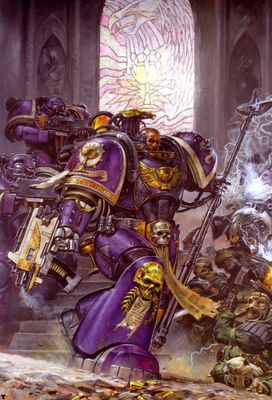

# 饮魂者军团

饮魂者军团

pierrekbdw

饮魂者 Soul Drinkers 

初始战团：帝国之拳

现任团长：Sarpedon 母星：以舰队为基地

主基：断背号。。。。。。。。（Brokenback），一艘Space Hulk。。。

涂装：紫色，金色，骨白色。

专长：跳帮战，近距离放火

战吼：为了顿哥~为了帝皇~~为了自由~~~~~~~~

现有战力：大约300名星际战士，在持续的战斗中还在不断减员

历史

叛变战团的规则并不适用于饮魂者战团，与他们对邪神的疯狂崇拜不同，饮魂者对邪神的鄙视和对帝国的仇恨同样深重。他们认为现在的帝国已经背离了当初帝皇所为之奋斗的目标，所以帝国应当被毁灭，这才是对人类更有好处。

Tellos

在被某位异端牛人Teturact击败之后，饮魂者战团被迫逃离Stratix Luminae，留下了几只突击小队殿后，由Tellos负责指挥他们。谁知道这小子

早就跟K神神交已久，在血神的感染下迅速堕落，带领全部的突击小队加入了K大信徒的行列。

战团长Sarpedon及时察觉了他的背叛，并追踪他到了Entymion IV,曾经是帝国的领土，现在被黑暗艾达和信奉沙姐的信徒们占领。IG大兵们在深红之拳的协助下正准备收复这里。

深红之拳的部队规模不大，他们只是为IG们夺回首都Gravenhold作先头部队，但他们很快跟Tellos带领的队伍接上了火。在认出了饮魂者的圣杯标志后，红拳头的指挥官Reinez认为整个饮魂者战团都参与了叛乱，他呼叫了在Rynn的2连，牧师Inhuaca带领2连前来助阵，Reinez下达了拿下Sarpedon人头的命令.

紧随Tellos而至的Sarpedon一到达Entymion IV就立刻着手搞清楚状况。。。他们通过劫持了几架帝国海军的登陆舰渗透了进来，并立刻警告了拳头团。另一方面，拳头团在掩护了Fornux Lix Fire Drakes团的铁拳部队（就是条件比较好，坐的起奇美拉，跑得比较快的大兵）的进攻之后，红拳头团追击饮魂者到了城市深处，在商业区发生了惨烈的战斗，饮魂者在夺了拳头的军旗和干掉了连队智库馆长后撤退。。。

这场战斗自始至终都被黑暗艾达监视着，在饮魂者撤退时，是黑暗艾达那些被洗了脑的奴隶大军阻止了拳头的追击。黑暗艾达很快和Sarpedon接触，双方一拍即合结成盟军——虽然他们双方随时都准备着出卖对方。

第一次团内战争

Sarpedon是战团的首席智库馆长，他曾要求与原战团长Gorgoleon来一次“荣誉决斗”，从帝国之拳分出来的战团都有“荣誉决斗”这种极度健康的活动。挑战者和应战者会打到一方死或者喷血为止。（这一段真不知道咋翻了，我干活的这地方没金山啊~原文：they duel to either the death, or the drawing of first blood）他们自己意淫帝皇和顿哥会将自己的力量赐予战胜者。Sarpedon用自己变异生出的爪子干掉了Gorgoleon，成为了新的战团长，并立刻对不愿加入他的前团长的追随者们来了次大清洗。

第二次团内战争

第二次团内战争发生在Sarpedon和新任命的军士Eumenes之间，在一个仇视帝国愿意收留他们的星球。激进的Eumenes认为他们应把矛头直指帝皇，他们应该毁掉星炬，让帝国的船只无法在亚空间航行。而Sarpedon从牧师那里得到消息，Vanqualis星正遭到Orks的袭击，没有支援马上就要毁灭，而且也为了给饮魂者的基地“断背号”补充基养，Sarpedon亲率200名仍忠于他的战士穿过Vanqualis的丛林，到达了Eumenes的部队据守的堡垒。刚到达那里，智库馆长Gresk就警告他尽快离开，Sarpedon照做了，他们刚走，堡垒附近的丛林就遭到了Eumenes自断背号上发起的轰炸。

之后的事

Sarpedon无法离开Vanqualis，不得已对Eumenes的主张作了让步。Eumenes成了新团长。Sarpedon找到了技术军士Lygris，他仍忠于Sarpedon，但一直被囚禁在断背号上，直到Eumenes允许他把Sarpedon的队伍接回断背号。回到船上后，Sarpedon先是干掉了智库馆长Scamandar，直杀到舰桥，在这里与Eumenes来了一场决斗。他用的是灵魂之矛，而Eumenes在干掉了呼啸狮鹫的智库馆长后得到了Lord Mercaeno的动力斧。最终Sarpedon还是用变异爪刺穿了Eumenes，夺回了团长之位。

几个特别能饮的饮魂者

Daenyathos——大兵中的思想者，写了一部Catechisms Martial，成为饮魂者的圣典。

Sarpedon——现任团长，是他正式与帝国决裂。他也是一位强大的灵能者，可以千里传音，但不会收音。。。。。。。。

Tellos——疯了。。。成为了K神的信徒，被饮魂者开除鸟

牧师ktinos——战团的圣洁导师（Master of Sanctity），但很明显他心怀鬼胎。。。。。

连长Karraidin——原战团中支持Sarpedon与帝国决裂的一位连长，在第二次团内战争中挂了，团里为数不多的终结者铠甲他就有一件。

军士Eumenes——新饮魂者（大概是指饮魂者背叛后加入的兵源，与楼上那位终结者大叔对应，那位大叔是老饮魂者），激进人士，被Sarpedon干掉了。

高阶军士Graevus——突击小队军士，右手不知是变异还是从事某机械活动过多变得的别发达，可单手挥舞动力斧。

军士Luko——使用一双电爪，在Entymion IV之后成为连长，一直是Sarpedon最忠实的追随者。

Tyrendian——智库馆长，会放电，高压电。

Gresk——又一个智库馆长，会开外挂给弟兄们加速，在对Sarpedon发出轨道轰炸的警告后被Eumenes干掉。

饮魂者重建后力量不明，只能推测是标准的1000人配置，在2次内战后仅剩300余人。

翻得很粗，大家自由发挥，自己加工下。

no.ace

这战团的团长有点意思 

Srpedon was the Chief Librarian of the Soul Drinkers, currently excommunicate. He possesses the unique psychic power known as &quot;The Hell&quot; along with a physical mutation giving him extra appendages, manifesting in the form of chitinous spider legs which were unwillingly bestowed upon him by the Tzeentch Daemon Prince Abraxes

萨帕多是饮魂者部队的首席馆长--尽管目前已经被逐出兄弟会了.他拥有一项独特的精神能力叫做“地狱”并且他的身体发生了奇异的变异,他象蜘蛛一样变异出了8条蜘蛛腿(这么说你12个肢体？蜈蚣列？？)---是T神的一位恶魔王子Abraxes赐予他的,尽管后者并不知道(知道了也不乐意吧)

Rejecting both the Imperium (though not the Emperor himself) and the forces of Chaos, Sarpedon followed the words of the Architect of Fate - who he and his chapter believed to be an aspect of the Emperor manifest; which was later revealed to be a Daemon Prince allied to Tzeentch. While following this daemon in disguise, Sarpedon developed a dramatic mutation of eight arachnid-like legs. One of these legs was torn off in a conflict with a Nurglite Champion, and replaced by an augmetic prosthetic which has yet to survive a book without being broken. 

既不属于帝国(尽管他们不承认自己背叛皇帝)也不属于混沌势力,萨帕多(Sarpedon)坚定的听从着命运建筑师的话语而行动,他跟他的战士相信那就是皇帝的化身,但后来被发现那其实是T神的一个恶魔王子.在他们追随这个大魔的假象的过程中.萨帕多的身体有了戏剧性的变异,他长出了8条蜘蛛腿.在跟N神的冠军战士的冲突中,他的一条蜘蛛腿被挑飞并且换成了义肢.小说里直到现在.这些肢体都还保存完整

Sarpedon is the master of The Hell; a rare psychic talent that can manifest psychic images on the battlefield to great effect on unprepared minds. Due to severe amplification by his mutations, this power can psychically reshape the battlefield perceived by all sides for a short duration. 

萨帕顿是&quot;地狱&quot;精神力大师;一种非常稀有的精神天赋,允许他将心志中的画面直接投射在战场上,从而对毫无防备的思想产生极大的震撼. 而且随着他的变异加深,这项能力也得到了加强,现在&quot;地狱&quot;能力可以在一段时间内重塑战场上所有人对战况的感知(意思就是所有部队的士气好坏都要看他的意思..)

----------------------------------

Sarpedon 有青凤蝶的意思 难道说将来他还打算长个翅膀?

战团其实还是被混沌污染了 不过还没投靠过去而已 ,已经确切的做掉一些帝国部队了 等着挨审判庭的烧吧
