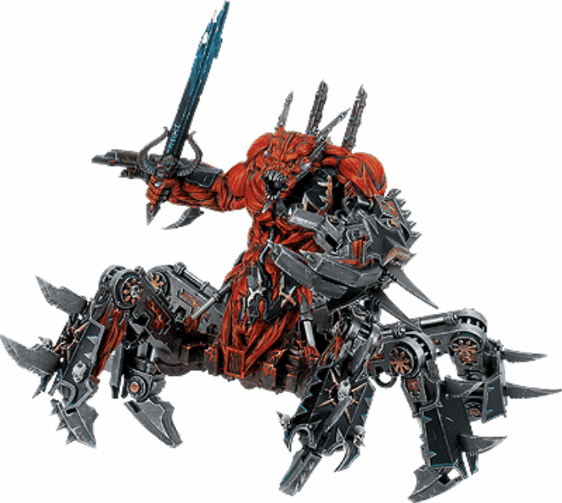
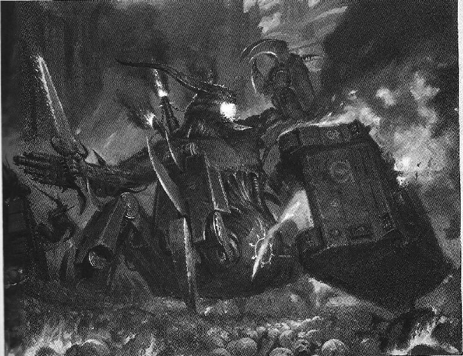

# [恶魔的机械大帅哥]灵魂碾磨者 SOUL GRINDERS

[恶魔的机械大帅哥]灵魂碾磨者 SOUL GRINDERS

trivel

感谢兔子半妖、泰拉的子孙、eliphasfan（伊利法奥斯）给予支持，帮助校对！荣耀永归翻译党

 

灵魂碾磨者，混沌的钢铁毁灭者 

在混乱世界多种多样的荒野中，有一块地方始终被禁忌冶金术产生的辛辣、难闻的含油黑烟所覆盖，摩擦产生的刺耳的吱吱杂音，混合以无数被折磨灵魂发出的哀号统御其上。这片应被诅咒的地方就是灵魂熔炉，瞎了眼又不断突变着的混沌工匠们，在大量巨大的铁匠铺之中不停敲打着他们的作品。 

被成千上万的半灵性噩梦生物驱使，这些洞穴实验室中的黑火以那些被诅咒的灵魂做燃料，并产生巨大的怒吼般声响。从灵魂熔炉的黑暗深处不断送出各种样式丑陋的邪恶武器。依靠着混乱工匠们的邪恶科技，恶魔能量熔铸于神秘金属创造出非凡的锯齿刀剑，哀号长剑，带倒刺的钢鞭以及其他强力武器和护身符，以供恶魔们在其永无休止的战斗中使用。 

尽管这些武器都无比的致命，但是在某件武器面前它们却都形同玩具——那就是恶魔工匠们所创造出的最伟大的作品，令人胆寒的灵魂碾磨者。这些恐怖的生物是亚空间之外，被恶魔们感染的战争机器，熔铸而成的超强恶魔实体。原料通常来自大型恶魔引擎或其他附魔车辆，例如the Legio Mortis（死亡军团）的强大战斗泰坦的残骸，或叛逆星际军团创造的横冲直撞的附魔机甲。所有这些遗迹材料都是被亚空间吸收的银河世界中的战斗残骸，它们通过恐惧之眼、大旋涡或其他非自然接触的地方，从物质世界漂流进亚空间。 

在灵魂熔炉之外的荒原之上，战斗从未停止过，数量众多的高级恶魔捉对厮杀、决斗，以争取成为那个可以和机械身体融合的灵魂，最终成为一个灵魂碾磨者。这是因为，不像附身于凡躯肉体，这些瓷钢外壳能支撑恶魔在凡间几十年，甚至几百年时间。在这期间灵魂碾磨者的外形会不断变化，他们金属的身体会越来越像恶魔的原形。 

这么珍贵的装甲外衣不会毫无代价的得来。熔炉中的工匠们一定会向每个新灵魂碾磨者索要极高的代价以换取这个邪恶的外形。在被释放之前，恶魔会被要求和熔炉之主们定下3个钢铁誓言。第一，所有灵魂碾磨者用巨剑收割的灵魂都要归熔炉所有。第二，被灵魂碾磨者精金利爪毁坏的战争机器残骸都要奉献给熔炉。最后，也许是最意味深长的，如果有任何一个混沌之神进攻灵魂熔炉或试图控制它，所有的灵魂碾磨者会为保卫它而战，并抛弃他先前对四股混沌力量的忠心。 

在战斗中，灵魂碾磨者会成为恶魔主子的装甲先锋，用他们具有的大规模火力冲击敌人的阵线，以及在邪神的普通部队与敌人近身战时提供掩护。他们的恶魔特性能允许他们出现在出人意外的稀薄空气中，他们受亚空间超自然能量保护的瓷塑外壳能让其不受小型武器的伤害，并能弹回除最强大的反装甲武器以外的所有攻击。当他们无可阻挡的开向敌人的同时，灵魂碾磨者会用他们致命的收割机枪织起一片不间断的弹幕。这些速射武器是混沌工匠们用凡人世界的古老武器残骸制作而成的。 

但这些并不是灵魂碾磨者武器库里的最强武器。他冒着烟的嘴才是最强的，里面能释放亚空间的邪恶能量用来攻击敌人。这种攻击的效果多种多样，在凡人眼中看来有着奇异的致命效果。有时灵魂碾磨者会吐出一团亚空间之火，有时他们像舌头一样的器官会射出一道能烧焦敌人的光线。甚至有时能从难以置信的远处吐出一团巨大翻滚着，不断变化的脓水，在一次巨大的爆炸后将好几队敌人完全抹除。在近身范围内，灵魂碾磨者也无可阻挡----巨大的金属巨兽上的许多分肢上装备着活塞驱动的粉碎之爪，或喷吐着超自然能量的恶魔武器。他们进攻中粗暴的冲击和无法拦挡的暴力是那样恐怖，很少有人能有机会给予反击，甚至在灵魂碾磨者冲击其阵线时带来的风暴中难以立存。 

WS BS  S  F    S    R    I  A Soul Grinder  3    3  6  13  13  11    3  4 

Unit type: Vehicle(walker) 

Special Rules: Feelt, Daemon(for Soul Grinder this rule simply means they deploy like all Daemons, and are immune to the ‘Shaken’ and ‘stunned’ damage results) 只是表明灵魂碾磨者像恶魔生物一样的方式部署，并且免疫‘震慑’和‘眩晕’。 Weapons: Mawcannon: Soul Grinders can unleash lethal Warp energies form their mouth. All Soul Grinders can use their Mawcannon with the Vomit profile shown below, but only some are powerful enough to use the Tongue or the Phlegm profiles. This is represented by upgrades that can be bought for the model in the army list. If these upgrades are purchased, the cannon can then be fired as any of the profiles available (the player must declare before firing it). A ‘weapon destroyed’ result on the cannon destroys all profiles.

嘴炮：灵魂碾磨者从嘴里可以释放致命的亚空间能量，所有的灵魂碾磨者都可以使用下表嘴炮武器中的‘吐糟’项，只有一些加强过的能用‘吐舌头’和‘吐痰’。需要事先在军队列表里表明购买，如果表明购买了升级，就能用表里所有的武器（但在发射前要事先声明），‘武器击毁’会导致表里所有的武器都损坏。 

Range            Strength          AP              Type 

Vomit（吐糟）      Template            6                4      Assault 1 Tongue（吐舌头）    24”                10                1                Assault 1 Phlegm（吐痰）        36                  8                3        Assault 1, Large Blast 

Harvester: As well as the dreaded Mawcanon, Soul Grinders are gifted with Harvester guns, which have the following profile:  

Ranger              Strength          AP            Type 

Harvester              24”                  4                  5            Assault 6 

所有你将杀死的灵魂。 所有你战斗中获得的掠夺物。 成为熔炉的守卫者。 对比给予你的恩惠来说，这些不过是些琐事。 摘自《钢铁协定誓言》 

所有你将杀死的灵魂。 所有你战斗中获得的掠夺物。 成为熔炉的守卫者。 对比给予你的恩惠来说，这些不过是些琐事。 摘自《钢铁协定誓言》 

当星际战士们冲过战斗驳船的甬道赶向报告地点时，他们可以听到持续接火带来的一阵阵爆炸之音。最后他们来到一个密封的舱门前，这阻碍了他们前进的步伐，警报灯间歇的闪烁着，一股浓重的硫磺恶臭渐渐充满空中。 

透过加固的钢板，战斗的声响又持续了一小会儿，突然地不祥的寂静代替一切。接着一阵好象沉重的脚步杂音渐渐在另一端靠向厚实的大门。然后又是一阵寂静，然后突然就发生了。

舱门向内被猛的击碎开来，一个巨大的噩梦身影显现出来，一半是机器一半是恶魔，狂乱的冲进回廊。这家伙根本不在意从前方射来的矢弹弹幕，白色---炙热的亚空间火焰从他嘴里冲吐而出，吞噬了星际战士们，转瞬间将装甲战士中的一些化为一团灰烬。 

投出一枚手雷后，士官兄弟带着他的人分别冲向机械恶魔，接下来发生的肉搏战从没这样可悲和短暂过。野兽强大的钢爪轻松的粉碎了相对无力的星际战士们，将他们的残躯甩出一片血花。最后，灵魂碾磨者拣起仍在挣扎着的士官兄弟，把他的四肢邪恶的抓紧，巨兽缓慢的肢解了他。 

灵魂碾磨者对大屠杀现场大致巡视了一番，找寻着更多的可屠杀灵魂，最后，失望了。他继续向前移动，去寻找更多的猎物。 
