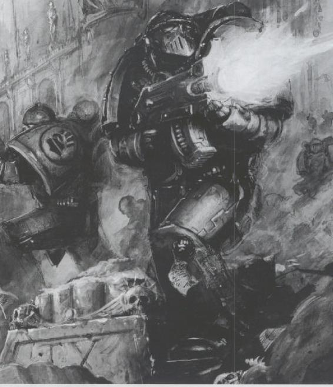
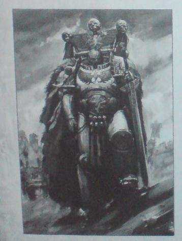

# 5版新SM泄露规则翻译

5版新SM泄露规则翻译

exar_kun

来源:[http://warseer.com/forums/showthread.php?t=148115](http://warseer.com/forums/showthread.php?t=148115)

第一个

肃卫营老兵班组

指挥官每每将肃卫老兵派遣到最最薄弱的战线上去执行任务.在那里,这些老战士将以冷静沉着的态度和精准的爆弹枪火力来应对各种绝望的战场态势.他们是每个战团军力的中流砥柱,每一个星际战士都渴望成为他们的一员.

相比前锋营的修士兄弟来说, 肃卫营老兵们多善于使用军械库中的各种远程武器.某些时候,每个班组中的军士长则可能握着肉搏专用武器参战,不过肃卫营老兵对肉搏武器的使用也仅限于此.他们认为,与其和敌人死死地战成一团,还不如站在远处把他们全部轰成渣. 绝大多数肃卫营老兵使用的爆弹枪上都有经过精工打造的乩孔和精确调校的瞄准具. 肃卫营老兵也可以获得诸如导弹发射器和激光炮之类的重装备,但他们通常更喜欢使用灵活轻便易于携带的爆弹枪.而在战斗中, 肃卫营老兵所携带的一系列专用特种弹药有效地弥补了任何潜在的火力不足问题.这些弹药中包括有装有不稳定融核装药,能有效对抗重装甲的复仇型子弹,装有额外推进药,可以进行远距离对射的克拉肯型子弹,以及最可怕的地狱火弹药,其内部装填的强酸可以击倒最狂暴的兽人或者泰伦生化巨怪.

在大多数战团中,各占据第一连组成人数一半的肃卫营老兵和前锋营老兵总是互不买帐,互相竞争.他们总是互相争夺荣誉,争抢着参加最危险战斗的机会----只有胜利才能给他们的拥护者带来光荣,或者洗刷掉过往的失败耻辱.不过除了这种竞争之外, 肃卫营老兵和前锋营老兵仍旧是修士兄弟,依然会为了兄弟的性命奋战到最后一刻.

Space marine Sergeant WS4 BS4 S4 T4 W1 I4 A2 LD9 SV3+

Veteran WS4 BS4 S4 T4 W1 I4 A2 LD9 SV3+

特殊规则

And they shall know no fear

Combat Squads

Combat Tactics

装备

特种弹药

每个装备爆弹枪的肃卫营老兵自动获得以下数种特殊弹药. 肃卫营老兵每次射击时,玩家都可以宣布使用其中一种弹药.此时特殊弹药的属性就替代掉爆弹枪原本的属性(包括组合式爆弹枪).在每个射击阶段中,小队中所有的单位都必须使用同样一种弹药.

龙火子弹

这些中空的子弹在击中时会爆裂开来,释放出一股巨热无比的气体,即使敌人藏身掩体中也无法抵挡

Range 24’ S4 AP5 速射,无视地形

地狱火子弹

参见新SM规则100页,猜测是2+伤害无视单位的T

克拉肯子弹

这种子弹拥有精钢弹芯和额外的推进药,可以在极远距离上击穿厚实的盔甲

Range 30’ S4 AP4 速射

复仇型子弹

这种子弹原本是设计用于对抗投靠混沌的叛乱星际战士,因此利用了不稳定的融核技术,在使用该弹药时有恶劣的副作用,不过在对抗身穿重甲的敌人时的效率却高的惊人.

Range 18 S4 AP3 速射,过热!

第二个,无图有真相

被诅咒的军团

被诅咒的十字军,由复仇之火所锻造

在帝国境内到处流传的传奇故事中,最荒诞的莫过于被诅咒军团的故事.这些沉默的战士拥有和星际战士一样的外表,但他们的盔甲上装饰着另人胆战心惊的枯骨和火焰的徽记.但他们不属于任何一个皇帝麾下的星际战团.绝大多数目击者甚至怀疑他们都已经成了死人,因为他们的盔甲一直笼罩在一股诡异的气息中,他们的脚边一直闪烁着鬼火般的光芒.有许多证据都证明这些战士能顶住足以彻底毁灭任何凡人的强大火力.最引人注目的报告来自于肯亚战区.目击者称,有6个神秘军团战士从火山炮造成的大爆炸中毫发无伤地走了出来,而那一下炮击足足摧毁了4辆掠食者坦克,消灭了40个星际战士.这些神秘战士携带的爆弹枪在外表上和其他星际战士使用的同类武器没有明显差别,但是它们射出的燃烧子弹却能击穿最坚固的装甲.无论是混沌天选战士,还是混凝土要塞,甚至就连滚烫的岩浆都阻挡不了神秘军团幽灵般的怒火.

帝国学者们一直对这个被诅咒军团的起源和实质争论不休.有些人认为他们是失落之火鹰战团的残部,当亚空间风暴吞没该战团的战舰时, 风暴的力量将他们扭曲变形,让他们获得了崭新而可怕的躯体.

其他人则认为,这些鬼魂战士是皇帝超人意志的延伸,是永恒的救主,甚至可能是那些在无数场战争中牺牲的星际战士之不朽复仇灵魂融合化身而成.在帝国的调查过程中,有数个审判官试图截捕这支被诅咒军团的战士,但都失败了.有些审判官甚至成功的来到了被诅咒军团正在战斗的战场上,但是每当审判官靠近时,神秘莫测的事件总是突然发生阻挠了他们的抓捕行动,最后审判官只能在一旁失望地观战.

可能除了仁慈的皇帝之外,没有任何人知道到底是谁,或者什么指引着这支被诅咒的军团.他们只在情况最危急的时刻出现,通常会出人意料地从弥漫的战火中步入岌岌可危的战场,力腕狂澜于不倒,扭转惨淡的战局.被诅咒的军团不管面对任何敌人都毫无畏惧,他们一边如同复仇之魂一般跨过战场血泊,一边施展出另人胆寒的精准攻击,任何凡人战士都难以望其项背.恐惧预示着他们的到来,而彻底的遗忘则是他们带来的礼物.每当战斗结束,所有的敌人都被消灭,被诅咒的军团就突然消失,和他们的到来一样让人难以捉摸.他们不需要那些被拯救的战士前来颁发奖励,或者表达谢意,在他们战斗之后,只留下敌人的尸首和一个经久不衰的迷团.

Damned Sergeant WS5 BS4 S4 T4 W1 I4 A2 LD10 ISV3+

Damned Legionnaire WS4 BS4 S4 T4 W1 I4 A2 LD10 ISV3+

特殊规则

Fearless

Slow and Purposeful

Unyielding Spectres

不屈的灵魂

被诅咒的军团战士能够抵挡最强大致命的武器,他们有特殊保护3+

Aid Unlooked For

不请自来的援军

被诅咒的军团总是在预备队中,总是通过深入打击进入战场,即使任务规则不允许深入打击的话,也是如此.注意,被诅咒的军团总是在最危急的关头到来,这就是他们出名的原因.因此,被诅咒的军团可以重掷深入打击的偏移骰.

第三个

科萨洛可汗

白疤战团第三连连长

科萨洛可汗是白疤战团的狩猎大师.自从察合台可汗之后,他是第51个获得这个光荣称号的战士.狩猎大师是白疤战团独有的头衔.在所有星际战团中,惟有白疤战团从不放过那些撞了大运或者过于狡猾,因而逃避了死亡之命运的夙敌.白疤战团决不容忍他们的敌人四处夸耀自己成功逃脱的胜利经历.每隔25年,在怒嚎典礼进行到高潮时,狩猎大师就会前往搜捕战团的夙敌,之后他会将敌人的头颅带回战团修道院要塞,作为战利品和成功的见证.

作为第三连的连长,科萨洛可汗可以调动各种军力资源来追捕他的猎物.而且他通常会从连队的修士兄弟中抽选出一些作为他的同伴一同进行追捕行动.可汗会一直追踪他的目标,从一个战区到另一个战区,跨越一个又一个行星,因此这样的追捕可能持续数个月,甚至数年.突然爆发的战事或者紧急任务可能打断狩猎行动,但是狩猎大师从不放弃.或早或晚,他终究会找出猎物的蛛丝马迹,将其团团围住,然后一刀砍下猎物的头颅.

当科萨洛一回到切格里斯行星,当地就举行盛大的庆典活动和月夜宴会,因为狩猎大师的归来就预示着一个可憎敌人的消亡.当狂欢结束后,科萨洛就把敌人的头颅献给战团的高阶牧师,而高阶牧师则从熊熊熔火中拿出烙铁,深深地烙进敌人头颅的眼窝中,将它的眼珠直接烧出.伴随着四下里响起的复仇圣歌,敌人的血肉一点一点地烧焦剥落,之后白疤战团就从猎物大名单中抹去了这个夙敌的名字.然后这个头颅就会被烙上一层白银,插在一根长矛上.长矛则插在通往修道院要塞的道路旁边,其上头颅的空洞眼窝就永远死死盯着前方的道路.白疤军团的要塞位于昆卡塔山脉的高峰上,漫长的沿途道路两侧,到处可见一根根长矛和上面银色的头骨.

在获得狩猎大师之头衔之后的多年中,科萨洛可汗成功地完成了20项任务,其中包括战团最可怕的一些夙敌,例如恶魔王子XXX之照片拍糊和灵族海盗头子瓦拉瑞尔.他们曾经躲过了前几任的狩猎大师,但最终都在科萨洛可汗的刀下找到了自己的归宿.

“不论你是找来最好的战士当你的保镖,还是躲进你所知晓的最黑最深的洞穴,我都无所谓.为了伟大的可汗和伟大的皇帝,我定当斩下你的头颅”

科萨洛可汗

白疤战团第三连

Kor’sarro Khan WS6 BS5 S4 T4 W3 I5 A3 Ld10 Sv3+

特殊规则

And they shall know no fear

Combat tactics

Independent Character

Master of hunt

狩猎大师

科萨洛可汗,以及他所在的单位都拥有打了就跑和暴怒冲击两项特殊规则

Chapter Tactics

战团战术

如果一个玩家的军队中拥有科萨洛可汗,则他可以将整个军队的Combat Tactics换成侧翼包抄(Outflank)的能力.如果玩家选择如此,那么所有专用的运输车也同时获得这项能力----参考宝书后的预备队规则部分.如果玩家的军队中有多个角色拥有战团战术这项特殊规则,则只能从其中选择一种使用.

装备

Moondrakkan

月龙

月龙号摩托原本是为战团第四任狩猎大师专门打造的装备.该摩托是一辆星际陆战队摩托(详细请参见规则书第100页).如果使用该摩托,那么科萨洛可汗可以在射击阶段快跑,而且获得迅疾之足的特殊规则.(详细请参见总规则书)

Moonfang

圆月弯刀

这是一把古老的能量剑,是白疤战团的神圣古物.该武器任何投出6的伤害骰都造成即死打击的效果,无视目标的T值.

最后,鄙视指挥官的编辑时间限制,睡了5个小时就不能编辑了,我只能发个新贴
