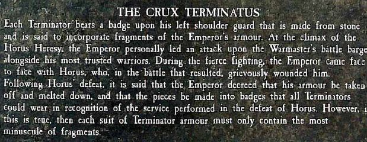

# 终结者盔甲和皇帝盔甲的关系

终结者盔甲和皇帝盔甲的关系

exar_kun

其实终结者的肩甲，都有皇帝本人的装甲的一部分

兔子半妖

于是DA就拆了皇帝装甲的1000多块么

exar_kun

白矬子上面写，皇帝进棺材前说，把自己的某件装甲熔化，和铸造终结者装甲的金属化在一起，

用来造终结者的肩甲

于是都有那么一点

Liujj312

刚看到一个哥们的msn昵称是: Many people think they are full of niubility and like to play zhuangbility which only reflect their shability 乐死我了

兔子半妖

= = 有个很好玩的故事

狼团去日别人

结果别人有狗坦

DAIWEI

日谁啊

兔子半妖

狼团飞兵炸狗腿未遂

只好跑

然后狼团终结者本来在嚣张

看到狗坦过来

只好泪奔...

跑又跑不动

被狗坦踩了...

但狗坦走了后..那人没死

懒猫咪

=。=

兔子半妖

所以说5+isv就是好啊就是好

exar_kun

终结者盔甲的另一个名字是战术无畏盔甲

某次老狼团一终结者被混沌狗太踩到地下去,等战斗结束狼团的把Y挖出来,盔甲坏了人没事情

按照HH小说,SM只要不死,就是不朽的.帝国普通人么比现在长一点,做延寿手术以后更长一点
