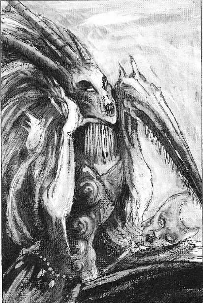

# 永恒的舞者 The Masque,Eternal Dancer of Slaanesh

[ACE翻译]永恒的舞者 The Masque,Eternal Dancer of Slaanesh

no.ace

The Masque,Eternal Dancer of Slaanesh 假面舞女，沙历士的永恒舞者 

Once the chief handmaiden of slaanesh,it was the masque that combed the dark prince`s shining hair and oiled it with fragrant balms. when slaanesh`s mood was grim,the masque would dance to lighten his thoughts.enrapturing her god with the most dazzling and acrobatic displays.yet for all of slaanesh`s indulgence,the masque was to become the most despised of all the prince of pleasure`s servant

假面舞女曾经是slaanesh的侍女长,是她每天负责精梳黑暗王子闪亮的头发,打上特制的薄荷香油.当slaanesh情绪低落的时候,假面舞女会跳起舞来放松他的思绪. 用杂技般的眼花缭乱的表演来使她的神陷入狂喜.因为slaanesh对她的溺爱,假面舞女成为了slaanesh所有奴仆中最为人所不齿的一个. 

During the etenal wrangling and wars that make up the great game,it came about that tzeentch tricked slaanesh into battling with khorne.the changer of ways lured slaanesh into a cause he would not archieve,and slaanesh was defeated and humiliated.seeing the dark mood of her master,the masque took it upon herself to ease his heart with her most energetic and scintillating dance ever.where once her leaps and pirouettes had brought laughter and joy, now slaanesh`s bitter heart saw mockery, each perfect combination of move calculated to be barbs into his pierced pride.slaanesh cast the masque aside,condemning her as a traitor.he cursed her,saying that if she wanted to dance,she must dance forever more. 

在那被叫做大游戏(#注1)的无尽的冲突与战争中,曾有一次,tzeentch用计挑拨slaanesh与khorne开战.道路的篡改者引诱slaanesh陷入了他不可能实现的目标中,而slaanesh耻辱的战败了.看到她主人阴暗的情绪,假面舞女认为自己有责任用她最闪烁激情的舞蹈来抹去他心中的不快.但是当她的跳跃和旋转开始展现欢笑与享受的时候,slaanesh苦涩的心却只看到了讽刺,每一个精确调整的完美的动作组合,都在刺痛着他的被伤害的骄傲与自大.slaanesh喝止了假面舞女的舞蹈,如同对待叛徒般的废除了她的地位.他诅咒她,说道&quot;既然你这么喜欢跳舞,那么你会永远这样跳下去&quot;

Such has been masque`s doom.to dance across eternity. in the circle of slaanesh`s realm she dances for other deamonettes, entrancing them with her sinuous movements until they are so enraptured they can no longer move or speak. she dances at the gates of khorne, mocking the Bloodletters who snarl and growl at her impudence. the masque dances across the mortal worlds of the galaxy trapping those who witness her. where mortals indulge their senses, where excess overcomes restraint,the Masque appears to lead the incautions on a dance of doom, as she enacts the tales of slaanesh`s greatest victories and most unholy conquests,her golden mask flickers and changes, matching the roles of characters she plays. so powerful is the lure of the masque`s display that all who see it feel compelled to join in the performence.immortal daemons and crude mortals alike feel this calling in their hearts and powerless to resist.as the dance go on.the tempo rises,while the masque`s unwitting chorus leap and flail in their attempts to keep up. consumed by the ecstasy and agony of masque`s aura,they dance themslves to death,using up their last ounce of energy,their dying breath,to keep pace with her twirls and somersaults 

这就是假面舞女的末日.永远的舞下去...她在slaanesh国度的环中为其他的女妖舞蹈,用她波浪般的舞步引领她们进入狂喜中,她们从此不能说话也不能移动.她甚至在khorne国度的大门前舞蹈,嘲弄着那些对她的厚颜无耻咆哮和吼叫的放血鬼.假面舞女也同样在凡人的国度与星系中舞蹈着,引诱着她的仰慕者落入陷阱.当凡人们因此而放纵自己的感受,超过了他们对自我的约束.假面舞女就会为这些粗心大意的人跳起末日之舞,当她用舞蹈表现slaanesh最伟大的胜利跟绝大多数邪恶的征服的传说的时候,她的黄金面具会闪现变化出她所表演的故事中的人物的样子.假面舞女的表演是如此的有诱惑力以至于所有看到这表演的人都会被迫的加入到她的演出里.无论是不朽的恶魔还是莽撞的凡人,都同样能感受到自己的内心虚弱的失去了抗拒的能力.当舞蹈继续下去,旋律响起,假面舞女无法形容的合唱与跳跃的舞步如枷锁一般的使她的伴舞们想要将这演出一直继续下去.在假面舞女的灵光下,他们被这苦痛的消魂一点一点耗尽,一点一点的让他们舞向自己的死亡,不惜用尽他们最后一丝能量,不惜用尽他们濒死的喘气,只为了能与她的旋转和翻腾保持一致.

NO-one knows the masque better then harlequins,they have a performance that tells the tale of how the Masque once infiltrated one of their troupes, as the harlequins and their audience were drawn into the Masque`s whirling spell,a solitaire appeared. the only harlequin able to perform the role of slaanesh in the great dance,the solitaire matched the masque move fo move,and for six days and six nights they cavorted and whirled,until the masque finally faltered and missed a step.horrified,she fled on sparkling feet and now seeks revenge of the followers of laughing god 

没有人比灵族丑角们更了解假面舞女了,他们有一出专门的表演就是为了传诵那个传奇---假面舞女曾经混入了它们的一个剧团,丑角们与他们的观众被卷进了假面舞女旋涡般的魔咒,这时一个独角(#2注)出现了.它是唯一能在大舞中扮演slaanesh的丑角,这个独角与假面一个动作一个动作的对抗着,六天六夜,它们一直腾越与飞旋着,直到假面舞女最终踉跄着错过了一个动作.惊骇的她脚步闪烁的逃走了,而直到今天,为寻求她的复仇,假面舞女依然不知疲劳的追杀着欢笑之神的信徒...

#注1: 混沌的国度不仅仅是黑暗众神的家园,同样也是他们的战场.用来比赛较量他们至高无上的大竞技场.一个混沌之神会突然同另一个混沌之神开战,争夺着由他们神力支持的无形的位面,忽略他们相互之间的千差万别,混沌之神们有一个共同的目标:统领这世界上的一切.这种绝对权力是不允许同任何人分享的---尤其是其他的神 

#注2: 独角(solitaire),在丑角们的巡回表演中,有两个角色是独特的,一是扮演死神的死亡弄臣,二是扮演邪神slaanesh本人的独角,当他被选为此角的那一时刻开始,slaanesh就会监视着它的灵魂,而它的灵魂永远不可能得到解脱,只能在死后被禁锢在slaanesh的国度中.

------------ 

Ws  Bs  S  T  W  I  A  Ld  Sv The Masque      5    4    3  3  2    7  4  10  3+ 

Unit Type: Infantry 

Daemonic Gifts Rending Claws,We are Legion,Instrument of Chaos,Pavane of Slaanesh,Aura of Acquiescence, Soporific Musk 

Special Rules: Daemon,fleet 

Etenal Dance:To represent the enthralling powers of the Masque,she may use her Pavane of slaanesh three times in her shooting phases
