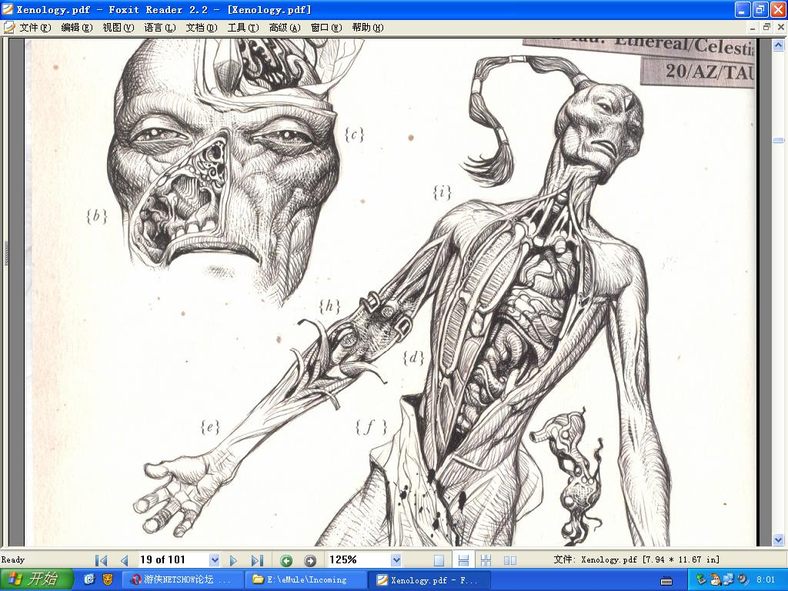

# [译稿]上上善道之真相

[译稿]上上善道之真相

liujj312

原文参见：Xenology: Notes and Research from the Alien Bestiary of Biegel

参考Sonicbbs，warmaster译本，谨表感谢。

译者按：我曾经在一年前提议，将&quot;Tau&quot;翻译为“道星人”，但行之不远。而今得览此文，深觉若以此译，更能切合文意。故从此译，另改动多种道语专有名词之译法，以使贴近东方之文化。

又，此文中可以看出一些西方人对东方集体主义的看法。很有参考价值。

============================以下为译文=============================

拷问录音副本 文件20/AZ/TAU/001

出席者：审判官马图灵·拉雷Maturin Ralei (10号牢房外); 无名样品&quot;以太(Aun)&quot; (10号牢房内)

日期：6.994.798.M41

Ralei：好，先说你的姓名?

[沉默]

Ralei：行了，我知道你能听懂。我的仆人达乌斯(Darvus)告诉我，你花了好几个小时，劝说他放了你。我们的语言，你确实讲得很好。

Aun：你想知道些什么？

Ralei：哦……开口了嘛，其实也不难，对不对？

Aun：你想知道些什么，蛮夷(Gula)？

Ralei：我只是想学习，不知名的朋友。

Aun：恕我唐突，但你们种族的人攻击我们时，从来不抱着任何学习的兴趣。

Ralei：哈，幸好我和他们不一样。比如说，Aun —— 这是对你阶层的称呼，对吧? —— 我很想听你

讲一讲，你们所谓的“上上善道”(Tau'Var)。

Aun：[长停顿]我看，你是自以为全都知晓了吧。

Ralei：尽管如此，还是请你……

[以太歪着她的头,然后将头挺直]

Aun：好吧。虽然没有吾民在侧，我至少能代表他们的正义。“上上善道”者，宇宙之正道也。你们蛮

夷，只信仰看不见摸不着的神。而上上善道，却令每个道星人安于之、乐于之。

Ralei：但它到底是什么?

Aun：就是你们所谓的“无私”“大好(Greater Good)”。须知取诸怀抱者，无非孤独与寂寥，而若

向外看，献全部身心于我族、于我族之对完美的追求，自然就能寻到和谐与宁静。

Ralei：所谓“道”，就是一个要进行的任务？那么，你承认你们的帝国并不完美？

Aun：当然了，世间岂有完人？蛮夷啊，“所行，道也”，道就是一条路，而不是要到达的目标。

Ralei：那你们这些灰皮就这么……同意了，走这条路?

Aun：很难相信吗？我们为什么反对这世间最最应乎天而顺乎人的事物呢？每个道星人都可以自由选择

其命运，他们都选择了上上善道，恰恰证明其真实不虚。道是我一切族人心之所向！

Ralei：“一切族人”，哦，那可好。不过我听说，过去也是有过争论的，而你们一发现有人不愿意被

统一，嗯？就弹压。

Aun：你这没有抓住重点。一达谓之道，决没有歧旁。我们的信仰中，不存在虚幻的神明。这是必须的

，人类，这是银河自我拯救的惟一办法。我们有句老话。&quot;AUR'OCQ SHATH'R'I TSKAN SHA TAU'VA.&quot;“大同世界，计日以成。”

Ralei：也不管别人喜不喜欢？

[沉默]

Ralei：好，换一个问题。关于博望侯(O'Shovah)，你知道什么?

[Aun愣住了，很长的停顿]

Aun：你少同我自作聪明，蛮夷，我告诉你——

Ralei：回避我的问题并不明智，Aun，我只是弹了一根神经。我再问你一遍：关于博望侯你知道什么?

关于远见指挥官(Commander Farsight)你知道什么?

[沉默]

Ralei：那我先说吧，这是我从一个达摩克力斯湾边缘的商人那里听来的。这个博望侯，好像是你们的

火氏大英雄，不仅仗打得好，还做什么都是天才。你们道星人可不是这样的，水氏谈话并辩论，风氏

把你们运到地面，土氏做力气活，各司其职，各安其位，没有杂交，没有混种。所以，博望侯出发去

夺回一些殖民地，而且很自然的还有个以太当头。结果以太被杀，博望侯接到了指挥权，突然没有人

再提醒什么该死的“上上善道”了，同时他还离家远得很。所以他做了什么？Aun？我的意思是，像

你说的，“上上善道”是你们自己选择的道路，对不对？那博望侯本应该不管什么情况，都继续服从

那些什么和谐宁静的狗屁，对不对？Aun？

[沉默]

Ralei：但是他没有啊。他怎么开始跑单帮了呢？他怎么自己搞一个小帝国，不要你们以太告诉他应该做什么

，不要一辈子遵循你们那扯淡的“上上善道”了呢？

[沉默]

Ralei：你自己讲的，Aun。“为什么反对最应乎天而顺乎人的事物呢”？我恐怕，这玩意只在一帮以

太管事的时候，才是应天顺人的吧。

[沉默]

（以下为warmaster译稿）

语音录音文件

生物大师DARVUS：

BIEGEL当地历：57日, 16/20

实验室.

这里.我的又一件珍宝被野蛮地糟蹋并丢失了.

我已经将我最后的笔记交给了审判官,当时他在乱摆弄控制室的面板.看来他不像他想象的那样完全了解那台逻辑引擎.

在解剖实验中,我没发现什么关联.全能救主在上,我还能坚持这样多久啊?

[中止]

尽管这一切,审判官以异常的喜悦接受了我的笔记.我搞不懂他.他刚才还责骂我的工作,诅咒我是一个异端,接着他吸收了我的笔记上的每一个字.

在我呈献的结果中有什么这么令人激动的?

我他越是参与进去,我从工作中得到的奖励的就越少.我想象着我自己仅仅为了他的娱乐而宰杀我的珍宝.

永远的问题：明天我要挑那只?

我要睡觉.我不能这样.

语音录音文件

审判官BREHM SASHAM

帝国历：6.067.805.M41

BIEGEL当地历：57日,17/20

图书馆.

DARVUS不明白.他不理解这个简单的图解. -尽管在他看来如此普通 -证明了RALEI的观点.他躲在他的&quot;或许&quot;和他的&quot;无说服力&quot;后面,但是我发现了真相.

TAU道不是TAU人认为的那样令人陶醉的意识形态.它是黑暗的.而今天,DARVUS解开了它的得以应用的手段.

以太一直控制着他们的臣民.去掉以太阶层,大好就没有意义了.没有他们的化学傀儡把戏,他们的荷尔蒙操控.TAU帝国就会坍缩成一群混乱的不同种的生物,没有任何凝聚力.

这就是他们的缺陷.这就是他们的弱点.他们相信的一切都是谎言.如果我们可以让他们睁开他们的眼睛,就会出现无限的可能性.

我多么热爱看见这些傲慢的生物被肢解!我多么欣赏他们洋洋自得的信念支离破碎.终于,我开始明白RALEI当初建立这个设施的内疚了.

[中止]

让我又重复一遍我的意图：这是个异端的巢穴而我将关闭它.但是它又会向我显漏什么样的脆弱?我几乎不能等了.

已经很晚了.NALKISS还没从殖民地归来.他现在在哪?

炽天使军团 

我还是觉得，直接用中文的“博望侯”不太符合锤子的风格啊。当然，既然塞丽斯人都有。。。

所以说，tau闹腾时帝国根本就没管他就是这个原因

kaneqc

哈哈

鼓掌鼓掌!

那边吃甜食的布道链接才发,这里原帖就来了! 河蟹假象之下的真面目如此可憎

This day shall be the glory one for the Imperium!!

liberator

并不是说Tau的大好完全没有说服力，只是说，以太阶层对整个Tau的种族的“完全”控制，是基于物种的信息素的.........

况且除了Tau的本族人，其他种族哪里有心甘情愿全族加入的......

Kroot是混饭吃，苍蝇人是可疑的“通讯仪器”........人类么...人类不也有宁死不屈的么.....还有逃出去打游击的......至于心甘情愿加入的人类......谁能确定换了混沌这些意志薄弱的家伙不是第一个画上六芒星的........

轩雅 

替LZ补张图片吧。

炽天使军团

原帖由 qpzdahab 于 2008-2-26 21:54 发表 跟以太混的人只能活40岁？哪来的资料？？？

不过，想不到tau的和谐是化学问题......似乎以太的化学能还挺强，不管是人类还是克鲁特都能感化，不过，为什么tau不去感化那个审判官？

如果真是化学问题，那tau=擅长远程攻击的虫族？ ... 食人族他可感化不了。。人家是受利益引诱来的。感化审判官？tau还没到那个级别。

40岁这个出自异族人解剖书，他们的人类协从军恐怕还活不到这个岁数

博望侯是远见的文言文版

liujj312 

文中提到那个以太“花了几个小时劝说”Darvus放掉他，这说明这所谓的化学能力不能在很短的时间里起作用，甚至需要其他的仪器之类才能起效。要不然Darvus身为科学家，天天接触外星人，早被人家感化得不看见了。

liberator 

没有人说“大好”完全是无意义的骗局.........只是显然不是“唯一的真理”而已，以太的荷尔蒙显然对非TAU种族无效啊......所以除了TAU，没有哪个种族是全族无条件加入的......

我说，为什么总有人要彻底神化TAU，就像暴雪狂信者彻底神化暴雪一样？战锤的世界里本来就没有什么“好的势力”，只有坏的和更坏的........这些资料证明的，不过是TAU也和帝国一样，不是什么“乌托邦”而已......撕掉一张不属于战锤的画皮至于触到什么神经么............

炽天使军团 

如果感化不了审判官，那说明那些人类是受不了帝国的压迫自愿加入的。以太别说审判官了，他连一个elysian的上校都搞不定

那可不可以有另一种可能。。tau用脉冲枪逼当地老百姓加入？tau对一个星球上的人类平民进行屠杀这是铁证。

还有，不光是人类，tau的激素对其他外星种族同样没有用。。。而kroot是为了吃肉才加入tau，有时也在一些ig里服役。苍蝇麽，以太给了他们一个语音盒。鬼知道那个语音盒里有什么鬼玩意

qpzdahab 

我记得说有一艘战舰上的人类都集体自愿了......

malganis 

好吧，那是我翻的，道族舰队书里的典型案例……不过只是低阶船员自愿了，不少高阶船员还是不顺从
